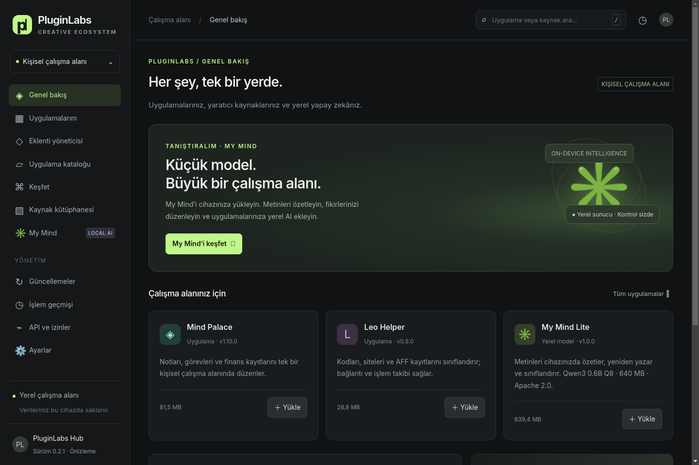
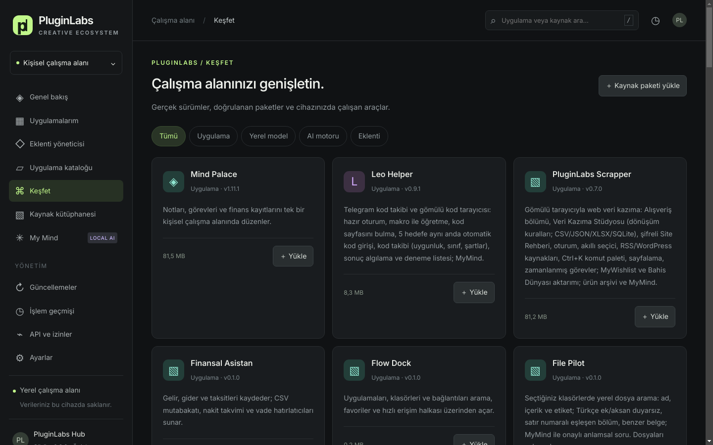
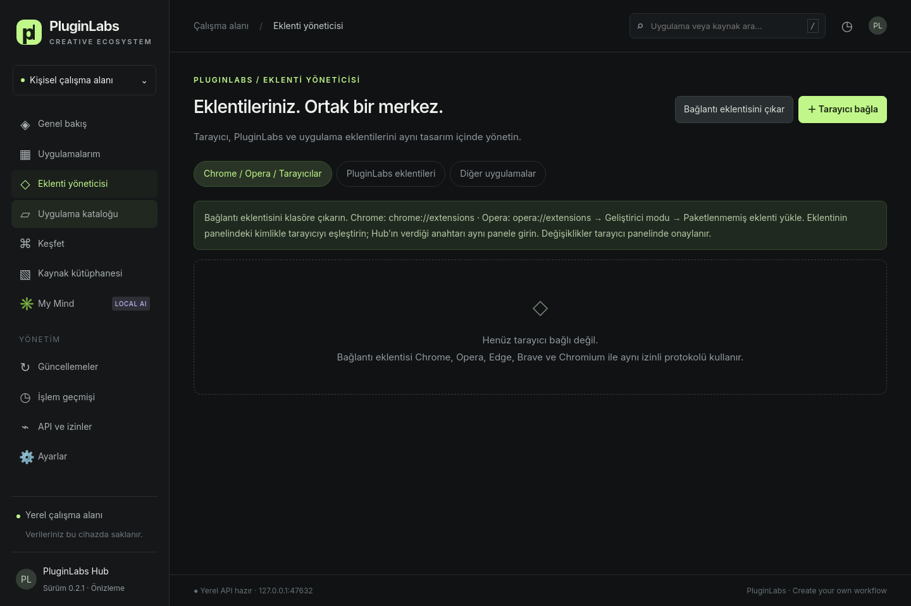
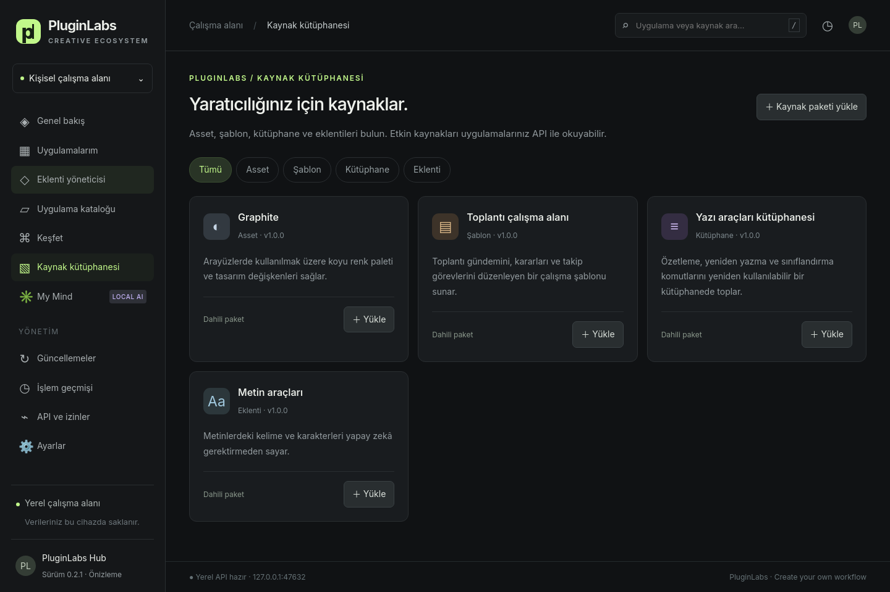
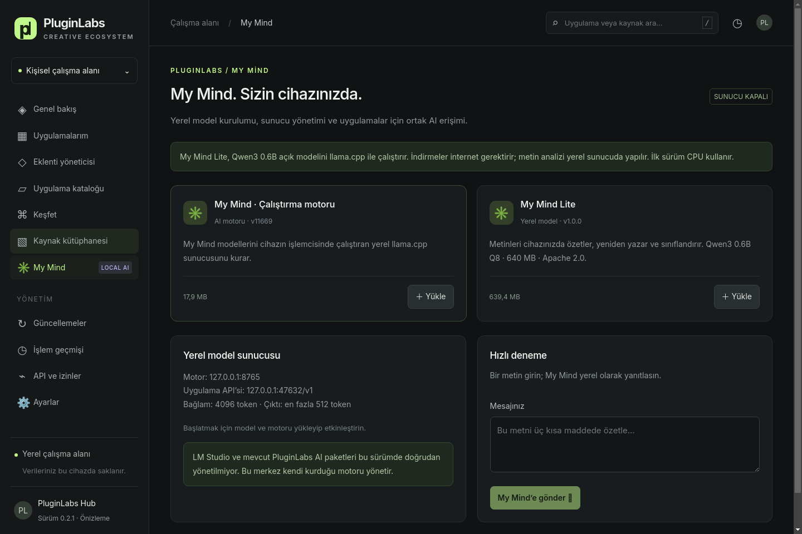
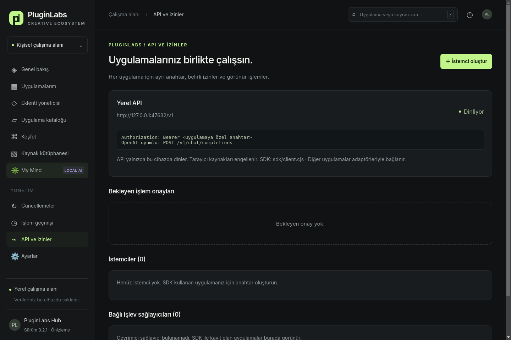

# PluginLabs Hub 0.3.0

PluginLabs uygulama, eklenti ve kaynak merkezi. Electron masaüstü arayüzü; yönetilen kurulumlar; yerel My Mind sunucusu; uygulama bazlı izinli cihaz API’si.

## Ekran görüntüleri

Aşağıdaki ekranlar v0.2.1 uygulamasından alınmıştır. Fontlar, uygulama açıklamaları ve katalog görünümü güncel sürümü gösterir.

### Genel bakış

Uygulamalara, kaynak kütüphanesine ve yerel My Mind yönetimine tek ekrandan erişim.



### Uygulama kataloğu

50 uygulama; ne işe yaradığını anlatan açıklamalar, platform bilgileri ve önizleme paketi yükleme seçenekleriyle listelenir.



### Eklenti yöneticisi

Tarayıcı bağlantıları, PluginLabs paketleri ve desteklenen diğer uygulamaların eklentileri ayrı sekmelerde yönetilir. Görsel, henüz tarayıcı eşleştirilmemiş ilk kullanım durumunu gösterir.



<details>
<summary>Kaynak kütüphanesi, My Mind ve API ekranlarını göster</summary>

### Kaynak kütüphanesi

Asset, şablon, kütüphane ve eklenti paketlerini keşfetme ve yükleme.



### My Mind

Yerel model ve motor kurulumu, sunucu durumu ve metin deneme alanı. Görselde model sunucusu henüz başlatılmamıştır.



### API ve izinler

Uygulamaya özel erişim anahtarları, işlem onayları ve bağlı işlev sağlayıcıları.



</details>

## Başlatma

Node 24 LTS ve npm gerekir:

```sh
npm ci
npm start
```

`npm test` API, kurulum, doğrulama, iptal, geri alma, sağlayıcı onayları, kaynak paketleri ve arşiv sınırlarını test eder. `npm run build:win` Windows NSIS + taşınabilir EXE, `npm run build:linux` AppImage üretir. Windows derlemesi için Windows veya uygun Wine kurulumu gerekir. Üretilen önizleme paketleri kod imzalı değildir.

## İşlevler

Geliştirme: [katkı/PR politikası](CONTRIBUTING.md), [güvenlik](SECURITY.md), [ortak tasarım dili](docs/DESIGN-SYSTEM.md), [Codex Cloud kurulumu](docs/CODEX-CLOUD.md) ve [Notion–GitHub takip eşlemesi](docs/TRACKING.md). `npm run test:ui` gerçek Electron arayüz akışlarını ve ekran görüntülerini üretir. CI her PR'da Windows/Linux testleri ve yayın yapmayan önizleme paketleri üretir; paketlerle ekran görüntülerini aynı artifact içinde sunar. CI tanımı, henüz çalışmamış kontrolün geçtiği anlamına gelmez.

- Katalog: Mind Palace ve Leo Helper’ın gerçek Windows sürümleri. Uygulamalar merkezin yönettiği sürüm klasörlerine indirilir; kullanıcı tarafından açılır. Diğer uygulamaların önceden yapılmış kurulumları otomatik taranmaz.
- HTTPS indirme, sabitlenmiş SHA-256 ve dosya boyutu, ilerleme ve iptal. Başarısız güncelleme mevcut sürümü korur; önceki paket saklanmışsa geri alınabilir.
- Güncelleme ekranı GitHub Releases’i denetler. Daha yeni sürüm ancak yayımlanmış dosya özeti varsa yüklenebilir. Hub’ın kendisi için otomatik güncelleme henüz yoktur.
- Graphite asset paketi, toplantı şablonu, yazı kütüphanesi ve metin araçları eklentisi dahildir. Her paketin ayrı ayarı, etkinlik durumu, kaldırma ve JSON dışa aktarma seçeneği vardır.
- `resources/example.plpack` örneğiyle kendi veri/görünüm paketinizi içe aktarın. Paket türleri asset/template/library/plugin; kimlik `custom-` ile başlamalıdır. En fazla 2 MB JSON, semantik sürüm, kısa metin/onay kutusu ayarları. İçerik veri olarak saklanır; script, HTML veya kabuk komutu olarak çalıştırılmaz.
- Gerçek işlev eklentileri sağlayıcı SDK’sıyla uygulama API’sine bağlanır. Bu sürüm, cihazdaki bütün eski ürünlerin bağlandığını iddia etmez: her ürün kendi adaptörünü eklemelidir.
- Veriler cihazda saklanır. Bu sürümde hesap, ücretli mağaza, bulut senkronizasyonu ve çok cihaz yönetimi yoktur.

## My Mind

My Mind Lite, Qwen3 0.6B Q8_0 ağırlıkları + llama.cpp CPU sunucusunu yöneten uygulama katmanıdır; sıfırdan eğitilmiş veya ince ayarlanmış model değildir. Model yaklaşık 640 MB, motor yaklaşık 18–20 MB. Kurulum internet; analiz yerel CPU/RAM gerektirir. Model ve motor ayrı ayrı yüklenir, ardından My Mind ekranından sunucu başlatılır. Kapanırken yalnızca merkezin oluşturduğu süreç durdurulur.

Motor `127.0.0.1:8765` üzerinde rastgele oturum anahtarıyla çalışır. Ortak API varsayılan `127.0.0.1:47632` üzerinden yetkili istemcileri modele yönlendirir. 4096 token bağlam, en fazla 512 token çıktı, tek eşzamanlı istek, 120 saniye sınırı. Bu sürümde streaming, görüntü girdisi, eğitim, fine-tuning ve otomatik araç çalıştırma yoktur. Küçük modelin Türkçe ve karmaşık analiz kalitesi sınırlıdır. LM Studio veya önceki Windows PluginLabs AI paketi bu sürümde yönetilmez.

Kaynaklar:
- Qwen3-0.6B-GGUF, Apache-2.0: https://huggingface.co/Qwen/Qwen3-0.6B-GGUF — sabit revision `23749fefcc72300e3a2ad315e1317431b06b590a`.
- llama.cpp b11669, MIT: https://github.com/ggml-org/llama.cpp/releases/tag/b11669 . Lisans dosyaları motor paketi içinde korunur.

Model son kullanıcı paketine gömülmez; merkezden talep edildiğinde indirilir. Linux x64 motoru ve gerçek metin üretimi geliştirme ortamında doğrulandı. Windows x64 motoru katalogda var; gerçek Windows cihazında model çalıştırma doğrulaması gerekir. macOS motor paketi yoktur.

## Yerel API

Masaüstünde **API ve izinler → İstemci oluştur**. Anahtar bir kez gösterilir; merkez yalnızca SHA-256 özetini saklar. İstemci anahtarını OS kasa/credential manager ile koruyun. Kaybolursa erişimi iptal edip yenisini üretin.

API yalnızca literal 127.0.0.1 üzerinde dinler. HTTP Host denetlenir, Origin içeren tarayıcı istekleri reddedilir. Anahtarı ön yüz JavaScript’ine veya sayfalara koymayın. HTTP API, yönetici anahtarı oluşturamaz veya kendi isteğini onaylayamaz. Tüm yerel kullanıcı programlarına karşı işletim sistemi izolasyonu sağladığı iddia edilmez.

| Yol | Yöntem | İzin / davranış |
| --- | --- | --- |
| `/health` | GET | Asgari servis bilgisi |
| `/v1/catalog`, `/v1/installed` | GET | `catalog.read` |
| `/v1/resources`, `/v1/resources/:id` | GET | `resources.read`, etkin paket verileri |
| `/v1/jobs` | GET | `jobs.read` |
| `/v1/downloads` | POST `{id}` | `downloads.request`, masaüstü onayı |
| `/v1/apps/launch` | POST `{id}` | `apps.launch`, masaüstü onayı |
| `/v1/requests/:id` | GET | İsteği oluşturan istemci |
| `/v1/providers` | GET | `actions.invoke` |
| `/v1/providers/register` | POST | `providers.register`, yerel callback doğrulaması |
| `/v1/actions/invoke` | POST `{provider,action,input}` | `actions.invoke`; yazma işlemi masaüstü onayı |
| `/v1/models`, `/v1/chat/completions` | GET / POST | `mymind.chat`, OpenAI uyumlu, non-stream |

SDK örneği:

```js
const {PluginLabsClient,ProviderAgent}=require('./sdk/client.cjs');
const client=new PluginLabsClient({token:process.env.PLUGINLABS_TOKEN});
const result=await client.chat([{role:'user',content:'Bu metni özetle: ...'}]);
const count=await client.invoke('hub','text-count',{text:'Merhaba dünya'});
```

Metin sayımı için `text-tools` eklentisi yüklü ve etkin olmalıdır. Örnek sağlayıcıyı `PLUGINLABS_TOKEN` ortam değişkeni ile `node sdk/example.cjs` çalıştırarak deneyin; örneğin kaydetme işlemi gerçek dosya yazmaz, ürün adaptörünün bağlanacağı yeri gösterir. SDK aynı makinede Node destekleyen ürünler içindir; diğer diller aynı HTTP sözleşmesini uygulayabilir.

Sağlayıcılar loopback callback + oturum sırrı ile challenge/HMAC doğrular; 90 saniyelik kira, 30 saniye yenileme. Bağlanmış olmak tek başına diğer uygulamanın verilerine erişim sağlamaz. İstemciye `actions.invoke` izni verilmesi tüm kayıtlı okuma işlemlerine erişim verir; yazma işlemleri tek tek onaya gider. İşlem sağlayıcısı uygulaması kendi input doğrulamasını ve yetkilerini de uygular. İstek kuyrukları bellektedir; yeniden başlatmada kaybolur. Onaylar beş dakikada sona erer. Prompt/yanıt içerikleri işlem günlüğüne yazılmaz.

## Proje yapısı

`src/hub.cjs`: paket, kaynak, API ve model yönetimi. `src/electron.cjs`: dar IPC köprüsü. `ui/`: uzak kod çalıştırmayan masaüstü arayüzü. `sdk/`: istemci ve işlev sağlayıcı sözleşmesi. `test/`: gerçek HTTP ve dosya sistemiyle entegrasyon testleri. Kullanıcı veri alanı Electron userData/hub klasörüdür. Geliştirmede `PLUGINLABS_DATA` değişkeniyle ayrı test alanı seçilebilir.

## 0.2.0 — Eklenti yöneticisi ve Notion kataloğu

Mevcut koyu arayüz korunur. Eklenti yöneticisinde üç alan vardır:

1. **Chrome / Opera / Tarayıcılar:** Paket içindeki PluginLabs Browser Bridge Manifest V3 eklentisi; `management`, `storage`, `alarms` ve yalnız loopback HTTP erişim izni. Hub → Eklenti yöneticisi → Bağlantı eklentisini çıkar. Chrome’da `chrome://extensions`, Opera’da `opera://extensions` üzerinden geliştirici modu / paketlenmemiş eklenti yükle ile kurun. Eklenti panelindeki 32 harfli kimliği Hub’daki Tarayıcı bağla alanına girin; tek gösterilen anahtarı eklenti paneline yapıştırın. Her tarayıcı profili için ayrı bağlantı/anahtar oluşturun. Bağlantı eklentisi ZIP olarak da release’e eklenir.
2. **PluginLabs eklentileri:** Var olan asset, şablon, kütüphane ve eklenti paketlerinin kurulumu, ayrı ayarları, etkinliği ve kaldırılması.
3. **Diğer uygulamalar:** VS Code / VSCodium uygulama dosyası seçilerek kendi CLI’siyle envanter, eklenti kurma, güncelleme ve kaldırma. Windows için Code.exe/VSCodium.exe; Linux için code/codium. macOS uygulama paketi bu adaptörde doğrulanmadı. VS Code aç/kapat ve özel ayarları kendi arayüzünde yapılır. Diğer uygulamalar için otomatik destek iddia edilmez; sağlayıcı SDK’sı gerekir.

### Tarayıcı işlem akışı

Eklenti adları, sürümleri, etkinlik durumu, yönetilebilirlik ve ilan edilmiş izinler listelenir. Sayfa içeriği, tarama geçmişi ve başka eklentilerin iç verisi okunmaz. Hub’dan etkinleştir/devre dışı bırak/kaldır/ayarları aç isteği gönderilir; tarayıcıdaki PluginLabs panelinde kullanıcı düğmesine basarak onaylar. Kaldırmada ayrıca tarayıcının kendi onay penceresi açılır. Kurum politikasıyla yönetilen eklentiler değiştirilemez. Köprü kendi kendini devre dışı bırakamaz veya kaldıramaz. İstekler beş dakikada sona erer; onay gelene kadar envanter değiştirilmiş gibi gösterilmez.

MV3 arka plan uyandığında yaklaşık 30 saniyede eşitler; panel açıkken üç saniyede bir yeniler. Tarayıcı tarafından askıya alınma, arka plan izni ve alarm davranışı süreyi uzatabilir. Panelde Şimdi eşitle kullanılabilir. Chrome ve Opera ayrı profillerdir; liste yalnız bağladığınız profili kapsar. Firefox/Safari bu Chromium bağlantı paketiyle desteklenmez. Tarayıcı eklenti güncellemelerini tarayıcının mağaza mekanizması yönetir; Hub profil dosyalarını değiştirmez veya mağaza doğrulamasını aşmaz. Bağlantı anahtarı eklentinin kendi Chrome storage.local alanında tutulur; iptal Hub → API ve izinler ekranından yapılır.

`POST /v1/browser/sync`, yalnız `browser.manage` izinli ve bağlantı eklentisi kimliğine bağlanmış anahtarla kullanılabilir. Diğer API yollarındaki Origin engeli korunur. Browser Bridge Origin’i kayıtlı chrome-extension kimliğiyle eşleşmelidir.

### Notion’daki 50 fikir

Notion kataloğu ekranı PL-001–PL-050 özgün adlarını, platformlarını, durumunu, ilk sürüm akışını, AI rolünü, bağımlılıklarını, gelir hipotezini, doğrulama ölçütünü ve öncelik/eforunu gösterir. Detayda tam kapsam ve Notion kaynak bağlantısı bulunur. Kaynaklar `resources/notion-catalog.json` içinde 26.10.2026 tarihli bir anlık görüntüdür; canlı senkronizasyon değildir. `GET /v1/ideas`, `catalog.read` izniyle kartları döndürür. 50 kartın tamamı Yükle düğmesiyle gerçek bir yerel ürün önizleme paketi kurar. Paket; özgün ürün kapsamını, kalıcı özel notları, kişisel geliştirme/inceleme listesini ve ayrı ayarları içerir. Kurulan paket Uygulamalarım bölümünden açılır, devre dışı bırakılır veya kaldırılır. Notlar paket sürümünden ayrı saklanır. Önizleme paketi kurulması, Notion’da planlanan bütün ana özelliklerin geliştirilmiş olduğu anlamına gelmez; bu durum ürün içinde açıkça gösterilir. Leo Helper ve Mind Palace için gerçek bağımsız Windows uygulamaları ayrıca katalogda bulunur.

Testler: `npm test`; masaüstü UI için Playwright kurulu ortamda `PLAYWRIGHT_MODULE=/path/to/playwright DISPLAY=:99 node test/extension-ui.cjs`. Tarayıcı izinleri ve gerçek mağaza eklentileri Windows Chrome/Opera cihazlarında ayrıca doğrulanmalıdır.

## 0.3.0 — Görünüm seçenekleri

Ayarlar → Görünüm'den Hub Yeşil veya Iris paleti ve Koyu veya Açık tema seçilir. Varsayılan Hub Yeşil + Koyu'dur. Palet tokenları `ui/styles.css` ve `node scripts/generate-themes.cjs` ile üretilen `ui/themes.css` içindedir.

## 0.2.1 — Okunabilirlik

Uygulama kataloğu, hedef kitle metinleri yerine uygulamanın işlevini anlatan 50 açıklama gösterir. Katalog başlığı ve gezinme adı Uygulama kataloğu olarak güncellenmiştir. Türkçe destekli Inter Variable fontu (Fontsource 5.2.8, SIL Open Font License) Latin/Latin Extended WOFF2 dosyalarıyla yerel pakete eklenir; lisansı `ui/fonts/OFL.txt` içindedir. Ana yazı 16 px, kart açıklamaları 14 px; küçük metinler büyütülmüştür. Kaynak ürün kapsamı, özgün uygulama adları ve kullanıcı notları korunur.

## Kurulum ve görev takibi

[Altı maddelik kurulum kontrol listesi](docs/SETUP-CHECKLIST.md), [Codex Cloud çalıştırma adımları](docs/CODEX-CLOUD.md) ve [Notion–GitHub görev akışı](docs/TRACKING.md), doğrulanan yetenekleri dış erişim ve gerçek cihaz kabulünden ayırır. Windows/Linux CI çıktıları önizlemedir; Web/Android hedefi veya otomatik release yayını yoktur.

## MUST HAVE — her proje için şartname
Her PluginLabs projesi şu 8 şartı karşılar: güncel README ekran görüntüleri, her düzenlemede release, yayında tek dal, ortak logo/ad düzeni, PluginLabs Tasarım Sistemi, MyMind entegrasyonu, Hub'dan kurulum ve her uygulama sürümünden sonra Hub sürümü. Ayrıntı ve kanıt listesi: [docs/MUST-HAVE.md](docs/MUST-HAVE.md).
