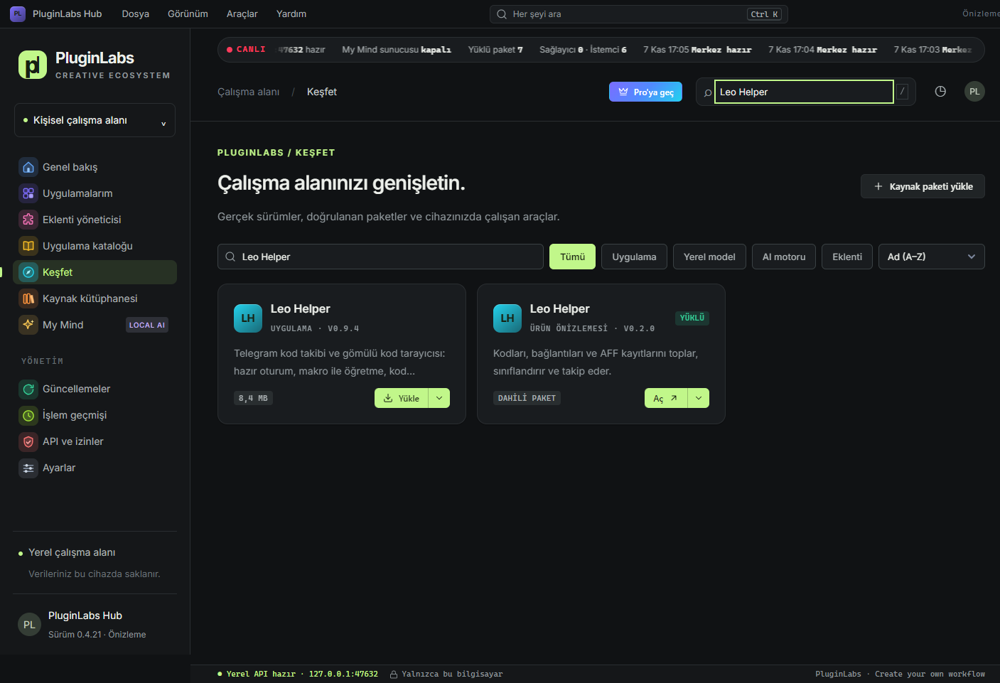

# 0.6.0 · 11.11.2026

**Telefon köprüsü.** PluginLabs Hub Android, aynı Wi-Fi ağındaki masaüstü Hub'a bağlanır: bilgisayarın durumu, kurulu uygulamalar ve MyMind motoru telefonda görünür; uygulama özellikleri telefondan değiştirilir; kurulum istekleri masaüstünde onay bekler. Köprü varsayılan kapalıdır (API ve izinler → Telefon köprüsü). Eşleşme 6 haneli tek kullanımlık kod, iki ekranda aynı görünen 4 haneli karşılaştırma kodu ve masaüstü onayıyla yapılır; sonrasındaki tüm trafik AES-256-GCM ile şifrelidir. Yerel API yine yalnız 127.0.0.1'de dinler.

**Uygulama özelliklerini aç/kapa.** Uygulama kataloğunda menüden “Özellikleri aç/kapa” (ör. Leo Helper: otomatik kod girişi, pano izleme, şart ayıklama, Scrapper köprüsü, kısayollar, MyMind). Uygulamalar değerleri `GET /v1/apps/features?app=<id>` ile okur.

**PluginLabs Hub Android 0.2.0 (test).** Açılış ekranı, katalog ve SHA-256 doğrulamalı APK kurulumu, cihaz bilgileri, masaüstü eşleşmesi, özellikler, eklentiler, MyMind ve abonelik ekranları.

Testler: `npm test` 47/47, `npm run test:ui` (Linux Xvfb, Electron 33). Paketler imzasızdır.

---

# 0.5.1

PluginLabs Hub 0.5.1 kataloğu Leo Helper 0.9.6'ya günceller. Leo'nun Telegram mesaj geçmişi ve aynı profil için oturum sırası bu sürümde kullanılabilir. Hub, genel dağıtımdan Leo 0.9.6 ile MyMind AI 0.1.2 paketlerini indirdi ve boyutlarını ve SHA256 özetlerini doğruladı. 0.5.0 ile eklenen 11 ürün katalogda yer alır.

Windows x64 paketinde 33 test, iki Electron UI akışı ve yalıtılmış katalog kabulü geçti. Üretim bağımlılık taramasında sıfır bulgu var. Kurulum, taşınabilir EXE, üç gerçek ekran ve SHA256 dosyası yayıma dahildir. Windows paketleri imzasızdır. Özel MyMind Qwen3-4B eğitimi ayrı çalışmada sürüyor.

[Leo Helper 0.9.6 dağıtımı](https://github.com/timdesigners-pixel/pluginlabs-dagitim/releases/tag/leo-helper-v0.9.6)

---

PluginLabs Hub 0.5.0 — PL-040..PL-050 Araştırma, Yazma, Geliştirici ve Profesyonel Araçlar Serisi Kataloğa Eklendi.

- **PL-040 Insight Table 0.1.0:** Tablosal veri içgörü ve sütun istatistikleri aracı.
- **PL-041 Dev Patch Notes 0.1.0:** Git commit ve PR'lardan otomatik sürüm notu derleyicisi.
- **PL-042 API Pocket 0.1.0:** Hızlı API test ve mock istek yönetim cep aracı.
- **PL-043 Access Lens 0.1.0:** Rol, izin ve IAM yetki matrisi denetim lensi.
- **PL-044 Design Token Scout 0.1.0:** Kod ve CSS dosyalarından tasarım tokenı ayıklama ve denetim aracı.
- **PL-045 Context Kit 0.1.0:** LLM ve model bağlamları için token/kod paketi hazırlayıcısı.
- **PL-046 Model Switchboard 0.1.0:** Yerel ve bulut yapay zeka modelleri arası yönlendirme panosu.
- **PL-047 Permission Radar 0.1.0:** Uygulama ve eklenti izin risk radarı.
- **PL-048 Offline Aid 0.1.0:** Çevrimdışı dokümantasyon, cheat sheet ve yerel acil bilgi deposu.
- **PL-049 Invoice Inbox 0.1.0:** Fatura ve makbuz ayrıştırma, KDV özeti ve muhasebe ön izleme kutusu.
- **PL-050 Decision Board 0.1.0:** Ağırlıklı karar matrisi ve mimari seçim karar tahtası.

Tüm 11 yeni ürün `pluginlabs-dagitim` üzerinden resmi v0.1.0 Windows paketleri (Portable + NSIS) olarak yayımlandı; SHA256 özetleri ve dosya boyutları Hub kataloğuna işlendi.
Hub artık PL-001..PL-059 arasındaki tüm 59 ürünün tamamını doğrudan kurma, doğrulama ve çalıştırma desteğine sahiptir.

---

PluginLabs Hub 0.4.26 — Leo Helper 0.9.5 katalog ve dağıtım güncellemesi.

- Leo Helper 0.9.5: Windows genel Ctrl+Alt+P hızlı mesaj paneli ve Ctrl+Alt+Esc durdurma; paket boyutu ve SHA256 güncel herkese açık dağıtımla eşleşir.
- MyMind AI 0.1.2 korunur. Hub çekirdeği üzerinden iki herkese açık paket indirildi; boyut ve SHA256 doğrulandı.
- 33/33 birim/API testi, native-ui ve extension-ui, üretim bağımlılık denetimi (0 açık), Windows kurulum ve taşınabilir derleme geçti. Paketli EXE katalog sürümleri ve ayrı profil yolu doğrulandı.
- Windows paketleri imzasızdır. Tam MyMind 4B eğitimi henüz bitmedi: checkpoint 125/1610 kurtarıldı; Kaggle telefon/GPU doğrulaması bekliyor. Leo'nun OCR/oyun/etkinlik ve eski panel kapsamı ayrıca açık; bu yayın tam eski uygulama eşdeğerliği iddiası taşımaz.

---

PluginLabs Hub 0.4.25 — Notion Bridge 0.1.0 kataloğa eklendi.

- Notion Bridge 0.1.0 (PL-039): seçilen içerik (yapıştırma, pano düğmesi ya da Ctrl+Alt+N genel kısayolu, .txt/.md) kullanıcının kendi entegrasyon anahtarıyla bağlanan tek Notion veritabanının şemasına göre alanlara eşlenir; şemada olmayan alan ya da seçenek uydurulmaz, belirsiz alan boş ve gerekçeli kalır; kayıt öncesi taslak önizleme ve şema doğrulaması (uyumsuz taslak gönderilmez); her Notion isteği ayrı onaylı, yalnız yeni kart eklenir (var olan sayfa değişmez); yerel parmak izi + başlık sorgusuyla mükerrer kayıt engeli; Notion CSV/MD/JSON. MyMind / yerel model onaylı, iletişim bilgileri ve Notion anahtarı gönderilmez; öneri aynı şema denetiminden geçer.
- Taşınabilir paket `pluginlabs-dagitim` notion-bridge-v0.1.0 sürümünden; boyut ve SHA-256 dağıtım dosyası indirilerek doğrulandı.
- Bu dal güncel `main` (Codex Hub 0.4.21: Leo Helper 0.9.4, MyMind AI 0.1.2) ile birleştirildi; aynı 0.4.21 numarası iki dalda kullanıldığından birleşik sürüm 0.4.25 olarak yayımlanır.

---

PluginLabs Hub 0.4.24 — Action Inbox 0.1.0 kataloğa eklendi.

- Action Inbox 0.1.0 (PL-038): sayfa, e-posta ve mesajlardan seçilip yakalanan metin (yapıştırma, pano düğmesi ya da Ctrl+Alt+I genel kısayolu, .txt/.md) kaynaklı görev adaylarına ayrılır; fiil, son tarih (yakalama gününe göre) ve gerekli materyal önerilir, kişi ataması yalnız taslaktır; inceleme kuyruğu (hiçbir aday kendiliğinden görev olmaz); yinelenen görev uyarısı ve mevcut göreve birleştirme; son tarih kovalı görev kuyruğu ve görev kutusu (widget); haftalık kaynaklı tamamlama ve yinelenen görev oranı; MD/ICS/CSV. MyMind / yerel model onaylı, kişi adları ve iletişim bilgileri gizli. Otomatik kaynak izleme yok.
- Taşınabilir paket `pluginlabs-dagitim` action-inbox-v0.1.0 sürümünden; boyut ve SHA-256 dağıtım dosyası indirilerek doğrulandı.

---

PluginLabs Hub 0.4.23 — Mail Triage 0.1.0 kataloğa eklendi.

- Mail Triage 0.1.0 (PL-037): salt okunur pilot — dışa aktarılan .eml/.mbox iletileri için gerekçeli etiket (Yanıt bekliyor, Fatura/Ödeme, Toplantı, Kargo/Sipariş, Güvenlik, Bülten/Kampanya, Bildirim) ve öncelik önerisi; önemli kişi, doğrudan soru/rica, yakın son tarih ve güvenlik iletileri Düşük önerilmez; eylem/son tarih/tutar çıkarımı; toplu değişiklik önizlemesi; yanıt taslağı (gönderilmez). Posta kutusuna bağlanmaz. MyMind / yerel model onaylı; adlar ve iletişim bilgileri gizlenir.
- Taşınabilir paket `pluginlabs-dagitim` mail-triage-v0.1.0 sürümünden; boyut ve SHA-256 dağıtım dosyası indirilerek doğrulandı.

---

PluginLabs Hub 0.4.22 — Voice Note Orbit 0.1.0 kataloğa eklendi.

- Voice Note Orbit 0.1.0 (PL-036): yüzen kayıt balonundan ya da ana pencereden basılı tutarak kısa ses notu (sürekli dinleme yok, görünür kayıt göstergesi); bu bilgisayardaki whisper sunucusuyla onaylı metne çevirme ya da elle yazma; görev/not ve tarih–saat taslağı, belirsiz ifadede seçenek; ses, transkript ve not ayrı silinir; ICS/CSV. MyMind / yerel model onaylı, hassas değerler yer tutucuyla.
- Taşınabilir paket `pluginlabs-dagitim` voice-note-orbit-v0.1.0 sürümünden; boyut ve SHA-256 dağıtım dosyası indirilerek doğrulandı.

---

PluginLabs Hub 0.4.21 — Meeting Trace 0.1.0 kataloğa eklendi.

- Meeting Trace 0.1.0 (PL-035): yüklenen/yapıştırılan toplantı transkriptinden (WebVTT, SRT, zaman damgalı satırlar) zaman damgalı karar, görev (sorumlu + son tarih) ve açık soru taslakları; konuşmacı tahmini ve belirsiz sorumlu görünür; her taslak kullanıcı onayından geçer; MD/TXT/CSV/ICS. Ses kaydı yok. MyMind / yerel model onaylı, takma ad + yer tutucuyla.
- Taşınabilir paket `pluginlabs-dagitim` meeting-trace-v0.1.0 sürümünden; boyut ve SHA-256 dağıtım dosyası indirilerek doğrulandı.

PluginLabs Hub 0.4.21 (Codex, main) — Leo Helper 0.9.4 ve MyMind AI 0.1.2. (Aynı numara iki ayrı dalda kullanıldı; birleşik dal sonraki sürüm numarasıyla yayımlanır.)

- Leo Helper 0.9.4: eksik/oyun/iptal kodlarda otomatik hazırlama ve giriş engeli; akıştaki adaylar korunur.
- MyMind AI 0.1.2: PL-059 ürün kartı kimliği; güncel Windows ve Chrome paketleri.
- Katalog URL, boyut ve SHA256 değerleri gerçek paketlerle eşleşir. PL-059 Notion kartı ve yayın merkezi bağlandı.
- 33 Hub testi ve iki gerçek Electron UI akışı geçti; paketlenmiş Windows EXE üzerinde iki ürünün sürümleri ayrıca doğrulandı.
- Windows yayın iş akışı kilitli Playwright sürümünü kullanır; eski 1.49.1'e geçici indirme kaldırıldı.
- Qwen3-4B özel model eğitimi henüz tamamlanmadı. Uygulama sürümüyle model eğitimi ayrı kabul edilir.

Geri alma: Hub 0.4.20 paketini kullanın; uygulama verisi ve işletim sistemi kasasını koruyun. İmzasız Windows paketidir.

---

PluginLabs Hub 0.4.20 — Flow Dock 0.2.0 ön sürüm entegrasyonu.

- Doğrulanmış 4.069.376 baytlık Rust/Tauri taşınabilir paket; SHA-256 dağıtım dosyası indirilerek doğrulandı.
- Katalogda açık ön sürüm etiketi; Windows 11 native doğrulaması geçti, Server 2025 native açılışı başarısız.
- Güncelleme denetimi yalnız katalogda açıkça işaretlenmiş mevcut ön sürüm etiketini kabul eder; diğer ön sürümler dışlanır, daha yeni kararlı sürümler kabul edilir.
- Kurgu bu yayına dahil değil; kesin yayımlanmış manifest bekleniyor.

---

PluginLabs Hub 0.4.19 — Gardrop 0.2.1

- Gardrop 0.2.1: seçili MyWishlist aktarımı, fiyatlı kombin kolajı, 14 üretilmiş ürün fotoğrafı ve model üzerinde sabit demo görseli; MyMind metin isteği ve önizleme.
- Katalog boyut/SHA256 değerleri Windows runner kaynak release paketinden alındı; dağıtım aynası aynı dosyaları sunar.
- Gerçekçi kişisel giydirme ve 3B renderer uygulanmadı. İmzasız Windows sürümüdür.

---

PluginLabs Hub 0.4.18 — Genel bakış widget'larına örnek görseller.

- Günün kombini (Gardrop) ve Günün menüsü (Mutfak Atölyesi: kahvaltı, öğle, akşam) widget'larında SVG çizimlerin yerine örnek fotoğraf görselleri. Görseller Google Gemini ile üretildi, uygulamayla birlikte gelir (`ui/img/`, WebP, toplam ~70 KB) ve internetten yüklenmez.
- Altyazılar “Örnek görsel (AI ile üretildi)” olarak işaretlendi. Kendi fotoğrafınızı eklemek, değiştirmek ve kaldırmak eskisi gibi çalışır; fotoğrafı kaldırınca örnek görsel geri gelir.
- Arayüz testi örnek görselin gerçekten yüklendiğini de denetler (`naturalWidth > 0`; CSP `img-src 'self'` korunur).
- Eski SVG çizimler kodda yedek olarak duruyor.

İmzasız önizleme sürümüdür; SmartScreen uyarı verebilir. Windows DPI ve klavye kabulü ayrıca yapılmamıştır.

---

PluginLabs Hub 0.4.17 — PluginLabs Advanced düğme varyantları (PLC-001 … 004) Hub genelinde tutarlı kullanılıyor.

- İkincil (secondary) düğme: asıl eylem olmayan kapatma düğmeleri (uygulama ve ürün bilgisi pencerelerinde “Kapat”) artık ikincil; Genel bakış › Kaynak kütüphanesi satırlarında “＋ Ekle” / “Yönet” ikincil küçük düğme (önceden çıplak metin bağlantısıydı).
- Hayalet (ghost) düğme: “Vazgeç” (paketi kaldır, tarayıcı ve uygulama eklentisi pencereleri) ve süren işlerin “İptal” düğmeleri; Genel bakış’taki “Tüm uygulamalar” ve “Tümünü gör” bağlantıları ghost küçük düğme.
- Yükleme durumu: işlem sürerken düğme “İşleniyor…” yazısı yerine PLC-001 yükleme durumuna geçer (etiket genişliği korunur, varyant rengine uygun döner simge, aria-busy). Katalog kartında süren yükleme döner simgeli ikincil düğmeyle gösterilir; tıklayınca iptal eder.
- Gradient düğme: üst çubuktaki “Pro’ya geç” ve karşılama alanındaki “My Mind’ı keşfet” korunur; gradient ve tehlike (danger) düğmelerine üzerine gelme durumu eklendi.
- Birincil, bölünmüş (Yükle ▾), segment ve simge düğmeleri değişmedi.

İmzasız önizleme sürümüdür; SmartScreen uyarı verebilir. Windows DPI ve klavye kabulü ayrıca yapılmamıştır.

---

PluginLabs Hub 0.4.16 — Kanal API'si (canlı veri akışı ve uygulamalar arası köprü) ve My Mind hazır görevleri.

- Kanallar: uygulamalar `POST /v1/channels/<ad-alanı>.<konu>` ile veri yayınlar; Genel bakış widget'ları (kodlar, fiyat düşüşleri, notlar, kazıma görevleri, yaklaşan ödemeler, veri akışı) “Canlı · <uygulama>” rozetiyle gerçek veriyi gösterir; süre dolunca örnek veriye döner. Yayın izni kendi ad alanıyla sınırlıdır; veri boyut, derinlik, süre ve hız sınırlıdır; yalnızca bellekte tutulur.
- Köprü: yayıncı `share` ile açtığı kanalı başka bir uygulama `GET /v1/channels/<kanal>` veya canlı `GET /v1/stream` (SSE) ile okuyabilir. Varsayılan olarak yalnızca Hub arayüzü okur. Yeni izinler: `channels.publish`, `channels.read`.
- Arayüz: API ve izinler sayfasında “Kanallar ve köprüler” tablosu (yayıncı, paylaşım, güncelleme, Kapat); anahtar oluştururken isteğe bağlı kanal ad alanı; istemci tablosunda ad alanı.
- My Mind: 12 hazır görev (özetle, yeniden yaz, etiket, kod ayıklama, çeviri, gün planı, görev parçalama, kombin, menü, fiyat notu, harcama sınıfı, metinden yanıt). `GET /v1/mymind/capabilities`, `POST /v1/mymind/run`; SDK `hub.mymind.*`. Girdi veri olarak işlenir, çıktı doğrulanır. My Mind sayfasında görev kataloğu listelenir.
- SDK: `publish`, `read`, `channels`, `subscribe`, `mymind.capabilities`, `mymind.run`.
- Belgeler: `docs/ecosystem-v1/KANAL-API.md`, `docs/ecosystem-v1/MYMIND-YETENEKLER.md`.

Uygulamaların bu kanallara yayın yapması kendi sürümlerinde yapılacaktır; bu sürüm Hub tarafını ve sözleşmeyi getirir. İmzasız önizleme sürümüdür; SmartScreen uyarı verebilir. Windows DPI ve klavye kabulü ayrıca yapılmamıştır.

---

PluginLabs Hub 0.4.15 — Üst çerçeve menüsü, bölünmüş Yükle düğmesi, uygulama logo karoları ve fotoğraf alanlı widget'lar.

- Üst çerçeve: Dosya / Görünüm / Araçlar / Yardım menüsü pencerenin en üstünde, tüm genişlikte (PLC-029 başlık çubuğu kalıbı: logo, başlık, menüler, “Her şeyi ara · Ctrl K”). Kenar çubuğu ve içerik bunun altında başlar.
- Sayfa geçişi: menüden bir sayfaya tıklayınca sayfa artık en üstten açılır (önceden bir miktar aşağıdan başlıyordu).
- Çalışma alanınız için: kartlarda yalnızca uygulama logosu, ad ve boyut var; “Yükle” bölünmüş düğmedir (indirme oku simgesi, ▾ ile açılan menüde Detaylı bilgi, Ayarlar ve paket bilgisi, Kaynağı gör). Tüm uygulama kartlarında ve “+ Yükle” düğmelerinde artı yerine indirme oku kullanılır.
- Uygulama simgeleri: tasarım sistemindeki uygulama logo karoları (iki harfli kısaltma + ürün aksanı; ürün aksanı olmayanlara palet rengi).
- Günün kombini ve Günün menüsü widget'ları: fotoğraf alanları. Varsayılan olarak ÇİZİM önizlemesi gösterilir; kendi fotoğrafınızı (kombin) ve yemek fotoğraflarını ekleyebilirsiniz. Fotoğraflar yalnızca bu cihazda saklanır (küçültülüp yerel depoya yazılır), hiçbir yere gönderilmez. Sizin üzerinizde gerçekçi kombin görüntüsü üretimi yoktur; bu, Gardrop'un sanal deneme özelliğine bağlıdır ve henüz yok.
- Tasarım sistemi bileşenleri: karşılama kahramanı (OnboardingHero), eklenti satırları anahtarlı (ExtensionRow), izin isteği kartı (PermissionCard), güncelleme kartı (UpdateCard), indirme satırı (InstallRow), durum çubuğu (StatusBar). Tüm düğmeler tasarım sistemindeki Button bileşeniyle birebir (pl-btn; yazı boyutu, ağırlık, köşe, yükseklik); “+”, “↻”, “▶”, “↗” harf simgeleri çizgi ikonlarıyla değişti. Önceden Hub'ın genel yazı kuralı düğme yazı değerlerini eziyordu.
- Daha fazla tasarım sistemi bileşeni: Filtre çubuğu + seçim kutusu (Keşfet/Kaynak), karşılama başlığı ve duyuru bandı (Genel bakış), hap gezinme (Eklenti yöneticisi), proje kenar çubuğu (Uygulama kataloğu), HUD metrik + HUD tablo (API ve izinler), modal başlık/gövde/alt yapısı; widget'larda gün şeridi + ajanda, karanlık görev kartı (başlangıç görevleri gerçek veriyle), büyük sayı üçlüsü, bütçe göstergesi, aktivite karosu, yemek kartı, saat-hava + iklim çipleri, iş kuyruğu, değerleme hesaplayıcı (çalışır), kişi kartı, cihaz anahtar karosu. Widget verileri “Örnek veri” rozetiyle işaretlidir (başlangıç görevleri ve My Mind widget'ı gerçek).

İmzasız önizleme sürümüdür; SmartScreen uyarı verebilir. Windows DPI ve klavye kabulü ayrıca yapılmamıştır.

---

PluginLabs Hub 0.4.14 — PluginLabs Advanced arayüzü, Akış panosu ve Widget düzenleyici.

- Tasarım sistemi: PluginLabs Advanced (v2.0.0) depoya kuruldu (`design-system/pluginlabs-advanced`, eski `pluginlabs-design` `design-system/_arsiv/` altında). Hub arayüzü Advanced bileşenleri ve değerlerine taşındı; Hub Yeşil ve Iris paletleri ile koyu/açık tema korundu.
- Üst menü (Dosya, Görünüm, Araçlar, Yardım), kayan akış bandı, sunucu ve bağlantı durum kartları, istatistik kartları, Ctrl+K komut paleti (opak panel), renkli menü simgeleri; menüde kaydırma çubuğu yok.
- Genel bakış: girişte başlığın altında işlem düğmeli My Mind sunucusu ve Uygulama bağlantısı durum kartları ile ilerleme çubuklu istatistik kartları; özgün düzen (karşılama, “Çalışma alanınız için”, kaynaklar ve API kartı) olduğu gibi korunur; sonunda Akış panosu — Veri akışı, Günün kombini, Günün menüsü, Bugün, Yaklaşan ödemeler, Fiyat düşüşleri, Yakalanan kodlar, Son notlar, Kazıma görevleri, Odak ve My Mind widget'ları. Şimdilik My Mind dışındakiler ÖRNEK VERİ gösterir ve "Örnek veri" rozeti taşır; uygulama yüklüyse ilgili widget genişler. Uygulamalar Hub'a veri akıtmaya başlayana kadar gerçek veri yoktur.
- Ayarlar: beş sekme (Görünüm, Widget'lar, Veri ve gizlilik, Bağlantılar, Kısayollar, Hakkında) ve Widget düzenleyici (widget ekle/çıkar, sıra, varsayılana dön; bu cihazda saklanır). Hub sürümü artık gerçek değeri gösterir (önceden 0.3.0 yazıyordu).
- Uygulamalarım: istatistik kartları, tür süzgeci, ızgara/liste görünümü, boş durum. My Mind sayfasındaki kart boşluğu düzeltildi.
- Üst başlıkta "Pro'ya geç" düğmesi var; Pro planı henüz yoktur, düğme bunu açıklayan bir pencere açar.

İmzasız önizleme sürümüdür; SmartScreen uyarı verebilir. Windows DPI ve klavye kabulü ayrıca yapılmamıştır.

---

PluginLabs Hub 0.4.13 — Özel MyMind modeli ve istemci sıcaklığı.

- My Mind: kendi eğitilmiş GGUF modelini içe aktarma (GGUF imzası, 1 MB–8 GB sınırı, aynı klasördeki SHA256SUMS ile SHA-256 doğrulaması, geçici dosya temizliği), katalog/özel model kaynağı seçimi, kaldırma. Model aynı `mymind-lite` API adıyla sunulur; istemcilerde değişiklik gerekmez.
- API: `/v1/chat/completions` istemcinin `temperature` değerini (0–1) iletir; verilmezse 0,4. Önceden her istek 0,4 ile gidiyordu.
- Eski kayıtlar: model kaynağı olmayan durum dosyası katalog modeliyle açılır.
- Bu sürüm, ayrı yayımlanmamış 0.4.11 (MyWishlist 0.1.0) ve 0.4.12 (The Ultimate Upscaler 0.1.0) katalog değişikliklerini de içerir.

İmzasız önizleme sürümüdür; SmartScreen uyarı verebilir.

---

PluginLabs Hub 0.4.12 — The Ultimate Upscaler 0.1.0 kataloğa eklendi.

- Katalog: The Ultimate Upscaler 0.1.0 (PL-056; cihazda görsel büyütme: Otomatik/Fotoğraf/Çizim/Piksel/Yumuşak profilleri, önce/sonra karşılaştırma, toplu sıra, MyMind ile yalnız ölçümlerle onaylı ayar önerisi; Chrome eklentisi sağ tık ile aynı sürümde). Boyut ve SHA-256 dağıtım deposundaki dosyayla doğrulandı.
- Tasarım sistemi: `upscaler` (`#38bdf8`) aksanı eklendi; Tork birleştirmesinde kaybolan `gardrop` (`#e879f9`) aksanı geri getirildi. Kanonik kaynak ve iki skill kopyası eşit.
- Hub'ın kendi davranışı değişmedi.

İmzasız önizleme sürümüdür; SmartScreen uyarı verebilir.

---

PluginLabs Hub 0.4.11 — MyWishlist 0.1.0 kataloğa eklendi.

- Katalog: MyWishlist 0.1.0 (PL-054; Rust/Tauri Windows uygulaması + Chrome eklentisi: istek listeleri, öncelik, fiyat takibi ve uyarılar, ürün adıyla çok sitede arama ve karşılaştırma, sepet planı, alışveriş asistanı, MyMind ile ekleme, ekran görüntüsünden tanıma). Boyut ve SHA-256 kaynak sürümdeki taşınabilir exe’den alındı.
- Hub'ın kendi davranışı değişmedi.

İmzasız önizleme sürümüdür; SmartScreen uyarı verebilir. Electron ve paketleme zincirindeki güvenlik bulguları (issue #3) açıktır.

---

PluginLabs Hub 0.4.10 — MyMind AI 0.1.0 kataloğa eklendi.

- Katalog: Gardrop 0.1.0 (PL-055; dijital gardırop: parçalar, kombinler, “Bugün ne giysem?”, giyim günlüğü, analiz, istek listesi, MyMind ile onaylı kombin önerisi; Chrome eklentisi aynı sürümde). SHA-256 ve boyut dağıtım deposundaki dosyayla doğrulandı.
- Tasarım sistemi: `gardrop` ürün aksanı (`#e879f9`) kanonik kaynağa ve iki skill kopyasına eklendi.
- Hub'ın kendi davranışı değişmedi.

İmzasız önizleme sürümüdür; SmartScreen uyarı verebilir. Electron ve paketleme zincirindeki güvenlik bulguları (issue #3) açıktır.

---

PluginLabs Hub 0.4.9 — Leo Helper 0.9.2 kataloğa eklendi.

- Katalog: Leo Helper 0.9.2 (Alınan kodlar sayfası ve şartların kaydı: başarılı her kod, alındığı andaki şartlarıyla saklanır; şart, durum ve not sonradan düzeltilir). SHA-256 ve boyut dağıtım deposundaki dosyayla doğrulandı.
- Hub'ın kendi davranışı değişmedi.

İmzasız önizleme sürümüdür; SmartScreen uyarı verebilir. Electron ve paketleme zincirindeki güvenlik bulguları (issue #3) açıktır.

---

PluginLabs Hub 0.4.8 — Leo Helper 0.9.1 kataloğa eklendi.

- Katalog: Leo Helper 0.9.1 (kod takibi: uygunluk göstergesi, mesaj önizlemesi, sınıflandırma, kod şartları). SHA-256 ve boyut dağıtım deposundaki dosyayla doğrulandı.
- Hub'ın kendi davranışı değişmedi.

İmzasız önizleme sürümüdür; SmartScreen uyarı verebilir. Electron ve paketleme zincirindeki güvenlik bulguları (issue #3) açıktır.

---

PluginLabs Hub 0.4.7 — PluginLabs Scrapper 0.7.0 kataloğa eklendi.

- Katalog: PluginLabs Scrapper 0.7.0 (ürün ekranları tek Alışveriş bölümünde; ham veriyi değiştirmeyen dönüşüm katmanıyla Veri Kazıma Stüdyosu, otomatik düzenleme, CSV/JSON/XLSX/SQLite çıktısı; parolaları şifreli tutan Site Rehberi). SHA-256 ve boyut dağıtım deposundaki dosyayla doğrulandı.
- Hub'ın kendi davranışı değişmedi.

İmzasız önizleme sürümüdür; SmartScreen uyarı verebilir. Electron ve paketleme zincirindeki güvenlik bulguları (issue #3) açıktır.

---

PluginLabs Hub 0.4.6 — Mutfak Atölyesi 0.4.1 kataloğa eklendi.

- Katalog: Mutfak Atölyesi 0.4.1 (Windows x64 taşınabilir zip; PluginLabs Tasarım Sistemi arayüzü, Ctrl+K komut paleti). SHA-256 ve boyut dağıtım deposundaki dosyayla doğrulandı; gerçek indirme + açma + başlatma yolu uçtan uca denendi.
- Hub: zip olarak dağıtılan uygulamalar için isteğe bağlı `launch` alanı (arşivden çıkan exe'nin göreli yolu). Yol, arşiv yolu kurallarıyla doğrulanır; kurulum klasörünün dışına çıkamaz. Mevcut exe uygulamaların davranışı değişmedi.

İmzasız önizleme sürümüdür; SmartScreen uyarı verebilir. Mutfak Atölyesi için Windows'ta WebView2 Runtime gerekir. Electron ve paketleme zincirindeki güvenlik bulguları (issue #3) açıktır.

---

PluginLabs Hub 0.4.5 — Leo Helper 0.9.0 kataloğa eklendi.

- Katalog: Leo Helper 0.9.0 (Tauri/Rust; gömülü kod tarayıcısı, Telegram bağlantısı, makro ile öğretme, 5 hedefe aynı anda otomatik kod girişi, sonuç algılama). SHA-256 ve boyut dağıtım deposundaki dosyayla doğrulandı.
- Hub'ın kendi davranışı değişmedi.

İmzasız önizleme sürümüdür; SmartScreen uyarı verebilir. Electron ve paketleme zincirindeki güvenlik bulguları (issue #3) açıktır.

---

PluginLabs Hub 0.4.4 — PluginLabs Scrapper 0.6.0 kataloğa eklendi.

- Katalog: PluginLabs Scrapper 0.6.0 (PluginLabs Tasarım Sistemi uyumu, Ctrl+K komut paleti, sade tarayıcı arayüzü). SHA-256 ve boyut dağıtım deposundaki dosyayla doğrulandı.
- Hub'ın kendi davranışı değişmedi.

İmzasız önizleme sürümüdür; SmartScreen uyarı verebilir. Electron ve paketleme zincirindeki güvenlik bulguları (issue #3) açıktır.

---

PluginLabs Hub 0.4.3 — PluginLabs Scrapper 0.5.1 kataloğa eklendi.

- Katalog: PluginLabs Scrapper 0.5.1 (gerçek siteler için düzeltmeler: akıllı seçim, RSS/WordPress API kaynakları, önizleme tanıları, kılavuz). SHA-256 ve boyut dağıtım deposundaki dosyayla doğrulandı.
- Hub'ın kendi davranışı değişmedi.

İmzasız önizleme sürümüdür; SmartScreen uyarı verebilir. Electron ve paketleme zincirindeki güvenlik bulguları (issue #3) açıktır.

---

PluginLabs Hub 0.4.2 — PluginLabs Scrapper 0.5.0 kataloğa eklendi.

- Katalog: PluginLabs Scrapper 0.5.0 (Kazıma Stüdyosu: gömülü tarayıcı, oturumlar, görsel seçici, zamanlanmış görevler, MyWishlist/Bahis Dünyası aktarımı). SHA-256 ve boyut dağıtım deposundaki dosyayla doğrulandı.
- Hub'ın kendi davranışı değişmedi.

İmzasız önizleme sürümüdür; SmartScreen uyarı verebilir. Electron ve paketleme zincirindeki güvenlik bulguları (issue #3) açıktır.

---

PluginLabs Hub 0.4.1 — PluginLabs Scrapper 0.4.1 kataloğa eklendi.

- Katalog: PluginLabs Scrapper 0.4.1 (sol menü genişledi, gezinme öğeleri tek satır, ince/düz scrollbar). SHA-256 ve boyut dağıtım deposundaki dosyayla doğrulandı.
- Hub'ın kendi davranışı değişmedi.

İmzasız önizleme sürümüdür; SmartScreen uyarı verebilir. Electron ve paketleme zincirindeki güvenlik bulguları (issue #3) açıktır.

---

PluginLabs Hub 0.4.0 — uygulamalar Hub'dan kurulabilir, MUST HAVE şartnamesi.

- Uygulama dosyaları herkese açık dağıtım deposundan (timdesigners-pixel/pluginlabs-dagitim) indirilir; özel depolar yüzünden oluşan 404 hatası giderildi. Kurulumdan önce SHA-256 doğrulaması aynen sürüyor.
- Katalog: Mind Palace 1.11.1, Leo Helper 0.8.0, PluginLabs Scrapper 0.4.0 (yeni), Finansal Asistan 0.1.0 (yeni), Flow Dock 0.1.0.
- Güncelleme denetimi dağıtım deposunu okur; her uygulama yalnız kendi `<id>-v` önekli, ön sürüm olmayan etiketlerini görür.
- Her proje için MUST HAVE şartnamesi (docs/MUST-HAVE.md) AGENTS.md'ye eklendi.
- Windows paketi artık GitHub Windows runner'ında main'den derlenir (hub-windows.yml); SHA256SUMS.txt ve BUILD-INFO.json içerir.

İmzasız önizleme sürümüdür; SmartScreen uyarı verebilir. Electron ve paketleme zincirindeki güvenlik bulguları (issue #3) açıktır.
