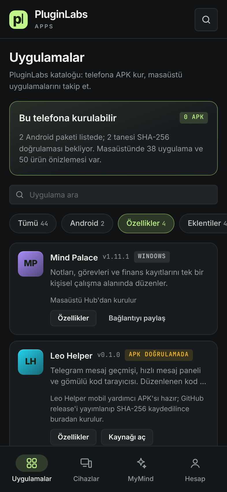
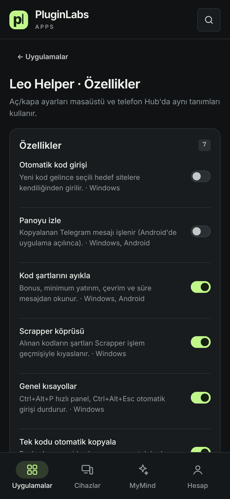
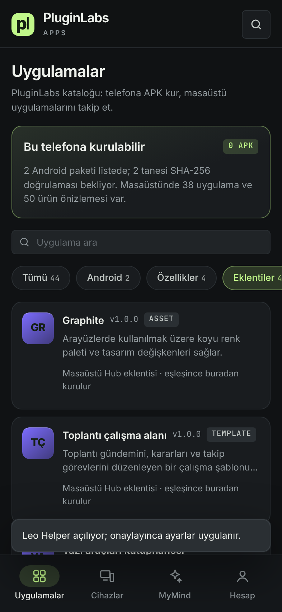
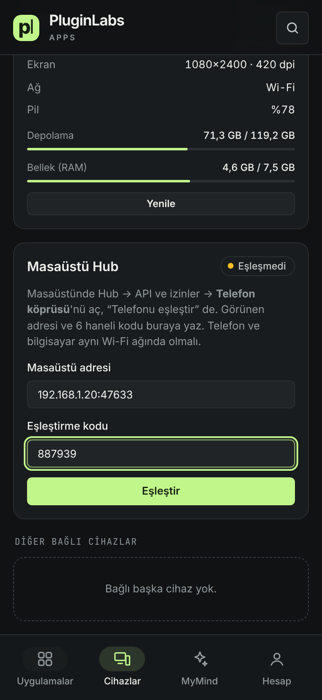
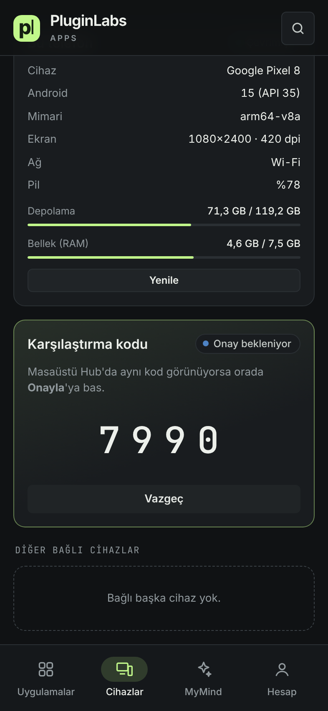
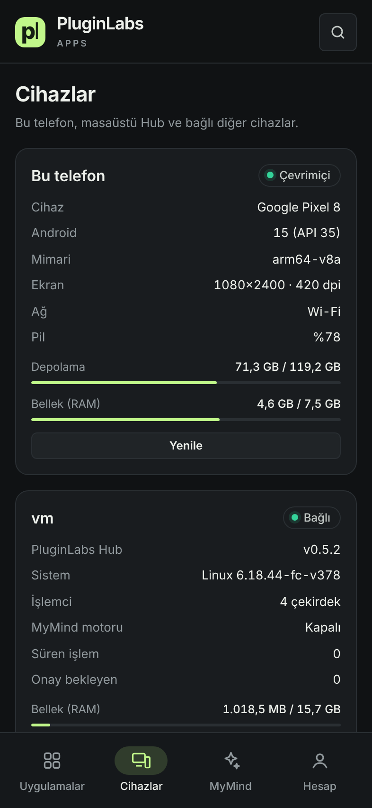
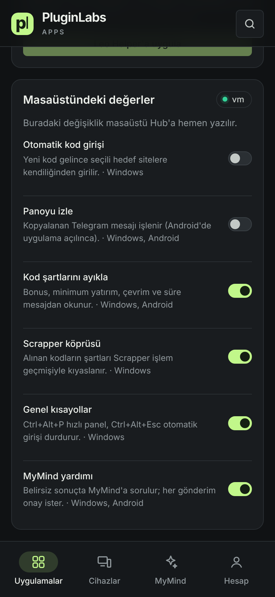

# PluginLabs Hub · Android (test sürümü 0.2.0)

PluginLabs Hub'ın telefon uygulaması. Masaüstü Hub'ın kataloğunu, tasarım çizgisini ve MyMind kurallarını Android'e taşır.

| Açılış | Uygulamalar | Cihazlar | MyMind AI | Hesap |
| --- | --- | --- | --- | --- |
|  |  |  |  |  |

> Görüntüler uygulamanın arayüz dosyalarından, 393×852 telefon boyutunda Chromium ile alındı; cihaz bilgileri örnek değerlerle verildi. Gerçek Android cihaz/emülatör görüntüsü henüz alınmadı.

## Ekranlar
- **Açılış:** PluginLabs logosu + `APPS`, ürün kartı (Hub · Mobil uygulama merkezi · 00), en az 4 saniyelik ilerleme çubuğu. Her adım gerçekten yapılan işi ve sonucunu yazar: arayüz/yazı tipi, katalog, cihaz bilgisi, MyMind ayarları, bağlı cihazlar, ana ekran.
- **Uygulamalar:** Hub kataloğu (`src/catalog.cjs`). Android paketi olanlar telefona kurulur; masaüstü uygulamalarının bağlantısı paylaşılabilir. Arama ve filtre (Tümü / Android / Masaüstü / MyMind AI), arama düğmesiyle komut paleti.
- **Cihazlar:** Bu telefonun modeli, Android sürümü, pil, depolama, RAM, ağ ve ekran bilgisi. Masaüstü Hub ve diğer cihazlar eşleştirme sonrası listelenir.
- **MyMind AI:** Etkinleştirme, zorunlu onay ve veri azaltma, yanıt dili, geçmiş, uygulama bazında izinler, aylık kullanım.
- **Hesap ve abonelik:** Geçerli plan, Pro plan içeriği, abonelik durumu, uygulama sürümü.

## Özellik aç/kapa ve eklentiler
- **Özellikler** filtresi ve her uygulamadaki **Özellikler** düğmesi, `registry/app-features.json` tanımlarını gösterir (masaüstü Hub ile aynı liste). Değerler bu telefonda saklanır.
- Leo Helper telefonda kuruluysa **Leo Helper'a uygula** Android'e uyan ayarları gönderir; Leo değişikliği onay almadan uygulamaz.
- **Eklentiler** filtresi Hub eklentilerini (eklenti, kütüphane, şablon, tema) listeler. Bunlar masaüstü Hub'a kurulur; telefondan kurulum masaüstü eşleşmesiyle açılacak.

| Özellik filtresi | Leo Helper özellikleri | Eklentiler |
| --- | --- | --- |
|  |  |  |

## APK kurulumu nasıl çalışır
1. Katalog kaydında `url`, `size` ve `sha256` bulunmalı (`android/catalog-android.json`, durum `verified`).
2. Uygulama dosyayı yalnız HTTPS ile ve yalnız GitHub release sunucularından indirir; yönlendirmelerin her adımı denetlenir, boyut sınırı 400 MB.
3. Boyut ve SHA-256 tutmazsa dosya silinir, kurulum yapılmaz.
4. Doğrulanan paket Android paket yükleyicisine verilir; son onay her zaman Android'in kendi ekranındadır.

Bugün kayıtlı APK'lar: Leo Helper mobil yardımcı 0.1.0 ve Mutfak Atölyesi 0.4.1 — release ve SHA-256 kaydı gelene kadar düğmeleri "Kaynağı aç" olarak kalır.

## Derleme
- GitHub: `Android APK` iş akışı (`.github/workflows/android.yml`) test APK'sını, `SHA256SUMS` ve `BUILD-INFO.txt` ile birlikte iş akışı çıktısı olarak üretir.
- Yerel: Node 24, JDK 17, Android SDK 35 ve Gradle 8.14 ile
  ```
  node scripts/android-sync.cjs
  cd android && gradle assembleDebug
  ```
- `assets/web/catalog.json` ve `assets/web/vendor/` betikle üretilir, git'e eklenmez.

## Mimari
- Yerel Java kabuğu (`MainActivity`) + `WebView` içinde PluginLabs Advanced tokenlarıyla yazılmış arayüz (`assets/web`). Arayüz yalnız `appassets.androidplatform.net` kökeninden yüklenir; başka adrese gezinme engellenir, dış bağlantılar tarayıcıda açılır. CSP yalnız uygulamanın kendi dosyalarına izin verir.
- Arayüzün çağırabildiği köprü (`HubBridge`) dardır: cihaz bilgisi okuma, doğrulamalı APK kurulumu, paylaşma ve dış bağlantı açma. Anahtar ya da belirteç arayüze verilmez.
- İzinler: `INTERNET`, `ACCESS_NETWORK_STATE`, `REQUEST_INSTALL_PACKAGES`. Yedekleme kapalı. Düz HTTP yalnız masaüstü köprüsü için kullanılır (içerik şifreli, yalnız yerel ağ).

## Masaüstü eşleşmesi
Cihazlar → Masaüstü Hub: masaüstündeki adres ve 6 haneli kod yazılır, iki ekranda aynı karşılaştırma kodu görülünce masaüstünde onaylanır. Sonra telefon masaüstü durumunu ve kurulu uygulamaları gösterir, Özellikler ekranında masaüstü değerlerini değiştirir, katalogdan "Masaüstüne kur" isteği gönderir (masaüstünde onay ister). Eşleşme anahtarı Android Keystore ile şifrelenip saklanır; istemci yalnız özel ağ (192.168.x, 10.x, 172.16–31.x) adreslerine bağlanır.

| Eşleştir | Karşılaştırma kodu | Masaüstü durumu | Masaüstü özellikleri |
| --- | --- | --- | --- |
|  |  |  |  |

## Henüz yapılmayanlar
- **MyMind istekleri:** telefondan MyMind'a görev gönderme eşleşmiş masaüstü üzerinden bir sonraki adımda açılacak; şu an yalnız motor durumu görünür.
- **Abonelik ödemesi:** Fiyat ve Google Play Faturalandırma kararı verilmedi; düğme kapalı.
- **İmzalı sürüm:** Test APK'sı hata ayıklama anahtarıyla imzalanır. Mağaza/yayın için ayrı imza anahtarı gerekir.
