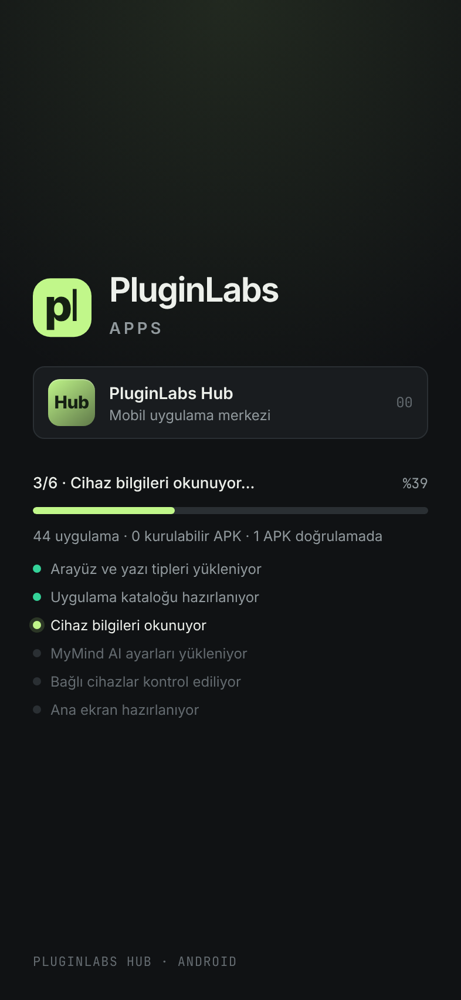
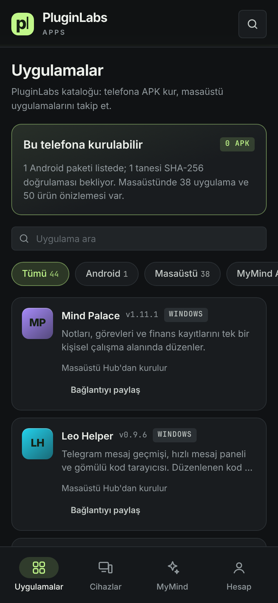
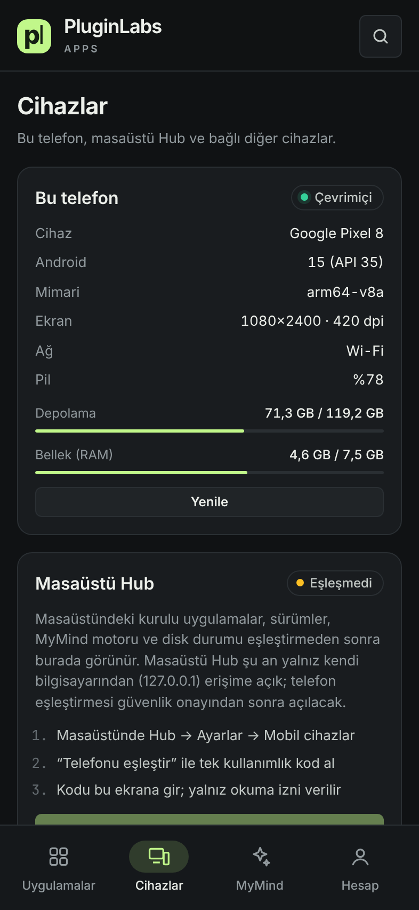
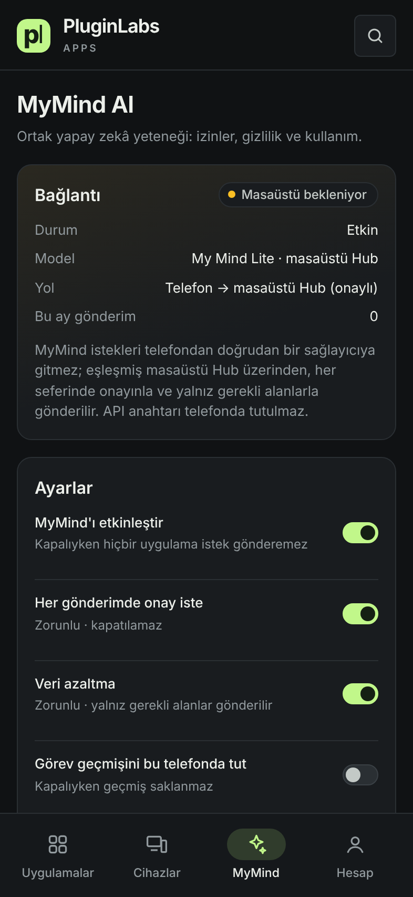
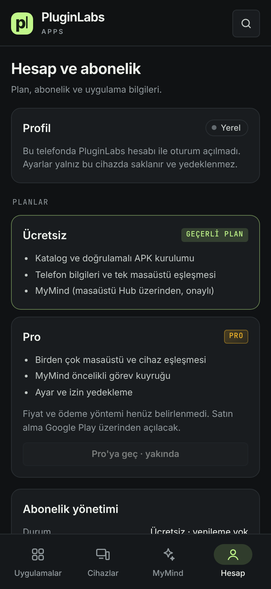

# PluginLabs Hub · Android (test sürümü 0.1.0)

PluginLabs Hub'ın telefon uygulaması. Masaüstü Hub'ın kataloğunu, tasarım çizgisini ve MyMind kurallarını Android'e taşır.

| Açılış | Uygulamalar | Cihazlar | MyMind AI | Hesap |
| --- | --- | --- | --- | --- |
|  |  |  |  |  |

> Görüntüler uygulamanın arayüz dosyalarından, 393×852 telefon boyutunda Chromium ile alındı; cihaz bilgileri örnek değerlerle verildi. Gerçek Android cihaz/emülatör görüntüsü henüz alınmadı.

## Ekranlar
- **Açılış:** PluginLabs logosu + `APPS`, ürün kartı (Hub · Mobil uygulama merkezi · 00), en az 4 saniyelik ilerleme çubuğu. Her adım gerçekten yapılan işi ve sonucunu yazar: arayüz/yazı tipi, katalog, cihaz bilgisi, MyMind ayarları, bağlı cihazlar, ana ekran.
- **Uygulamalar:** Hub kataloğu (`src/catalog.cjs`). Android paketi olanlar telefona kurulur; masaüstü uygulamalarının bağlantısı paylaşılabilir. Arama ve filtre (Tümü / Android / Masaüstü / MyMind AI), arama düğmesiyle komut paleti.
- **Cihazlar:** Bu telefonun modeli, Android sürümü, pil, depolama, RAM, ağ ve ekran bilgisi. Masaüstü Hub ve diğer cihazlar eşleştirme sonrası listelenir.
- **MyMind AI:** Etkinleştirme, zorunlu onay ve veri azaltma, yanıt dili, geçmiş, uygulama bazında izinler, aylık kullanım.
- **Hesap ve abonelik:** Geçerli plan, Pro plan içeriği, abonelik durumu, uygulama sürümü.

## APK kurulumu nasıl çalışır
1. Katalog kaydında `url`, `size` ve `sha256` bulunmalı (`android/catalog-android.json`, durum `verified`).
2. Uygulama dosyayı yalnız HTTPS ile ve yalnız GitHub release sunucularından indirir; yönlendirmelerin her adımı denetlenir, boyut sınırı 400 MB.
3. Boyut ve SHA-256 tutmazsa dosya silinir, kurulum yapılmaz.
4. Doğrulanan paket Android paket yükleyicisine verilir; son onay her zaman Android'in kendi ekranındadır.

Bugün kayıtlı APK: Mutfak Atölyesi 0.4.1 — dağıtım deposuna aynalanıp SHA-256 doğrulanana kadar düğmesi "Kaynağı aç" olarak kalır.

## Derleme
- GitHub: `Android APK` iş akışı (`.github/workflows/android.yml`) test APK'sını, `SHA256SUMS` ve `BUILD-INFO.txt` ile birlikte iş akışı çıktısı olarak üretir.
- Yerel: Node 24, JDK 17, Android SDK 35 ve Gradle 8.14 ile
  ```
  node scripts/android-sync.cjs
  cd android && gradle assembleDebug
  ```
- `assets/web/catalog.json` ve `assets/web/vendor/` betikle üretilir, git'e eklenmez.

## Mimari
- Yerel Java kabuğu (`MainActivity`) + `WebView` içinde PluginLabs Advanced tokenlarıyla yazılmış arayüz (`assets/web`). Arayüz yalnız `appassets.androidplatform.net` kökeninden yüklenir; başka adrese gezinme engellenir, dış bağlantılar tarayıcıda açılır. CSP yalnız uygulamanın kendi dosyalarına izin verir.
- Arayüzün çağırabildiği köprü (`HubBridge`) dardır: cihaz bilgisi okuma, doğrulamalı APK kurulumu, paylaşma ve dış bağlantı açma. Anahtar ya da belirteç arayüze verilmez.
- İzinler: `INTERNET`, `ACCESS_NETWORK_STATE`, `REQUEST_INSTALL_PACKAGES`. Yedekleme kapalı, düz HTTP kapalı.

## Henüz yapılmayanlar (onay bekleyen ikinci aşama)
- **Masaüstü eşleştirme ve masaüstü verisi:** Masaüstü Hub'ın yerel API'si yalnız `127.0.0.1` üzerinden açıktır. Telefonun masaüstü verisini görmesi için masaüstü tarafında kullanıcının açtığı, tek kullanımlık kodla eşleşen, yalnız okuma yetkili bir "mobil köprü" gerekir. Bu, Hub'ın güvenlik sınırını değiştirdiği için ayrıca onaylanmalı.
- **MyMind istekleri:** Telefon, MyMind'ı yalnız eşleşmiş masaüstü Hub üzerinden kullanacak; eşleştirme gelince açılır.
- **Abonelik ödemesi:** Fiyat ve Google Play Faturalandırma kararı verilmedi; düğme kapalı.
- **İmzalı sürüm:** Test APK'sı hata ayıklama anahtarıyla imzalanır. Mağaza/yayın için ayrı imza anahtarı gerekir.
