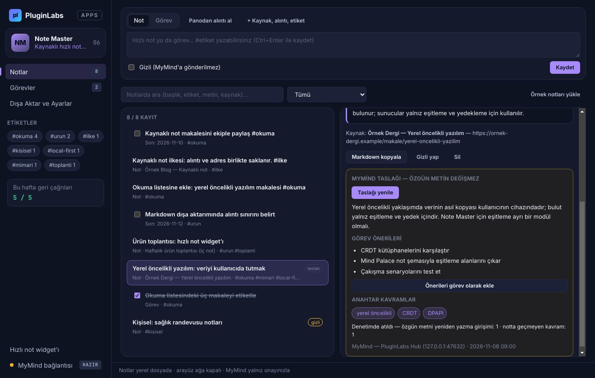

# PL-006 · Note Master

> Hızlı notları ve görevleri kaynak bağlantılarıyla kaydeder, etiketler ve düzenler.

| Alan | Değer |
| --- | --- |
| Kimlik | `PL-006` · `note-master` |
| Kategori | 01 · Mevcut ürünler ve fikirler — PL-001–010 |
| Durum | 08.11.2026: **0.1.0 Windows uygulaması hazır** — kaynak [app/](app/README.md) (9 birim testi + gerçek Electron duman testi + ekran görüntüleri); dağıtım iş akışı [`app/ci/`](app/ci/pluginlabs-dagitim-note-master-windows.yml) · Notion durumu: Mevcut fikir · Proje ve Fikirler notu |
| Öncelik / efor | P1 · S |
| Hedef platformlar | Windows, Linux, macOS, Chrome |
| Dağıtım biçimi | masaüstü uygulaması, Chrome eklentisi (Manifest V3), widget |
| Geliştirme deposu | [timdesigners-pixel/note-master](https://github.com/timdesigners-pixel/note-master) (henüz kod yok) — kaynak bu klasörün [`app/`](app/README.md) alt klasöründe (ön geliştirme alanı; bkz. [repo hiyerarşisi](../../../docs/REPO-HIYERARSISI.md)); Windows derlemesi ve sürüm dosyaları `pluginlabs-dagitim` deposunda `note-master-v<sürüm>` etiketiyle |
| Codex projesi | `PL-006 · Note Master` — ikinci klasör: PluginLabs |
| Notion kaynağı | [Notion](https://app.notion.com/p/4038aa13d8f981edbfa2cdc55d867114) |

## Ne işe yarar

**Kullanıcı ve problem:** Okuma sırasında fikir ve yapılacakları kaybetmeden not almak isteyen kişiler.

**Kısa tanım (Hub kataloğu):** Hızlı notları ve görevleri kaynak bağlantılarıyla kaydeder, etiketler ve düzenler.

## Hangi platformlar için yayınlanır

**Notion’daki platform tanımı:** Chrome + W / L / M hızlı not widget’ı

- Windows
- Linux
- macOS
- Chrome

> Platformlar hedef kapsamdır. PluginLabs ürün ilkesi gereği test edilmemiş platform “destekleniyor” diye etiketlenmez; her platform gerçek cihaz/tarayıcı kabulünden sonra yayın listesine girer.

## Özellikler

### MVP ve temel akış

Seçili metinden kaynaklı not, hızlı görev, etiket ve Markdown dışa aktarma. Mind Palace ile aynı not şemasını kullanır.

### Yapay zekânın rolü

Uzun notu görev/özet/anahtar kavram taslağına çevirir; özgün metni saklar.

## Teknik bağımlılık ve sınırlar

Kaynak URL ve alıntı sınırı tutulur; gizli sayfa içeriği varsayılan buluta gönderilmez.

## Gelir hipotezi

Ücretsiz not alma; Pro arama ve bağlam önerileri, paket içinde konumlandırma.

## Doğrulama ölçütü

İlk notun 60 sn içinde alınması; haftada ≥5 geri çağrılan not.

## Öncelik ve efor

P1 · S; Mind Palace modülü ve bağımsız eklenti aynı çekirdek.

## 0.1.0 sürümü (Windows)

Notion MVP akışı: **seçili metinden kaynaklı not, hızlı görev, etiket ve Markdown dışa aktarma.** Seçilen metin panodan alıntı olarak alınır; alıntı kaynak adresi ya da kaynak adı olmadan kaydedilmez. `#etiket` otomatik eklenir; görevlerde son tarih ve tamamlandı durumu; Türkçe karakter duyarlı arama ve etiket süzgeci; her zaman üstte hızlı not widget'ı (`Ctrl+Shift+Space`). Markdown (gizliler hariç seçeneğiyle) ve `pluginlabs-note/1` JSON yedek/içe aktarma.

Yapay zekânın rolü (Notion): **uzun notu görev/özet/anahtar kavram taslağına çevirir; özgün metni saklar.** Taslak notun ayrı bir alanına yazılır, gövde değişmez; modelin metni yeniden yazma girişimleri ve notta geçmeyen kavramlar denetimde atılır; görev önerileri ana notun kaynağını devralan ayrı görevlere çevrilebilir. MyMind (Hub) ya da loopback yerel model isteğe bağlıdır ve her istek onaylıdır.

Teknik sınır ve doğrulama ölçütü (Notion): **kaynak URL ve alıntı sınırı tutulur; gizli sayfa içeriği varsayılan buluta gönderilmez. İlk notun 60 sn içinde alınması; haftada ≥5 geri çağrılan not.** Kaynak adresinden izleme parametreleri atılır; alıntı varsayılan 600 karakterle sınırlanır (120–2000). Gizli işaretli notlar varsayılan olarak modele gönderilmez; izinle gönderilirse e-posta/telefon/IBAN/TCKN maskelenir ve kaynağın yalnız alan adı gider. İlk not süresi ve haftalık geri çağrılan not sayısı uygulamada yerel olarak ölçülür.

Sınır: “Mind Palace ile aynı not şeması” hedefi bu sürümde doğrulanmadı; JSON şeması (`pluginlabs-note/1`) Note Master'a özgüdür. Chrome eklentisi ve Linux/macOS paketleri sonraki faz.

Ayrıntı: [app/README.md](app/README.md).

## Geliştirme ve ortak çalışma (Codex + Claude Code)

- Dal adı: `codex/PL-006-<konu>` veya `claude/PL-006-<konu>`; iki ajan aynı dalda aynı anda çalışmaz.
- İşe başlamadan önce [AKTIF-ISLER.md](../../../docs/ortak-calisma/AKTIF-ISLER.md) tablosuna satır eklenir; iş bitince devir notu yazılır.
- Kurallar: [AGENTS.md](../../../AGENTS.md) (her iki ajan için ortak), protokol: [AI-ORTAK-CALISMA.md](../../../docs/ortak-calisma/AI-ORTAK-CALISMA.md).

## Notion kartının özgün metni

Aşağıdaki metin `resources/notion-catalog.json` (Notion anlık görüntüsü, 2026-10-26) içindeki kartın kısaltılmadan aktarılmış hâlidir.

Tam kartı göster

- **Durum:** Mevcut fikir · Proje ve Fikirler notu
- **Platform:** Chrome + W / L / M hızlı not widget’ı
- **Kullanıcı ve problem:** Okuma sırasında fikir ve yapılacakları kaybetmeden not almak isteyen kişiler.
- **MVP ve temel akış:** Seçili metinden kaynaklı not, hızlı görev, etiket ve Markdown dışa aktarma. Mind Palace ile aynı not şemasını kullanır.
- **Yapay zekânın rolü:** Uzun notu görev/özet/anahtar kavram taslağına çevirir; özgün metni saklar.
- **Teknik bağımlılık ve sınır:** Kaynak URL ve alıntı sınırı tutulur; gizli sayfa içeriği varsayılan buluta gönderilmez.
- **Gelir hipotezi:** Ücretsiz not alma; Pro arama ve bağlam önerileri, paket içinde konumlandırma.
- **Doğrulama ölçütü:** İlk notun 60 sn içinde alınması; haftada ≥5 geri çağrılan not.
- **Öncelik ve efor:** P1 · S; Mind Palace modülü ve bağımsız eklenti aynı çekirdek.

---
Oluşturma: 29.10.2026 · Kaynak → hedef: Notion kataloğu → `registry/projects.json` → bu dosya
