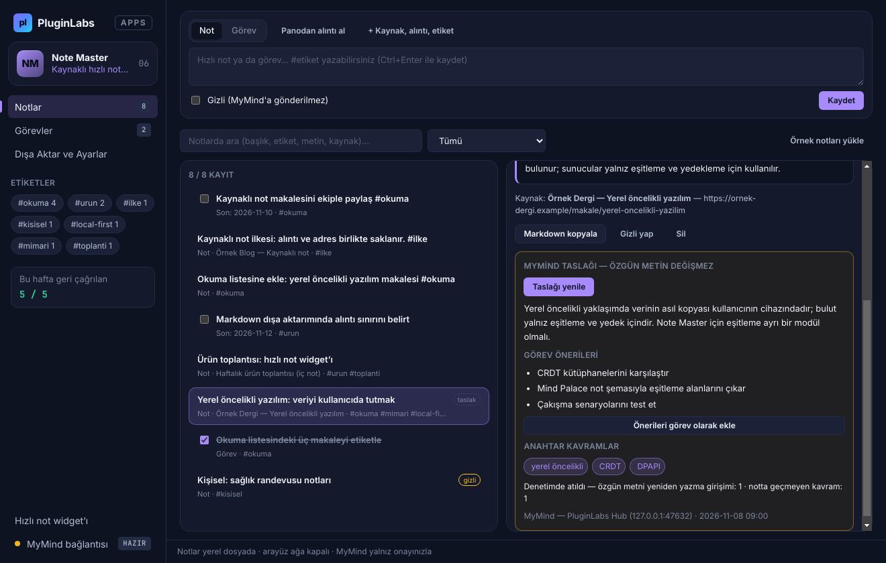
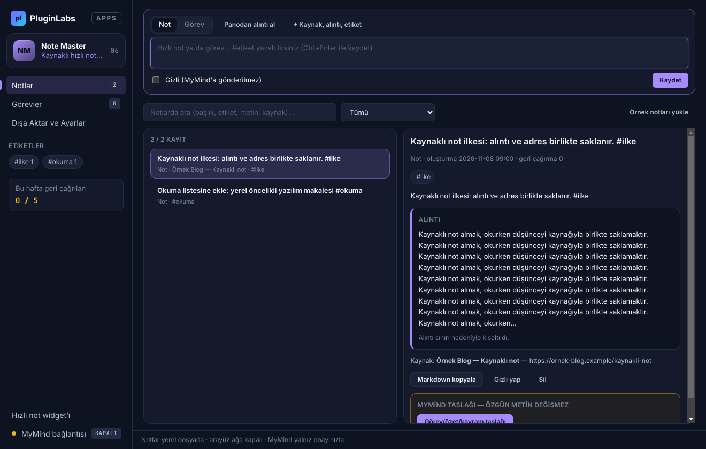
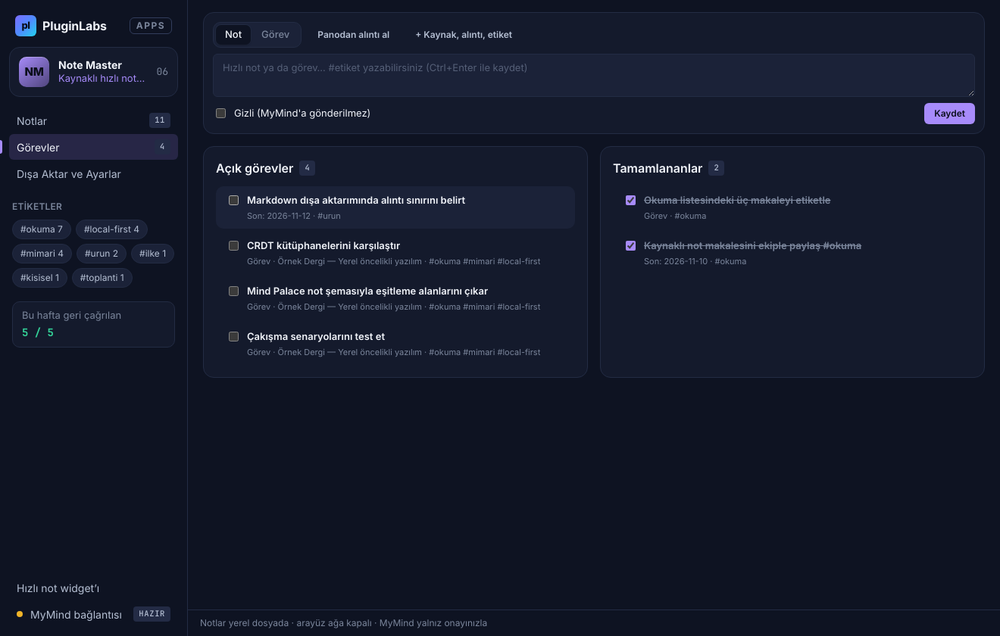
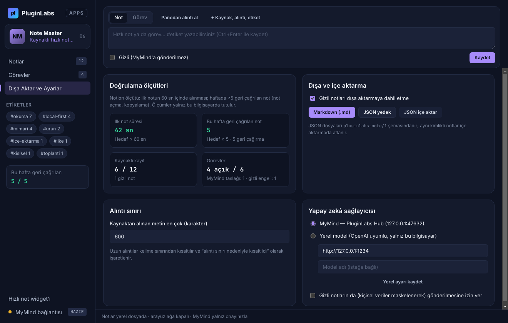
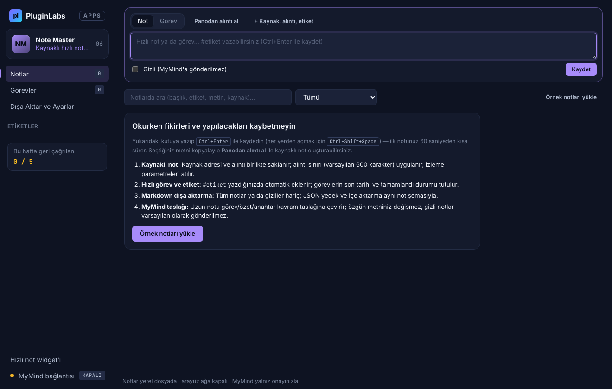
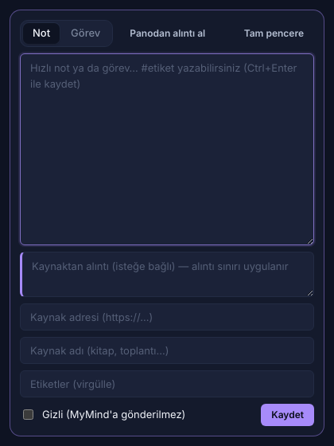

# Note Master (PL-006) — Windows uygulaması

Okurken fikirleri ve yapılacakları kaybetmeden **kaynaklı hızlı not** ve **hızlı görev** alın; notları **etiketleyin**, **arayın** ve **Markdown** olarak dışa aktarın. Kaynak adresi ve **alıntı sınırı** tutulur; **gizli notlar varsayılan olarak MyMind'a gönderilmez**. MyMind uzun notu görev/özet/anahtar kavram taslağına çevirir, **özgün metni değiştirmez**.

> Ürün deposu ([timdesigners-pixel/note-master](https://github.com/timdesigners-pixel/note-master)) henüz kod içermiyor; kaynak bu klasördedir (PluginLabs ürün ön geliştirme alanı). Windows paketleri `pluginlabs-dagitim` deposunda `note-master-v<sürüm>` etiketiyle yayımlanır.



| Kaynaklı not ve alıntı sınırı | Görevler |
| --- | --- |
|  |  |
| **Doğrulama ölçütleri, dışa/içe aktarma ve ayarlar** | **Başlangıç (60 sn içinde ilk not)** |
|  |  |



> Ekran görüntüleri gerçek Electron penceresinden, `tests/desktop-smoke.cjs` ile Linux/Xvfb üzerinde alınmıştır (kurgusal örnek veri). Windows derlemesinin kendi ekranları sürüm dosyalarında `windows-masaustu-*.png` adıyla yer alır.

## Kullanım
1. **Hızlı not:** Üstteki kutuya yazın, `Ctrl+Enter` ile kaydedin. `#etiket` yazdığınız etiketler otomatik eklenir. Görev için **Görev** sekmesini seçin; son tarih **+ Kaynak, alıntı, etiket** altındadır.
2. **Kaynaklı not:** Okuduğunuz metni seçip kopyalayın (`Ctrl+C`), **Panodan alıntı al**'a basın; ardından sayfa adresini kopyalayıp tekrar basın (adres kaynak olarak eklenir) ya da kaynak adını yazın. Alıntı sınırı aşılırsa kelime sınırından kısaltılır ve işaretlenir.
3. **Bul ve geri çağır:** Arama başlık, etiket, metin ve kaynakta Türkçe karakter duyarlı çalışır; soldaki etiketlerle süzün. Bir notu açmak ya da Markdown olarak kopyalamak *geri çağırma* sayılır (aynı not 10 dk içinde bir kez).
4. **MyMind taslağı:** Uzun bir notta **Görev/özet/kavram taslağı**'na basın; gönderilecekler onay penceresinde listelenir. Önerilen görevleri **Önerileri görev olarak ekle** ile kaynaklı görevlere çevirin.
5. **Dışa aktarma:** *Dışa Aktar ve Ayarlar* bölümünden Markdown ya da JSON yedek (isterseniz gizliler hariç); JSON içe aktarma.
6. **Widget:** Kenar çubuğundaki **Hızlı not widget'ı** ya da her yerden `Ctrl+Shift+Space`.

## Güvenlik ve gizlilik
- Arayüz CSP ile ağa kapalıdır (`connect-src 'none'`); metin yalnız `textContent`/`value` ile yazılır; `contextIsolation` + `sandbox`; gezinme ve yeni pencere engelli.
- Notlar ve MyMind istemci anahtarı Windows kasasında (DPAPI) şifreli saklanır.
- Pano yalnız düğmeye bastığınızda okunur. Model bağlantısı yalnız bu bilgisayardır (Hub 127.0.0.1:47632 ya da loopback yerel model).
- Gizli notlar varsayılan olarak modele gönderilmez; izin verilirse kişisel veriler maskelenir; kaynağın yalnız alan adı gönderilir.

## Geliştirme
```bash
npm ci
npm test                                   # çekirdek birim testleri (node --test)
node tests/desktop-smoke.cjs docs/screenshots   # gerçek Electron duman testi (Linux'ta xvfb-run -a)
npm run build:win
node scripts/make-icons.cjs
```
