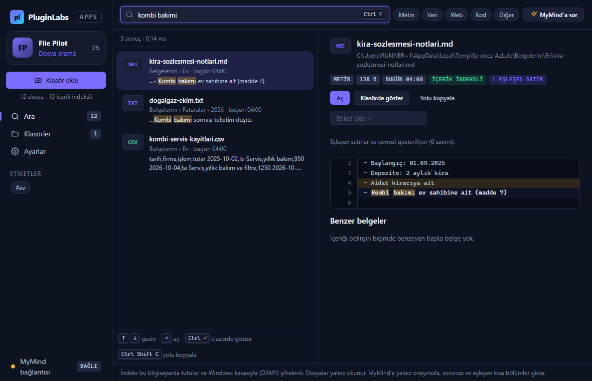
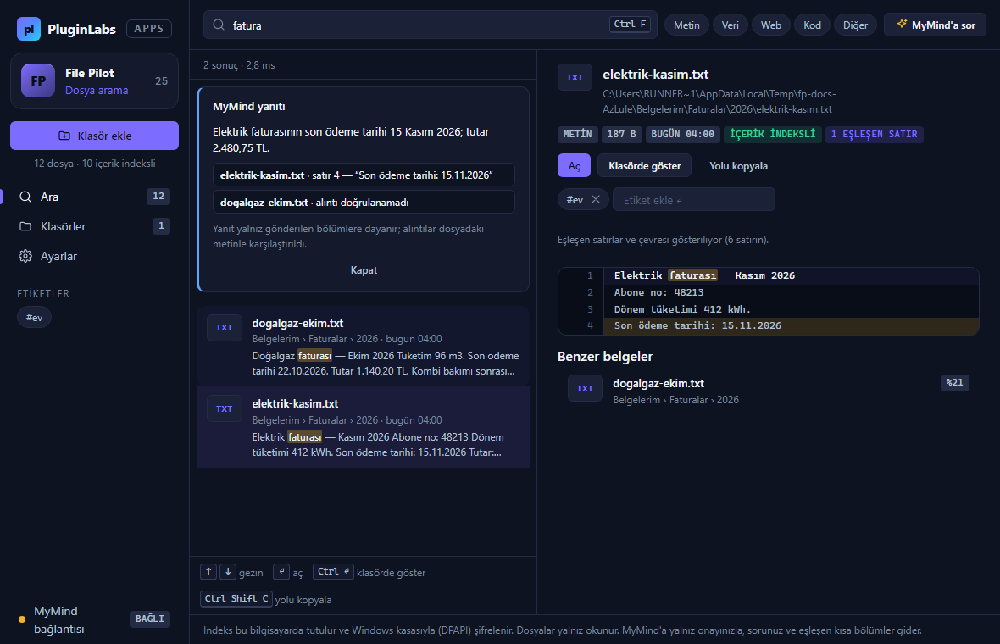
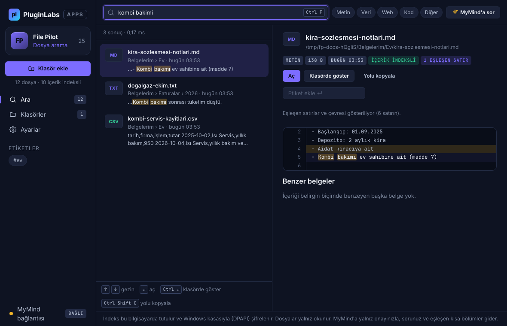
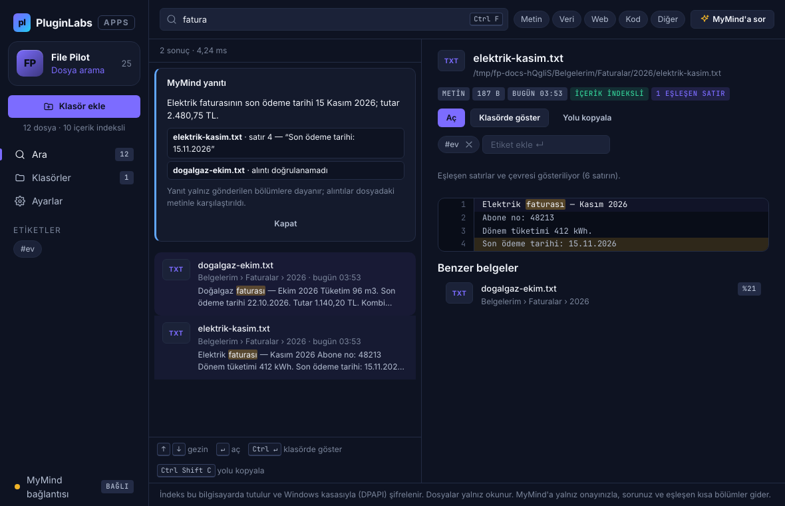
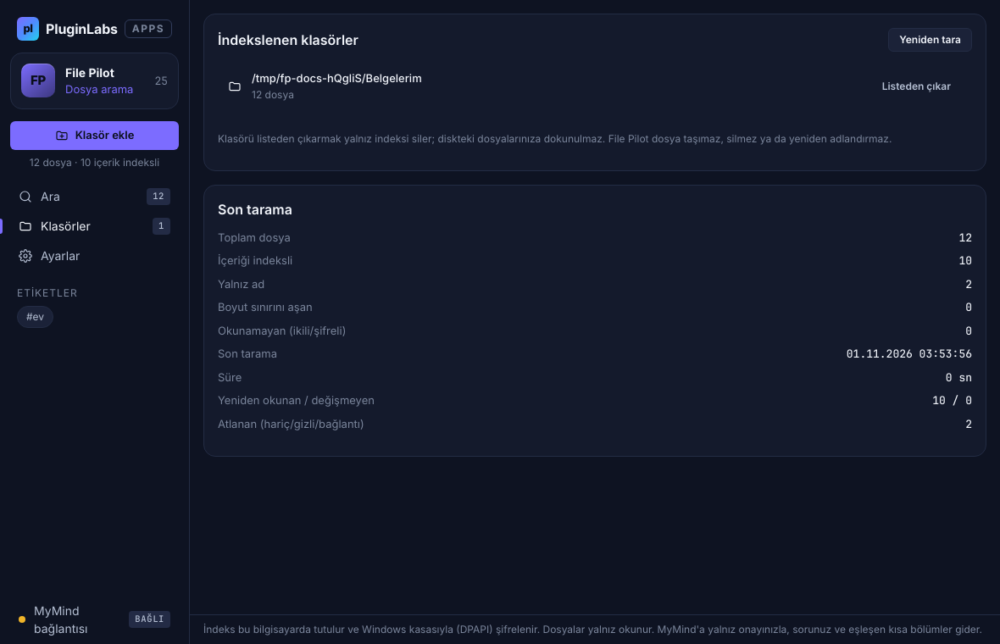
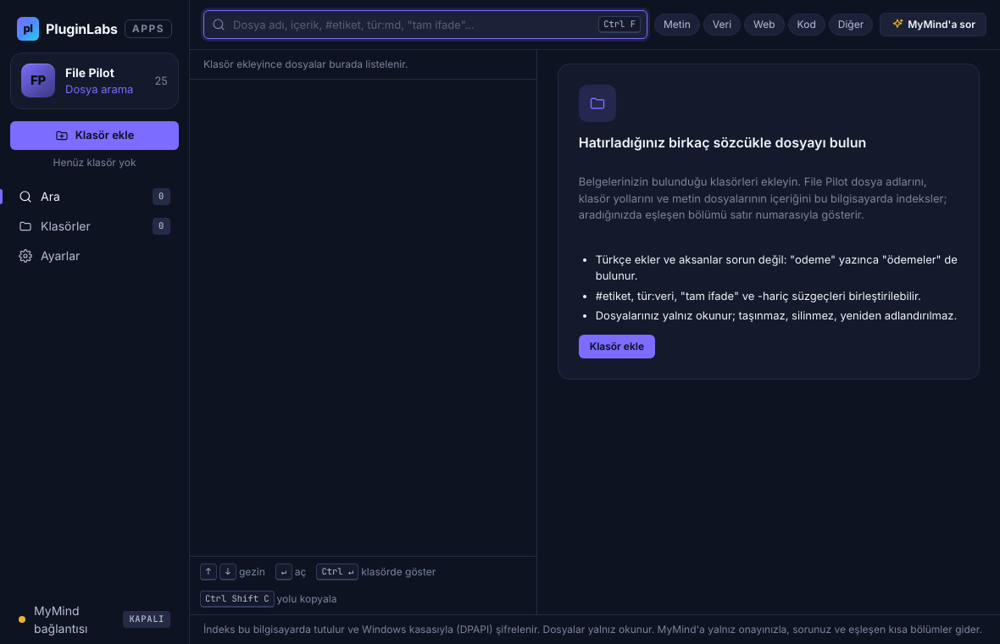

# File Pilot (PL-025) — Windows uygulaması

> Klasör adını hatırlayıp dosya adını hatırlamayanlar için: seçtiğiniz klasörleri bu bilgisayarda indeksler; ad, içerik ve etiketle arar, eşleşen bölümü satır numarasıyla gösterir.

Ürün kartı (Notion kaynağı, kısaltılmamış): [../README.md](../README.md) · Sürüm notları: [RELEASE-NOTES.md](RELEASE-NOTES.md)

**İndir (Windows, imzasız önizleme):** https://github.com/timdesigners-pixel/pluginlabs-dagitim/releases/tag/file-pilot-v0.1.0 — kurulum `.exe` ya da taşınabilir `.exe`; `SHA256SUMS-windows.txt` ile doğrulayın. PluginLabs Hub kataloğundan da kurulabilir.

## Ekran görüntüleri

**Windows** (release'i üreten Windows runner'ında, paketlemeden önceki duman testinde alındı; kaynak commit `1d9b500`, test verisi):

| Arama | MyMind yanıtı (kaynağa ve satıra bağlı) |
| --- | --- |
|  |  |

**Linux xvfb** (geliştirme ortamı, aynı duman testi):

Gerçek uygulama penceresi; otomatik duman testinin geçici örnek klasörüyle (test verisi) alınmıştır. Windows görüntülerinin tamamı release'te `windows-masaustu-*.png` adıyla bulunur.

| Arama ve eşleşen bölüm | MyMind yanıtı (kaynağa bağlı) |
| --- | --- |
|  |  |
| **Klasörler ve son tarama** | **İlk açılış** |
|  |  |

## Ne yapar
- **Klasör ekle → indeks:** dosya adları, klasör yolları ve metin dosyalarının içeriği (txt, md, csv, tsv, json, log, html, xml, yaml, ini, rtf, srt, js/ts/py… ) okunur. Varsayılan hariç tutulanlar: `node_modules`, `.git`, `$RECYCLE.BIN`, `AppData`, `*.tmp`, `~$*`; gizli dosyalar atlanır; sembolik bağlantılar izlenmez. Boyut sınırı (varsayılan 2 MB) üstündeki ve PDF/Office dosyaları adıyla bulunur.
- **Arama:** BM25 sıralaması + ad/klasör eşleşmesi; Türkçe duyarsız (ı/i, ş/s, ç/c, ğ/g, ö/o, ü/u) ve önek eşleşmesi ("fatura" → "faturaları"). Süzgeçler: `#etiket`, `tür:veri`, `uzantı:md`, `"tam ifade"`, `-hariç`.
- **Önizleme:** eşleşen satırlar ve çevresi, satır numaralı, işaretli. **Aç**, **Klasörde göster**, **Yolu kopyala** (`↵`, `Ctrl+↵`, `Ctrl+Shift+C`).
- **Etiket** (yalnız indekste; dosyaya yazılmaz) ve **benzer belgeler** (TF-IDF kosinüs).
- **MyMind'a sor:** soru + yerel aramanın bulduğu ≤8 dosyanın adı ve ≤360 karakterlik bölümü, onayınızla yerel Hub'a (127.0.0.1:47632, `mymind.chat` izinli istemci anahtarı) gider. Yanıt JSON olarak doğrulanır; yalnız gönderilen adaylar kabul edilir, alıntı dosya metninde yoksa "doğrulanamadı" yazılır.

## Güvenlik ve gizlilik
- Dosyalar **yalnız okunur**; taşıma/silme/yeniden adlandırma için kod yolu yoktur. Klasörü listeden çıkarmak yalnız indeksi siler.
- İndeks (dosya metinlerinden parçalar içerir) `%APPDATA%\File Pilot\indeks.bin` içinde Windows kasasıyla (DPAPI, `safeStorage`) şifrelidir; kasa yoksa düz JSON olur ve Ayarlar'da belirtilir. MyMind anahtarı da kasada tutulur.
- Arayüz: `contextIsolation`, `sandbox`, sıkı CSP (`connect-src 'none'`), gezinme ve yeni pencere engelli; IPC yalnız kendi penceresinden kabul edilir; arayüz dosyaları kimlikle anar.
- Ağ yalnız `desktop/net.js` içinde, onaylı MyMind isteği için ve yalnız yerel Hub adresine.

## Doğrulama ölçütü (Notion)
"1000 belgede bilinen dosyayı ilk 5 sonuçta bulma ≥ %90; p95 sorgu ≤ 1 sn" — `src/bench.js` belirleyici sentetik derlemle ölçer (`npm run bench`; paketlenmiş uygulamada `FP_SELFTEST=<çıktı.json>` ile). Sorgular, belgenin en belirgin iki kök sözcüğünü üç biçimde kullanır: belgedeki ekli biçim, eksiz kök, aksansız yazım + kişi/şehir. Linux ölçümü: ilk 5 %98,7–99,7, p95 6–8 ms; Windows'ta paketlenmiş uygulama (release `BENCH-windows.json`): ilk 5 %99, p95 5,37 ms. Sınır: yalnız genel konu sözcükleri hatırlandığında isabet düşer (tekdüze derlemde %66) — gerçek klasörlerde kullanıcı kabulüyle ayrıca ölçülmelidir.

## Geliştirme
```bash
npm ci
npm test                       # çekirdek + tarayıcı + kıyaslama
npm run bench                  # kıyaslama çıktısı
xvfb-run -a -s "-screen 0 1440x900x24" node tests/desktop-smoke.cjs docs/screenshots   # Linux duman testi (playwright gerekir)
npm run build:win              # Windows paketi (Windows'ta)
```
Windows derlemesi ve yayını `pluginlabs-dagitim` deposundaki `File Pilot Windows sürümü` iş akışıyla yapılır: bu klasörü belirli bir PluginLabs commit'inden alır, Windows runner'ında test + duman testi + paketlenmiş öz test koşar, kurulum ve taşınabilir exe üretir, SHA256 ve BUILD-INFO ile `file-pilot-v<sürüm>` etiketinde yayımlar.

Kaynak, PluginLabs deposundaki ürün ön geliştirme alanındadır (`apps/03-…/PL-025-file-pilot/app`); ürün deposu (`file-pilot`) açıldığında buradan taşınır.
