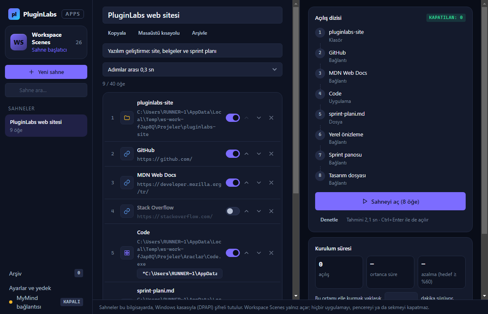
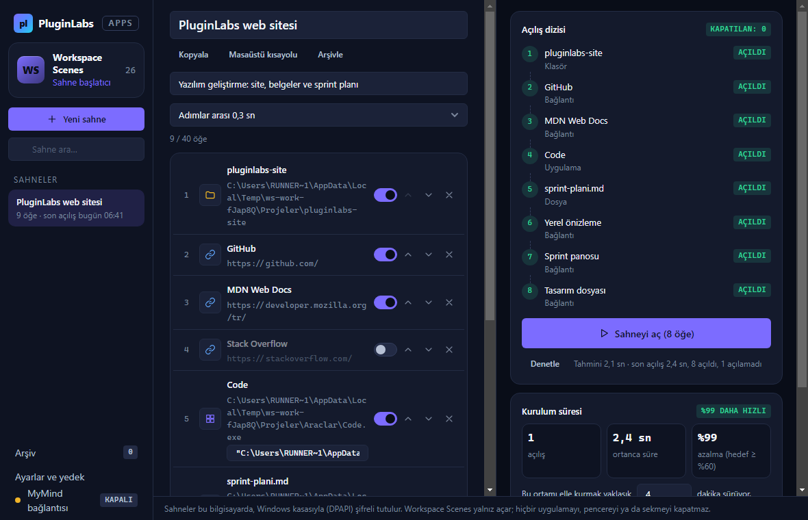
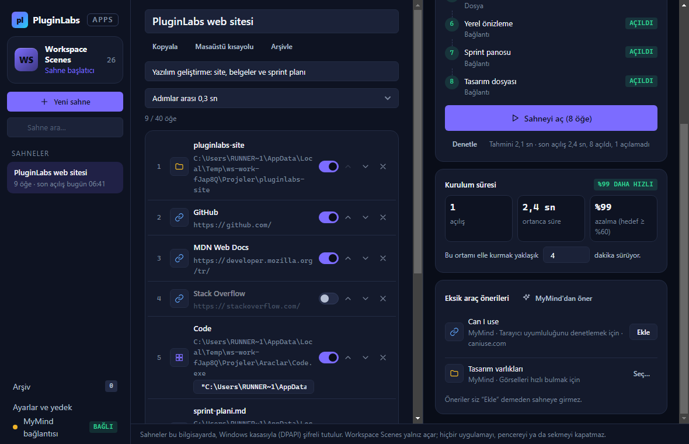
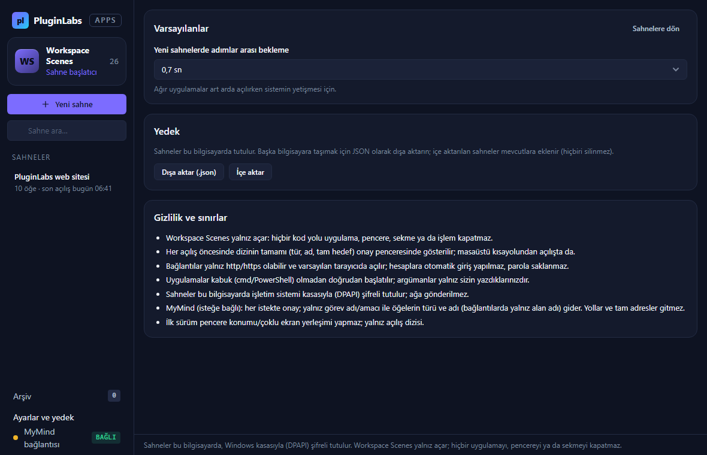
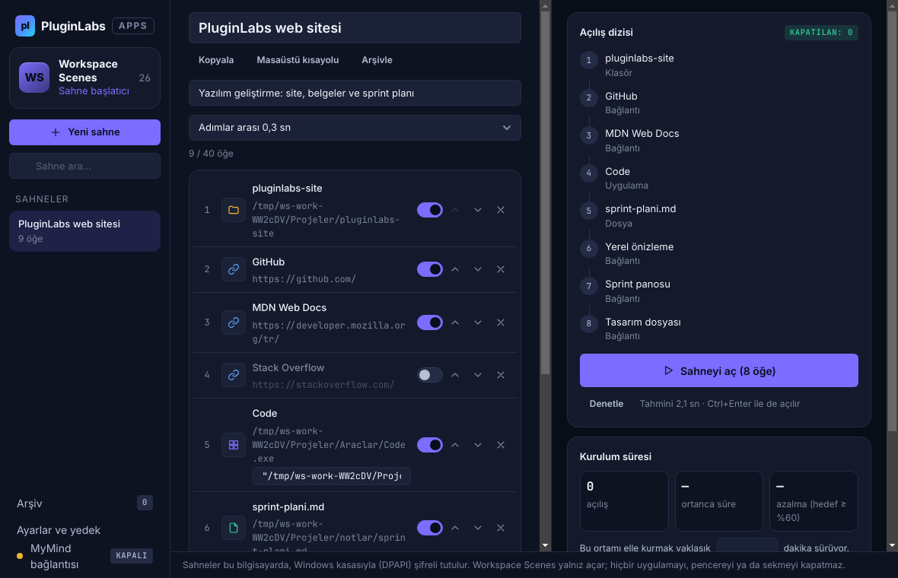
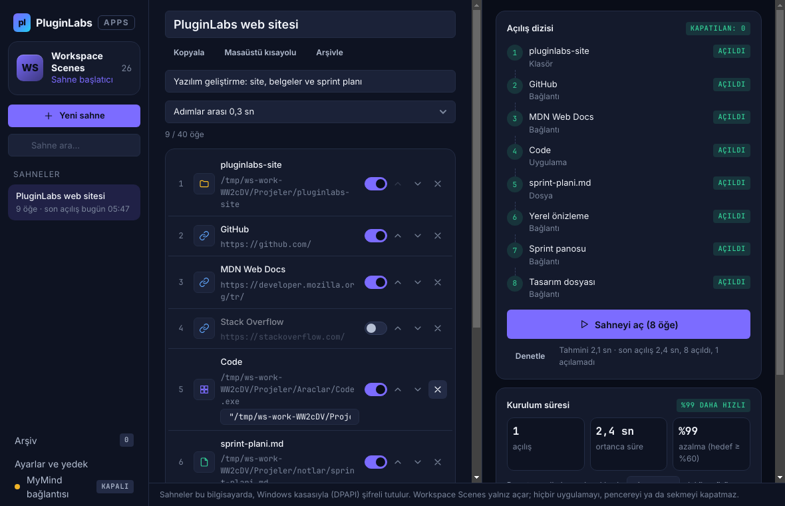
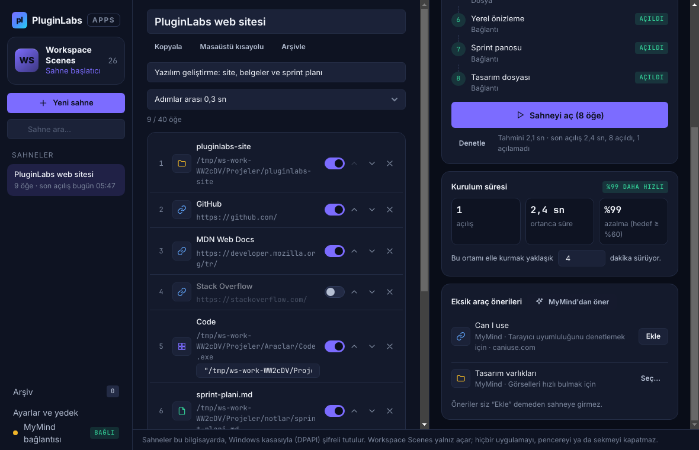
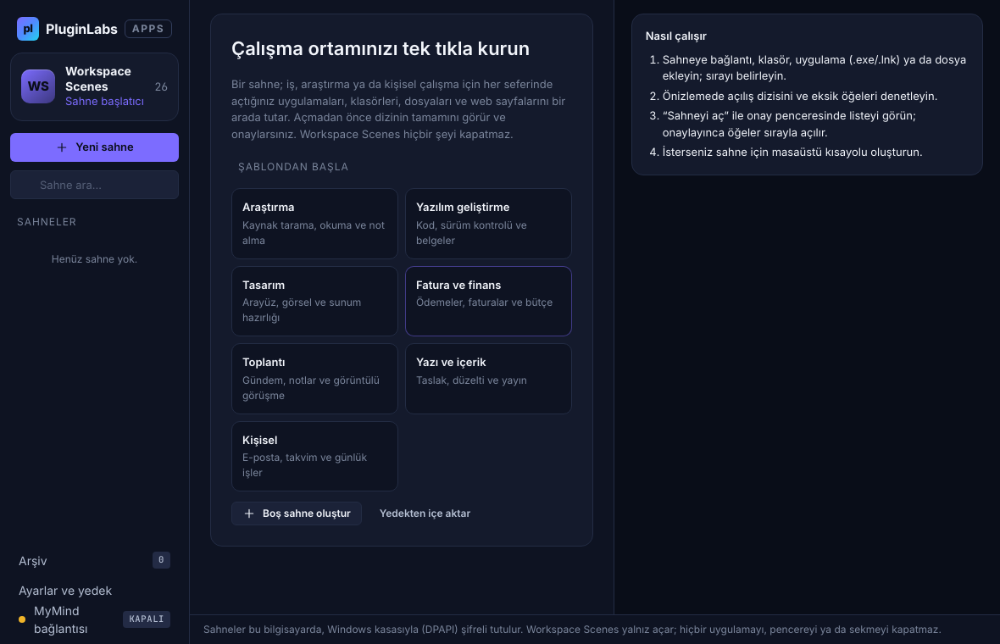

# Workspace Scenes (PL-026) — Windows uygulaması

> İş, araştırma ve kişisel çalışma arasında aynı araçları tekrar tekrar açanlar için: uygulamaları, klasörleri, dosyaları ve web sayfalarını kayıtlı **sahneler** hâlinde tutar; açılış dizisini önizletip onayınızla sırayla açar. Hiçbir şeyi kapatmaz.

Ürün kartı (Notion kaynağı, kısaltılmamış): [../README.md](../README.md) · Sürüm notları: [RELEASE-NOTES.md](RELEASE-NOTES.md)

**İndir (Windows, imzasız önizleme):** https://github.com/timdesigners-pixel/pluginlabs-dagitim/releases/tag/workspace-scenes-v0.1.0 — kurulum `WorkspaceScenes-0.1.0-Windows-x64.exe` ya da taşınabilir `WorkspaceScenes-0.1.0-Windows-Portable-x64.exe`; `SHA256SUMS-windows.txt` ile doğrulayın. 01.11.2026 06:42 UTC'de `pluginlabs-dagitim` iş akışıyla ([ci/](ci/pluginlabs-dagitim-workspace-scenes-windows.yml)) Windows runner'ında derlendi: `npm test` + gerçek Electron penceresinde duman testi geçti; kaynak commit `2154463`. Hub kataloğunda (Hub 0.4.9).

## Ekran görüntüleri

**Windows (release'i üreten Windows runner'ı, 01.11.2026, kaynak `2154463`, test verisi):**

| Sahne düzenleyici ve açılış dizisi | Açılış sonucu ve kurulum süresi |
| --- | --- |
|  |  |
| **Eksik araç önerileri (kural + MyMind)** | **Ayarlar ve yedek** |
|  |  |

**Linux xvfb (aynı kaynak):**

Gerçek uygulama penceresi; otomatik duman testinin geçici örnek çalışma alanıyla (test verisi) **Linux xvfb** üzerinde alınmıştır (kaynak bu klasör, 01.11.2026). Release'i üreten Windows runner'ında alınan aynı ekranlar release'te `windows-masaustu-*.png` adıyla bulunur.

| Sahne düzenleyici ve açılış dizisi | Açılış sonucu ve kurulum süresi |
| --- | --- |
|  |  |
| **Eksik araç önerileri (kural + MyMind)** | **İlk açılış: şablonlar** |
|  |  |

## Ne yapar
- **Sahne:** ad, amaç ve sıralı öğeler — **bağlantı** (yalnız http/https, varsayılan tarayıcıda), **klasör** (Gezgin'de), **uygulama** (`.exe`, `.lnk`, `.appref-ms`, `.url`; isteğe bağlı başlatma argümanları), **dosya** (varsayılan uygulamasıyla). En fazla 40 öğe, 60 sahne.
- **Hızlı ekleme:** seçme pencereleri; tek bağlantı; **çoklu bağlantı yapıştırma** (her satıra bir adres, "Başlık - adres" ve Markdown `[ad](adres)` biçimleri; tarayıcıdaki sekme listesini toplu aktarmak için).
- **Düzenleme:** öğe adını değiştir, sırayı taşı, açılışa dahil et/çıkar, sahneden çıkar (Geri al), adımlar arası bekleme (0–3 sn), kopyala, arşivle (silinmez; Geri al).
- **Önizleme ve denetim:** açılış dizisi, tahmini süre; "Denetle" her yolun diskte olup olmadığını gösterir.
- **Aç:** "Sahneyi aç" ya da `Ctrl+Enter` → onay penceresinde dizinin tamamı (tür, ad, tam hedef) → onaylanınca sırayla açılır; her adımın sonucu (Açıldı / Açılamadı) işaretlenir.
- **Masaüstü kısayolu (Windows):** sahne için `.lnk`; kısayoldan açılışta da önce onay istenir.
- **Kurulum süresi:** her açılışın süresi kaydedilir; "elle kurmak … dakika" girilirse azalma yüzdesi (Notion doğrulama ölçütü: ≥ %60) gösterilir.
- **Şablonlar ve eksik araç önerisi:** Araştırma, Yazılım, Tasarım, Fatura/finans, Toplantı, Yazı, Kişisel. Sahne adı/amacına göre eksik bağlantı ve öğe türleri gerekçesiyle önerilir; siz "Ekle" demeden sahneye girmez.
- **MyMind (isteğe bağlı):** görev adına göre sahne/araç önerisi. Onay penceresi neyin gideceğini gösterir: görev adı/amacı + öğelerin türü ve adı (bağlantılarda yalnız alan adı). Yanıt doğrulanır: yalnız bilinen türler, bağlantılarda yalnız `https`, mevcut alan adları yinelenmez, en fazla 5 öneri.
- **Yedek:** JSON dışa/içe aktarma (içe aktarılan sahneler eklenir; mevcutlar silinmez).

## Güvenlik ve gizlilik
- **Hiçbir şey kapatılmaz:** kodda uygulama, pencere, sekme ya da işlem kapatan yol yoktur (Notion ölçütü "beklenmeyen uygulama kapatma sıfır"). Hesaplara otomatik giriş yapılmaz, parola saklanmaz.
- Her açılış onaylıdır; yalnız kullanıcının eklediği hedefler açılır. Bağlantılar yalnız `http/https`, giriş bilgisi içeren adresler reddedilir. Uygulamalar kabuk olmadan (`shell: false`) başlatılır.
- Sahneler `%APPDATA%\Workspace Scenes\sahneler.bin` içinde Windows kasasıyla (DPAPI, `safeStorage`) şifrelidir; kasa yoksa düz JSON olur ve Ayarlar'da belirtilir. MyMind anahtarı da kasada.
- Arayüz: `contextIsolation`, `sandbox`, sıkı CSP (`connect-src 'none'`), gezinme ve yeni pencere engelli; IPC yalnız kendi penceresinden kabul edilir.
- Ağ yalnız `desktop/net.js` içinde, onaylı MyMind isteği için ve yalnız yerel Hub adresine (127.0.0.1:47632, `mymind.chat` izinli istemci anahtarı).

## Sınırlar (0.1.0)
- Pencere konumu, boyutu ve çoklu ekran yerleşimi yok (Notion: ilk sürüm yalnız açılış dizisi; yerleşim ikinci faz).
- Chrome oturum eklentisi yok; tarayıcı sekmeleri bağlantı listesi olarak eklenir ve varsayılan tarayıcıda açılır.
- Linux/macOS paketi yok. Windows DPI, ekran okuyucu ve gerçek masaüstünde elle test yapılmadı; doğrulama ölçütleri (kurulum süresinde ≥ %60 azalma) gerçek kullanıcıyla ölçülmedi.

## Geliştirme
```bash
npm ci
npm test                       # çekirdek birim testleri
PLAYWRIGHT_MODULE=playwright xvfb-run -a -s "-screen 0 1440x900x24" node tests/desktop-smoke.cjs docs/screenshots   # Linux duman testi
npm run build:win              # Windows paketi (Windows'ta)
```
Windows derlemesi ve yayını `pluginlabs-dagitim` deposundaki `Workspace Scenes Windows sürümü` iş akışıyla yapılır: bu klasörü belirli bir PluginLabs commit'inden alır, Windows runner'ında test + duman testi koşar, kurulum ve taşınabilir exe üretir, SHA256 ve BUILD-INFO ile `workspace-scenes-v<sürüm>` etiketinde yayımlar.

Kaynak, PluginLabs deposundaki ürün ön geliştirme alanındadır (`apps/03-…/PL-026-workspace-scenes/app`); ürün deposu (`workspace-scenes`) açıldığında buradan taşınır.
