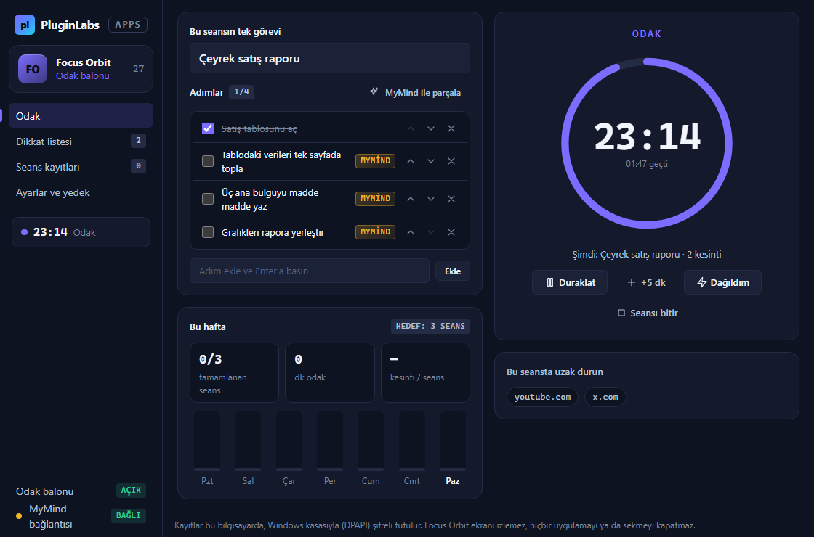
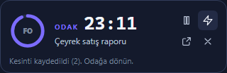
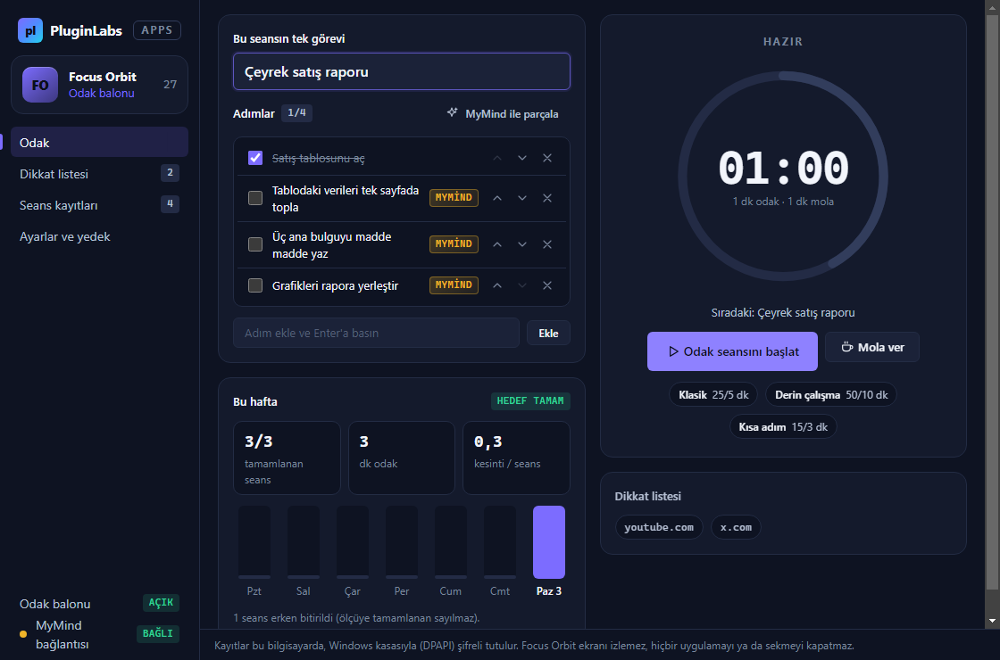
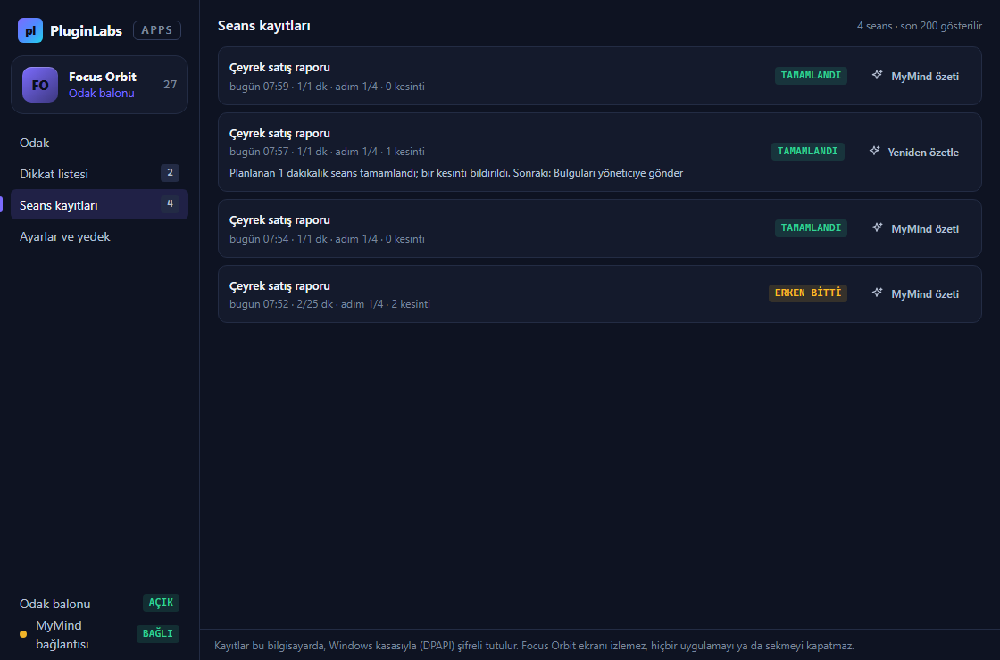
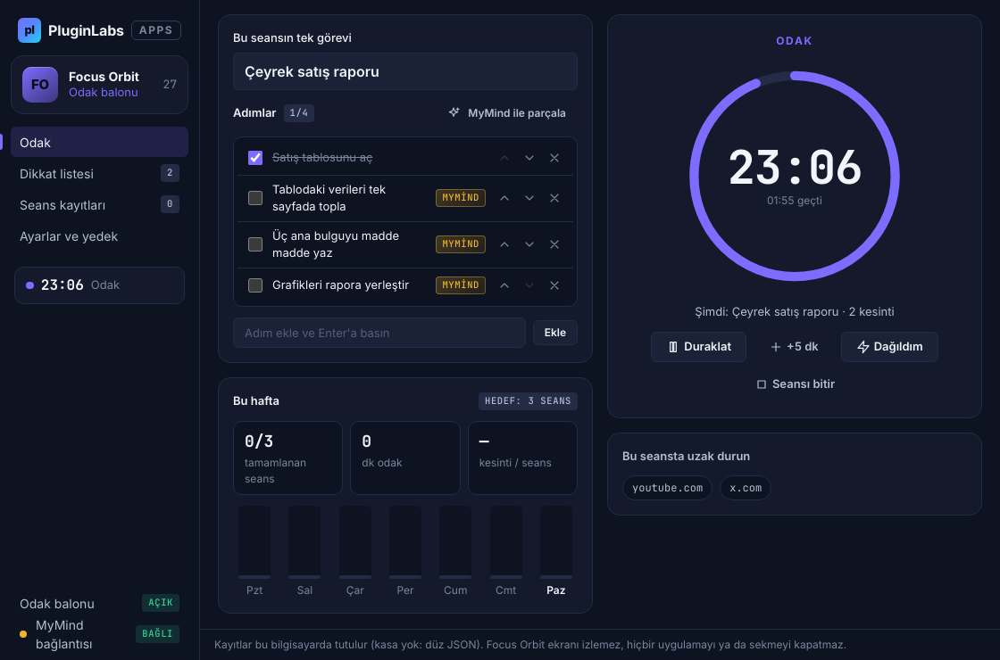
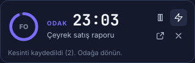
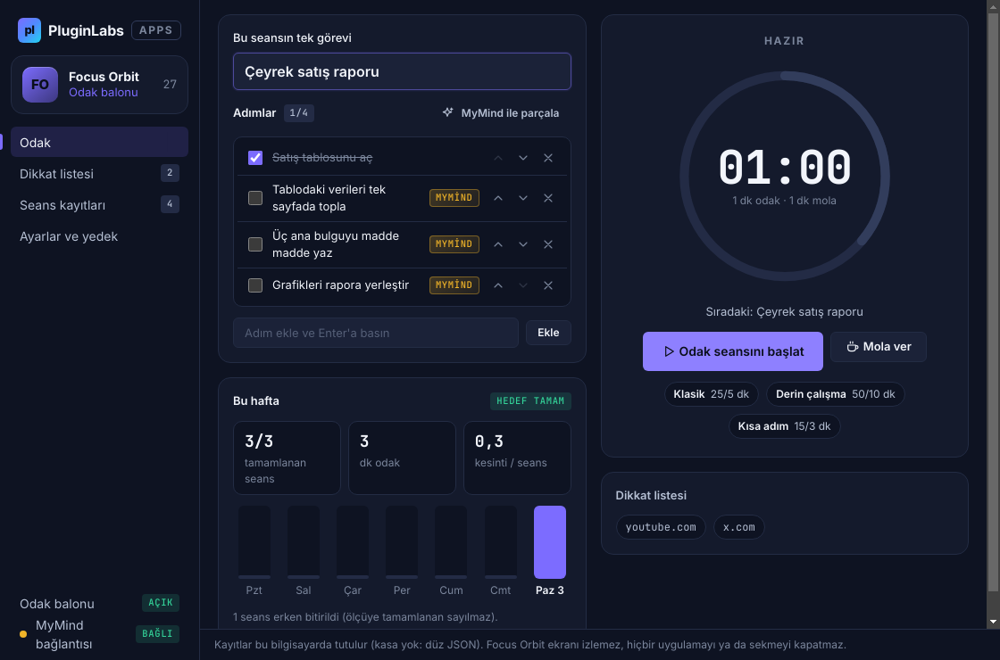
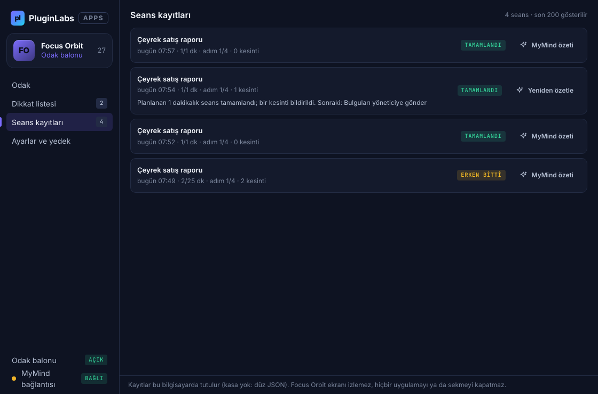
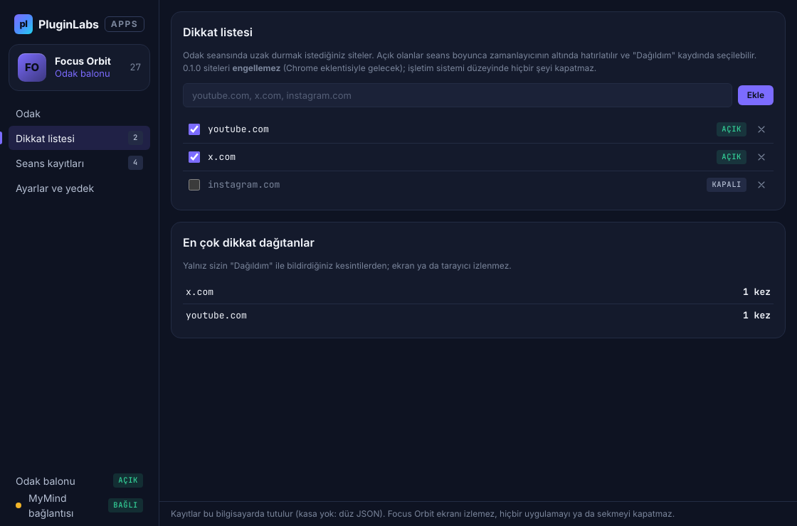

# Focus Orbit (PL-027) — Windows uygulaması

> Odak seansında görevi ve kalan süreyi görünür tutmak isteyenler için: tek görev, odak zamanlayıcısı, her zaman üstte sürüklenebilir **odak balonu**, mola hatırlatmaları ve isteğe bağlı dikkat listesi. Ekranı izlemez, hiçbir şeyi kapatmaz.

Ürün kartı (Notion kaynağı, kısaltılmamış): [../README.md](../README.md) · Sürüm notları: [RELEASE-NOTES.md](RELEASE-NOTES.md)

**İndir (Windows, imzasız önizleme):** https://github.com/timdesigners-pixel/pluginlabs-dagitim/releases/tag/focus-orbit-v0.1.0 — kurulum `FocusOrbit-0.1.0-Windows-x64.exe` ya da taşınabilir `FocusOrbit-0.1.0-Windows-Portable-x64.exe`; `SHA256SUMS-windows.txt` ile doğrulayın. 01.11.2026 07:51 UTC'de `pluginlabs-dagitim` iş akışıyla ([çalıştırma 41286344096](https://github.com/timdesigners-pixel/pluginlabs-dagitim/actions/runs/41286344096)) Windows runner'ında derlendi: `npm test` + gerçek Electron penceresinde duman testi geçti (Windows kasası/DPAPI etkin); kaynak commit `56b5eba`. Hub kataloğunda (Hub 0.4.9).

## Ekran görüntüleri

**Windows (release'i üreten Windows runner'ı, 01.11.2026, kaynak `56b5eba`, test verisi):**

| Odak seansı, adımlar (MyMind) ve dikkat listesi | Odak balonu (her zaman üstte, sürüklenir) |
| --- | --- |
|  |  |
| **Bu hafta: hedef, kesinti / seans** | **Seans kayıtları ve MyMind özeti** |
|  |  |

**Linux xvfb (aynı kaynak):**

Gerçek uygulama pencereleri; otomatik duman testinin test verisiyle (hızlandırılmış saat, taklit Hub) **Linux xvfb** üzerinde alınmıştır (01.11.2026, bu klasördeki kaynak). Release'i üreten Windows runner'ında alınan aynı ekranlar release'te `windows-masaustu-*.png` adıyla bulunur.

| Odak seansı, adımlar (MyMind) ve dikkat listesi | Odak balonu (her zaman üstte, sürüklenir) |
| --- | --- |
|  |  |
| **Bu hafta: hedef, kesinti / seans** | **Seans kayıtları ve MyMind özeti** |
|  |  |
| **Dikkat listesi ve en çok dikkat dağıtanlar** | |
|  | |

## Ne yapar
- **Tek görev:** seansın görevi ve en fazla 12 adım (işaretle, sırala, kaldır). Seans sürerken görev değiştirilemez.
- **Zamanlayıcı:** hazır süreler (25/5, 50/10, 15/3) ya da özel; her N odakta bir uzun mola; duraklat/sürdür, +5 dk, erken bitir. Tek yetkili ana süreçtir; süre zaman damgalarından hesaplanır.
- **Odak balonu:** çerçevesiz, her zaman üstte, sürüklenebilir; konumu hatırlanır, ekran dışına düşerse sağ üste döner. Duraklat/sürdür, "Dağıldım", ana pencere, gizle.
- **Mola hatırlatması:** odak ve mola bitişinde Windows bildirimi (kapatılabilir); mola isteğe bağlı kendiliğinden başlar.
- **Dikkat listesi:** alan adına indirgenir (yerel ağ/IP/giriş bilgili adresler reddedilir), açık/kapalı yapılabilir; açık olanlar seans boyunca hatırlatılır.
- **Dağıldım:** kullanıcının bildirdiği kesinti (isteğe bağlı site ve kısa not); seans sürer.
- **Ölçüler (Notion doğrulama ölçütü):** haftalık tamamlanan seans / hedef (≥3) ve kesinti / seans, geçen haftaya göre eğilim.
- **MyMind (isteğe bağlı):** görev parçalama (yalnız görev başlığı gider) ve seans sonu özeti (görev, süreler, kesinti sayısı, adımlar; kesinti siteleri ve notlar gitmez). Her istekte onay; yanıt doğrulanır, öneriler siz eklemedikçe/kaydetmedikçe yazılmaz.
- **Yedek:** JSON dışa/içe aktarma; içe aktarma aynı seansı iki kez eklemez, hiçbir şey silinmez.

## Güvenlik ve gizlilik
- Ekran, pencereler, tarayıcı ya da uygulamalar **izlenmez**; hiçbir uygulama, pencere ya da sekme **kapatılmaz**; site engelleme yoktur (0.1.0).
- Kayıtlar `%APPDATA%\Focus Orbit\odak.bin` içinde Windows kasasıyla (DPAPI, `safeStorage`) şifrelidir; kasa yoksa düz JSON olur ve arayüzde belirtilir. MyMind anahtarı da kasada; düz metin diske yazılmaz.
- Arayüz: `contextIsolation`, `sandbox`, sıkı CSP (`connect-src 'none'`, satır içi betik/stil yok), gezinme ve yeni pencere engelli; IPC yalnız ana pencere ve odak balonundan kabul edilir.
- Ağ yalnız `desktop/net.js` içinde, onaylı MyMind isteği için ve yalnız yerel Hub adresine (127.0.0.1:47632, `mymind.chat` izinli istemci anahtarı, yönlendirme reddedilir).

## Sınırlar (0.1.0)
- Chrome dikkat filtresi (site engelleme) yok — Notion platform tanımındaki Chrome eklentisi sonraki faz.
- Linux/macOS paketi yok. Windows DPI, ekran okuyucu ve gerçek masaüstünde elle test yapılmadı; doğrulama ölçütleri gerçek kullanıcıyla ölçülmedi.

## Geliştirme
```bash
npm ci
npm test                       # çekirdek birim testleri (11)
PLAYWRIGHT_MODULE=playwright xvfb-run -a -s "-screen 0 1440x900x24" node tests/desktop-smoke.cjs docs/screenshots   # Linux duman testi
npm run build:win              # Windows paketi (Windows'ta)
node scripts/make-icons.cjs    # simgeler (geliştirme aracı)
```
Windows derlemesi ve yayını `pluginlabs-dagitim` deposundaki `Focus Orbit Windows sürümü` iş akışıyla yapılır ([ci/](ci/pluginlabs-dagitim-focus-orbit-windows.yml)): bu klasörü belirli bir PluginLabs commit'inden alır, Windows runner'ında test + duman testi koşar, kurulum ve taşınabilir exe üretir, SHA256 ve BUILD-INFO ile `focus-orbit-v<sürüm>` etiketinde yayımlar.

Kaynak, PluginLabs deposundaki ürün ön geliştirme alanındadır (`apps/03-…/PL-027-focus-orbit/app`); ürün deposu (`focus-orbit`) açıldığında buradan taşınır.
