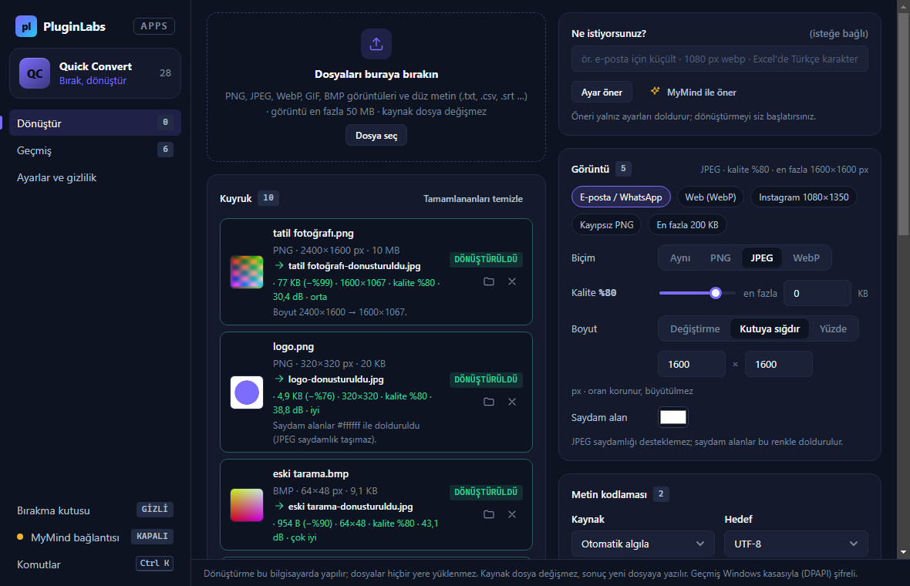
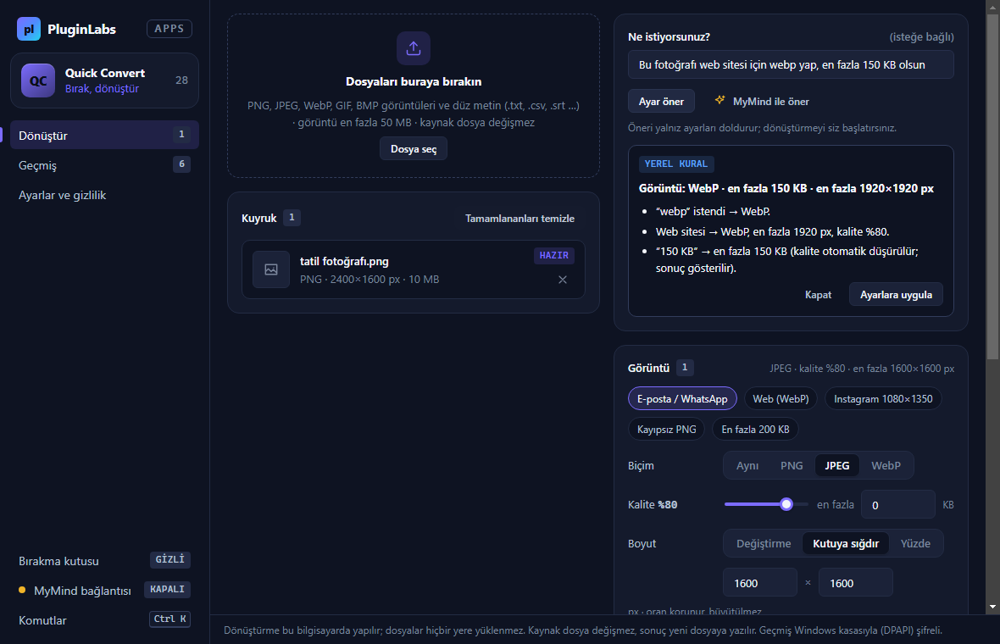
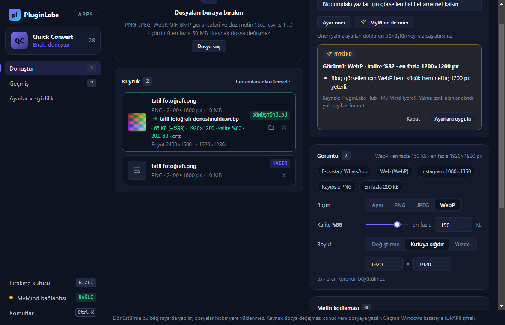
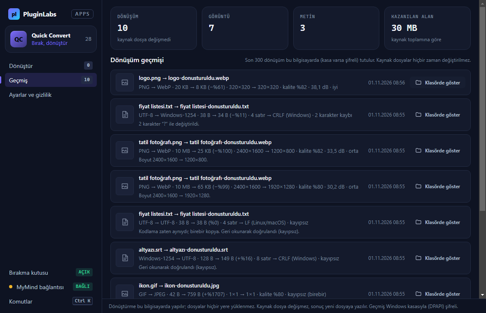
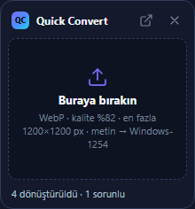
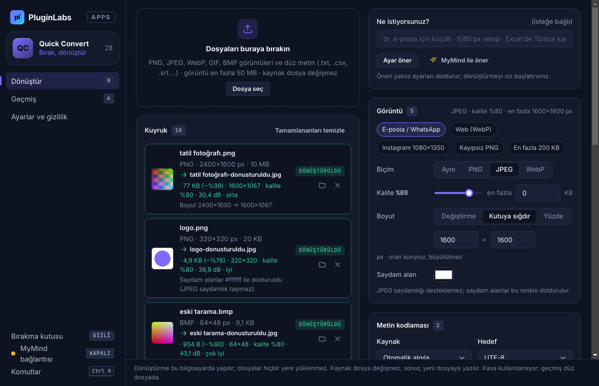
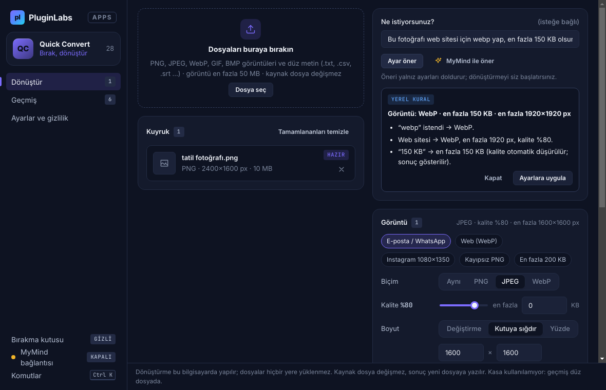
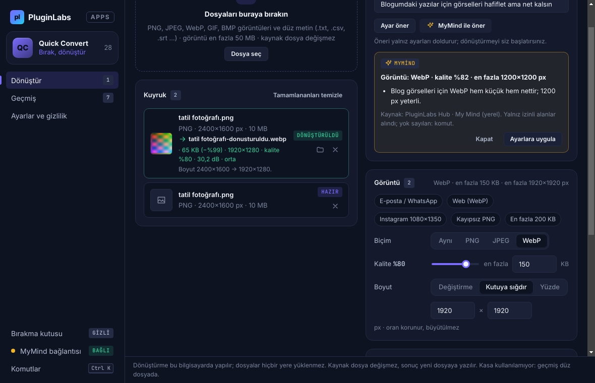
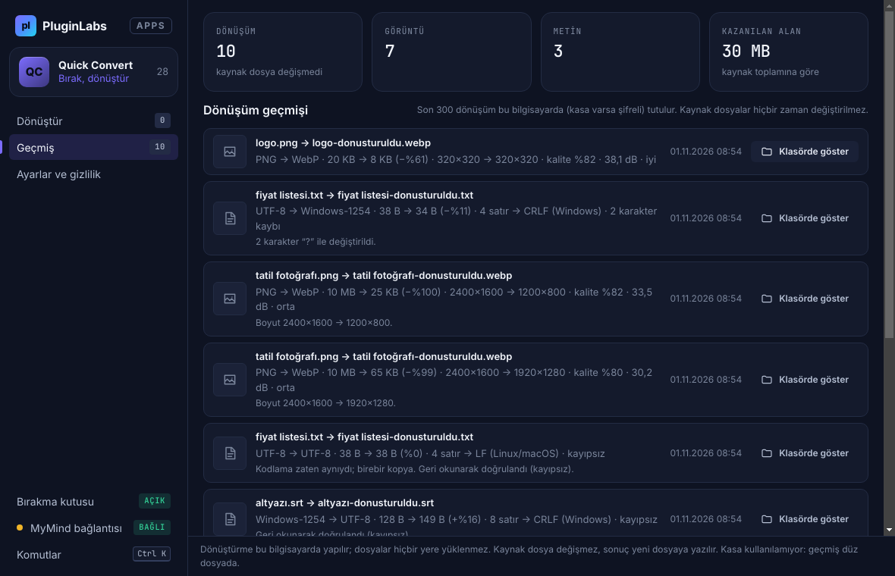
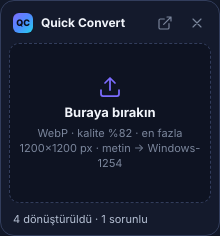

# Quick Convert (PL-028) — Windows uygulaması

> Günlük görsel ve metin dönüşümlerini farklı sitelere yüklemeden yapmak isteyenler için: dosyayı bırakın, ayarı seçin (ya da ne istediğinizi yazın), sonuç **yeni dosyaya** kaydedilsin. Kaynak dosya değişmez; dosyalar hiçbir yere yüklenmez.

Ürün kartı (Notion kaynağı, kısaltılmamış): [../README.md](../README.md) · Sürüm notları: [RELEASE-NOTES.md](RELEASE-NOTES.md)

**İndir (Windows, imzasız önizleme):** https://github.com/timdesigners-pixel/pluginlabs-dagitim/releases/tag/quick-convert-v0.1.0 — kurulum `QuickConvert-0.1.0-Windows-x64.exe` ya da taşınabilir `QuickConvert-0.1.0-Windows-Portable-x64.exe`; `SHA256SUMS-windows.txt` ile doğrulayın. 01.11.2026 08:56 UTC'de `pluginlabs-dagitim` iş akışıyla ([çalıştırma 41290845836](https://github.com/timdesigners-pixel/pluginlabs-dagitim/actions/runs/41290845836)) Windows runner'ında derlendi: `npm test` + gerçek Electron penceresinde duman testi geçti (Windows kasası/DPAPI etkin); kaynak commit `436a8d9`. Hub kataloğunda (Hub 0.4.9).

## Ekran görüntüleri

**Windows (release'i üreten Windows runner'ı, 01.11.2026, kaynak `436a8d9`, test verisi):**

| Kuyruk ve sonuçlar (boyut, ölçü, kalite) | Kurala dayalı ayar önerisi |
| --- | --- |
|  |  |
| **MyMind ayar önerisi** | **Dönüşüm geçmişi** |
|  |  |
| **Bırakma kutusu** | |
|  | |

**Linux xvfb (aynı kaynak):**

Gerçek uygulama pencereleri; otomatik duman testinin test verisiyle (üretilmiş görüntüler ve metinler, taklit Hub) **Linux xvfb** üzerinde alınmıştır (01.11.2026, kaynak `436a8d9`).

| Kuyruk ve sonuçlar (boyut, ölçü, kalite) | Kurala dayalı ayar önerisi |
| --- | --- |
|  |  |
| **MyMind ayar önerisi (onaylı, yalnız izinli alanlar)** | **Dönüşüm geçmişi** |
|  |  |
| **Bırakma kutusu (her zaman üstte)** | |
|  | |

## Ne yapar
- **Sürükle-bırak:** ana penceredeki alana ya da masaüstünde her zaman üstte duran, sürüklenebilir **bırakma kutusuna** bırakın (konumu hatırlanır). Bırakma kutusu isteğe bağlı olarak geçerli ayarlarla hemen dönüştürür. "Dosya seç" ve Windows'ta "Birlikte aç" da çalışır.
- **Görüntü:** PNG, JPEG, WebP, GIF (ilk kare), BMP → PNG, JPEG, WebP. Kalite; **hedef boyut** ("en fazla … KB": kalite kendiliğinden düşürülür); kutuya sığdırma ya da yüzde (oran korunur, **asla büyütülmez**); JPEG için saydam alan rengi. Hazır ayarlar: E-posta/WhatsApp, Web (WebP), Instagram 1080×1350, Kayıpsız PNG, En fazla 200 KB.
- **Metin kodlaması:** UTF-8, UTF-8 (BOM'lu — Excel Türkçe karakterleri doğru açsın), UTF-16 LE/BE, Windows-1254 (Türkçe ANSI). Otomatik algılama: BOM → UTF-16 deseni → katı UTF-8 doğrulaması → Windows-1254. Satır sonu CRLF/LF. Hedefte gösterilemeyen karakterler (ör. Windows-1254'te “₺”, emoji) varsayılan olarak **dönüştürmeyi durdurur** ve listelenir; izin verirseniz “?” yazılır.
- **Kaynak korunur, çıktı doğrulanır:** kaynak yalnız okunur, öncesi/sonrası SHA-256 karşılaştırılır. Sonuç “-donusturuldu” ekli yeni dosyaya yazılır (`wx`: var olan dosyanın üzerine yazılmaz; ad doluysa -2, -3 …). Görüntü çıktısı yeniden açılır, biçimi ve ölçüleri ana süreçte denetlenir; metin geri çözülerek kaynakla birebir karşılaştırılır.
- **Boyut ve kalite gösterilir** (Notion doğrulama ölçütü): yeni boyut ve değişim yüzdesi, piksel ölçüleri, kalite ve kaynakla karşılaştırmalı **PSNR** (dB; PNG için "kayıpsız (birebir)").
- **Desteklenmeyen açıkça söylenir:** yürütülebilir (.exe/.dll, ELF, Mach-O), betik (#!), PDF, Office/ZIP, RAR/7z, HEIC/AVIF/MP4, TIFF, ICO, SVG **içerikten** tanınır ve nedeniyle reddedilir; uzantı içerikle uyuşmazsa uyarılır ("Uzantı .jpg ama içerik PNG"). Bozuk dosya çökme olmadan "çözülemedi" hatası verir, çıktı yazılmaz.
- **Ayar önerisi:** "Ne istiyorsunuz?" kutusuna yazılan cümleden (ör. "e-posta için küçült", "1080 px webp, en fazla 300 KB", "Excel'de Türkçe karakterler bozuk") kurala dayalı, gerekçeli yerel öneri.
- **MyMind (isteğe bağlı, PluginLabs Hub üzerinden):** aynı cümleden ayar önerisi. Gönderilen: yalnız ihtiyaç cümlesi ve dosyanın türü/ölçüsü/boyutu (metinde kodlama ve satır sonu). **Dosya adı, yolu ve içeriği gönderilmez.** Her istekte onay penceresi; yanıt yalnız izinli alan ve aralıklarla doğrulanır (bilinmeyen alanlar yok sayılır ve gösterilir); siz "Ayarlara uygula" demedikçe ayarlara yazılmaz. Dönüştürmeyi MyMind yapmaz.
- **Geçmiş:** son 300 dönüşüm (biçim, boyut, ölçü, kalite, not), "Klasörde göster", toplam kazanılan alan.
- Ctrl+K komut paleti (eylemler, hazır ayarlar, bölümler), Ctrl+Enter dönüştür, Ctrl+1–3 bölümler; hareketi azalt seçeneği (sistem ayarı da izlenir).

## MyMind bağlantısı
1. PluginLabs Hub'ı açın, My Mind motorunu başlatın.
2. Hub → Ayarlar → API istemcileri: `mymind.chat` izniyle istemci oluşturun.
3. Quick Convert → **MyMind bağlantısı** → anahtarı yapıştırın. Anahtar Windows kasasında (DPAPI, Electron `safeStorage`) şifreli saklanır.
İstekler yalnız `http://127.0.0.1:47632` adresine gider (bu bilgisayar).

## Kabul
- **Otomatik (12 birim testi):** içerikten tür tanıma ve ret nedenleri, görüntü başlığından ölçü, sınırlar, boyut planı (büyütmez), çıktı adı (ezmez, Windows'ta geçersiz adlar), Windows-1254 tablosunun WHATWG/ICU çözücüsüyle 256 baytta birebir eşitliği, kodlama algılama (fazla uzun UTF-8, vekil, yarım dizi), kayıpsız gidiş-dönüş (emoji dahil), eşlenemeyen karakter raporu, satır sonu, kurala dayalı öneri, MyMind yükü (dosya adı/yolu yok) ve yanıt doğrulama.
- **Duman testi (gerçek Electron penceresi + bırakma kutusu):** 10 gerçek dosya (2400×1600 PNG, saydam PNG, BMP, GIF, yarım PNG, `.exe` ve exe içerikli `.png`, PDF, Windows-1254 SRT, UTF-8 metin); E-posta hazır ayarıyla toplu dönüştürme (bozuk PNG hata, çökme yok); JPEG ölçüleri 1600×1067; saydamlık notu; SRT'nin UTF-8 çıktısı birebir; öneri → WebP en fazla 150 KB (çıktı ≤150 KB, 1920×1280); MyMind (ret → hiçbir şey gönderilmez; onay → yalnız cümle + 2400×1600 px; izinsiz alan yok sayılır); seçilen klasöre yazma; Windows-1254'te “₺” durdurur, izinle “?”; bırakma kutusundan hemen dönüştürme; bırakma kutusu dosya okuyamaz (yetkisiz); geçmiş, klasörde göster, komut paleti; **tüm kaynakların SHA-256'sı değişmedi**; yeniden açılışta geçmiş/ayarlar kalıcı ve şifreli; PNG çıktısı PSNR "birebir"; CSP ihlali 0.
- **Ölçülmedi (not-run):** gerçek kullanıcı dosyalarında uzun süreli kullanım; Windows DPI, ekran okuyucu ve gerçek masaüstünde elle test; Hub üzerinden gerçek kurulum.

## Kapsam dışı (bilinçli)
HEIC/AVIF, TIFF, ICO, SVG, PDF, Office belgeleri, ses/video ve arşivler bu sürümde yok (codec lisansı ve yürütülebilir içerik riski ayrıca değerlendirilecek). Toplu kuyruk/klasör izleme (Pro), Linux/macOS paketleri sonraki aşamada.

## Güvenlik ve gizlilik
- Arayüzün ağ erişimi yok (CSP `connect-src 'none'`, `worker-src 'none'`). Ağ yalnız ana süreçte, `desktop/net.js` içinde, onaylı MyMind isteği için; yönlendirme kabul edilmez.
- Electron: `contextIsolation`, `sandbox` açık, `nodeIntegration` kapalı; sayfaya yalnız `window.qcDesktop` açılır; her IPC pencere kimliğiyle doğrulanır, bırakma kutusu yalnız dosya ekleme/görünüm kanallarını çağırabilir (okuma/yazma çağıramaz); gezinme ve yeni pencere kilitli; izin istekleri reddedilir.
- Bırakılan dosyanın yolu `webUtils.getPathForFile` ile alınır; ana süreç her yolu yeniden denetler (mutlak yol, normal dosya, boyut sınırı, değişmemiş boyut).
- Geçmiş (dosya yolları) `%APPDATA%\Quick Convert\donustur.bin` içinde DPAPI ile şifreli (kasa yoksa düz `donustur.json`), atomik yazma.

## Geliştirme
```
npm ci
npm test                      # birim testleri
npm start                     # uygulamayı aç
PLAYWRIGHT_MODULE=playwright xvfb-run -a node tests/desktop-smoke.cjs docs/screenshots   # Linux duman testi
npm run build:win             # Windows kurulum + taşınabilir exe (Windows'ta)
node scripts/make-icons.cjs   # simgeleri yeniden üret (playwright gerekir)
```
Windows derlemesi ve yayın: `pluginlabs-dagitim` deposunda [`ci/pluginlabs-dagitim-quick-convert-windows.yml`](ci/pluginlabs-dagitim-quick-convert-windows.yml) (sabit kaynak commit'i; Windows runner'da test + duman testi + derleme + SHA256 + BUILD-INFO + Windows ekran görüntüleri).
