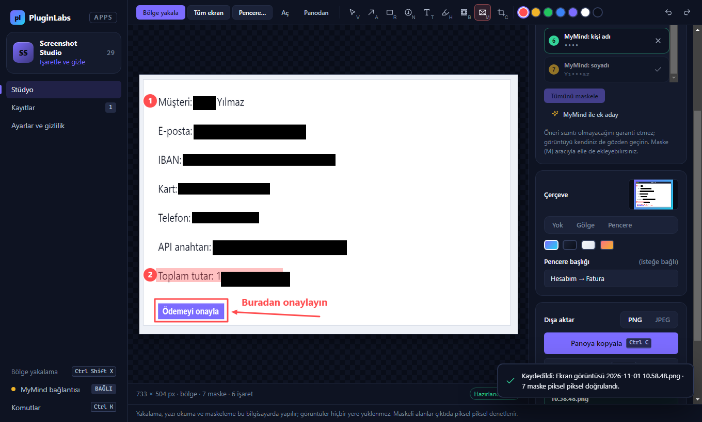

# PL-029 · Screenshot Studio

> Ekran görüntüsü alır; kırpma, işaretleme ve hassas alanları gizleme araçları sunar.

| Alan | Değer |
| --- | --- |
| Kimlik | `PL-029` · `screenshot-studio` |
| Kategori | 03 · Masaüstü, dosya araçları ve widget’lar — PL-021–030 |
| Durum | 01.11.2026: **0.1.0 Windows uygulaması yayımlandı** — [screenshot-studio-v0.1.0](https://github.com/timdesigners-pixel/pluginlabs-dagitim/releases/tag/screenshot-studio-v0.1.0) (`pluginlabs-dagitim`, Windows runner: test + duman testi + SHA256 + BUILD-INFO + Windows ekran görüntüleri); kaynak [app/](app/README.md); Hub 0.4.9 kataloğunda · Notion durumu: Yeni fikir |
| Öncelik / efor | P1 · M |
| Hedef platformlar | Windows, Linux, macOS |
| Dağıtım biçimi | masaüstü uygulaması |
| Geliştirme deposu | Henüz yok — kaynak bu klasörün [`app/`](app/README.md) alt klasöründe (ön geliştirme alanı; bkz. [repo hiyerarşisi](../../../docs/REPO-HIYERARSISI.md)); Windows derlemesi ve sürüm dosyaları `pluginlabs-dagitim` deposunda (iş akışı: [`app/ci/`](app/ci/pluginlabs-dagitim-screenshot-studio-windows.yml)) |
| Codex projesi | `PL-029 · Screenshot Studio` — ikinci klasör: PluginLabs |
| Notion kaynağı | [Notion](https://app.notion.com/p/4038aa13d8f98193b5c3ef18528e0c83) |

## Ne işe yarar

**Kullanıcı ve problem:** Hızlıca okunabilir, açıklamalı ekran görüntüsü paylaşmak isteyen ekipler.

**Kısa tanım (Hub kataloğu):** Ekran görüntüsü alır; kırpma, işaretleme ve hassas alanları gizleme araçları sunar.

## Hangi platformlar için yayınlanır

**Notion’daki platform tanımı:** W / L / M ekran görüntüsü aracı

- Windows
- Linux
- macOS

> Platformlar hedef kapsamdır. PluginLabs ürün ilkesi gereği test edilmemiş platform “destekleniyor” diye etiketlenmez; her platform gerçek cihaz/tarayıcı kabulünden sonra yayın listesine girer.

## Özellikler

### MVP ve temel akış

Bölge yakalama, ok/numara/blur, pencere çerçevesi ve panoya kopyalama. İlk sürüm görüntü düzenleme ve dışa aktarma.

### Yapay zekânın rolü

Gizli bilgi olabilecek alanları maskeleme adayı olarak işaretler; insan gözden geçirir.

## Teknik bağımlılık ve sınırlar

Maskeleme önerisi sızıntı olmayacağını garanti etmez. Kaydetmeden önce piksel bazında kalıcı redaksiyon doğrulanır.

## Gelir hipotezi

Ücretsiz anotasyon; Pro marka şablonları ve ekip kütüphanesi.

## Doğrulama ölçütü

Paylaşılabilir görsel hazırlama süresi ≤30 sn; seçili maskenin çıktıdan geri çıkarılamaması.

## Öncelik ve efor

P1 · M; ekran izinleri Snap OCR ile ortak.

## 0.1.0 sürümü (Windows)

Bölge (tam ekran seçim katmanı), tüm ekran, pencere, dosya ve pano yakalama; ok, kutu, otomatik numara, metin, vurgu, bulanıklaştırma, **kalıcı maske** ve kırpma; pencere çerçevesi (gölge / başlık çubuğu); panoya kopyalama ve PNG/JPEG kaydetme. Hassas alan adayları cihazda (Tesseract OCR + kurallar: e-posta, telefon, IBAN, kart, T.C. kimlik, IP, API anahtarı, etiketli şifre) işaretlenir, insan kabul eder. Her dışa aktarmada maskenin altındaki **her piksel** ana süreçte doğrulanır; geçmezse dosya yazılmaz/panoya konmaz (Notion: "kaydetmeden önce piksel bazında kalıcı redaksiyon doğrulanır"). Hazırlık süresi (≤30 sn) ve aday kabul oranı ölçülür. İsteğe bağlı MyMind ek adayı (Hub üzerinden, onaylı; görüntü ve numaralar gönderilmez). Ayrıntı, ekran görüntüleri ve kabul: [app/README.md](app/README.md).

## Geliştirme ve ortak çalışma (Codex + Claude Code)

- Dal adı: `codex/PL-029-<konu>` veya `claude/PL-029-<konu>`; iki ajan aynı dalda aynı anda çalışmaz.
- İşe başlamadan önce [AKTIF-ISLER.md](../../../docs/ortak-calisma/AKTIF-ISLER.md) tablosuna satır eklenir; iş bitince devir notu yazılır.
- Kurallar: [AGENTS.md](../../../AGENTS.md) (her iki ajan için ortak), protokol: [AI-ORTAK-CALISMA.md](../../../docs/ortak-calisma/AI-ORTAK-CALISMA.md).

## Notion kartının özgün metni

Aşağıdaki metin `resources/notion-catalog.json` (Notion anlık görüntüsü, 2026-10-26) içindeki kartın kısaltılmadan aktarılmış hâlidir.

Tam kartı göster

- **Durum:** Yeni fikir
- **Platform:** W / L / M ekran görüntüsü aracı
- **Kullanıcı ve problem:** Hızlıca okunabilir, açıklamalı ekran görüntüsü paylaşmak isteyen ekipler.
- **MVP ve temel akış:** Bölge yakalama, ok/numara/blur, pencere çerçevesi ve panoya kopyalama. İlk sürüm görüntü düzenleme ve dışa aktarma.
- **Yapay zekânın rolü:** Gizli bilgi olabilecek alanları maskeleme adayı olarak işaretler; insan gözden geçirir.
- **Teknik bağımlılık ve sınır:** Maskeleme önerisi sızıntı olmayacağını garanti etmez. Kaydetmeden önce piksel bazında kalıcı redaksiyon doğrulanır.
- **Gelir hipotezi:** Ücretsiz anotasyon; Pro marka şablonları ve ekip kütüphanesi.
- **Doğrulama ölçütü:** Paylaşılabilir görsel hazırlama süresi ≤30 sn; seçili maskenin çıktıdan geri çıkarılamaması.
- **Öncelik ve efor:** P1 · M; ekran izinleri Snap OCR ile ortak.

---
Oluşturma: 29.10.2026 · Kaynak → hedef: Notion kataloğu → `registry/projects.json` → bu dosya
