# Screenshot Studio (PL-029) — Windows uygulaması

> Hızlıca okunabilir, açıklamalı ekran görüntüsü paylaşmak isteyen ekipler için: bölgeyi yakalayın, ok ve numara ekleyin, hassas alanları **kalıcı** maskeleyin, pencere çerçevesiyle panoya kopyalayın. Yakalama, yazı okuma ve maskeleme bu bilgisayarda yapılır; görüntüler hiçbir yere yüklenmez.

Ürün kartı (Notion kaynağı, kısaltılmamış): [../README.md](../README.md) · Sürüm notları: [RELEASE-NOTES.md](RELEASE-NOTES.md)

**İndir (Windows, imzasız önizleme):** https://github.com/timdesigners-pixel/pluginlabs-dagitim/releases/tag/screenshot-studio-v0.1.0 — kurulum `ScreenshotStudio-0.1.0-Windows-x64.exe` ya da taşınabilir `ScreenshotStudio-0.1.0-Windows-Portable-x64.exe`; `SHA256SUMS-windows.txt` ile doğrulayın. 01.11.2026 10:59 UTC'de `pluginlabs-dagitim` iş akışıyla ([çalıştırma 41299757109](https://github.com/timdesigners-pixel/pluginlabs-dagitim/actions/runs/41299757109)) Windows runner'ında derlendi: `npm test` + gerçek Electron pencerelerinde duman testi geçti (gerçek OCR, 7 maske piksel piksel doğrulandı, bağımsız OCR; Windows kasası/DPAPI etkin; pakette OCR dil verisi denetlendi); kaynak commit `9150522`. Hub kataloğunda (Hub 0.4.9).

## Ekran görüntüleri

**Windows (release'i üreten Windows runner'ı, 01.11.2026, kaynak `9150522`, test verisi; runner ekranı 1024×768 olduğundan test "ekranı" yatayda sıkışık görünür):**

| Hassas alan adayları ve işaretler | MyMind ek adayları (onaylı) |
| --- | --- |
| 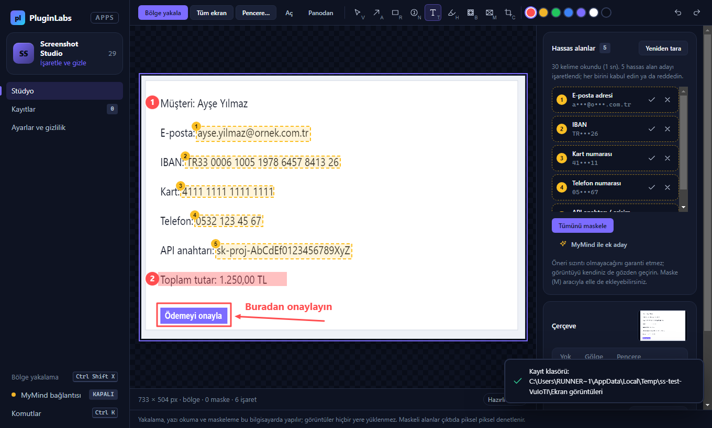 | 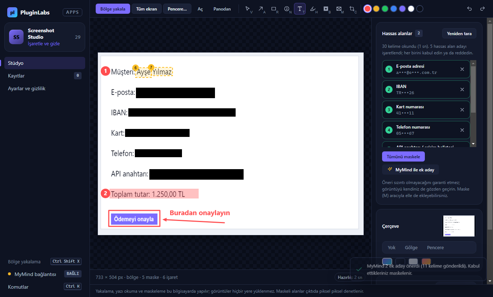 |
| **Maskeler doğrulandı, kaydedildi** | **Gerçek çıktı (pencere çerçevesi)** |
|  | 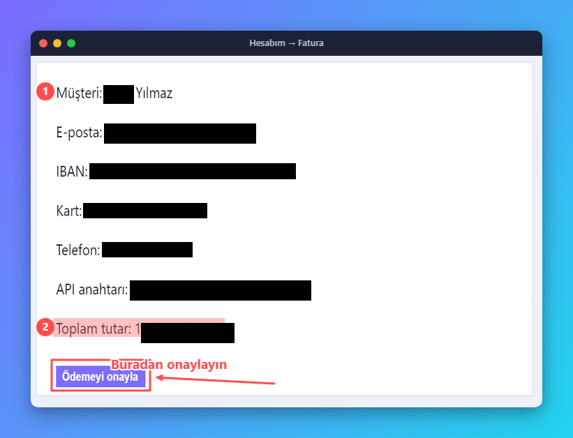 |
| **Kayıtlar ve ölçüm** | **Ayarlar ve gizlilik** |
| 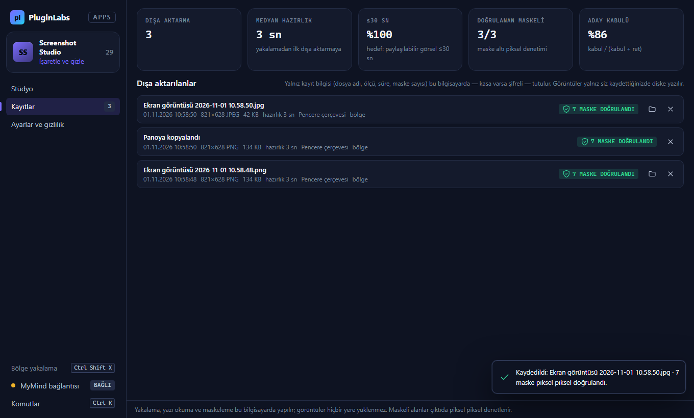 | 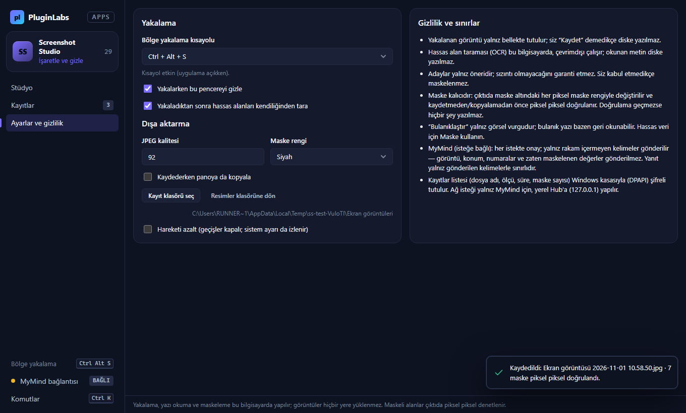 |

**Linux xvfb (aynı uygulama, 1440×900):** gerçek uygulama pencereleri; otomatik duman testinin test verisiyle (uygulamanın kendi tuvalinde çizilen sahte fatura ekranı, taklit Hub) **Linux xvfb** üzerinde alınmıştır (01.11.2026).

| Hassas alan adayları ve işaretler | MyMind ek adayları (onaylı) |
| --- | --- |
| 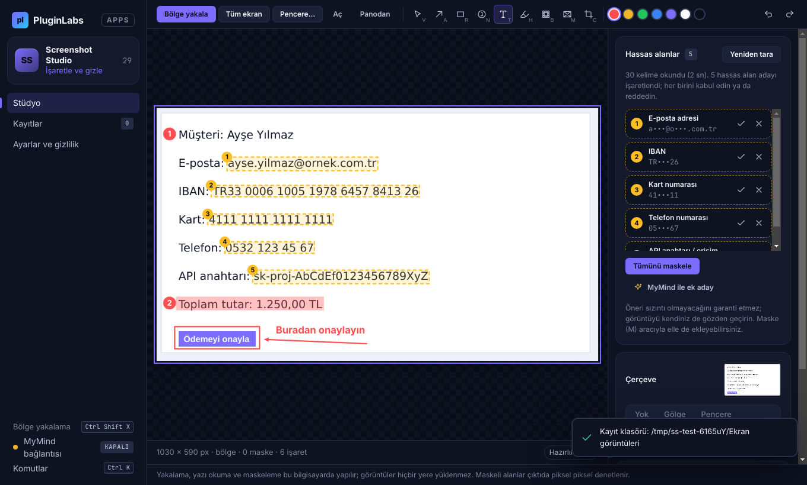 | 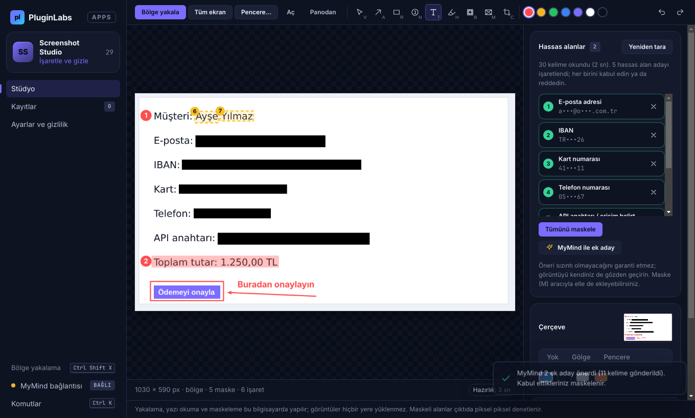 |
| **Maskeler doğrulandı, kaydedildi** | **Uygulamanın gerçek çıktısı (pencere çerçevesi)** |
| 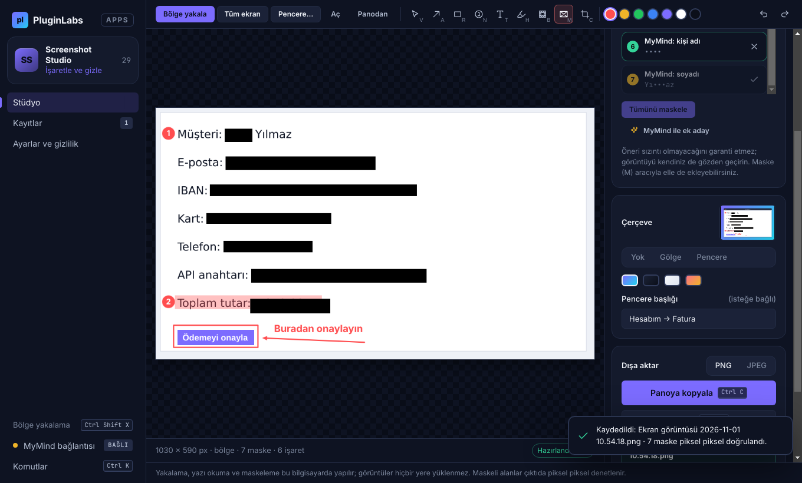 | 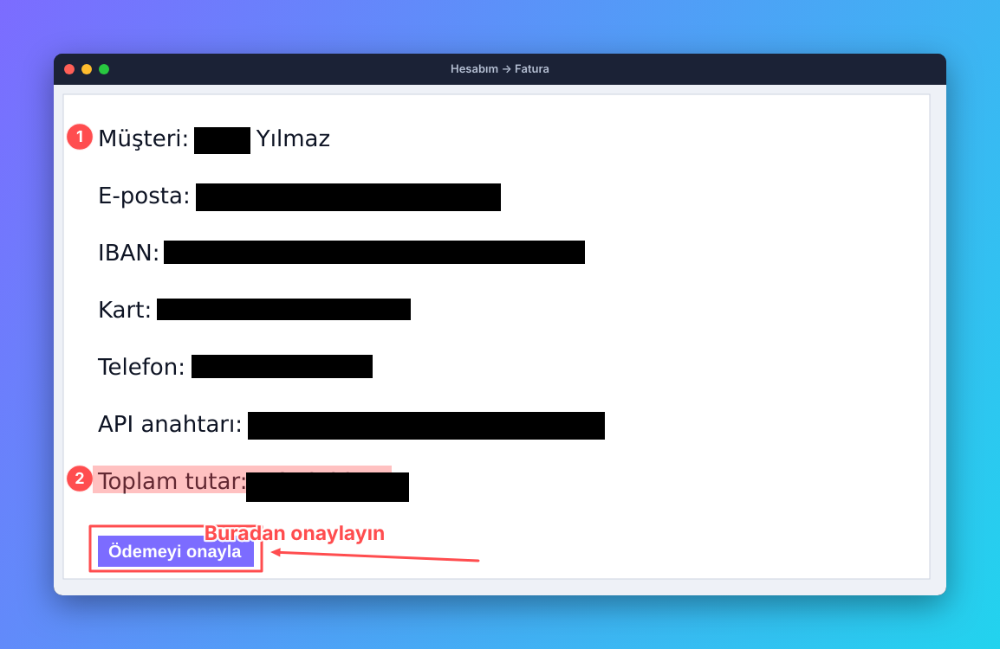 |
| **Kayıtlar ve ölçüm (≤30 sn)** | **Pencere seçimi** |
| 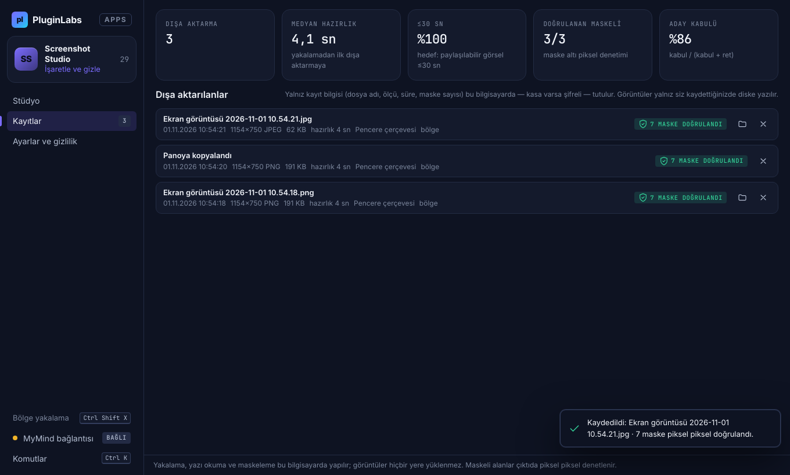 | 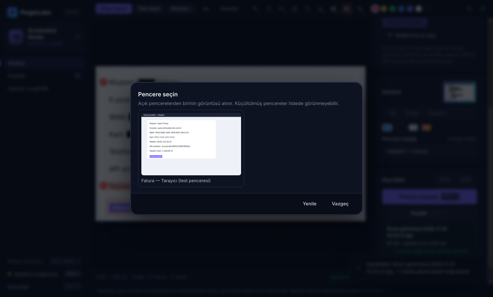 |
| **Boş durum** | **Ayarlar ve gizlilik** |
| 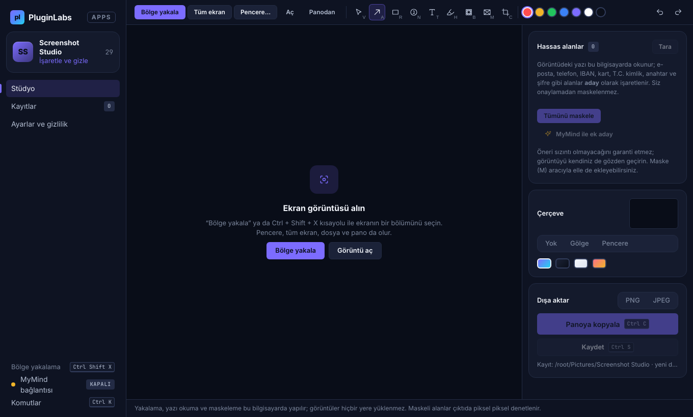 | 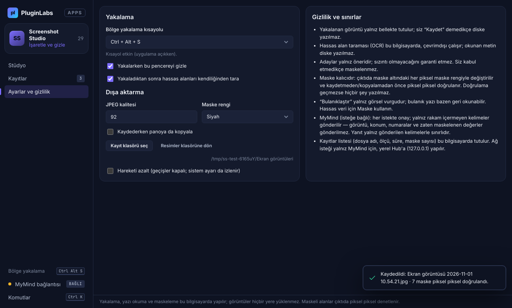 |

## Ne yapar
- **Yakalama:** bölge (donmuş tam ekran görüntüsü üzerinde seçim; fare ya da klavye), tüm ekran, açık bir pencere, görüntü dosyası ve pano. Genel kısayol: varsayılan **Ctrl+Shift+X** (Ctrl+Alt+S, Ctrl+Shift+2, PrtSc ya da kapalı; çakışırsa uyarı). Yakalarken uygulama penceresi gizlenir.
- **İşaretleme:** ok (A), kutu (R), otomatik artan numara (N), metin (T), vurgu (H), bulanıklaştırma (B), **maske (M)**, kırpma (C), seç/taşı/sil (V, Delete); 7 renk; geri al/yinele.
- **Pencere çerçevesi:** boşluk ve gölge ya da başlık çubuklu pencere; 4 zemin; isteğe bağlı başlık. Sağ üstte canlı çıktı önizlemesi.
- **Hassas alan adayları (Notion: "AI gizli bilgi olabilecek alanları maskeleme adayı olarak işaretler; insan gözden geçirir"):** yazı Tesseract (WebAssembly) ile cihazda, çevrimdışı okunur; kurallar e-posta, telefon, IBAN (mod 97 doğrulamalı), kart (Luhn), T.C. kimlik (sağlama), IP, API anahtarı/erişim belirteci (OpenAI, GitHub, AWS, Slack, Google, JWT), "Şifre:/PIN:/token:" gibi etiketli değerleri (yalnız değer, etiket görünür kalır) ve bağlantıdaki gizli parametreleri **aday** olarak işaretler. Her aday kabul/ret edilir ya da "Tümünü maskele"; listede değer değil kısaltılmış ipucu görünür.
- **Kalıcı redaksiyon, piksel bazında doğrulama (Notion: "Kaydetmeden önce piksel bazında kalıcı redaksiyon doğrulanır"):** maskeler her zaman en son çizilir; çıktı ana süreçte yeniden çözülür ve her maske dikdörtgenindeki **her piksel** maske rengine birebir eşit mi denetlenir (çerçevenin köşe yuvarlatması hesaba katılır). Tek piksel bile kalırsa dosya yazılmaz, panoya konmaz. JPEG, doğrulanmış piksellerden ana süreçte üretilir — maskenin altındaki içerik kodlayıcıya hiç ulaşmaz.
- **Panoya kopyala (Ctrl+C) / kaydet (Ctrl+S):** PNG ya da JPEG; yeni dosya, var olanın üzerine yazılmaz.
- **Ölçüm (Notion ölçütü "≤30 sn"):** yakalamadan ilk dışa aktarmaya geçen süre canlı gösterilir; Kayıtlar'da medyan süre, ≤30 sn oranı, doğrulanan maskeli çıktı ve aday kabul oranı.
- **MyMind (isteğe bağlı, PluginLabs Hub üzerinden):** "MyMind ile ek aday" — kurallarla bulunamayan kişi adı, soyadı, adres parçası, müşteri adı. Gönderilen: yalnız okunmuş, **rakam içermeyen**, kurallarca zaten işaretlenmemiş/maskelenmemiş benzersiz kelimeler (en çok 150). Görüntü, kelimelerin konumu, numaralar, e-posta, IBAN vb. **gönderilmez**. Her istekte onay penceresi (gönderilecek kelime sayısı ve örnekleriyle); yanıt yalnız gönderilen kelimelerle sınırlanır (başka kelime ve alanlar yok sayılır); öneriler yalnız aday olur.
- Ctrl+K komut paleti; hareketi azalt seçeneği (sistem ayarı da izlenir).

## MyMind bağlantısı
1. PluginLabs Hub'ı açın, My Mind motorunu başlatın.
2. Hub → Ayarlar → API istemcileri: `mymind.chat` izniyle istemci oluşturun.
3. Screenshot Studio → **MyMind bağlantısı** → anahtarı yapıştırın. Anahtar Windows kasasında (DPAPI, Electron `safeStorage`) şifreli saklanır.
İstekler yalnız `http://127.0.0.1:47632` adresine gider (bu bilgisayar).

## Kabul
- **Otomatik (10 birim testi):** Luhn/IBAN/TCKN doğrulayıcıları; aday kuralları (8 tür; geçersiz kart/IBAN/TCKN ve sıradan sayılar aday değil; etiketli şifrede yalnız değer; aday metni saklanmaz; çakışan kurallar tekilleşir); maske doğrulaması (tek piksel sızıntı yakalanır, köşe kırpması); çerçeve yerleşimi ve kırpma/çerçeve koordinat dönüşümü; dosya adı; ayar normalleştirme; MyMind yükü (rakamlı/maskeli kelime yok) ve yanıtın gönderilen kelimelerle sınırlanması; istatistikler; bölge → fiziksel piksel.
- **Duman testi (gerçek Electron pencereleri):** gerçek seçim katmanında fareyle bölge seçimi (katman ana pencere arayüzüne erişemez); otomatik OCR taraması 5 adayı buldu (e-posta, IBAN, kart, telefon, API anahtarı); ok, 2 numara, kutu, vurgu, metin; geri al/yinele; tümünü maskele; MyMind (anahtar yok → bağlantı; ret → Hub'a hiçbir şey gitmez; onay → rakamlı/maskeli hiçbir değer gönderilmez; gönderilmeyen kelime aday olmaz); elle maske; pencere çerçevesi + PNG kaydet → **7 maske, ~59 000 piksel doğrulandı**; **bağımsız Tesseract çalıştırması** özgün ekranda okunan 5 değerin hiçbirini çıktıda okuyamadı; panoya kopyalama (gerçek pano, ölçü eşleşmesi); JPEG; içerik kalan sahte maske bildirimi reddedildi ve dosya yazılmadı; pencere yakalama; kayıtlar (≤30 sn %100), klasörde göster, kısayol değişimi, komut paleti; yeniden açılışta kayıtlar/ayarlar kalıcı, kullanıcı verisinde görüntü yok; CSP ihlali 0.
- **Ölçülmedi (not-run):** gerçek kullanıcıda ≤30 sn hazırlık ve aday kabul oranı; gerçek masaüstünde çoklu ekran/DPI ve ekran okuyucu; Hub üzerinden gerçek kurulum.

## Kapsam dışı (bilinçli)
Video/GIF kaydı, kaydırmalı yakalama, sistem tepsisi ve oturum açılışında başlatma, bulut paylaşım bağlantısı, ekip kütüphanesi ve marka şablonları (Pro) bu sürümde yok. Linux/macOS paketleri sonraki aşamada.

## Güvenlik ve gizlilik
- Yakalanan görüntü yalnız bellekte tutulur; siz kaydetmedikçe diske yazılmaz. OCR'ın okuduğu metin diske yazılmaz.
- Arayüzün ağ erişimi yok (CSP `connect-src 'none'`, `worker-src 'none'`). Ağ yalnız ana süreçte, `desktop/net.js` içinde, onaylı MyMind isteği için; yönlendirme kabul edilmez. OCR dil verisi uygulamayla gelir, indirilmez.
- Electron: `contextIsolation`, `sandbox` açık, `nodeIntegration` kapalı; ana pencereye yalnız `window.ssDesktop`, seçim katmanına yalnız `window.ssOverlay` (3 kanal) açılır; her IPC pencere kimliğiyle doğrulanır; gezinme ve yeni pencere kilitli; izin istekleri reddedilir.
- Kayıtlar (dosya adı/yolu, ölçü, süre, maske sayısı) `%APPDATA%\Screenshot Studio\studyo.bin` içinde DPAPI ile şifreli (kasa yoksa düz `studyo.json`), atomik yazma.

## Geliştirme
```
npm ci                        # OCR dil verisi ocr-data/ klasörüne kopyalanır (postinstall)
npm test                      # birim testleri
npm start                     # uygulamayı aç
PLAYWRIGHT_MODULE=playwright xvfb-run -a -s "-screen 0 1440x900x24" node tests/desktop-smoke.cjs docs/linux-screenshots   # Linux duman testi
npm run build:win             # Windows kurulum + taşınabilir exe (Windows'ta)
node scripts/make-icons.cjs   # simgeleri yeniden üret (playwright gerekir)
```
Windows derlemesi ve yayın: `pluginlabs-dagitim` deposunda [`ci/pluginlabs-dagitim-screenshot-studio-windows.yml`](ci/pluginlabs-dagitim-screenshot-studio-windows.yml) (sabit kaynak commit'i; Windows runner'da test + duman testi + derleme + OCR verisi denetimi + SHA256 + BUILD-INFO + Windows ekran görüntüleri).
