# Daily Brief Widget (PL-030) — Windows uygulaması

> Güne başlarken takvimi, görevleri ve çakışmaları tek bakışta görmek isteyenler için: yerel görevler + eklediğiniz takvimlerden (yerel etkinlik, `.ics` dosyası, gizli iCal adresi) **bugün** özeti; her zaman üstte **widget**, çakışma önerileri, boş aralıklara yerleştirilmiş kısa plan, hassas başlık gizleme ve görünür veri zamanı. Takvimlere hiçbir şey yazmaz.

Ürün kartı (Notion kaynağı, kısaltılmamış): [../README.md](../README.md) · Sürüm notları: [RELEASE-NOTES.md](RELEASE-NOTES.md)

**İndir (Windows, imzasız önizleme):** https://github.com/timdesigners-pixel/pluginlabs-dagitim/releases/tag/daily-brief-widget-v0.1.0 — kurulum `DailyBrief-0.1.0-Windows-x64.exe` ya da taşınabilir `DailyBrief-0.1.0-Windows-Portable-x64.exe`; `SHA256SUMS-windows.txt` ile doğrulayın. 01.11.2026 11:58 UTC'de `pluginlabs-dagitim` iş akışıyla ([çalıştırma 41304114393](https://github.com/timdesigners-pixel/pluginlabs-dagitim/actions/runs/41304114393)) Windows runner'ında derlendi: `npm test` + gerçek Electron penceresinde duman testi geçti (Windows kasası/DPAPI etkin); kaynak commit `c72b946`. Hub kataloğunda (Hub 0.4.9).

## Ekran görüntüleri

**Windows (release'i üreten Windows runner'ı, 01.11.2026, kaynak `c72b946`, test verisi):**

| Bugün: takvim, çakışmalar, görevler, kısa plan | Widget (her zaman üstte, sürüklenir) |
| --- | --- |
| 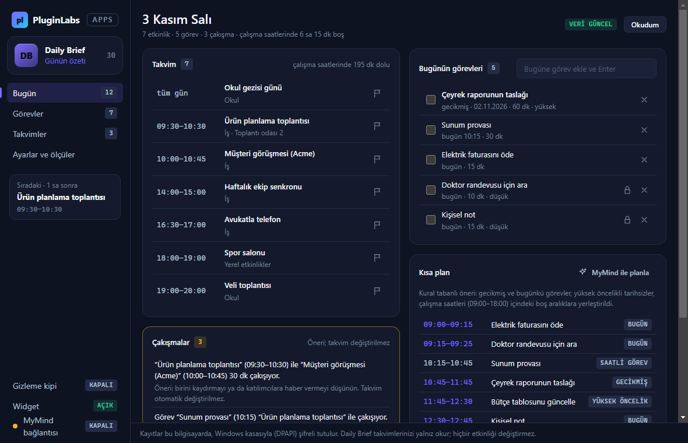 | 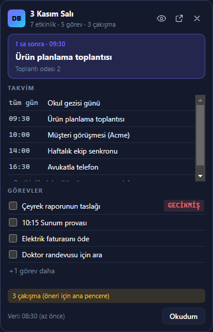 |
| **Takvimler ve veri zamanı** | **Gizleme kipi** |
| 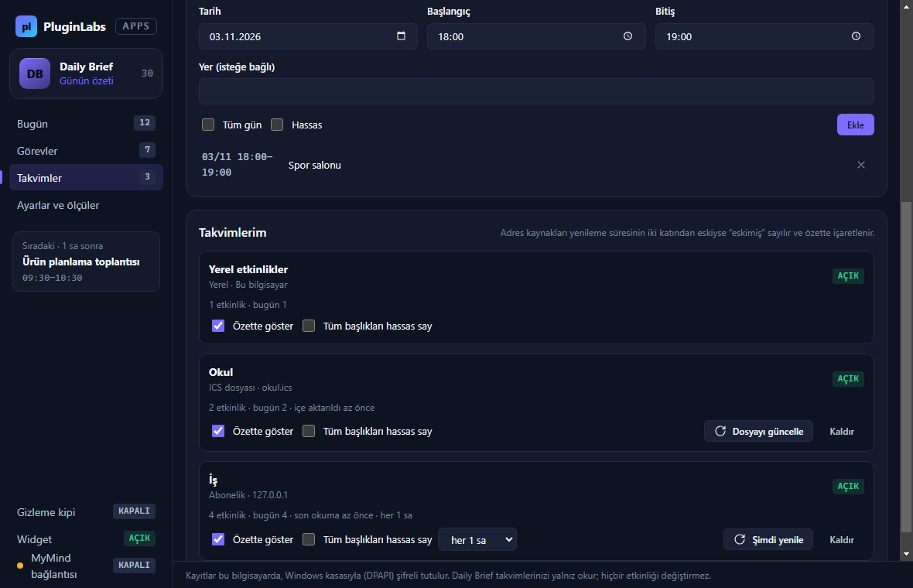 | 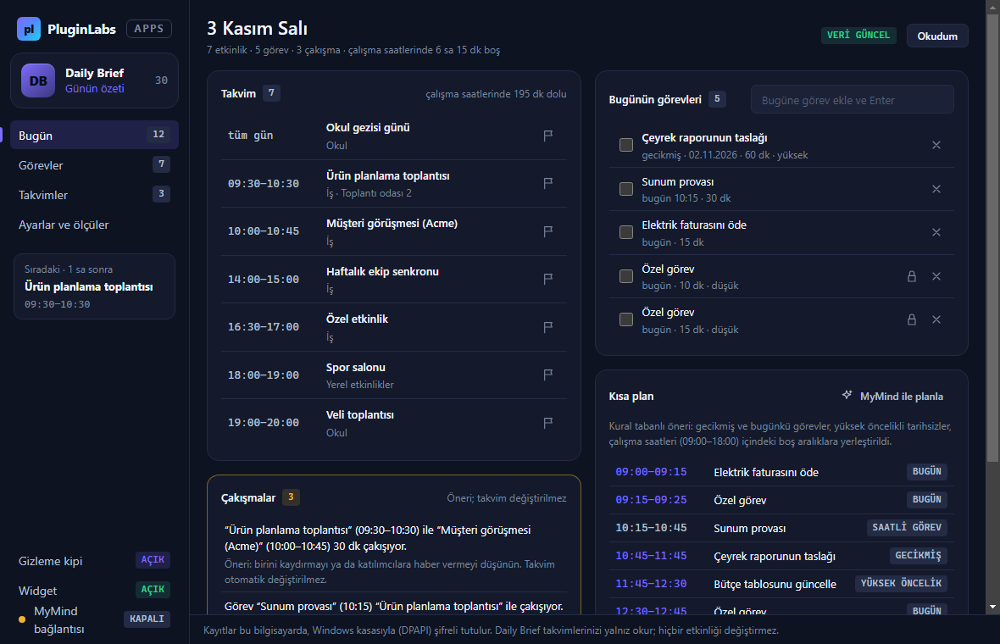 |
| **MyMind planı** | **Ölçüler ve gizlilik** |
| 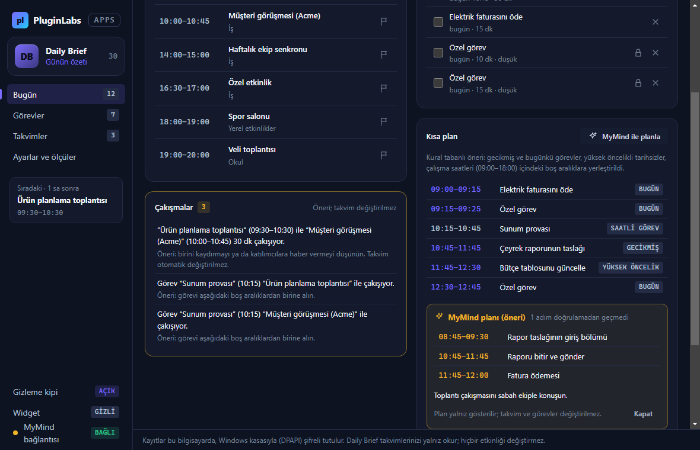 | 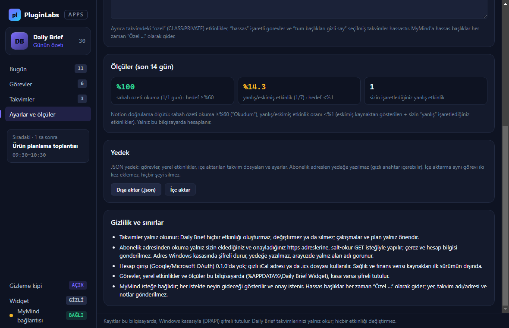 |

**Linux xvfb (bu klasördeki kaynak, 01.11.2026):** gerçek uygulama pencereleri; otomatik duman testinin test verisiyle (saat 3 Kasım 2026 08:30'a sabit, taklit takvim sunucusu ve taklit Hub).

| Bugün: takvim, çakışmalar, görevler, kısa plan | Widget (her zaman üstte, sürüklenir) |
| --- | --- |
| 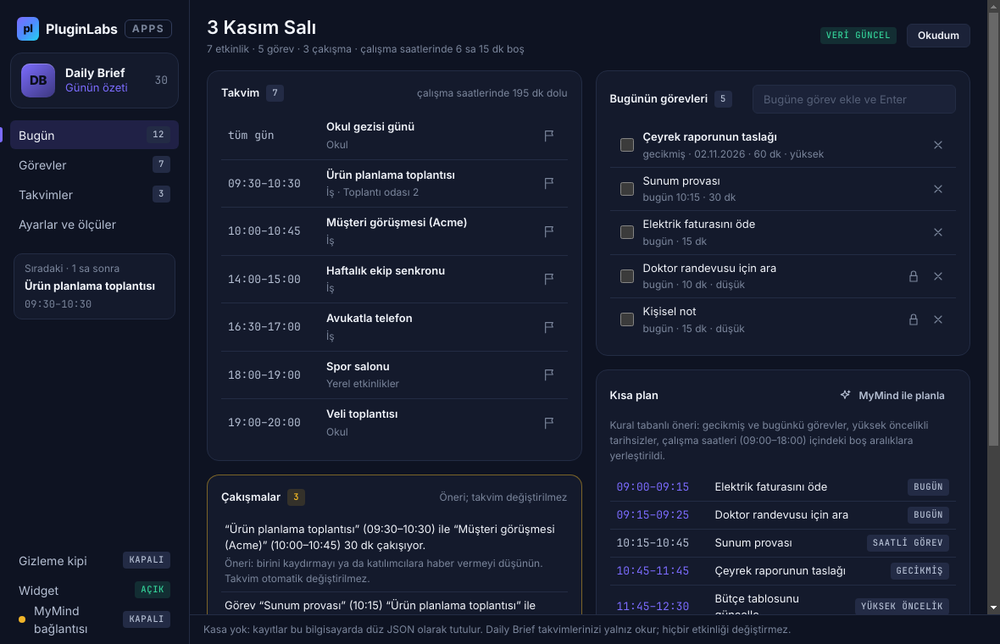 | 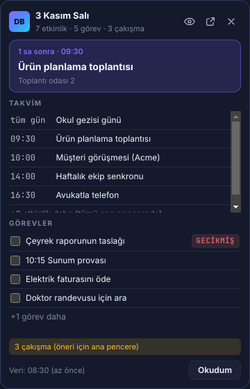 |
| **Takvimler: yerel, .ics dosyası, abonelik; veri zamanı** | **Gizleme kipi: hassas başlıklar “Özel …”** |
| 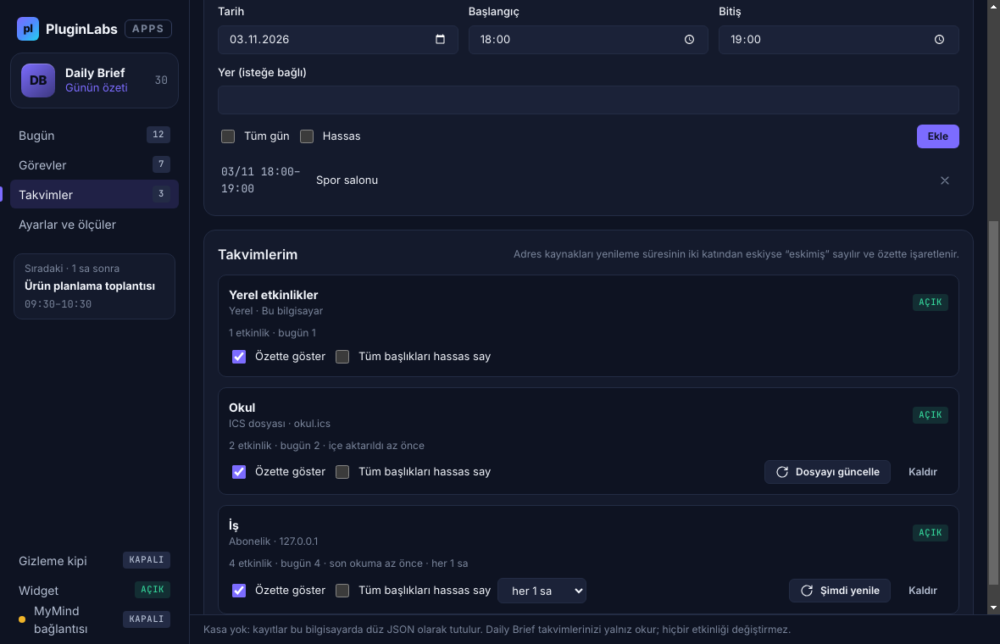 | 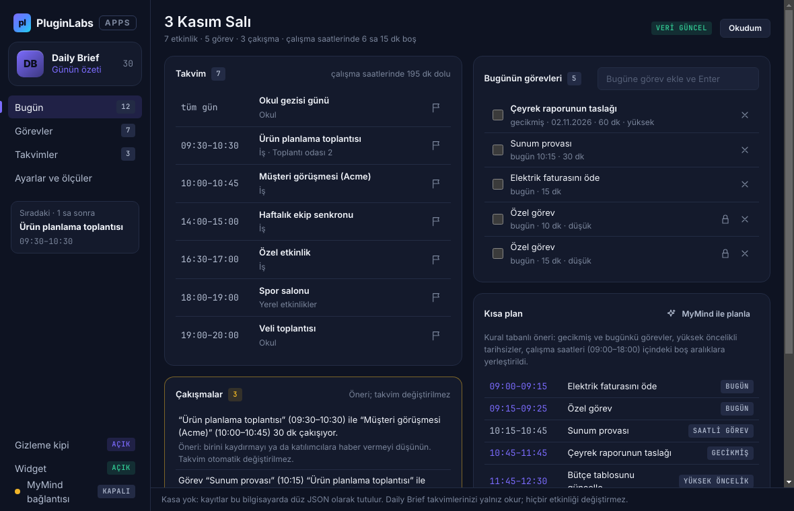 |
| **MyMind planı (onaylı, veri azaltılmış)** | **Ölçüler, yedek, gizlilik** |
| 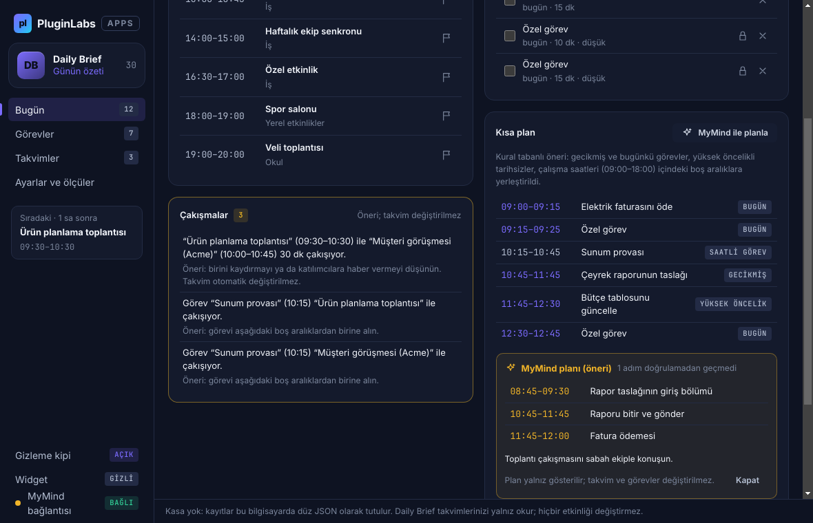 | 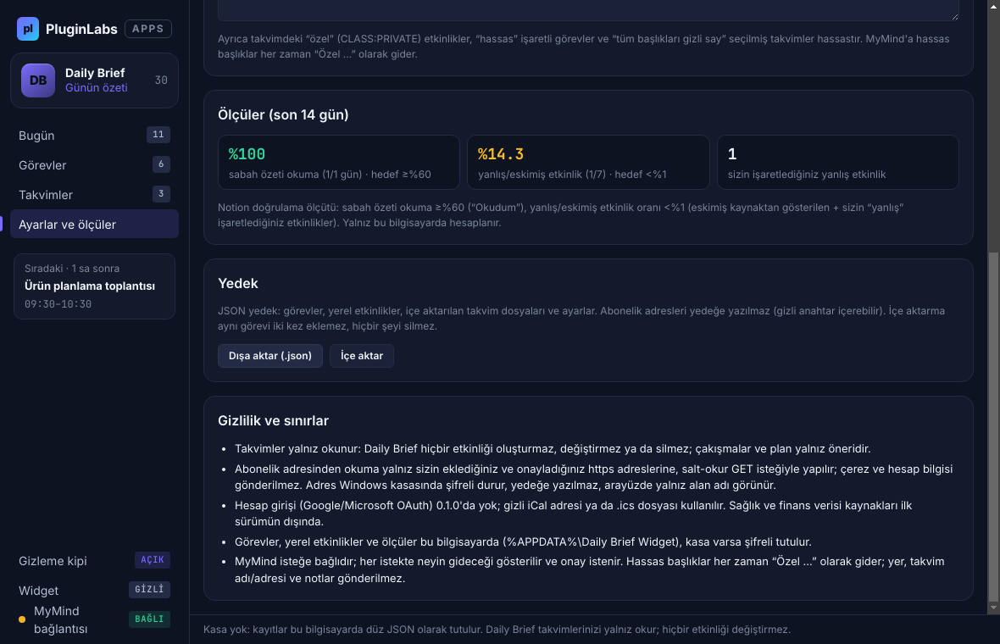 |

## Ne yapar
- **Bugün:** tüm gün + saatli etkinlikler (kaynak, yer), şimdiki/sıradaki etkinlik, gecikmiş ve bugünkü görevler (işaretle, sil, hızlı ekle), çalışma saatlerinde dolu/boş süre.
- **Widget:** çerçevesiz, her zaman üstte, sürüklenebilir; konumu hatırlanır, ekran dışına düşerse sağ üste döner. Sıradaki etkinlik geri sayımı, kalan etkinlikler, görevler (işaretlenebilir), çakışma/eskimiş uyarısı, veri zamanı, gizleme kipi, "Okudum".
- **Takvimler (yalnız okuma):** yerel etkinlik; `.ics` dosyası; https/webcal abonelik adresi (eklerken onay; 15 dk–24 sa yenileme; yönlendirme yalnız https; 5 MB ve 20 sn sınırı). iCalendar: TZID (IANA + Windows adları), UTC, tüm gün, DURATION, RRULE DAILY/WEEKLY(BYDAY)/MONTHLY/YEARLY + INTERVAL/COUNT/UNTIL, EXDATE, RECURRENCE-ID, STATUS:CANCELLED, CLASS:PRIVATE.
- **Çakışmalar:** etkinlik × etkinlik ve saatli görev × etkinlik; yalnız öneri.
- **Kısa plan (kural tabanlı):** gecikmiş → bugünkü → yüksek öncelikli tarihsiz görevler, önceliğe göre çalışma saatlerindeki ilk uygun boşluğa; sığmayanlar listelenir.
- **Gizleme kipi:** hassas kelimeler (varsayılan: doktor, hastane, maaş, banka), takvimin "özel" etkinlikleri, hassas görevler ve "tüm başlıkları hassas say" takvimleri "Özel etkinlik/görev" görünür.
- **Veri zamanı:** her kaynağın son okuma zamanı; yenileme süresinin iki katını aşan abonelik "eskimiş"; okuma hataları kaynağın altında.
- **Sabah bildirimi:** seçilen saatte (ya da sonra açılınca) günde bir kez.
- **Ölçüler (Notion doğrulama ölçütü):** son 14 gün; sabah özeti okuma (≥%60) ve yanlış/eskimiş etkinlik oranı (<%1).
- **MyMind (isteğe bağlı):** günü kısa plana dönüştürme; hassas başlıklar her zaman "Özel …", yer/takvim adı/adres/not gönderilmez; her istekte onay; yanıt doğrulanır, yalnız gösterilir.
- **Yedek:** JSON (abonelik adresleri hariç); içe aktarma yinelemez, hiçbir şey silmez.

## Güvenlik ve gizlilik
- Takvime **yazma yok**: hiçbir etkinlik oluşturulmaz, değiştirilmez, silinmez.
- Kayıtlar `%APPDATA%\Daily Brief Widget\ozet.bin` içinde Windows kasasıyla (DPAPI, `safeStorage`) şifrelidir (abonelik adresleri gizli anahtar içerebilir); kasa yoksa düz JSON olur ve arayüzde belirtilir. MyMind anahtarı da kasada.
- Arayüz: `contextIsolation`, `sandbox`, sıkı CSP (`connect-src 'none'`, satır içi betik/stil yok), gezinme ve yeni pencere engelli; IPC yalnız ana pencere ve widget'tan kabul edilir. Adreslerin yalnız alan adı gösterilir.
- Ağ yalnız `desktop/net.js` içinde: onaylı abonelik adreslerinden salt-okur GET (çerez/kimlik bilgisi yok; http, IP, yerel ağ ve parolalı adresler reddedilir) ve onaylı MyMind isteği (yalnız yerel Hub, 127.0.0.1:47632, `mymind.chat` izinli anahtar, yönlendirme reddedilir).

## Sınırlar (0.1.0)
- Google/Microsoft hesap girişi (OAuth) yok — Notion'daki "bağlı takvim/görev sağlayıcıları" bu sürümde gizli iCal adresiyle karşılanır. Harici görev sağlayıcısı (Todoist, Microsoft To Do) yok.
- Bilinmeyen saat dilimi adları yerel saat sayılır (sayısı gösterilir); BYSETPOS gibi ileri tekrar kuralları desteklenmez; tekrarlar yerel duvar saatine göre açılır.
- Sağlık/finans verisi kaynakları ilk sürüm dışında (Notion sınırı). Linux/macOS paketi yok. Windows DPI, ekran okuyucu ve gerçek masaüstünde elle test yapılmadı; doğrulama ölçütleri gerçek kullanıcıyla ölçülmedi.

## Geliştirme
```bash
npm ci
npm test                       # çekirdek birim testleri (11; saat diliminden bağımsız)
PLAYWRIGHT_MODULE=playwright xvfb-run -a -s "-screen 0 1440x900x24" node tests/desktop-smoke.cjs docs/screenshots   # Linux duman testi
npm run build:win              # Windows paketi (Windows'ta)
node scripts/make-icons.cjs    # simgeler (geliştirme aracı)
```
Windows derlemesi ve yayını `pluginlabs-dagitim` deposundaki `Daily Brief Widget Windows sürümü` iş akışıyla yapılır ([ci/](ci/pluginlabs-dagitim-daily-brief-widget-windows.yml)): bu klasörü belirli bir PluginLabs commit'inden alır, Windows runner'ında test + duman testi koşar, kurulum ve taşınabilir exe üretir, SHA256 ve BUILD-INFO ile `daily-brief-widget-v<sürüm>` etiketinde yayımlar.

Kaynak, PluginLabs deposundaki ürün ön geliştirme alanındadır (`apps/03-…/PL-030-daily-brief-widget/app`); ürün deposu (`daily-brief-widget`) açıldığında buradan taşınır.
