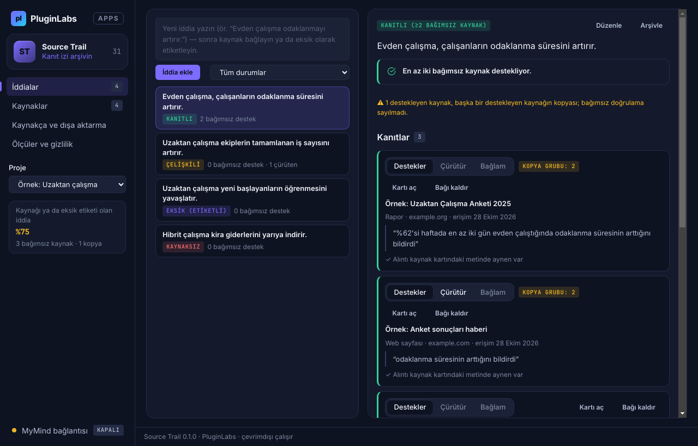
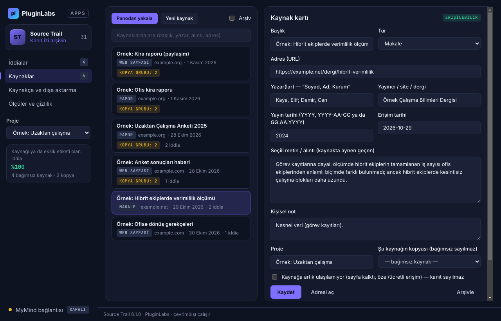
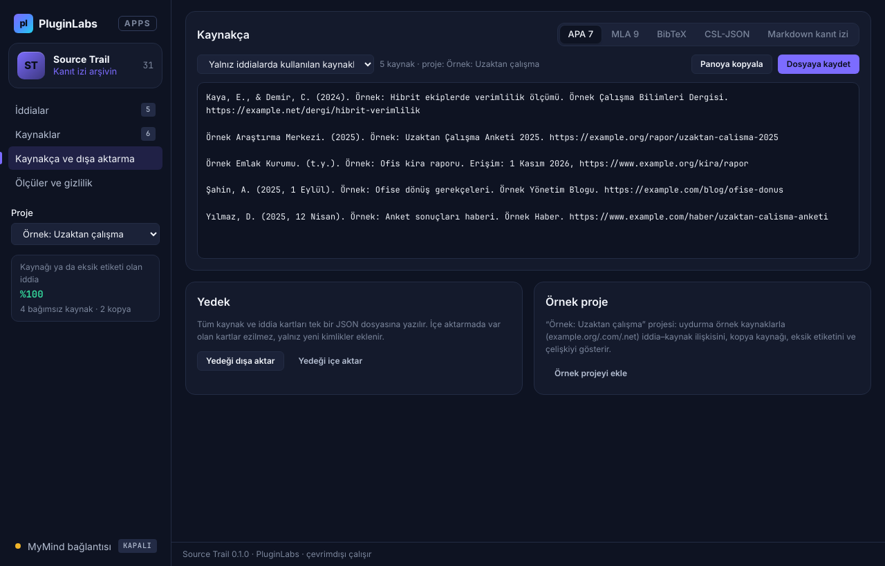
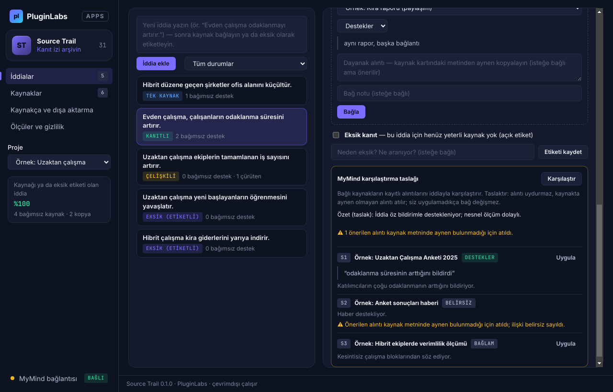
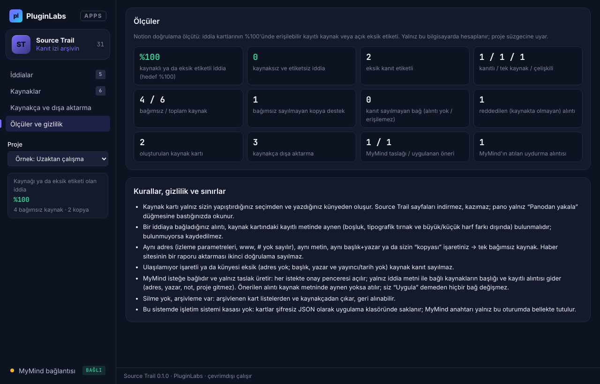

# Source Trail (PL-031) — Windows uygulaması

Araştırmada bir sonucun **hangi kaynağa ve hangi alıntıya** dayandığını kaybetmemek için kaynak kartı + iddia kartı arşivi. Tarayıcıda seçtiğiniz metni ve adresi kopyalayıp **Panodan yakala** dersiniz; alıntı, adres, erişim tarihi, künye ve notunuz kaynak kartı olur. İddia kartlarına kaynak bağlarsınız (destekler / çürütür / bağlam); bağ alıntısı kaynak kartındaki metinde **aynen** bulunmalıdır. Kaynağı olmayan iddia açıkça **eksik kanıt** olarak etiketlenir. Aynı kaynağın kopyaları (aynı adres, aynı metin, aynı başlık+yazar) **bağımsız doğrulama sayılmaz**. Kaynakça APA 7, MLA 9, BibTeX, CSL-JSON ya da Markdown kanıt izi olarak dışa aktarılır.

> Ürün deposu henüz yok; kaynak bu klasördedir (PluginLabs ürün ön geliştirme alanı, PL-025 modeli). Windows paketleri `pluginlabs-dagitim` deposunda `source-trail-v<sürüm>` etiketiyle yayımlanır.



| Kaynak kartı ve kopya grubu | Kaynakça (APA 7) |
| --- | --- |
|  |  |
| **MyMind karşılaştırma taslağı: uydurma alıntı atılır** | **Ölçüler (hedef %100)** |
|  |  |

Ekran görüntüleri gerçek uygulamadan, duman testinin uydurma örnek verisiyle (example.org/.com/.net) alınmıştır (`masaustu-*`: Linux/xvfb). Windows runner'ında alınanlar (`windows-masaustu-*`) release ekindedir.

## İndir
[source-trail-v0.1.0](https://github.com/timdesigners-pixel/pluginlabs-dagitim/releases/tag/source-trail-v0.1.0) — `SourceTrail-0.1.0-Windows-x64.exe` (kurulum), `SourceTrail-0.1.0-Windows-Portable-x64.exe` (taşınabilir), SHA256SUMS + BUILD-INFO. İmzasız önizleme. PluginLabs Hub kataloğundan da kurulabilir (Hub kataloğu birleşip yayımlanınca).

## Kullanım
1. Tarayıcıda alıntılamak istediğiniz metni seçip kopyalayın; adres çubuğundaki bağlantıyı da metnin altına/ayrı satıra ekleyin (isteğe bağlı `Başlık:` ve `Yazar:` satırları tanınır). **Kaynaklar → Panodan yakala**. İlk deneme için **Kaynakça → Örnek projeyi ekle**.
2. Künyeyi tamamlayın (tür, yazar “Soyad, Ad; Kurum”, yayıncı, yayın tarihi; erişim tarihi bugündür) → **Kaydet**. Aynı adres/metin zaten kayıtlıysa uyarı çıkar; ikisi tek bağımsız kaynak sayılır. Elle de “Şu kaynağın kopyası” seçilebilir.
3. **İddialar** → iddiayı yazın (Ctrl+Enter) → **Kanıt bağla**: kaynak, ilişki ve kaynak kartındaki metinden aynen kopyalanmış dayanak alıntı.
4. Kaynak yoksa **Eksik kanıt** etiketini işaretleyip neyin arandığını yazın. Kenar çubuğundaki oran (kaynaklı ya da etiketli iddia) %100 olmalıdır.
5. **Kaynakça ve dışa aktarma**: biçim, kapsam (yalnız iddialarda kullanılan / tüm kaynaklar), proje süzgeci → **Panoya kopyala** ya da **Dosyaya kaydet**. JSON yedek dışa/içe aktarma.
6. İsteğe bağlı: **MyMind bağlantısı** → Hub istemci anahtarı → iddiada **Karşılaştır** (her istekte onay). Dönen taslakta yalnız kaynakta aynen bulunan alıntılı öneriler **Uygula** ile bağa yazılabilir.

## Kurallar
- **İddia durumu:** ≥2 bağımsız destekleyen kaynak → *Kanıtlı*; 1 → *Tek kaynak*; destekleyen + çürüten → *Çelişkili*; hiç geçerli destek yok ve etiketli → *Eksik*; hiçbiri → *Kaynaksız* (ölçütü bozar).
- **Kanıt sayılmayan bağ:** alıntısı kaynak kartındaki metinde aynen olmayan, kaynağı arşivlenmiş, “ulaşılamıyor” işaretli ya da künyesi eksik (adres yok; başlık + yazar + yayıncı/tarih de yok) kaynak.
- **Kopya:** aynı kanonik adres (www/m., izleme parametreleri, # ve sondaki / yok sayılır), aynı alıntı metni (≥60 harf/rakam; biri diğerini ≥80 karakterle içeriyorsa da), aynı başlık + ilk yazar ya da kullanıcı işareti.
- **Alıntı karşılaştırması:** Unicode NFC, tipografik tırnak/tire/üç nokta, boşluk ve Türkçe büyük/küçük harf farkı yok sayılır; kelimeler değişemez.

## Güvenlik ve gizlilik
- Kaynak sayfalar indirilmez/kazınmaz; pano yalnız “Panodan yakala” ile okunur. Dış bağlantılar yalnız herkese açık http(s) adresleri için sistem tarayıcısında açılır (kullanıcı adı/parola ve yerel ağ adresleri reddedilir).
- Ağ erişimi yalnız `desktop/net.js` içinde ve yalnız yerel Hub'a (127.0.0.1:47632). MyMind'a yalnız iddia metni ile bağlı kaynakların başlığı ve kayıtlı alıntısı gider (en çok 8 kaynak, her biri ≤1500 karakter); adres, yazar, not, proje ve diğer iddialar gitmez. Kaynak metinlerindeki talimatlar veri sayılır. Yanıt doğrulanır: bilinmeyen kaynak atılır, kaynakta aynen olmayan alıntı atılır ve ilişki “belirsiz” olur; alıntısız destekler/çürütür de “belirsiz”dir.
- Arayüz `contextIsolation` + `sandbox`; CSP `connect-src 'none'`; metin yalnız `textContent`/`value` ile yazılır; gezinme ve yeni pencere engelli; IPC yalnız kendi penceresinden.
- Kartlar Windows kasasında (DPAPI) şifreli, atomik yazma + son sağlam yedek; kasa yoksa düz JSON, MyMind anahtarı yalnız bellekte. Silme yok, arşivleme var.

## Geliştirme
```bash
npm ci
npm test                                   # çekirdek birim testleri (node:test)
PLAYWRIGHT_MODULE=playwright xvfb-run -a -s "-screen 0 1440x900x24" node tests/desktop-smoke.cjs docs/screenshots
npm run build:win                          # Windows: kurulum + taşınabilir
node scripts/make-icons.cjs                # simgeleri yeniden üret
```
Windows derlemesi `ci/pluginlabs-dagitim-source-trail-windows.yml` iş akışıyla `pluginlabs-dagitim` deposunda, sabit bir PluginLabs commit'inden yapılır.

## Kapsam dışı (bu sürüm)
Chrome eklentisi (sayfada sağ tık ile yakalama), Linux/macOS paketleri, BibTeX/RIS içe aktarma, PDF sayfa numarası, ekip/proje paylaşımı (Pro) bu sürümde yok.
