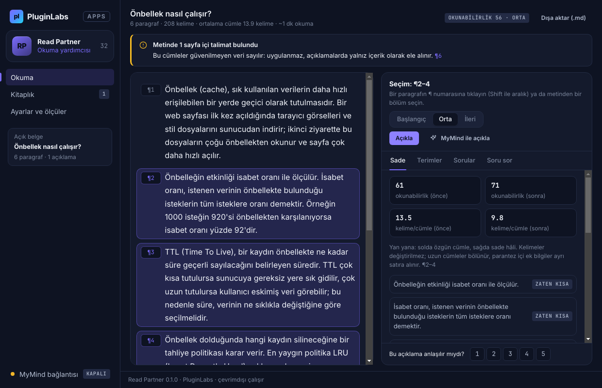
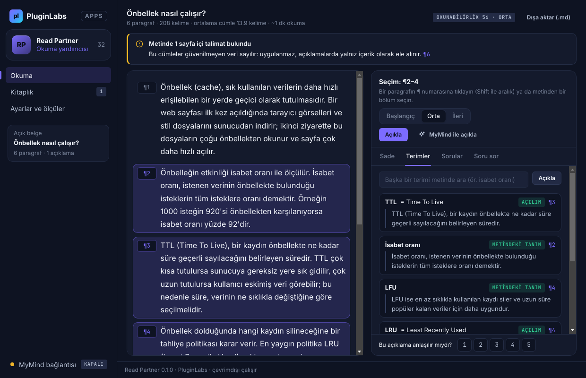
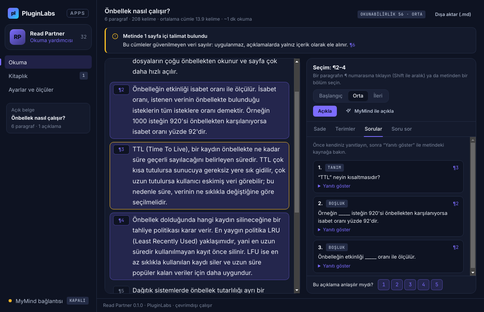
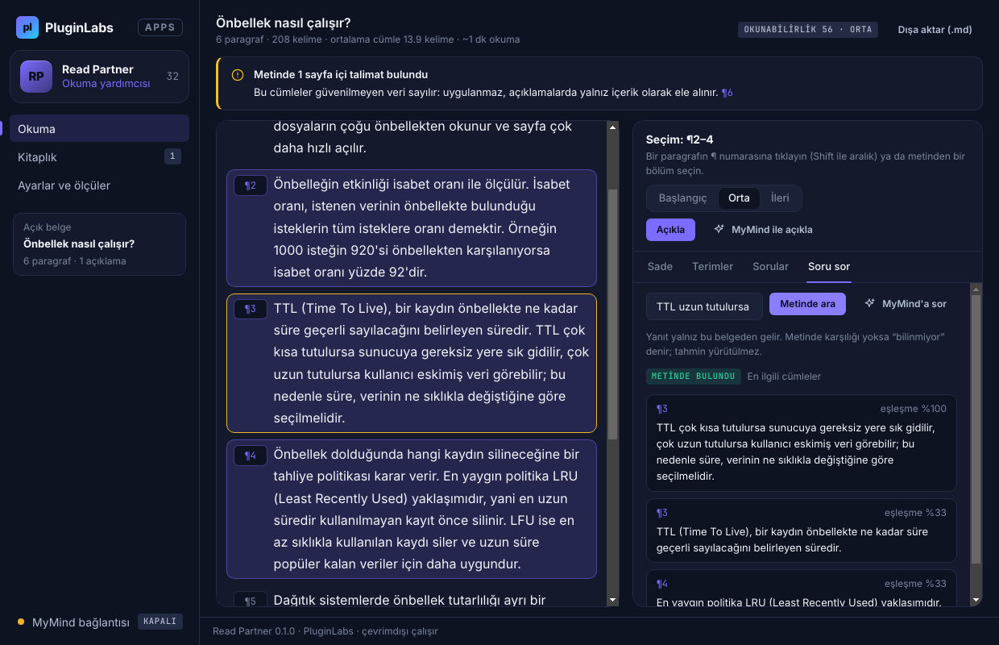
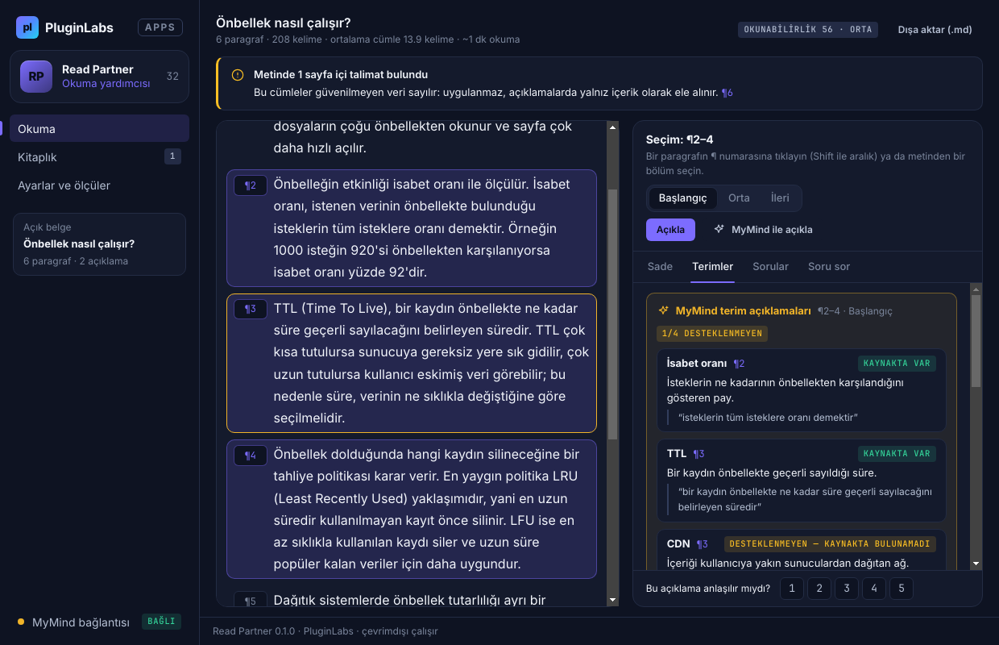
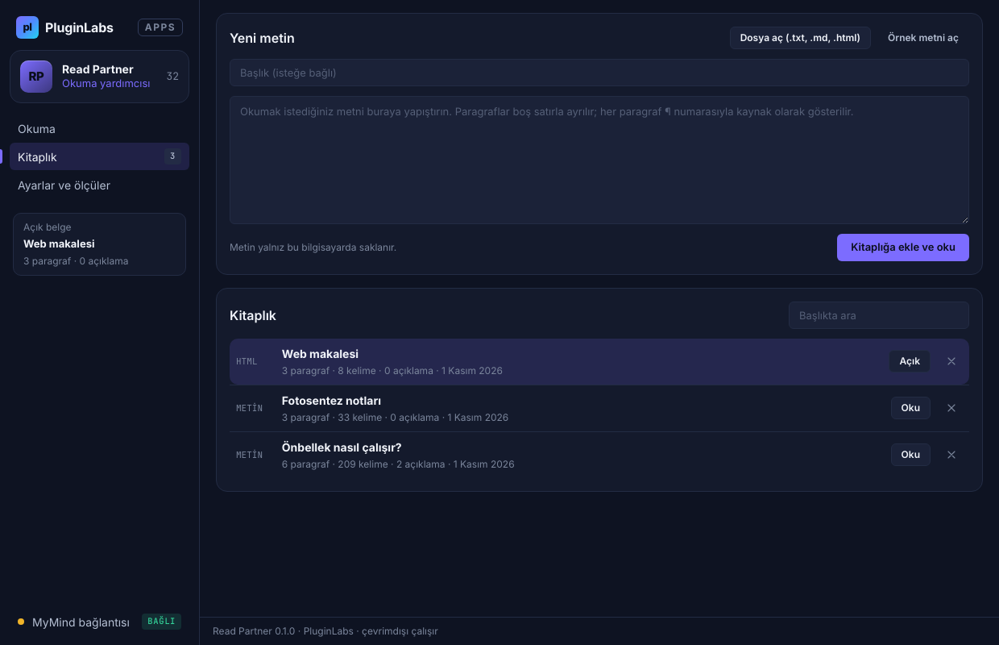
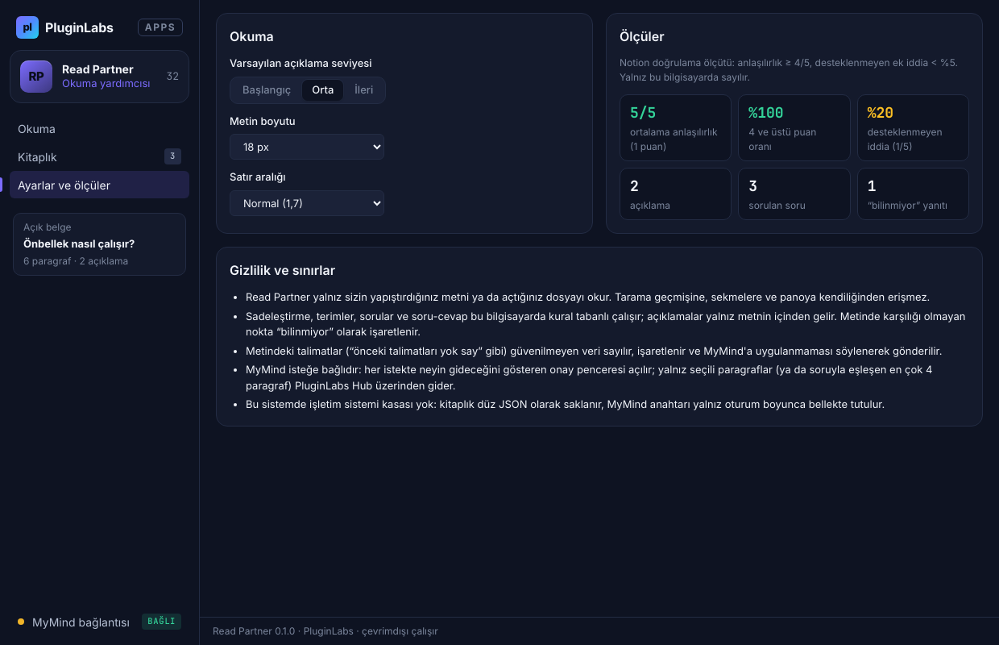

# Read Partner (PL-032) — Windows uygulaması

Açık metni veya belgeyi seçtiğiniz bölüm üzerinden açıklar: yan yana sadeleştirme, terimler, 3 anlama sorusu ve kaynak içi soru-cevap. Açıklamalar yalnız metnin içinden gelir ve her biri ¶ numarasıyla kaynağına bağlanır; metinde karşılığı olmayan nokta “bilinmiyor” olarak işaretlenir.

> Ürün deposu henüz yok; kaynak bu klasördedir (PluginLabs ürün ön geliştirme alanı, PL-025 modeli). Windows paketleri `pluginlabs-dagitim` deposunda `read-partner-v<sürüm>` etiketiyle yayımlanır.



| Terimler (metnin içinden, ¶ kaynaklı) | Anlama soruları |
| --- | --- |
|  |  |
| **Kaynak içi soru-cevap (bilinmiyor dahil)** | **MyMind: alıntı denetimi** |
|  |  |
| **Kitaplık** | **Ayarlar ve ölçüler** |
|  |  |

Ekran görüntüleri gerçek uygulamadan, duman testinin test verisiyle alınmıştır (`masaustu-*`: Linux/xvfb; `windows-masaustu-*`: GitHub Actions Windows runner, release ekinde).

## Kullanım
1. **Kitaplık → Yeni metin**: metni yapıştırın ya da **Dosya aç** (.txt, .md, .html; Ctrl+O). İlk deneme için **Örnek metni aç**.
2. **Okuma**: ¶ numarasına tıklayın (Shift ile aralık; Alt+↑/↓ klavyeyle) ya da metinden bir bölüm seçin.
3. Seviyeyi seçin ve **Açıkla** (Ctrl+Enter): Sade · Terimler · Sorular sekmeleri dolar. **Soru sor** sekmesi tüm belgede arar.
4. Açıklamayı 1–5 arası puanlayın; **Dışa aktar (.md)** ile açıklamaları kaydedin.
5. İsteğe bağlı: **MyMind bağlantısı** → Hub istemci anahtarı → **MyMind ile açıkla** / **MyMind'a sor** (her istekte onay).

## Güvenlik ve gizlilik
- Kullanıcı seçimi olmadan hiçbir şey okunmaz; tarama geçmişi, sekmeler ve pano okunmaz. Ağ erişimi yalnız `desktop/net.js` içinde ve yalnız yerel Hub'a (127.0.0.1:47632).
- Arayüz `contextIsolation` + `sandbox`; CSP `connect-src 'none'`; belge metni yalnız `textContent` ile yazılır, HTML olarak yorumlanmaz; gezinme ve yeni pencere engelli; IPC yalnız kendi penceresinden.
- Sayfa içi talimatlar güvenilmeyen veri: işaretlenir, MyMind isteğinde `<kaynak>` sınırı içinde ve “uygulama” uyarısıyla gider (`</kaynak>` kaçırılır).
- MyMind yanıtındaki her açıklamanın alıntısı kaynak paragrafta aranır; bulunamazsa “desteklenmeyen” sayılır ve ölçüye girer.
- Kitaplık ve anahtar Windows kasasında (DPAPI) şifreli; kasa yoksa kitaplık düz JSON, anahtar yalnız bellekte.

## Geliştirme
```bash
npm ci
npm test                                   # çekirdek birim testleri (node:test)
PLAYWRIGHT_MODULE=playwright xvfb-run -a -s "-screen 0 1440x900x24" node tests/desktop-smoke.cjs docs/screenshots
npm run build:win                          # Windows: kurulum + taşınabilir
node scripts/make-icons.cjs                # simgeleri yeniden üret
```
Windows derlemesi `ci/pluginlabs-dagitim-read-partner-windows.yml` iş akışıyla `pluginlabs-dagitim` deposunda, sabit bir PluginLabs commit'inden yapılır.
