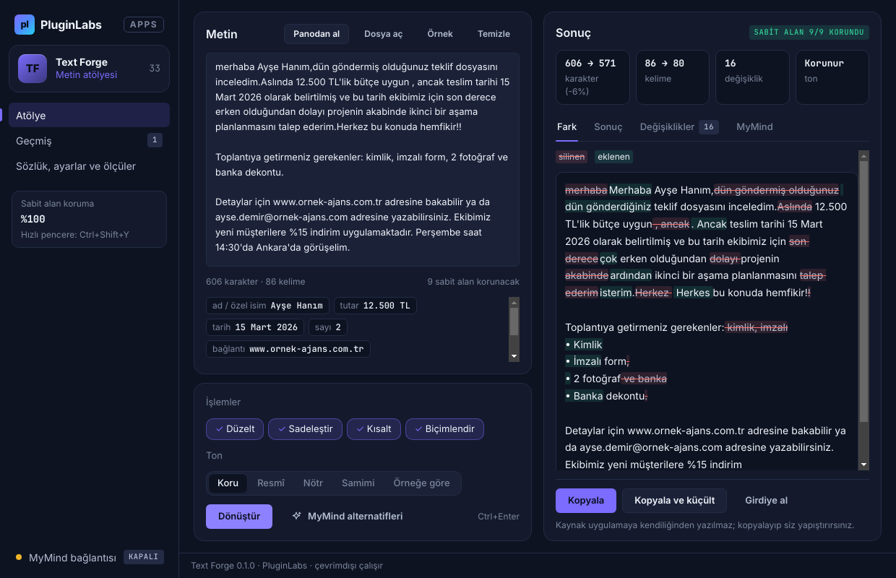

# PL-033 · Text Forge

> Metinleri seçilen tona göre yeniden yazar; kısaltma, düzeltme ve biçimlendirme önerileri sunar.

| Alan | Değer |
| --- | --- |
| Kimlik | `PL-033` · `text-forge` |
| Kategori | 04 · Araştırma, yazma ve bilgi akışları — PL-031–040 |
| Durum | 01.11.2026: **0.1.0 Windows uygulaması yayımlandı** — [text-forge-v0.1.0](https://github.com/timdesigners-pixel/pluginlabs-dagitim/releases/tag/text-forge-v0.1.0) (`pluginlabs-dagitim`, Windows runner: test + duman testi + SHA256 + BUILD-INFO + Windows ekran görüntüleri); kaynak [app/](app/README.md); Hub 0.4.9 kataloğunda · Notion durumu: Yeni fikir |
| Öncelik / efor | P0 · S |
| Hedef platformlar | Windows, Linux, macOS, Chrome |
| Dağıtım biçimi | masaüstü uygulaması, Chrome eklentisi (Manifest V3) |
| Geliştirme deposu | Henüz yok — kaynak bu klasörün [`app/`](app/README.md) alt klasöründe (ön geliştirme alanı; bkz. [repo hiyerarşisi](../../../docs/REPO-HIYERARSISI.md)); Windows derlemesi ve sürüm dosyaları `pluginlabs-dagitim` deposunda (iş akışı: [`app/ci/`](app/ci/pluginlabs-dagitim-text-forge-windows.yml)) |
| Codex projesi | `PL-033 · Text Forge` — ikinci klasör: PluginLabs |
| Notion kaynağı | [Notion](https://app.notion.com/p/4038aa13d8f981c08edfda43643b31fc) |

## Ne işe yarar

**Kullanıcı ve problem:** Farklı uygulamalarda kısa metinlerini yeniden yazmak isteyen kişiler.

**Kısa tanım (Hub kataloğu):** Metinleri seçilen tona göre yeniden yazar; kısaltma, düzeltme ve biçimlendirme önerileri sunar.

## Hangi platformlar için yayınlanır

**Notion’daki platform tanımı:** Chrome seçili metin menüsü + W / L / M hızlı pencere

- Windows
- Linux
- macOS
- Chrome

> Platformlar hedef kapsamdır. PluginLabs ürün ilkesi gereği test edilmemiş platform “destekleniyor” diye etiketlenmez; her platform gerçek cihaz/tarayıcı kabulünden sonra yayın listesine girer.

## Özellikler

### MVP ve temel akış

Seçili metni sadeleştir, kısalt, dil bilgisi düzelt; fark görünümü ve kopyala. Kaynak uygulamaya yazma kullanıcı eylemiyle.

### Yapay zekânın rolü

Kullanıcının verdiği ton örneğine göre alternatif üretir; sayılar/isimler gibi sabit alanları işaretler.

## Teknik bağımlılık ve sınırlar

Özel alan/şifre kutularında devre dışı; yerel işleme veya açık bulut seçimi. Otomatik e-posta gönderimi yok.

## Gelir hipotezi

Freemium karakter kotası; Pro kişisel stil ve ekip terim sözlüğü.

## Doğrulama ölçütü

Sabit sayı/isim koruma ≥%99; öneriyi kullanma oranı ≥%50.

## Öncelik ve efor

P0 · S; Prompt Dünyası şablon altyapısı ortak.

## 0.1.0 sürümü (Windows)

Metin yazılır/yapıştırılır, **Panodan al** düğmesiyle ya da başka bir uygulamada kopyalayıp **Ctrl+Shift+Y** hızlı pencere kısayoluyla (pano yalnız kullanıcı eylemiyle okunur; parola gibi görünen tek parça metin alınmaz) veya `.txt`/`.md` dosyasından alınır. Seçilen işlemler cihazda, kural tabanlı çalışır: **Düzelt** (noktalama, tekrar, sık yazım hataları, cümle başı), **Sadeleştir** (eski/bürokratik kelimeler, “-mektedir → -iyor”, uzun cümle bölme), **Kısalt** (dolgu ifadeler, gereksiz tekrarlar), **Biçimlendir** (satır içi sayım → madde listesi, tırnak, tire). **Ton:** koru, resmî, nötr, samimi ya da kullanıcının verdiği **ton örneğinden** çıkarılan üslup.

**Sabit alanlar** (sayı, tarih, saat, tutar, yüzde, ad/özel isim, e-posta, bağlantı, @/# etiket, terim sözlüğü) işlemden önce yer tutucuya alınır, sonra geri konur ve her birinin sonuçta aynen bulunduğu denetlenir (Notion ölçütü ≥ %99). Parola/PIN, kart, IBAN, T.C. kimlik gizli sabit alan sayılır: maskelenir, değişmez, MyMind'a gitmez (Notion: “özel alan/şifre kutularında devre dışı”). Sonuç **kelime düzeyinde fark** ve değişiklik listesiyle gösterilir; **kaynak uygulamaya otomatik yazılmaz** — Kopyala / Kopyala ve küçült ile kullanıcı yapıştırır; e-posta gönderimi yok. **MyMind** (Hub üzerinden, her istekte onaylı) en çok 2 alternatif yazar; yalnız ⟦n⟧ yer tutuculu metin gider, eksik sabit alanlı alternatif uyarıyla işaretlenir. Ölçüler: sabit alan koruma, öneri kullanma oranı (Notion ölçütü ≥ %50). Geçmiş ve terim sözlüğü cihazda (DPAPI).

Kapsam dışı (bu sürüm): Chrome seçili metin menüsü, freemium karakter kotası, ekip sözlüğü (Pro). Ayrıntı: [app/README.md](app/README.md).

## Geliştirme ve ortak çalışma (Codex + Claude Code)

- Dal adı: `codex/PL-033-<konu>` veya `claude/PL-033-<konu>`; iki ajan aynı dalda aynı anda çalışmaz.
- İşe başlamadan önce [AKTIF-ISLER.md](../../../docs/ortak-calisma/AKTIF-ISLER.md) tablosuna satır eklenir; iş bitince devir notu yazılır.
- Kurallar: [AGENTS.md](../../../AGENTS.md) (her iki ajan için ortak), protokol: [AI-ORTAK-CALISMA.md](../../../docs/ortak-calisma/AI-ORTAK-CALISMA.md).

## Notion kartının özgün metni

Aşağıdaki metin `resources/notion-catalog.json` (Notion anlık görüntüsü, 2026-10-26) içindeki kartın kısaltılmadan aktarılmış hâlidir.

Tam kartı göster

- **Durum:** Yeni fikir
- **Platform:** Chrome seçili metin menüsü + W / L / M hızlı pencere
- **Kullanıcı ve problem:** Farklı uygulamalarda kısa metinlerini yeniden yazmak isteyen kişiler.
- **MVP ve temel akış:** Seçili metni sadeleştir, kısalt, dil bilgisi düzelt; fark görünümü ve kopyala. Kaynak uygulamaya yazma kullanıcı eylemiyle.
- **Yapay zekânın rolü:** Kullanıcının verdiği ton örneğine göre alternatif üretir; sayılar/isimler gibi sabit alanları işaretler.
- **Teknik bağımlılık ve sınır:** Özel alan/şifre kutularında devre dışı; yerel işleme veya açık bulut seçimi. Otomatik e-posta gönderimi yok.
- **Gelir hipotezi:** Freemium karakter kotası; Pro kişisel stil ve ekip terim sözlüğü.
- **Doğrulama ölçütü:** Sabit sayı/isim koruma ≥%99; öneriyi kullanma oranı ≥%50.
- **Öncelik ve efor:** P0 · S; Prompt Dünyası şablon altyapısı ortak.

---
Oluşturma: 29.10.2026 · Kaynak → hedef: Notion kataloğu → `registry/projects.json` → bu dosya
