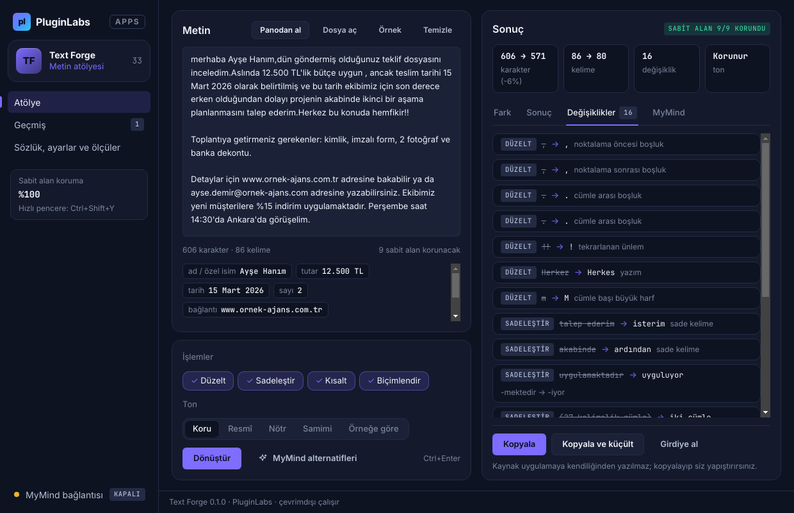
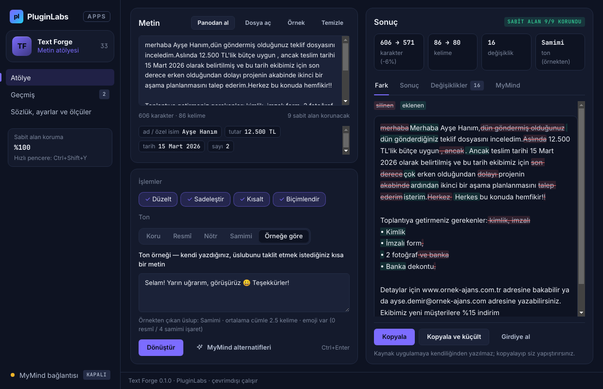
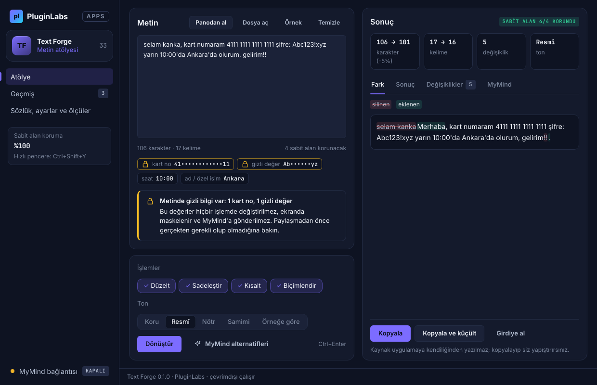
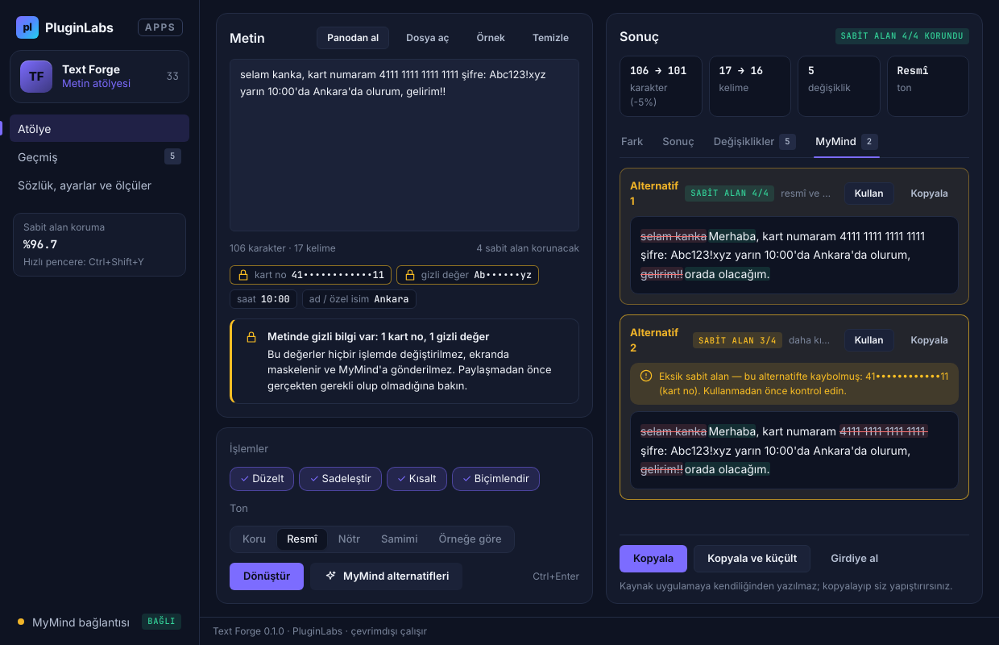
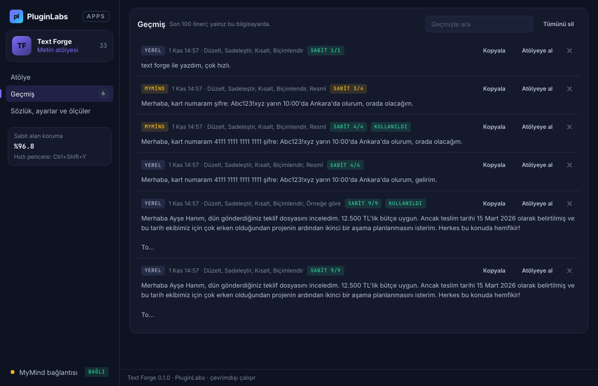
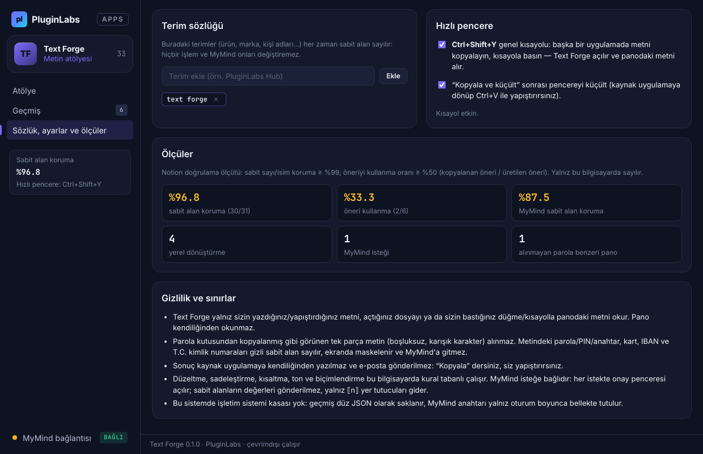
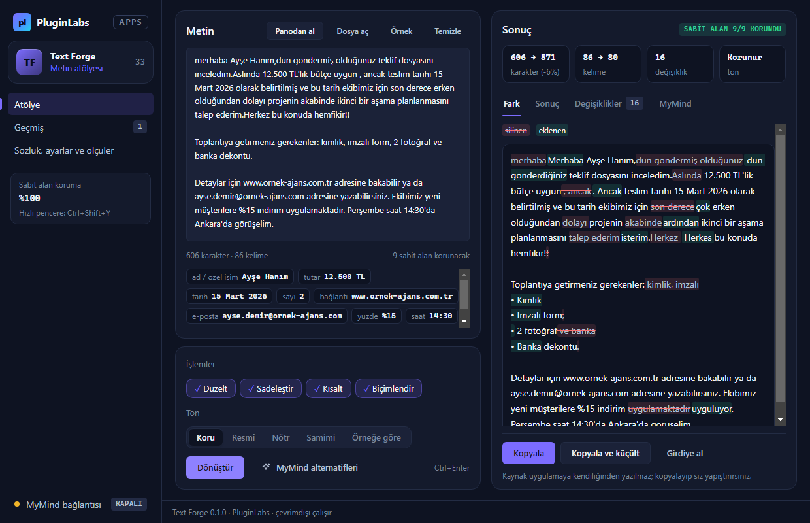
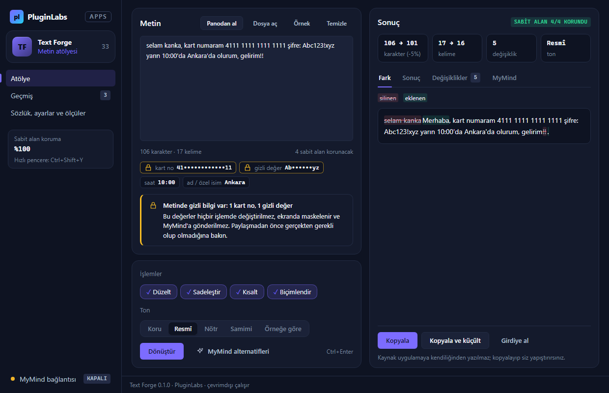
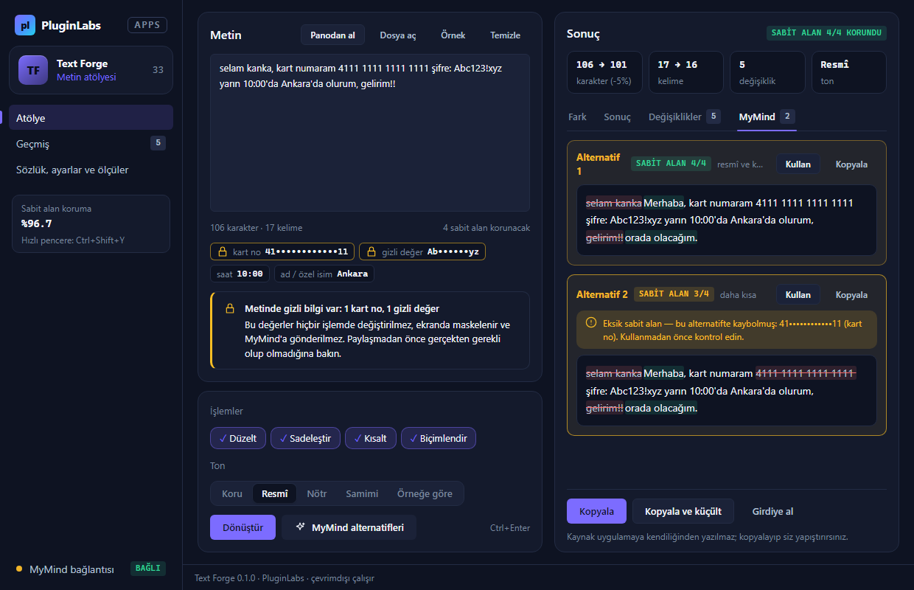

# Text Forge (PL-033) — Windows uygulaması

Kısa metinleri seçtiğiniz işleme (düzelt, sadeleştir, kısalt, biçimlendir) ve tona (resmî, nötr, samimi ya da kendi ton örneğiniz) göre yeniden yazar. Sayı, tarih, tutar, ad, e-posta, bağlantı gibi **sabit alanlar** işlemden önce korumaya alınır ve sonuçta aynen bulunduğu denetlenir. Sonuç kelime düzeyinde fark görünümüyle gösterilir; kaynak uygulamaya kendiliğinden yazılmaz — “Kopyala” deyip siz yapıştırırsınız.

> Ürün deposu henüz yok; kaynak bu klasördedir (PluginLabs ürün ön geliştirme alanı, PL-025 modeli). Windows paketleri `pluginlabs-dagitim` deposunda `text-forge-v<sürüm>` etiketiyle yayımlanır.


| Değişiklik listesi | Ton örneğine göre |
| --- | --- |
|  |  |
| **Gizli veri koruması (Ctrl+Shift+Y ile panodan)** | **MyMind alternatifleri: sabit alan denetimi** |
|  |  |
| **Geçmiş** | **Sözlük, ayarlar ve ölçüler** |
|  |  |

Ekran görüntüleri gerçek uygulamadan, duman testinin test verisiyle alınmıştır (`masaustu-*`: Linux/xvfb, commit b3d7cd7; `windows-masaustu-*`: GitHub Actions Windows runner, [çalıştırma 41318853222](https://github.com/timdesigners-pixel/pluginlabs-dagitim/actions/runs/41318853222), release ekinde de var).

**Windows'ta (Windows runner, gerçek pencere):**



| Windows — gizli veri koruması | Windows — MyMind alternatifleri |
| --- | --- |
|  |  |

## İndir
[text-forge-v0.1.0](https://github.com/timdesigners-pixel/pluginlabs-dagitim/releases/tag/text-forge-v0.1.0) — `TextForge-0.1.0-Windows-x64.exe` (kurulum, SHA-256 `1f02edc8…ae0e`), `TextForge-0.1.0-Windows-Portable-x64.exe` (taşınabilir, SHA-256 `d550f53d…b78f`, 81 521 242 bayt), SHA256SUMS + BUILD-INFO. İmzasız önizleme. PluginLabs Hub kataloğundan da kurulabilir (Hub kataloğu birleşip yayımlanınca).

## Kullanım
1. Metni yazın/yapıştırın, **Panodan al**, **Dosya aç** (.txt/.md) ya da başka bir uygulamada metni kopyalayıp **Ctrl+Shift+Y**. İlk deneme için **Örnek**.
2. Girdinin altında korunacak sabit alanları görün (gizli değerler maskeli ve kilitli).
3. İşlemleri (Düzelt · Sadeleştir · Kısalt · Biçimlendir) ve tonu seçin; **Dönüştür** (Ctrl+Enter).
4. **Fark**, **Sonuç**, **Değişiklikler** sekmelerinden inceleyin; **Kopyala** ya da **Kopyala ve küçült** (kaynak uygulamada Ctrl+V).
5. İsteğe bağlı: **MyMind bağlantısı** → Hub istemci anahtarı → **MyMind alternatifleri** (her istekte onay). Beğendiğiniz alternatifte **Kullan**.
6. **Sözlük**: marka/ürün/kişi adlarını ekleyin; hiçbir işlem onları değiştirmez.

## Güvenlik ve gizlilik
- Pano yalnız kullanıcı eylemiyle (düğme ya da Ctrl+Shift+Y) okunur; parola kutusundan kopyalanmış gibi görünen tek parça metin alınmaz. Sonuç kaynak uygulamaya otomatik yazılmaz; e-posta gönderimi yok.
- Parola/PIN/anahtar, kart (Luhn), IBAN ve T.C. kimlik (sağlama) gizli sabit alan: maskeli gösterilir, değiştirilmez, MyMind'a gitmez.
- Ağ erişimi yalnız `desktop/net.js` içinde ve yalnız yerel Hub'a (127.0.0.1:47632). MyMind'a yalnız ⟦n⟧ yer tutuculu metin gider; `<metin>` sınırı kaçırılır, metindeki talimatlar veri sayılır.
- Arayüz `contextIsolation` + `sandbox`; CSP `connect-src 'none'`; metin yalnız `textContent`/`value` ile yazılır; gezinme ve yeni pencere engelli; IPC yalnız kendi penceresinden.
- Geçmiş, sözlük ve anahtar Windows kasasında (DPAPI) şifreli; kasa yoksa geçmiş düz JSON, anahtar yalnız bellekte.

## Geliştirme
```bash
npm ci
npm test                                   # çekirdek birim testleri (node:test)
PLAYWRIGHT_MODULE=playwright xvfb-run -a -s "-screen 0 1440x900x24" node tests/desktop-smoke.cjs docs/screenshots
npm run build:win                          # Windows: kurulum + taşınabilir
node scripts/make-icons.cjs                # simgeleri yeniden üret
```
Windows derlemesi `ci/pluginlabs-dagitim-text-forge-windows.yml` iş akışıyla `pluginlabs-dagitim` deposunda, sabit bir PluginLabs commit'inden yapılır.
