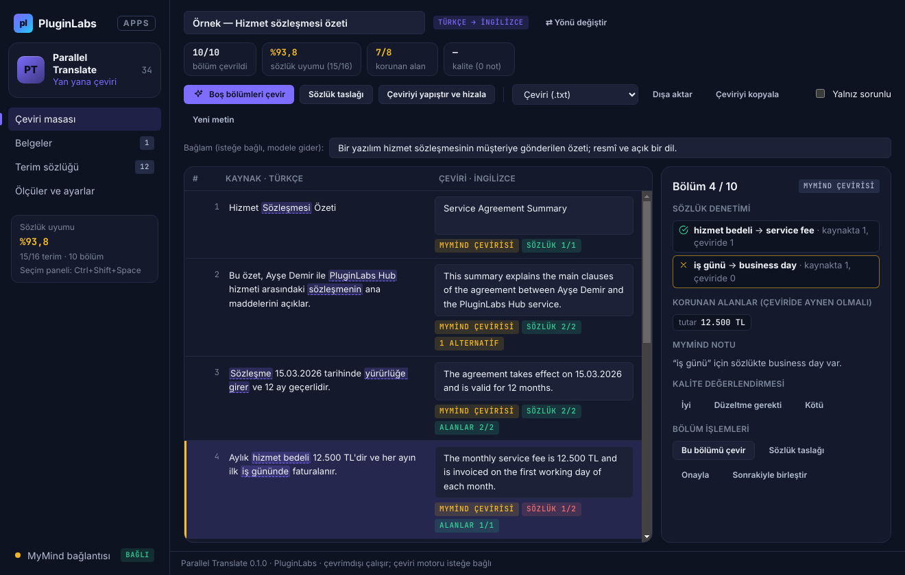

# PL-034 · Parallel Translate

> Seçilen metni özgün içerikle yan yana çevirir ve kişisel terim sözlüğünü uygular.

| Alan | Değer |
| --- | --- |
| Kimlik | `PL-034` · `parallel-translate` |
| Kategori | 04 · Araştırma, yazma ve bilgi akışları — PL-031–040 |
| Durum | 01.11.2026: **0.1.0 Windows uygulaması yayımlandı** — [parallel-translate-v0.1.0](https://github.com/timdesigners-pixel/pluginlabs-dagitim/releases/tag/parallel-translate-v0.1.0) (`pluginlabs-dagitim`, Windows runner: test + duman testi + SHA256 + BUILD-INFO + Windows ekran görüntüleri); kaynak [app/](app/README.md); Hub 0.4.11 kataloğunda · Notion durumu: Yeni fikir |
| Öncelik / efor | P1 · M |
| Hedef platformlar | Windows, Linux, macOS, Chrome |
| Dağıtım biçimi | masaüstü uygulaması, Chrome eklentisi (Manifest V3) |
| Geliştirme deposu | Henüz yok — kaynak bu klasörün [`app/`](app/README.md) alt klasöründe (ön geliştirme alanı; bkz. [repo hiyerarşisi](../../../docs/REPO-HIYERARSISI.md)); Windows derlemesi ve sürüm dosyaları `pluginlabs-dagitim` deposunda (iş akışı: [`app/ci/`](app/ci/pluginlabs-dagitim-parallel-translate-windows.yml)) |
| Codex projesi | `PL-034 · Parallel Translate` — ikinci klasör: PluginLabs |
| Notion kaynağı | [Notion](https://app.notion.com/p/4038aa13d8f981c08edfda43643b31fc) |

## Ne işe yarar

**Kullanıcı ve problem:** İki dil arasında çalışırken çeviri ve özgün metni birlikte izlemek isteyen kişiler.

**Kısa tanım (Hub kataloğu):** Seçilen metni özgün içerikle yan yana çevirir ve kişisel terim sözlüğünü uygular.

## Hangi platformlar için yayınlanır

**Notion’daki platform tanımı:** Chrome + W / L / M seçim paneli

- Windows
- Linux
- macOS
- Chrome

> Platformlar hedef kapsamdır. PluginLabs ürün ilkesi gereği test edilmemiş platform “destekleniyor” diye etiketlenmez; her platform gerçek cihaz/tarayıcı kabulünden sonra yayın listesine girer.

## Özellikler

### MVP ve temel akış

Seçilen metni yan yana çevir; kişisel terim sözlüğü ve bölüm eşleştirme. İlk sürüm Türkçe-İngilizce.

### Yapay zekânın rolü

Bağlama uygun çeviri, alternatif terim ve kısa açıklama üretir.

## Teknik bağımlılık ve sınırlar

Gizli sözleşme/mesajlar için yerel model seçeneği; teknik/hukuki anlam doğrulaması kullanıcıda. Sınırsız düşük maliyet iddiası yok.

## Gelir hipotezi

Ücretsiz günlük kota; Pro belge boyutu ve kurumsal sözlük.

## Doğrulama ölçütü

Temsilî terim kümesinde sözlük uyumu ≥%95; insan kalite değerlendirmesi.

## Öncelik ve efor

P1 · M; birden çok dil desteği aşamalı.

## 0.1.0 sürümü (Windows)

Metin yapıştırılır, **Panodan al** (yalnız kullanıcı eylemiyle), `.txt`/`.md` dosyası ya da **Ctrl+Shift+Space** seçim paneliyle (başka uygulamada kopyala → kısayol) alınır; kaynak dil (Türkçe/İngilizce) otomatik tespit edilir. Metin paragraf, madde satırı ve cümle **bölümlerine** ayrılır (kısaltma ve ondalık sayılar bölünmez); her bölümün karşısında çeviri kutusu vardır — **yan yana** çalışma, bölüm birleştirme. **Kişisel terim sözlüğü** (TR ⇄ EN, not, `|` ile birden çok kabul edilen karşılık; CSV içe/dışa aktarma) her bölümde canlı denetlenir: Türkçe ekler ve ünsüz yumuşaması (sözleşmenin, kitabı), İngilizce çoğul/fiil/iyelik (parties, invoiced, party's) tanınır; kaynakta terimler işaretlenir, çeviride karşılığı yoksa bölüm uyarılır. Notion doğrulama ölçütü (sözlük uyumu ≥ %95) kenar çubuğunda ve Ölçüler'de canlı; **insan kalite değerlendirmesi** bölüm başına İyi / Düzeltme gerekti / Kötü notuyla. Sayı, tutar, saat, bağlantı, e-posta ve gizli değerler **korunan alan**dır, çeviride aranır. Elinizdeki çeviriyi **yapıştırıp hizalama** (1-1, 1-2, 2-1) ve çevrimdışı **sözlük taslağı** vardır. **MyMind** (Hub üzerinden) ya da gizli belgeler için bu bilgisayardaki **yerel model** (LM Studio/Ollama; adres yalnız loopback) ile bağlama uygun çeviri, alternatif terim ve kısa açıklama üretilir: her istekte onay; korunan alan değerleri gönderilmez (⟦n⟧), sözlükten yalnız ilgili terimler gider; elle düzenlenmiş çeviri üzerine yazılmaz. Dışa aktarma: .txt, iki sütunlu .csv (Excel), Markdown tablo, **TMX** (çeviri belleği); JSON yedek. Silme yok, arşivleme var; kayıt Windows kasasıyla (DPAPI) şifreli.

Kapsam dışı (bu sürüm): Chrome eklentisi (sayfada seçimi doğrudan çevirme), Linux/macOS paketleri, Türkçe/İngilizce dışındaki diller, uygulamanın kendi makine çevirisi (motor isteğe bağlı MyMind ya da yerel model), günlük kota / Pro. Ayrıntı: [app/README.md](app/README.md).

## Geliştirme ve ortak çalışma (Codex + Claude Code)

- Dal adı: `codex/PL-034-<konu>` veya `claude/PL-034-<konu>`; iki ajan aynı dalda aynı anda çalışmaz.
- İşe başlamadan önce [AKTIF-ISLER.md](../../../docs/ortak-calisma/AKTIF-ISLER.md) tablosuna satır eklenir; iş bitince devir notu yazılır.
- Kurallar: [AGENTS.md](../../../AGENTS.md) (her iki ajan için ortak), protokol: [AI-ORTAK-CALISMA.md](../../../docs/ortak-calisma/AI-ORTAK-CALISMA.md).

## Notion kartının özgün metni

Aşağıdaki metin `resources/notion-catalog.json` (Notion anlık görüntüsü, 2026-10-26) içindeki kartın kısaltılmadan aktarılmış hâlidir.

Tam kartı göster

- **Durum:** Yeni fikir
- **Platform:** Chrome + W / L / M seçim paneli
- **Kullanıcı ve problem:** İki dil arasında çalışırken çeviri ve özgün metni birlikte izlemek isteyen kişiler.
- **MVP ve temel akış:** Seçilen metni yan yana çevir; kişisel terim sözlüğü ve bölüm eşleştirme. İlk sürüm Türkçe-İngilizce.
- **Yapay zekânın rolü:** Bağlama uygun çeviri, alternatif terim ve kısa açıklama üretir.
- **Teknik bağımlılık ve sınır:** Gizli sözleşme/mesajlar için yerel model seçeneği; teknik/hukuki anlam doğrulaması kullanıcıda. Sınırsız düşük maliyet iddiası yok.
- **Gelir hipotezi:** Ücretsiz günlük kota; Pro belge boyutu ve kurumsal sözlük.
- **Doğrulama ölçütü:** Temsilî terim kümesinde sözlük uyumu ≥%95; insan kalite değerlendirmesi.
- **Öncelik ve efor:** P1 · M; birden çok dil desteği aşamalı.

---
Oluşturma: 29.10.2026 · Kaynak → hedef: Notion kataloğu → `registry/projects.json` → bu dosya
