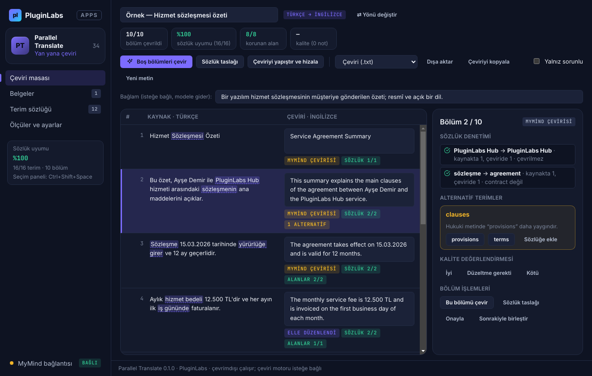
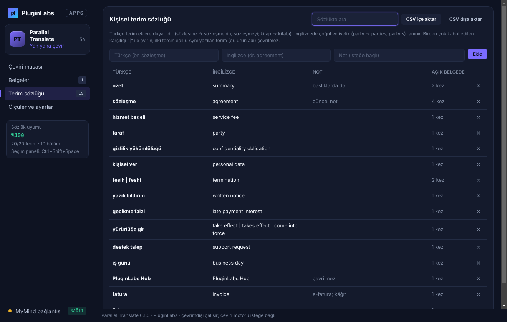
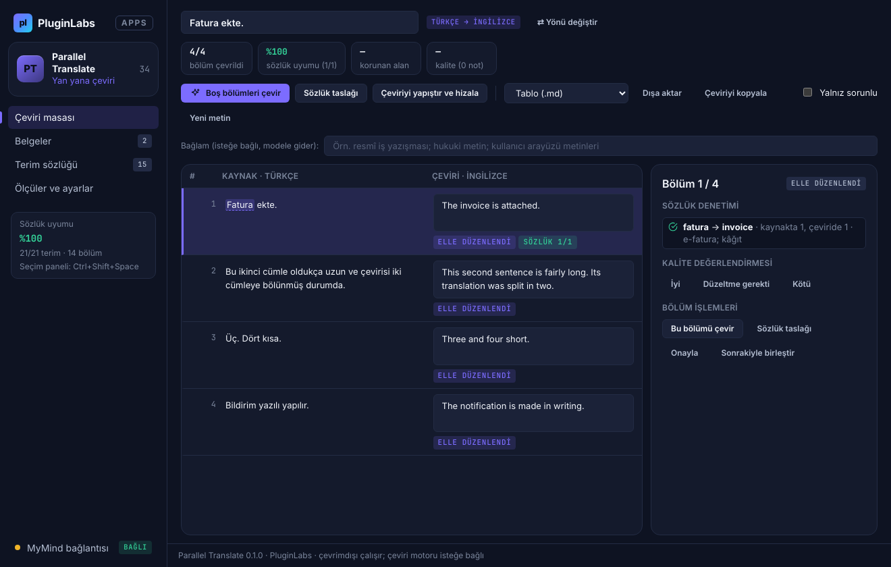
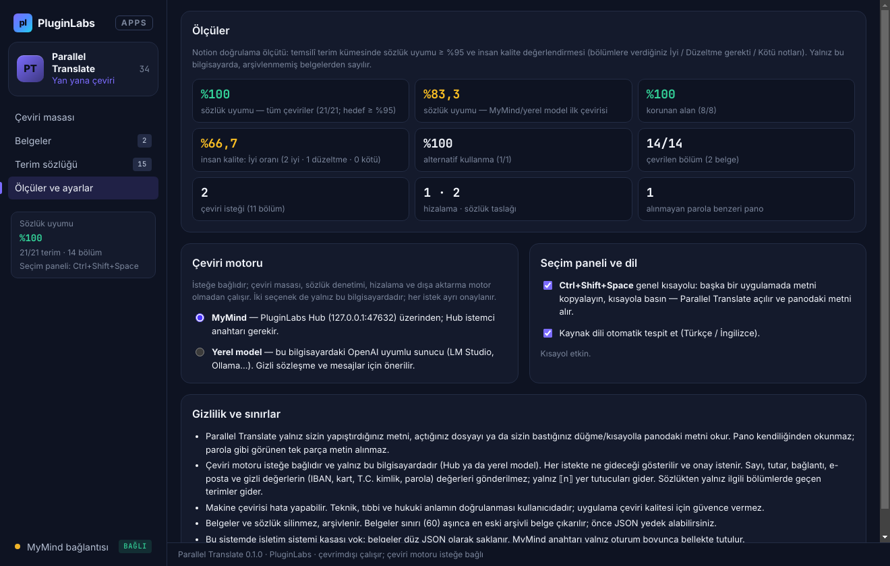
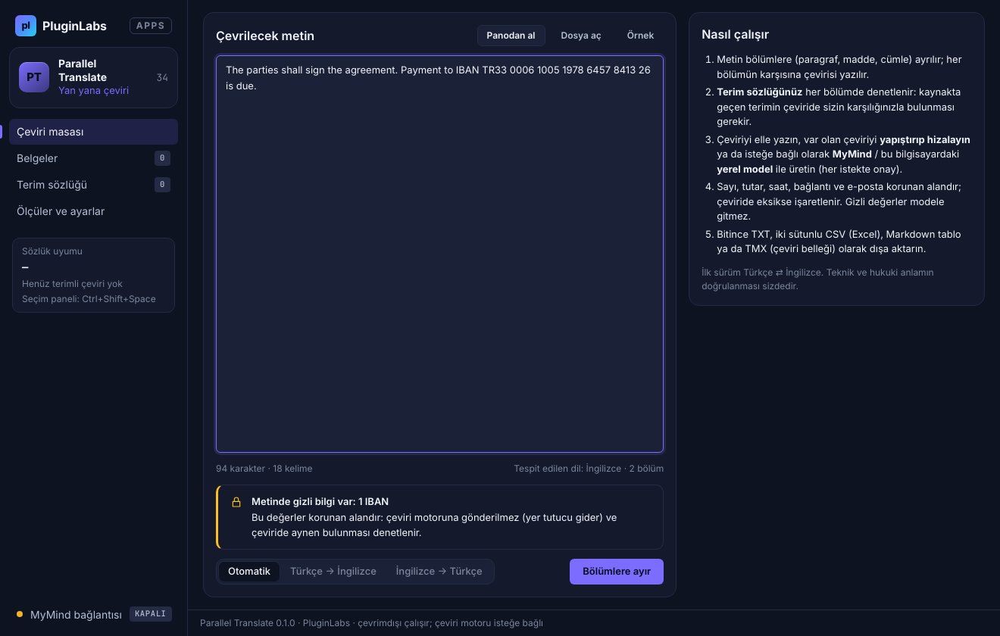
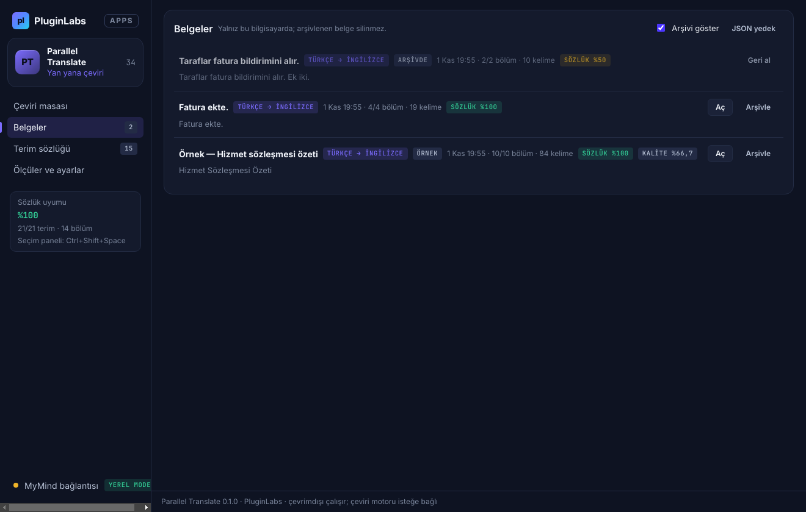
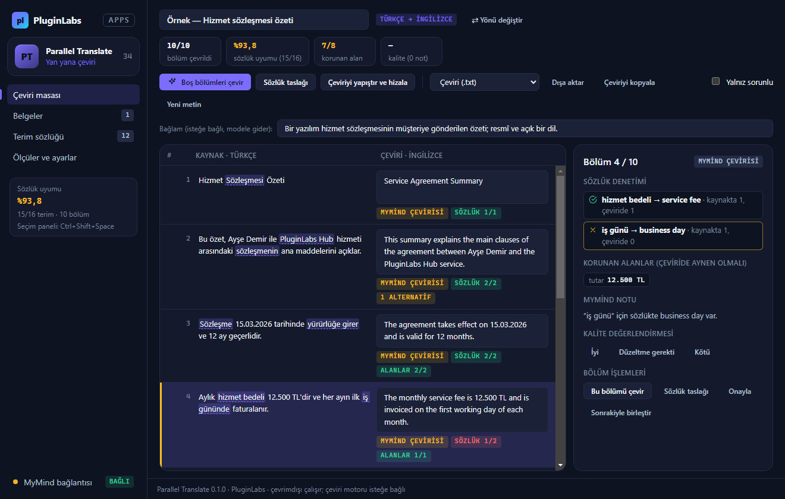
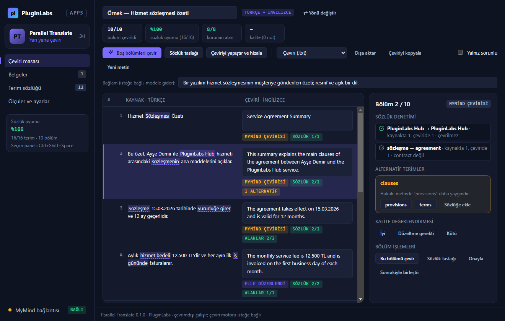
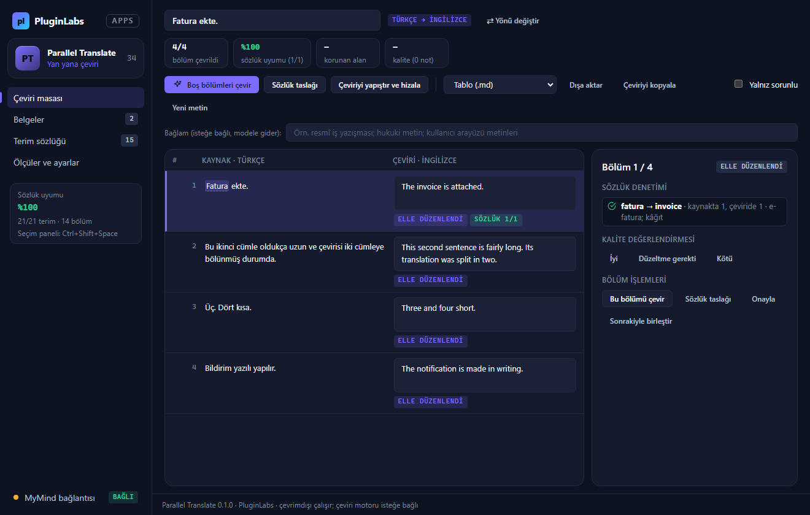

# Parallel Translate (PL-034) — Windows uygulaması

Seçtiğiniz ya da yapıştırdığınız metni paragraf, madde ve cümle **bölümlerine** ayırır; her bölümün karşısına çevirisini yazarsınız — özgün metin ve çeviri **yan yana**. **Kişisel terim sözlüğünüz** (Türkçe ⇄ İngilizce) her bölümde denetlenir: kaynakta geçen terimin çeviride sizin karşılığınızla bulunması gerekir. Sayı, tutar, saat, bağlantı ve e-posta gibi **korunan alanlar** çeviride aranır. Çeviriyi elle yazabilir, elinizdeki çeviriyi yapıştırıp **hizalayabilir** ya da isteğe bağlı olarak **MyMind** (PluginLabs Hub) veya bu bilgisayardaki **yerel model** ile — her istekte onayla — üretebilirsiniz.

> Ürün deposu henüz yok; kaynak bu klasördedir (PluginLabs ürün ön geliştirme alanı, PL-025 modeli). Windows paketleri `pluginlabs-dagitim` deposunda `parallel-translate-v<sürüm>` etiketiyle yayımlanır.


| Alternatif terim (MyMind) | Terim sözlüğü |
| --- | --- |
|  |  |
| **Var olan çeviriyi hizalama** | **Ölçüler ve ayarlar (yerel model)** |
|  |  |
| **Metin girişi (dil tespiti, gizli veri uyarısı)** | **Belgeler (arşiv)** |
|  |  |

Ekran görüntüleri gerçek uygulamadan, duman testinin test verisiyle (uydurma örnek sözleşme özeti; taklit MyMind yanıtı) alınmıştır (`masaustu-*`: Linux/xvfb, commit 4127858; `windows-masaustu-*`: GitHub Actions Windows runner, [çalıştırma 41344219418](https://github.com/timdesigners-pixel/pluginlabs-dagitim/actions/runs/41344219418), release ekinde de var).

**Windows'ta (Windows runner, gerçek pencere):**



| Windows — alternatif terim | Windows — hizalama |
| --- | --- |
|  |  |

## İndir
[parallel-translate-v0.1.0](https://github.com/timdesigners-pixel/pluginlabs-dagitim/releases/tag/parallel-translate-v0.1.0) — `ParallelTranslate-0.1.0-Windows-x64.exe` (kurulum, SHA-256 `1ea56960…3c13`), `ParallelTranslate-0.1.0-Windows-Portable-x64.exe` (taşınabilir, SHA-256 `9cf8b34c…5c1b`, 81 527 975 bayt), SHA256SUMS + BUILD-INFO. İmzasız önizleme. PluginLabs Hub kataloğundan da kurulabilir (Hub kataloğu birleşip yayımlanınca).

## Kullanım
1. Metni yapıştırın, **Panodan al**, **Dosya aç** (.txt/.md) ya da başka bir uygulamada metni kopyalayıp **Ctrl+Shift+Space**. İlk deneme için **Örnek** (temsilî terim kümesini de ekler).
2. Yönü seçin (Otomatik / Türkçe → İngilizce / İngilizce → Türkçe) ve **Bölümlere ayır**.
3. Her bölümün karşısına çeviriyi yazın (Alt+↑/↓ bölümler arasında gezinir). Ya da:
   - **Çeviriyi yapıştır ve hizala**: elinizdeki çeviri bölümlerle eşleştirilir.
   - **Boş bölümleri çevir**: MyMind / yerel model (onay penceresi neyin gideceğini gösterir).
   - **Sözlük taslağı**: boş bölümlere yalnız sözlük terimleri yerleştirilir (çeviri değildir).
4. Sağdaki panelde seçili bölümün sözlük denetimi, korunan alanları, MyMind notu ve **alternatif terimleri** (tek tıkla uygula) görünür. **İyi / Düzeltme gerekti / Kötü** ile değerlendirin, **Onayla**.
5. **Dışa aktar**: çeviri .txt, iki sütunlu .csv (Excel), Markdown tablo, TMX (çeviri belleği); ya da **Çeviriyi kopyala**.

## Güvenlik ve gizlilik
- Pano yalnız kullanıcı eylemiyle (düğme ya da Ctrl+Shift+Space) okunur; parola kutusundan kopyalanmış gibi görünen tek parça metin alınmaz.
- Ağ erişimi yalnız `desktop/net.js` içinde ve yalnız bu bilgisayara: Hub (127.0.0.1:47632) ya da kullanıcının yerel model sunucusu (adres yalnız 127.0.0.1 / localhost / ::1 olabilir; `redirect: error`).
- Modele korunan alanların değerleri gitmez (yalnız ⟦n⟧), sözlükten yalnız ilgili bölümlerde geçen terimler gider; `<bolumler>`/`<sozluk>` sınırları kaçırılır, metindeki talimatlar veri sayılır. Yanıtta yalnız istenen bölümler kabul edilir; yer tutucu ve sözlük denetiminden geçer. Elle düzenlenmiş çeviriler üzerine yazılmaz.
- Arayüz `contextIsolation` + `sandbox`; CSP `connect-src 'none'`; metin yalnız `textContent`/`value` ile yazılır; gezinme ve yeni pencere engelli; IPC yalnız kendi penceresinden. CSV dışa aktarmada formül enjeksiyonu engellenir.
- Belgeler, sözlük ve anahtar Windows kasasında (DPAPI) şifreli; kasa yoksa belgeler düz JSON, anahtar yalnız bellekte.

## Geliştirme
```bash
npm ci
npm test                                   # çekirdek birim testleri (node:test)
PLAYWRIGHT_MODULE=playwright xvfb-run -a -s "-screen 0 1440x900x24" node tests/desktop-smoke.cjs docs/screenshots
npm run build:win                          # Windows: kurulum + taşınabilir
node scripts/make-icons.cjs                # simgeleri yeniden üret
```
Windows derlemesi `ci/pluginlabs-dagitim-parallel-translate-windows.yml` iş akışıyla `pluginlabs-dagitim` deposunda, sabit bir PluginLabs commit'inden yapılır.
