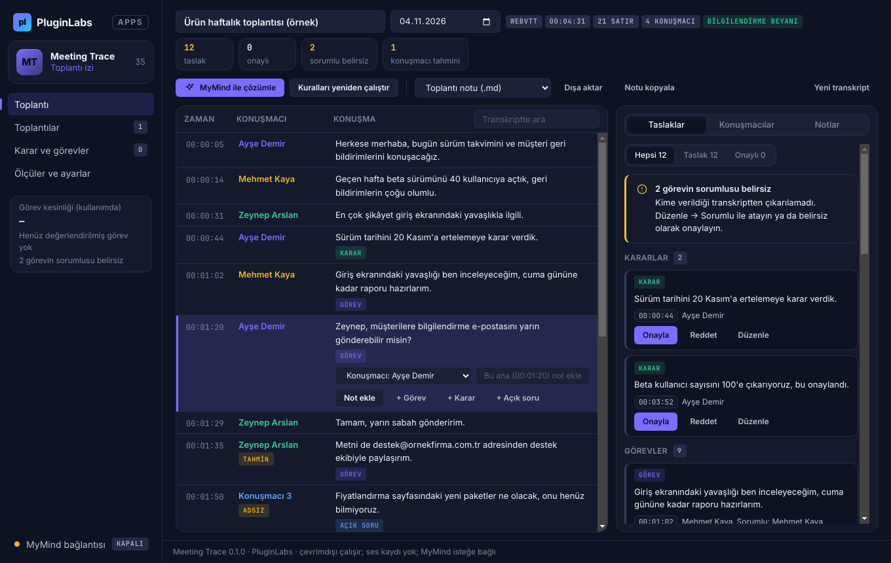

# PL-035 · Meeting Trace

> İzinli kayıt veya yüklenen transkriptten zaman damgalı toplantı notları, kararlar ve görev taslakları çıkarır.

| Alan | Değer |
| --- | --- |
| Kimlik | `PL-035` · `meeting-trace` |
| Kategori | 04 · Araştırma, yazma ve bilgi akışları — PL-031–040 |
| Durum | 07.11.2026: **0.1.0 Windows uygulaması yayımlandı** — [meeting-trace-v0.1.0](https://github.com/timdesigners-pixel/pluginlabs-dagitim/releases/tag/meeting-trace-v0.1.0) (`pluginlabs-dagitim`, Windows runner: test + duman testi + SHA256 + BUILD-INFO + Windows ekran görüntüleri); kaynak [app/](app/README.md); Hub 0.4.21 kataloğunda · Notion durumu: Yeni fikir |
| Öncelik / efor | P2 · L |
| Hedef platformlar | Windows, Linux, macOS |
| Dağıtım biçimi | masaüstü uygulaması |
| Geliştirme deposu | Henüz yok — kaynak bu klasörün [`app/`](app/README.md) alt klasöründe (ön geliştirme alanı; bkz. [repo hiyerarşisi](../../../docs/REPO-HIYERARSISI.md)); Windows derlemesi ve sürüm dosyaları `pluginlabs-dagitim` deposunda (iş akışı: [`app/ci/`](app/ci/pluginlabs-dagitim-meeting-trace-windows.yml)) |
| Codex projesi | `PL-035 · Meeting Trace` — ikinci klasör: PluginLabs |
| Notion kaynağı | [Notion](https://app.notion.com/p/4038aa13d8f981c08edfda43643b31fc) |

## Ne işe yarar

**Kullanıcı ve problem:** Toplantı kararlarını ve görev sahiplerini sonradan bulamayan ekipler.

**Kısa tanım (Hub kataloğu):** İzinli kayıt veya yüklenen transkriptten zaman damgalı toplantı notları, kararlar ve görev taslakları çıkarır.

## Hangi platformlar için yayınlanır

**Notion’daki platform tanımı:** W / L / M; tarayıcı toplantı yakalama isteğe bağlı

- Windows
- Linux
- macOS

> Platformlar hedef kapsamdır. PluginLabs ürün ilkesi gereği test edilmemiş platform “destekleniyor” diye etiketlenmez; her platform gerçek cihaz/tarayıcı kabulünden sonra yayın listesine girer.

## Özellikler

### MVP ve temel akış

İzinli ses kaydı veya kullanıcı yüklediği transkript → zaman damgalı not → karar/görev taslağı → insan onayı.

### Yapay zekânın rolü

Konuşmacı ayrımı ve karar çıkarımı; konuşmacı kimliğinin belirsiz olduğu yerde tahmin etiketli.

## Teknik bağımlılık ve sınırlar

Kayıt için katılımcı bilgilendirme/izin akışı ve kaynak platform kuralları. İlk sürüm yüklenen dosyada; gizli sürekli kayıt yok.

## Gelir hipotezi

Dakika bazlı kredi + ekip lisansı.

## Doğrulama ölçütü

Elle etiketli örneklerde görev çıkarma kesinliği ≥%90; atanan kişi belirsizlikleri görünür.

## Öncelik ve efor

P2 · L; gerçek zamanlı çok platform ses yakalama sonraki faz.

## 0.1.0 sürümü (Windows)

Kullanıcının yüklediği ya da yapıştırdığı transkript (WebVTT — Teams/Zoom/Meet —, SRT, `[00:01:02] Ad: metin`, `Ad (00:01:02): metin`, Teams kopyası, `Ad: metin`, düz metin) **katılımcı bilgilendirme beyanı** işaretlendikten sonra zaman damgalı satırlara ayrılır; **ses kaydı yapılmaz** (mikrofon/ekran izni reddedilir — Notion: “ilk sürüm yüklenen dosyada; gizli sürekli kayıt yok”). Konuşmacısı yazmayan satır önceki konuşmacıya **tahmin** etiketiyle bağlanır; adsız etiketler (“Konuşmacı 3”) işaretlenir, adlandırılır, birleştirilir, satır satır doğrulanır. Kurala dayalı (Türkçe + İngilizce) **karar**, **görev** ve **açık soru** taslakları kaynak satırına bağlıdır; görevlerde **sorumlu** (adı geçen kişi, üstlenen konuşmacı, sonraki satırda kabul eden — tahmin —, “biz” — ekip) ve toplantı tarihine göre çözülen **son tarih** (yarın, cuma, haftaya pazartesi, ay sonu, 15 Kasım…). Sorumlusu çıkarılamayan görev **belirsiz** olarak görünür (Notion: atanan kişi belirsizlikleri görünür). Her taslak **insan onayından** geçer (onayla / reddet / düzenle); satırdan elle öğe ve **zaman damgalı not** eklenir. Tüm toplantılardan **karar ve görevler** listesi (kişi arama, belirsiz süzgeci, gecikme vurgusu). Dışa aktarma: toplantı notu (Markdown/TXT), CSV, ICS (VTODO). **MyMind** ya da **yerel model** (loopback) ile onaylı çözümleme: konuşmacı adları S1… takma adlarıyla, hassas değerler ⟦n⟧ ile gider; dayanaksız öneri atılır. Notion doğrulama ölçütü: elle etiketli örnekte görev çıkarma kesinliği ≥ %90 — örnekte 12/12, iki bağımsız etiketli örnekte de ≥ %90 (birim testi); kullanımdaki kesinlik onay/red kararlarından uygulamada ölçülür.

Kapsam dışı (bu sürüm): ses kaydı ve ses → metin, sesten konuşmacı ayrımı, gerçek zamanlı çok platform yakalama, tarayıcı toplantı yakalama, Linux/macOS paketleri, dakika kredisi / ekip lisansı. Ayrıntı: [app/README.md](app/README.md).

## Geliştirme ve ortak çalışma (Codex + Claude Code)

- Dal adı: `codex/PL-035-<konu>` veya `claude/PL-035-<konu>`; iki ajan aynı dalda aynı anda çalışmaz.
- İşe başlamadan önce [AKTIF-ISLER.md](../../../docs/ortak-calisma/AKTIF-ISLER.md) tablosuna satır eklenir; iş bitince devir notu yazılır.
- Kurallar: [AGENTS.md](../../../AGENTS.md) (her iki ajan için ortak), protokol: [AI-ORTAK-CALISMA.md](../../../docs/ortak-calisma/AI-ORTAK-CALISMA.md).

## Notion kartının özgün metni

Aşağıdaki metin `resources/notion-catalog.json` (Notion anlık görüntüsü, 2026-10-26) içindeki kartın kısaltılmadan aktarılmış hâlidir.

Tam kartı göster

- **Durum:** Yeni fikir
- **Platform:** W / L / M; tarayıcı toplantı yakalama isteğe bağlı
- **Kullanıcı ve problem:** Toplantı kararlarını ve görev sahiplerini sonradan bulamayan ekipler.
- **MVP ve temel akış:** İzinli ses kaydı veya kullanıcı yüklediği transkript → zaman damgalı not → karar/görev taslağı → insan onayı.
- **Yapay zekânın rolü:** Konuşmacı ayrımı ve karar çıkarımı; konuşmacı kimliğinin belirsiz olduğu yerde tahmin etiketli.
- **Teknik bağımlılık ve sınır:** Kayıt için katılımcı bilgilendirme/izin akışı ve kaynak platform kuralları. İlk sürüm yüklenen dosyada; gizli sürekli kayıt yok.
- **Gelir hipotezi:** Dakika bazlı kredi + ekip lisansı.
- **Doğrulama ölçütü:** Elle etiketli örneklerde görev çıkarma kesinliği ≥%90; atanan kişi belirsizlikleri görünür.
- **Öncelik ve efor:** P2 · L; gerçek zamanlı çok platform ses yakalama sonraki faz.

---
Oluşturma: 29.10.2026 · Kaynak → hedef: Notion kataloğu → `registry/projects.json` → bu dosya
