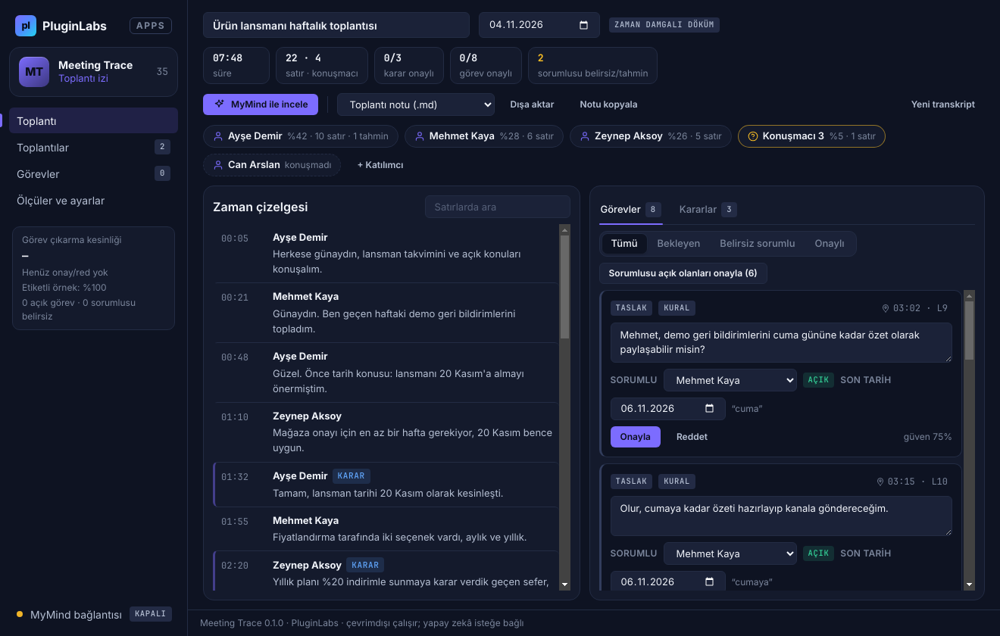
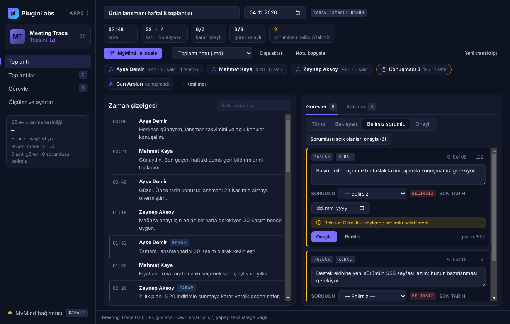
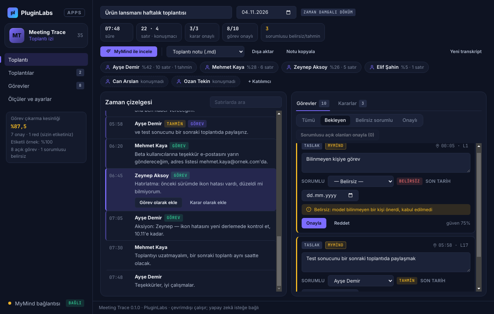
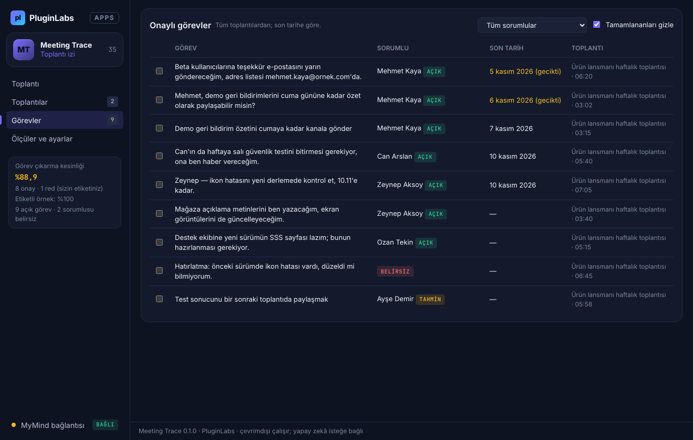
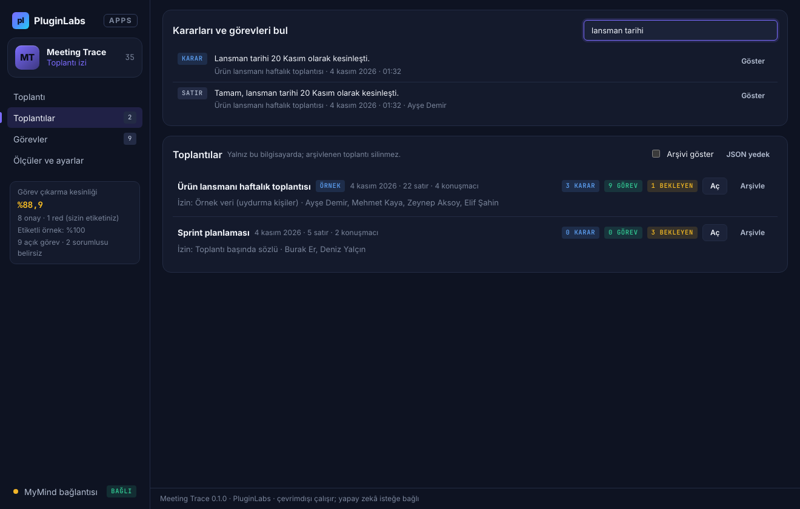

# Meeting Trace (PL-035) — Windows uygulaması

Toplantı transkriptinizi (Teams, Zoom, Google Meet dökümü, WebVTT, SRT ya da düz metin) **zaman damgalı notlara**, **kararlara** ve **görev taslaklarına** dönüştürür. Her görevde sorumlu ve son tarih önerilir; sorumlu metinden açıkça çıkmıyorsa **Belirsiz** ya da **Tahmin** olarak işaretlenir ve nedeni yazılır. Hiçbir taslak sizin onayınız olmadan nota girmez. Toplantılar, onaylı kararlar ve görevler sonradan aranabilir. İsteğe bağlı olarak **MyMind** (PluginLabs Hub) ya da bu bilgisayardaki **yerel model** ile — her istekte onayla, adlar kodlanarak — inceleme yapılır.

> Ürün deposu henüz yok; kaynak bu klasördedir (PluginLabs ürün ön geliştirme alanı, PL-025 modeli). Windows paketleri `pluginlabs-dagitim` deposunda `meeting-trace-v<sürüm>` etiketiyle yayımlanır.



| Sorumlusu belirsiz görevler (neden görünür) | MyMind incelemesi (taslak, onay bekler) |
| --- | --- |
|  |  |
| **Transkript girişi (biçim tanıma, izin kaydı)** | **Onaylı görevler** |
|  |  |
| **Toplantılar ve arama** | **Ölçüler ve ayarlar** |
|  |  |

Ekran görüntüleri gerçek uygulamadan, duman testinin test verisiyle (uydurma örnek toplantı; taklit MyMind yanıtı) Linux/xvfb'de alınmıştır. Windows runner'ında alınan gerçek pencere görüntüleri release ekindedir (`windows-masaustu-*`).

## İndir
[meeting-trace-v0.1.0](https://github.com/timdesigners-pixel/pluginlabs-dagitim/releases/tag/meeting-trace-v0.1.0) — `MeetingTrace-0.1.0-Windows-x64.exe` (kurulum), `MeetingTrace-0.1.0-Windows-Portable-x64.exe` (taşınabilir), SHA256SUMS + BUILD-INFO. İmzasız önizleme. PluginLabs Hub kataloğundan da kurulabilir (Hub kataloğu birleşip yayımlanınca).

## Kullanım
1. **Dosya aç** (.vtt, .srt, .txt), transkripti yapıştırın ya da **Panodan al**. İlk deneme için **Örnek toplantı** (uydurma kişiler; elle etiketli).
2. Toplantı adı, tarih (son tarihler buna göre hesaplanır) ve varsa konuşmayan katılımcıları girin.
3. **Katılımcılar bilgilendirildi** kutusunu işaretleyin, bilgilendirme yolunu seçin (gerekirse **Bilgilendirme metnini kopyala**) ve **Transkripti çözümle**.
4. Sağda **Görevler / Kararlar** taslakları: metni düzeltin, sorumluyu ve son tarihi seçin, **Onayla** ya da **Reddet**. **Belirsiz sorumlu** süzgeci gözden geçirilmesi gerekenleri gösterir. Konuşmacı çiplerine tıklayıp "Konuşmacı 3" gibi etiketlere gerçek ad verin. Soldaki satıra tıklayıp elle görev/karar ekleyin.
5. İsteğe bağlı **MyMind ile incele** (onay penceresi neyin gideceğini gösterir).
6. **Dışa aktar**: toplantı notu .md/.txt, görevler .csv (Excel), takvim görevleri .ics — yalnız onaylı öğeler. **Toplantılar** sekmesinde tüm toplantılarda arayın; **Görevler** sekmesinde açık işleri izleyin.

Kısayollar: Ctrl+O dosya aç, Ctrl+Enter çözümle, Ctrl+F tüm toplantılarda ara.

## Çıkarım nasıl çalışır
- **Kararlar:** "kesinleşti", "karar verdik/verildi", "kararlaştırıldı", "onaylandı", "anlaştık", "… ile/…la devam ediyoruz", "we agreed/decided", "Karar:". Olumsuzlar ("henüz karar vermedik", "karar verelim mi?") alınmaz.
- **Görevler:** Türkçe gelecek zaman (‑acağım → konuşan kişi; ‑acaksın → hitap edilen; ‑acağız → belirsiz/"biz"; 3. kişi → cümlede adı geçen kişi; edilgen → belirsiz), rica ("Mehmet, … paylaşabilir misin?"), "‑sın" ile görevlendirme, tamlayan + gereklilik ("Can'ın … bitirmesi gerekiyor"), "Aksiyon:/Görev:/TODO:" satırları; İngilizce "I will", "<Ad> will", "can you", "we need to". Geçmiş zaman soruları, "kim üstlenecek?" ve süre gereklilikleri ("bir hafta gerekiyor") görev sayılmaz.
- **Sorumlu durumu:** Açık (metinden açıkça), Tahmin (genel konuşmacı etiketi, tahmini satır, "sen" ile tek muhatap, birden çok addan ilki), Belirsiz (ad yok, "biz", aynı ilk ada sahip iki kişi). Neden her görevde görünür ve nota yazılır.
- **Son tarih:** bugün/yarın/öbür gün, gün adları (cumaya, cuma günü, haftaya salı), gg.aa(.yyyy), "15 Aralık", hafta sonu, ay sonu, İngilizce karşılıkları; toplantı tarihine göre. "saat 14.30" tarih sayılmaz.

## Güvenlik ve gizlilik
- **Ses kaydı yok:** mikrofon/kamera izin istekleri ve izin denetimleri her zaman reddedilir; CSP `media-src 'none'`.
- Pano yalnız kullanıcı eylemiyle okunur; parola kutusundan kopyalanmış gibi görünen tek parça metin alınmaz.
- Ağ erişimi yalnız `desktop/net.js` içinde ve yalnız bu bilgisayara: Hub (127.0.0.1:47632) ya da kullanıcının yerel model sunucusu (adres yalnız 127.0.0.1 / localhost / ::1; `redirect: error`).
- Modele kişi adları gitmez (K-kodları, metin içindeki adlar da), iletişim ve gizli değerler ⟦n⟧ ile gider; toplantı başlığı ve diğer toplantılar gönderilmez. Transkriptteki talimatlar veri sayılır. Yanıtta yalnız istekteki satırlara bağlı öğeler ve bilinen kodlar kabul edilir; yeni öğeler taslaktır.
- Arayüz `contextIsolation` + `sandbox`; CSP `connect-src 'none'`; metin yalnız `textContent`/`value` ile yazılır; gezinme ve yeni pencere engelli; IPC yalnız kendi penceresinden. CSV dışa aktarmada formül enjeksiyonu engellenir.
- Toplantılar ve anahtar Windows kasasında (DPAPI) şifreli; kasa yoksa toplantılar düz JSON, anahtar yalnız bellekte. Toplantılar silinmez, arşivlenir.

## Geliştirme
```bash
npm ci
npm test                                   # çekirdek birim testleri (node:test)
PLAYWRIGHT_MODULE=playwright xvfb-run -a -s "-screen 0 1440x900x24" node tests/desktop-smoke.cjs docs/screenshots
npm run build:win                          # Windows: kurulum + taşınabilir
node scripts/make-icons.cjs                # simgeleri yeniden üret
```
Windows derlemesi `ci/pluginlabs-dagitim-meeting-trace-windows.yml` iş akışıyla `pluginlabs-dagitim` deposunda, sabit bir PluginLabs commit'inden yapılır.
