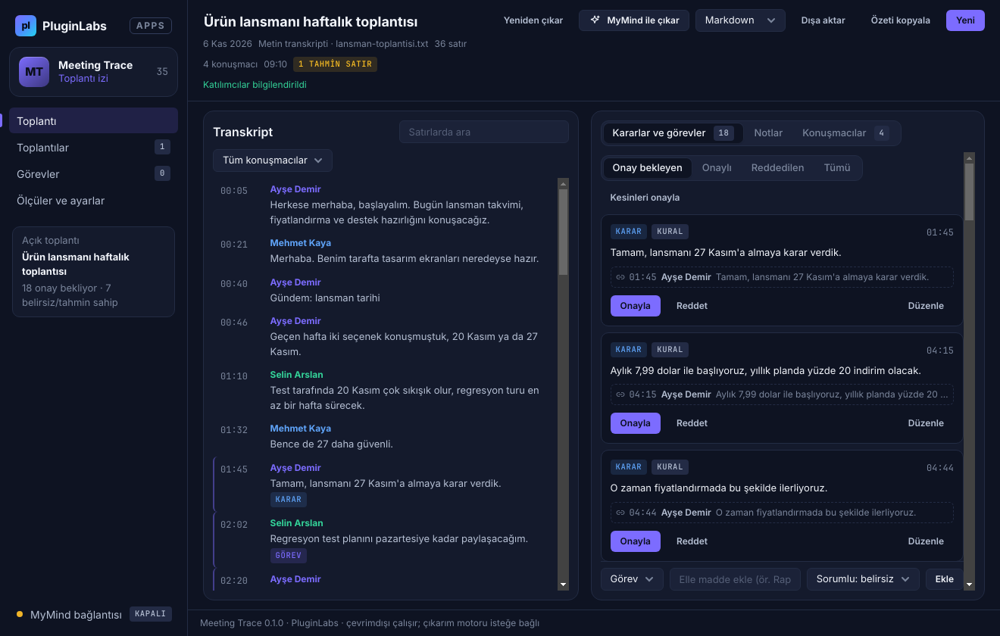
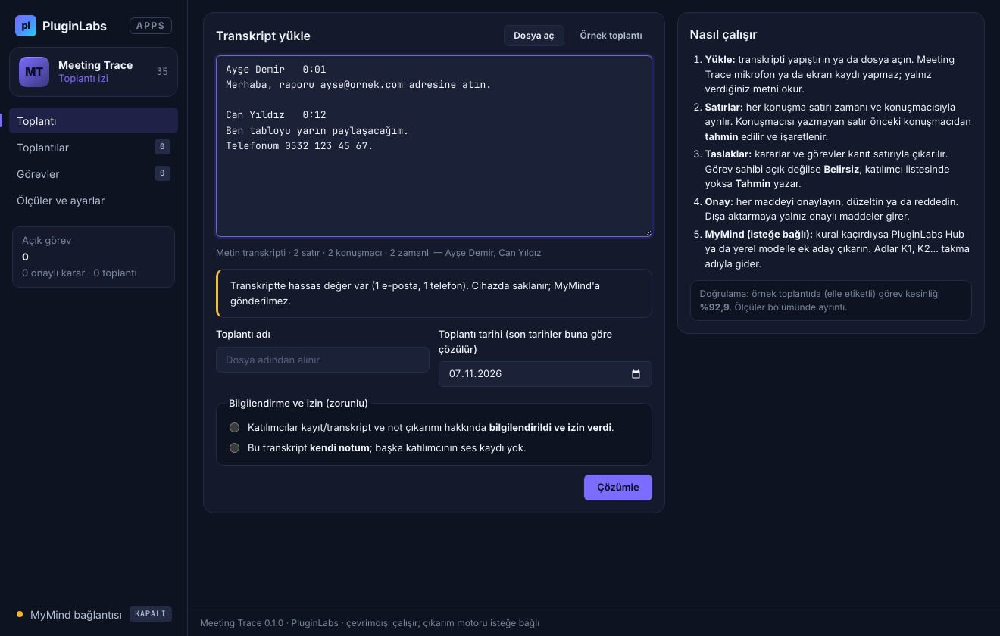
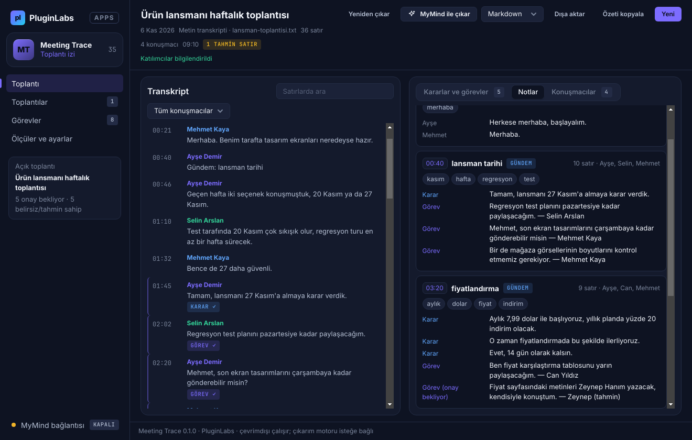
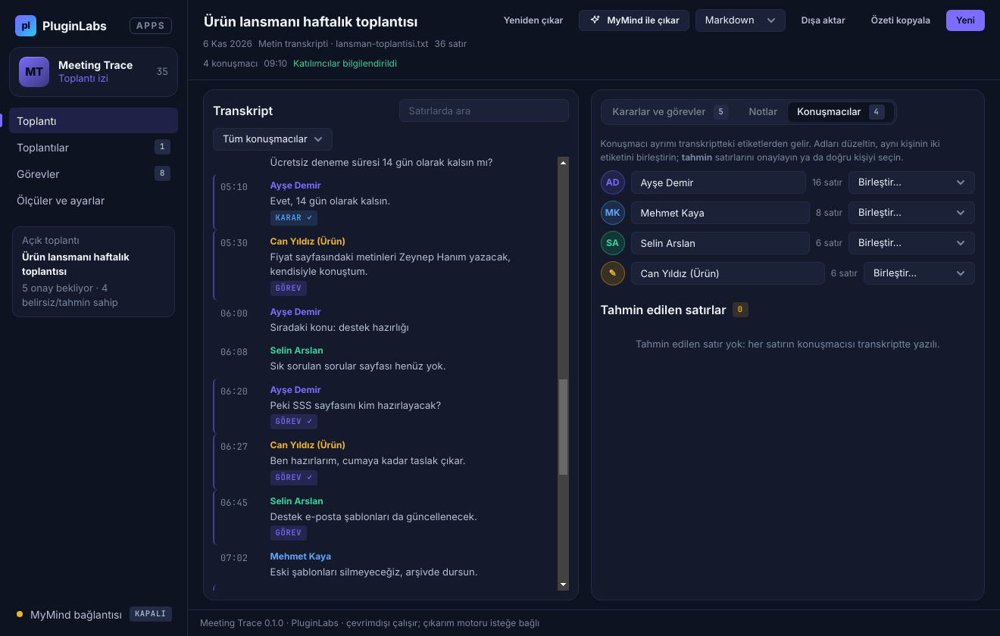
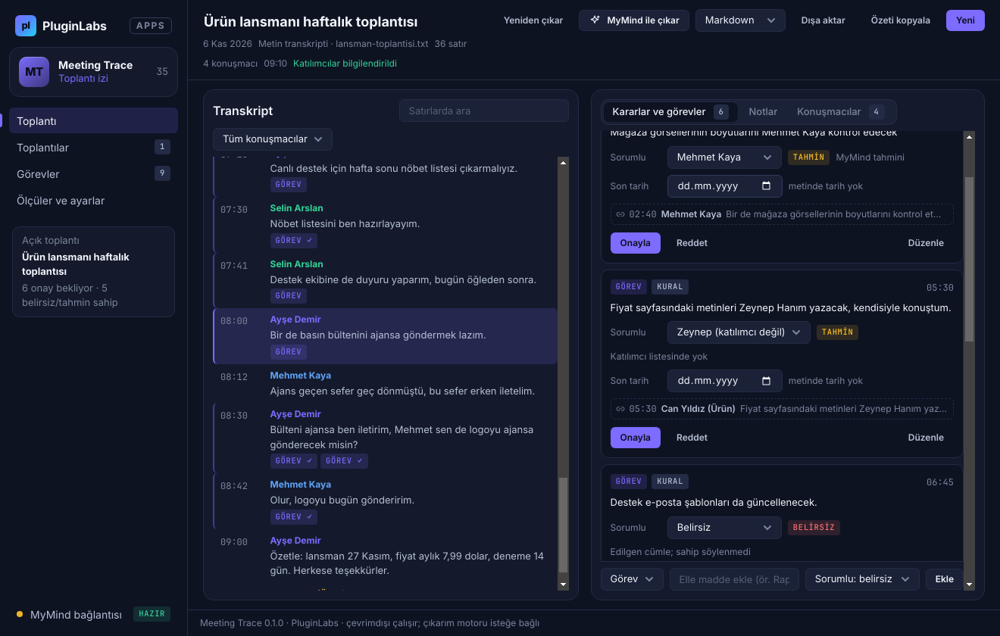
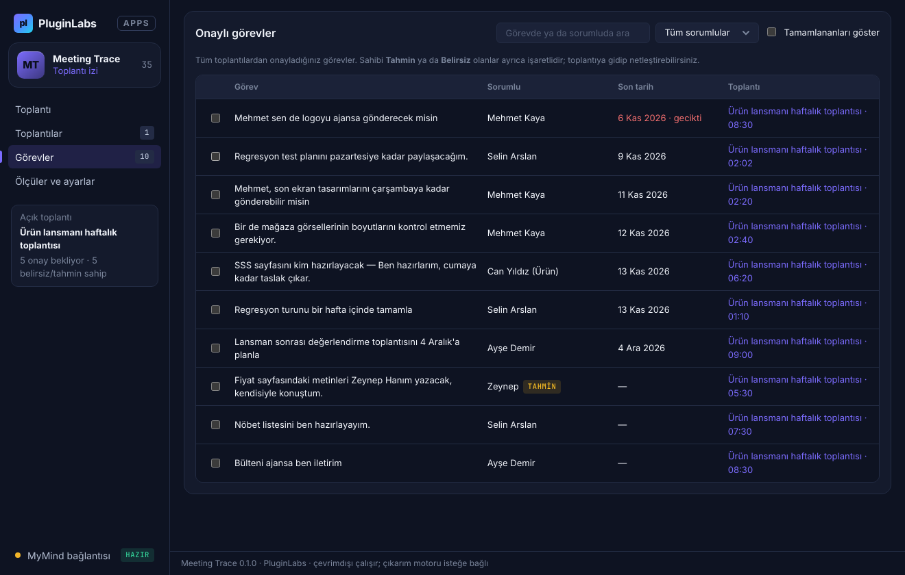

# Meeting Trace 0.1.0 (PL-035) — Windows uygulaması

Yüklenen toplantı transkriptinden zaman damgalı notlar, kararlar ve görev taslakları çıkarır; her madde insan onayından geçer. Ürün kartı ve Notion metni: [../README.md](../README.md). Sürüm notu: [RELEASE-NOTES.md](RELEASE-NOTES.md).

> Ürün deposu henüz yok; kaynak bu ön geliştirme klasöründedir. Windows derlemesi `pluginlabs-dagitim` deposunda sabit bir PluginLabs commit'inden yapılır ([ci/](ci/pluginlabs-dagitim-meeting-trace-windows.yml)).



| | |
| --- | --- |
|  |  |
|  |  |
|  |  |

Ekran görüntüleri: `masaustu-*.png` Linux (xvfb) üzerinde, `windows-masaustu-*.png` Windows runner'ında duman testinin gerçek Electron penceresinden alınır (örnek toplantı, uydurma kişiler, 1320×840).

## Akış

1. **Yükle:** transkripti yapıştırın ya da `.txt` / `.vtt` / `.srt` / `.md` açın; önizleme biçimi, satır ve konuşmacı sayısını gösterir. Bilgilendirme / izin seçimi zorunludur ve toplantıyla saklanır.
2. **Satırlar:** her konuşma satırı zaman ve konuşmacıyla ayrılır; etiketsiz satırın konuşmacısı **tahmin** işaretlidir.
3. **Taslaklar:** kararlar ve görevler kanıt satırıyla çıkarılır; görev sahibi **Kesin / Tahmin / Belirsiz**; son tarih toplantı tarihine göre çözülür.
4. **Onay:** onayla, düzelt, reddet. Dışa aktarmaya yalnız onaylı maddeler girer.
5. **Notlar ve görevler:** gündem işaretine ya da süreye göre zaman damgalı not bölümleri; tüm toplantılardan onaylı görev listesi.
6. **MyMind (isteğe bağlı):** kuralın kaçırdığı maddeler için Hub ya da yerel model; adlar takma adla, hassas değerler yer tutucuyla gider; sonuçlar onay bekler.

## Yapı

| Yol | İçerik |
| --- | --- |
| `src/core.js` | Saf çekirdek: transkript çözümleme (metin, Zoom/Teams, WebVTT, SRT), cümle, son tarih, karar/görev kuralları, notlar, veri azaltılmış MyMind isteği ve yanıt doğrulama, değerlendirme, dışa aktarma |
| `src/sample.js` | Örnek toplantı (uydurma kişiler) ve elle etiketleri |
| `desktop/main.js` | Electron ana süreç: kalıcılık (DPAPI), IPC, onay pencereleri, izin reddi |
| `desktop/net.js` | Tek ağ noktası: yalnız loopback (Hub 127.0.0.1:47632 ya da yerel model) |
| `desktop/preload.js` | Sayfaya dar `window.mtDesktop` arayüzü |
| `app.html` / `app.js` / `app.css` | Arayüz (PluginLabs tokenları, `pl/` değiştirilmez) |
| `tests/core.test.mjs` | Birim testleri (Notion ölçütü dahil) |
| `tests/desktop-smoke.cjs` | Gerçek pencerede uçtan uca duman testi + ekran görüntüleri |

## Geliştirme

```bash
npm ci
npm test                                   # çekirdek birim testleri
npm start                                  # uygulamayı aç
PLAYWRIGHT_MODULE=playwright xvfb-run -a -s "-screen 0 1440x900x24" node tests/desktop-smoke.cjs docs/screenshots
npm run build:win                          # Windows kurulum + taşınabilir (Windows'ta)
```

## Güvenlik ve gizlilik

- Sayfada Node/Electron yok (`contextIsolation`, `sandbox`); CSP `connect-src 'none'`, `media-src 'none'`. Ağ yalnız ana süreçte ve yalnız loopback adreslere.
- Mikrofon, kamera, ekran yakalama ve diğer Chromium izinleri reddedilir.
- MyMind isteği her seferinde onaylanır; konuşmacı adları K1, K2…; e-posta, telefon, bağlantı, IBAN, kart, T.C. kimlik, parola değerleri gönderilmez; toplantı başlığı ve dosya adı gönderilmez. Yanıttaki maddeler var olan satır kimliğine dayanmazsa atılır.
- Veriler ve Hub istemci anahtarı Windows kasasında (DPAPI) şifreli; kasa yoksa anahtar diske yazılmaz.

## Doğrulama durumu

| Kontrol | Sonuç |
| --- | --- |
| `npm test` (13 test) | Linux'ta geçti |
| Duman testi (gerçek Electron penceresi) | Linux/xvfb'de geçti; Windows runner sonucu release'teki `BUILD-INFO-windows.txt` içinde |
| Notion ölçütü (görev kesinliği ≥ %90, belirsiz sahipler görünür) | Örnek toplantıda %92,9 (13/14), duyarlılık %100, 4/4 belirsiz sahip görünür. Ayrı İngilizce örnekte görev 4/4, karar duyarlılığı %50. Örnekler kısa ve uydurma; gerçek toplantılarda ölçülmedi |
| Gerçek modelle MyMind çıkarımı | Denenmedi (taklit sunucuyla test edildi) |
| Windows DPI, klavye, ekran okuyucu | Elle denenmedi |
