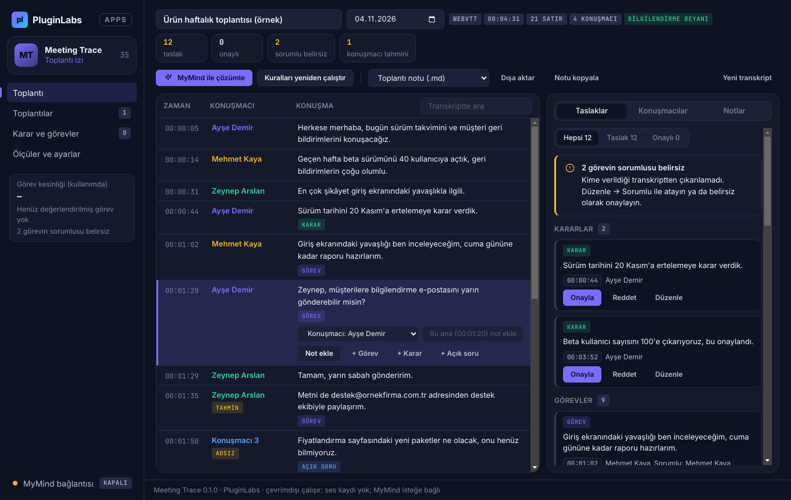
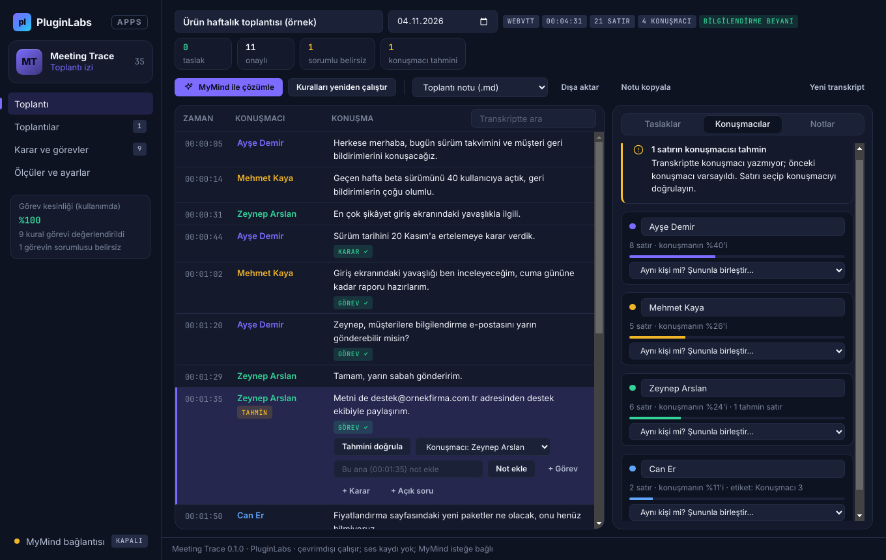
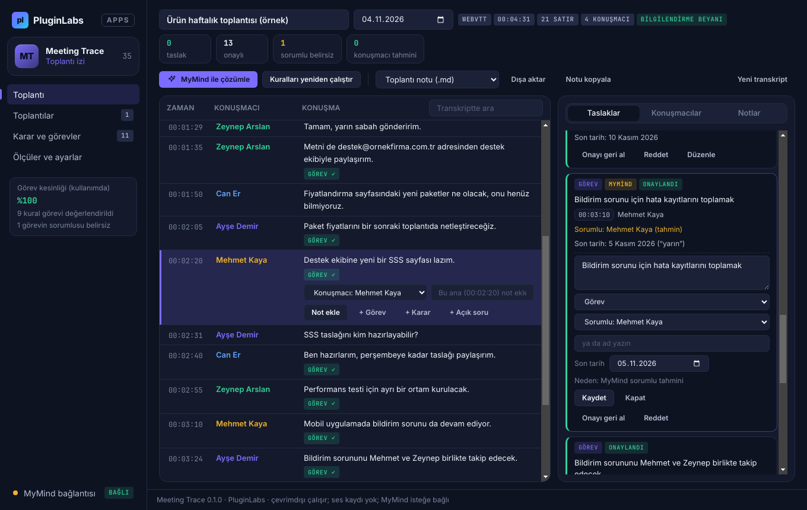
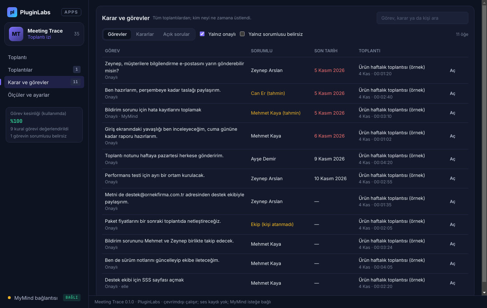
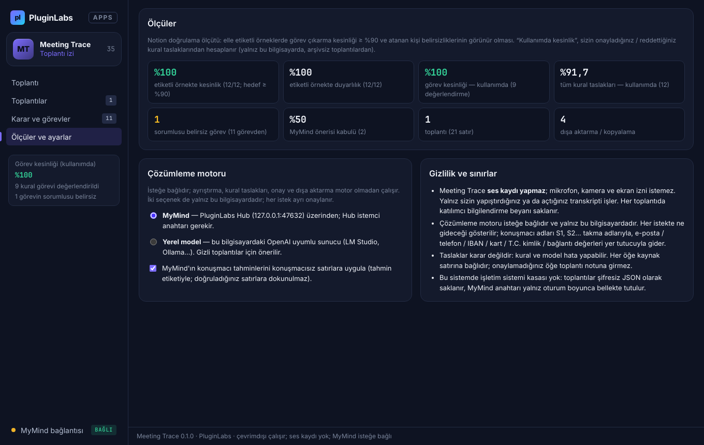
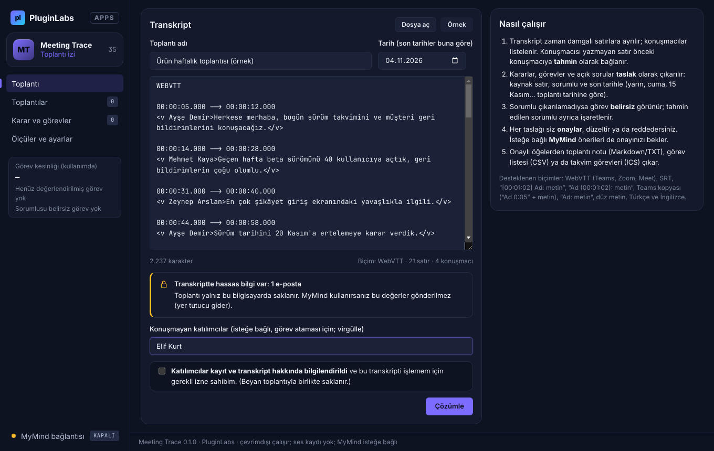
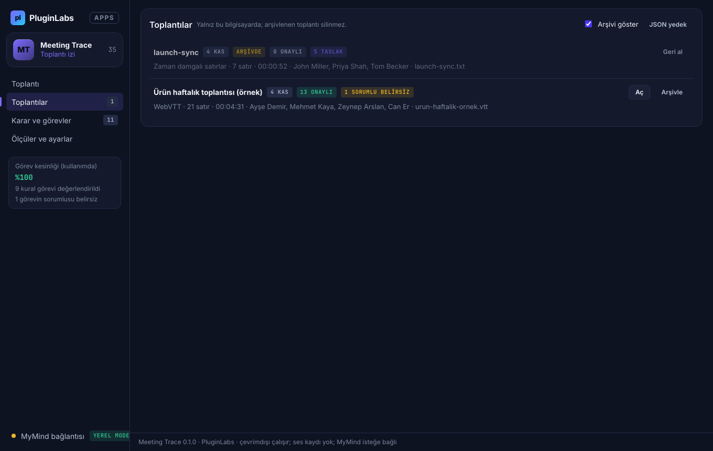

# Meeting Trace (PL-035) — Windows uygulaması

Yüklediğiniz ya da yapıştırdığınız **toplantı transkriptini** (Teams / Zoom / Meet WebVTT, SRT, zaman damgalı notlar) zaman damgalı satırlara ayırır; **kararları**, **görevleri** (sorumlu + son tarih) ve **açık soruları** kaynak satırına bağlı **taslak** olarak çıkarır. Konuşmacısı yazmayan satırlar **tahmin**, sorumlusu çıkarılamayan görevler **belirsiz** olarak görünür. Her taslağı siz onaylar, düzeltir ya da reddedersiniz; onaylı öğelerden toplantı notu, görev listesi ve takvim görevleri çıkar. İsteğe bağlı **MyMind** (PluginLabs Hub) ya da bu bilgisayardaki **yerel model** — her istekte onayla, adlar ve hassas değerler gönderilmeden — öneri ve konuşmacı tahmini ekler. **Ses kaydı yapmaz.**

> Ürün deposu henüz yok; kaynak bu klasördedir (PluginLabs ürün ön geliştirme alanı, PL-025 modeli). Windows paketleri `pluginlabs-dagitim` deposunda `meeting-trace-v<sürüm>` etiketiyle yayımlanır.



| Konuşmacılar (tahmin, adsız konuşmacı) | MyMind önerisi (düzenleme) |
| --- | --- |
|  |  |
| **Karar ve görevler (tüm toplantılar)** | **Ölçüler ve ayarlar** |
|  |  |
| **Transkript girişi (biçim önizlemesi, hassas veri uyarısı, beyan)** | **Toplantılar (arşiv)** |
|  |  |

Ekran görüntüleri gerçek uygulamadan, duman testinin test verisiyle (uydurma kişilerle örnek toplantı; taklit MyMind yanıtı) alınmıştır (`masaustu-*`: Linux/xvfb).

## İndir
[meeting-trace-v0.1.0](https://github.com/timdesigners-pixel/pluginlabs-dagitim/releases/tag/meeting-trace-v0.1.0) — `MeetingTrace-0.1.0-Windows-x64.exe` (kurulum), `MeetingTrace-0.1.0-Windows-Portable-x64.exe` (taşınabilir), SHA256SUMS + BUILD-INFO + Windows ekran görüntüleri. İmzasız önizleme. PluginLabs Hub kataloğundan da kurulabilir (Hub kataloğu birleşip yayımlanınca).

## Kullanım
1. **Dosya aç** (.vtt, .srt, .txt, .md) ya da transkripti yapıştırın; ilk deneme için **Örnek**. Toplantı adını ve **tarihini** girin (yarın, cuma gibi son tarihler buna göre hesaplanır). Konuşmayan katılımcıları isteğe bağlı yazın (görev ataması için).
2. **Katılımcıların bilgilendirildiğini** işaretleyin ve **Çözümle**.
3. Sağdaki **Taslaklar**: her karar/görev/soru kartında kaynak zaman (tıklayınca satıra gider), sorumlu ve son tarih. **Onayla**, **Reddet** ya da **Düzenle** (metin, tür, sorumlu, son tarih). Sorumlusu belirsiz görevler üstte uyarıyla sayılır.
4. **Konuşmacılar**: "Konuşmacı 3" gibi etiketlere gerçek adını verin, aynı kişinin iki etiketini birleştirin. Transkriptte satırı seçip **Tahmini doğrula** ya da konuşmacıyı değiştirin.
5. Satır seçiliyken **Not ekle** (zaman damgalı) ya da **+ Görev / + Karar / + Açık soru** (kuralın kaçırdığı öğeler için).
6. İsteğe bağlı **MyMind ile çözümle**: onay penceresi neyin gideceğini gösterir; öneriler taslak olarak eklenir.
7. **Dışa aktar**: toplantı notu (.md/.txt), karar ve görevler (.csv), görevler (.ics); ya da **Notu kopyala**. **Karar ve görevler** bölümünde tüm toplantılardaki onaylı görevler kişi ve tarihe göre listelenir.

## Güvenlik ve gizlilik
- Ses kaydı yok: mikrofon, kamera, ekran ve bildirim izinleri reddedilir. Yalnız kullanıcının verdiği metin işlenir. Toplantı başına katılımcı bilgilendirme beyanı saklanır.
- Arayüz ağa erişemez (CSP `connect-src 'none'`, `media-src 'none'`); tek ağ yolu ana süreçteki loopback istemcisidir (`desktop/net.js`: yalnız `127.0.0.1` / `localhost` / `::1`, yönlendirme yok).
- MyMind / yerel model isteği her seferinde onaylanır. Konuşmacı adları (satır metninde geçenler dahil) S1, S2… takma adlarıyla; e-posta, telefon, IBAN, kart, T.C. kimlik, bağlantı ve parola değerleri ⟦n⟧ yer tutucusuyla gider ve yanıtta yerelde geri konur. Başlık, tarih, notlar, konuşmayan katılımcılar ve diğer toplantılar gönderilmez. Yanıttaki her öneri var olan satır kimliklerine dayanmak zorundadır; sorumlu yalnız takma adlardan biri olabilir.
- Toplantılar ve MyMind istemci anahtarı Windows kasasında (Electron `safeStorage`, DPAPI) şifreli; kasa yoksa toplantılar düz JSON, anahtar yalnız bellekte. Yazma atomiktir. Silme yok; toplantılar arşivlenir (sınır 80; aşılırsa en eski arşivli çıkar).
- `contextIsolation`, `sandbox`, `nodeIntegration: false`; IPC yalnız kendi penceresinden; dış gezinme ve yeni pencere engelli. CSV dışa aktarmada formül enjeksiyonuna karşı koruma.

## Geliştirme
```
npm ci
npm test                       # çekirdek birim testleri (etiketli örnek + iki bağımsız örnek: kesinlik ≥ %90)
npm start                      # uygulamayı açar
PLAYWRIGHT_MODULE=playwright xvfb-run -a -s "-screen 0 1440x900x24" node tests/desktop-smoke.cjs docs/screenshots   # duman testi (Linux)
npm run build:win              # Windows kurulum + taşınabilir (Windows'ta)
```
- `src/core.js` — saf işlevler: transkript ayrıştırma, konuşmacı tahmini, kural çıkarımı (karar/görev/soru, sorumlu, son tarih), değerlendirme, maskeleme, MyMind isteği ve yanıt doğrulaması, dışa aktarma.
- `src/sample.js` — elle etiketlenmiş örnek toplantı (uydurma kişiler).
- `desktop/` — Electron ana süreç, preload (dar `mtDesktop` arayüzü), loopback ağ istemcisi.
- `ci/pluginlabs-dagitim-meeting-trace-windows.yml` — `pluginlabs-dagitim` deposunda Windows derleme ve yayın iş akışı (kaynak sabit commit'ten alınır).
- Tasarım: PluginLabs tokenları ve bileşenleri (`pl/`, değiştirilmez), koyu tema, Hub aksanı; düzen PL-034 Parallel Translate ile aynı çizgide.

## Sınırlar
Ses kaydı / ses → metin ve sesten konuşmacı ayrımı yok (sonraki faz). Kurallar Türkçe ve İngilizce. Chrome eklentisi, Linux ve macOS paketleri bu sürümde yok. Gerçek toplantılarla ve gerçek modelle ölçülmedi; Windows DPI ve ekran okuyucu elle denenmedi.
