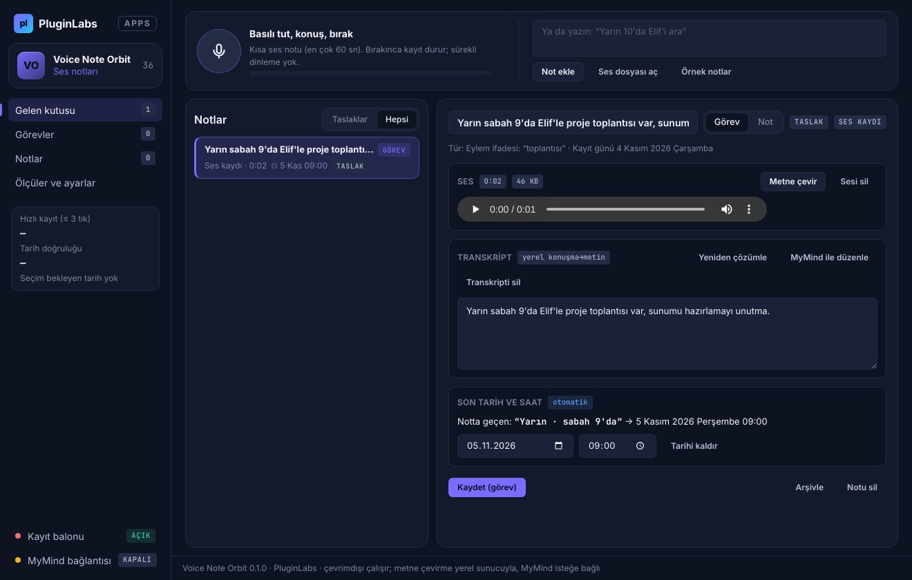

# PL-036 · Voice Note Orbit

> Kısa ses notlarını kaydeder, metne dönüştürür ve not veya görev olarak düzenler.

| Alan | Değer |
| --- | --- |
| Kimlik | `PL-036` · `voice-note-orbit` |
| Kategori | 04 · Araştırma, yazma ve bilgi akışları — PL-031–040 |
| Durum | 07.11.2026: **0.1.0 Windows uygulaması yayımlandı** — [voice-note-orbit-v0.1.0](https://github.com/timdesigners-pixel/pluginlabs-dagitim/releases/tag/voice-note-orbit-v0.1.0) (`pluginlabs-dagitim`, Windows runner: test + duman testi + SHA256 + BUILD-INFO + Windows ekran görüntüleri); kaynak [app/](app/README.md); Hub 0.4.22 kataloğunda · Notion durumu: Yeni fikir |
| Öncelik / efor | P1 · M |
| Hedef platformlar | Windows, Linux, macOS |
| Dağıtım biçimi | masaüstü uygulaması, yüzen balon |
| Geliştirme deposu | Henüz yok — kaynak bu klasörün [`app/`](app/README.md) alt klasöründe (ön geliştirme alanı; bkz. [repo hiyerarşisi](../../../docs/REPO-HIYERARSISI.md)); Windows derlemesi ve sürüm dosyaları `pluginlabs-dagitim` deposunda (iş akışı: [`app/ci/`](app/ci/pluginlabs-dagitim-voice-note-orbit-windows.yml)) |
| Codex projesi | `PL-036 · Voice Note Orbit` — ikinci klasör: PluginLabs |
| Notion kaynağı | [Notion](https://app.notion.com/p/4038aa13d8f981c08edfda43643b31fc) |

## Ne işe yarar

**Kullanıcı ve problem:** Aklına gelen işi yazmadan yakalamak isteyen hareketli bilgi çalışanları.

**Kısa tanım (Hub kataloğu):** Kısa ses notlarını kaydeder, metne dönüştürür ve not veya görev olarak düzenler.

## Hangi platformlar için yayınlanır

**Notion’daki platform tanımı:** W / L / M kayıt balonu

- Windows
- Linux
- macOS

> Platformlar hedef kapsamdır. PluginLabs ürün ilkesi gereği test edilmemiş platform “destekleniyor” diye etiketlenmez; her platform gerçek cihaz/tarayıcı kabulünden sonra yayın listesine girer.

## Özellikler

### MVP ve temel akış

Basılı tutarak not kaydet → transkripti düzelt → görev/not olarak kaydet. İlk sürüm kısa ses notları ve yerel dosya.

### Yapay zekânın rolü

Konuşmayı metne çevirir, görev/tarih taslağı çıkarır; belirsiz tarih için kullanıcı seçimi ister.

## Teknik bağımlılık ve sınırlar

Mikrofon izni ve görünür kayıt göstergesi; sürekli dinleme yok. Dosya ve transkript silme ayrı kontrol.

## Gelir hipotezi

Ücretsiz kısa kayıt; Pro transkripsiyon kotası ve iş akışı şablonları.

## Doğrulama ölçütü

30 sn notu kaydetme akışı ≤3 tık; görev tarihi doğru çıkarma ≥%90.

## Öncelik ve efor

P1 · M; Meeting Trace’den farklı olarak kişisel tek konuşmacı yakalama.

## 0.1.0 sürümü (Windows)

Notion MVP akışı: **basılı tutarak not kaydet → transkripti düzelt → görev/not olarak kaydet**. Yüzen **kayıt balonu** (her zaman üstte, sürüklenebilir, `Ctrl+Alt+N`) ya da ana penceredeki düğme basılı tutulduğu sürece mikrofon açık; bırakınca, odak kaybolunca ya da süre dolunca kapanır — **sürekli dinleme yok**, kayıt sırasında **görünür kırmızı gösterge** ve sayaç (Notion: “mikrofon izni ve görünür kayıt göstergesi; sürekli dinleme yok”). Mikrofon izni yalnız uygulamanın kendi pencerelerine ve yalnız ses için verilir; kamera ve ekran reddedilir. Kısa ses notları ve yerel dosya: 16 kHz mono WAV; ses dosyası içe aktarma (WAV/MP3/OGG/WebM/FLAC/M4A, ≤ 5 dk).

**Yapay zekânın rolü:** konuşma bu bilgisayardaki OpenAI uyumlu konuşma→metin sunucusuyla (whisper.cpp server, faster-whisper-server… — yalnız loopback, her seferinde onaylı) metne çevrilir; sunucu yoksa metin elle yazılır. Görev/not türü ve tarih–saat **taslağı** kurallarla çıkarılır; **belirsiz tarih için kullanıcı seçimi istenir** (“saat 3” → 15:00 / 03:00, “haftaya” → hangi gün, “hafta sonu”, bugünün gün adı, geçmiş saat → bugün/yarın) — balonda seçenek tek tıkla seçilip kaydedilir. İsteğe bağlı MyMind / yerel model yazım düzeltmesi ve tür/başlık önerisi yapar (ses gitmez; hassas değerler yer tutucuyla). **Dosya ve transkript silme ayrı kontrol** (ses, transkript ve not ayrı düğmeler).

**Doğrulama ölçütü:** 30 sn notu kaydetme akışı ≤ 3 tık — ana pencereden bas (1) → onay (2) → Kaydet (3); balondan belirsiz saatte bas (1) → onay (2) → “Kaydet · seçenek” (3); uygulama her ses kaydında tıkları sayar ve Ölçüler'de gösterir. Görev tarihi doğru çıkarma ≥ %90 — elle etiketli 41 örnekte 41/41, kurallar yazıldıktan sonra eklenen bağımsız 20 örnekte 20/20 (belirsiz ifadelerde doğru davranış seçenek sunmaktır); kullanımda kaydedilen görevlerden ayrıca hesaplanır. Gerçek mikrofon, gerçek whisper modeli ve gerçek kullanıcıyla ölçülmedi.

Kapsam dışı (bu sürüm): uygulama içi konuşma tanıma modeli (yerel whisper sunucusu gerekir; Hub'da ses→metin uç noktası henüz yok), Pro transkripsiyon kotası ve iş akışı şablonları, Linux/macOS paketleri. Ayrıntı: [app/README.md](app/README.md).

## Geliştirme ve ortak çalışma (Codex + Claude Code)

- Dal adı: `codex/PL-036-<konu>` veya `claude/PL-036-<konu>`; iki ajan aynı dalda aynı anda çalışmaz.
- İşe başlamadan önce [AKTIF-ISLER.md](../../../docs/ortak-calisma/AKTIF-ISLER.md) tablosuna satır eklenir; iş bitince devir notu yazılır.
- Kurallar: [AGENTS.md](../../../AGENTS.md) (her iki ajan için ortak), protokol: [AI-ORTAK-CALISMA.md](../../../docs/ortak-calisma/AI-ORTAK-CALISMA.md).

## Notion kartının özgün metni

Aşağıdaki metin `resources/notion-catalog.json` (Notion anlık görüntüsü, 2026-10-26) içindeki kartın kısaltılmadan aktarılmış hâlidir.

Tam kartı göster

- **Durum:** Yeni fikir
- **Platform:** W / L / M kayıt balonu
- **Kullanıcı ve problem:** Aklına gelen işi yazmadan yakalamak isteyen hareketli bilgi çalışanları.
- **MVP ve temel akış:** Basılı tutarak not kaydet → transkripti düzelt → görev/not olarak kaydet. İlk sürüm kısa ses notları ve yerel dosya.
- **Yapay zekânın rolü:** Konuşmayı metne çevirir, görev/tarih taslağı çıkarır; belirsiz tarih için kullanıcı seçimi ister.
- **Teknik bağımlılık ve sınır:** Mikrofon izni ve görünür kayıt göstergesi; sürekli dinleme yok. Dosya ve transkript silme ayrı kontrol.
- **Gelir hipotezi:** Ücretsiz kısa kayıt; Pro transkripsiyon kotası ve iş akışı şablonları.
- **Doğrulama ölçütü:** 30 sn notu kaydetme akışı ≤3 tık; görev tarihi doğru çıkarma ≥%90.
- **Öncelik ve efor:** P1 · M; Meeting Trace’den farklı olarak kişisel tek konuşmacı yakalama.

---
Oluşturma: 29.10.2026 · Kaynak → hedef: Notion kataloğu → `registry/projects.json` → bu dosya
