# Voice Note Orbit (PL-036) — Windows uygulaması

Aklınıza gelen işi **yazmadan yakalayın**: yüzen **kayıt balonunu** ya da ana penceredeki düğmeyi **basılı tutun, konuşun, bırakın**. Kısa ses notu bu bilgisayardaki konuşma→metin sunucusuyla (her seferinde onayınızla) metne çevrilir; **görev mi not mu**, **tarih ve saat** taslak olarak çıkarılır. "Saat 3", "haftaya", "hafta sonu" gibi **belirsiz** ifadelerde tek tarih uydurulmaz — seçenek sunulur, balonda tek tıkla seçip kaydedersiniz. **Sürekli dinleme yok**; kayıt sırasında kırmızı gösterge ve sayaç görünür. Ses dosyası, transkript ve not **ayrı ayrı** silinir. İsteğe bağlı **MyMind** (PluginLabs Hub) ya da yerel model, onayla ve veri azaltılarak yazım düzeltmesi ve tür/başlık önerisi yapar.

> Ürün deposu henüz yok; kaynak bu klasördedir (PluginLabs ürün ön geliştirme alanı, PL-025 modeli). Windows paketleri `pluginlabs-dagitim` deposunda `voice-note-orbit-v<sürüm>` etiketiyle yayımlanır.

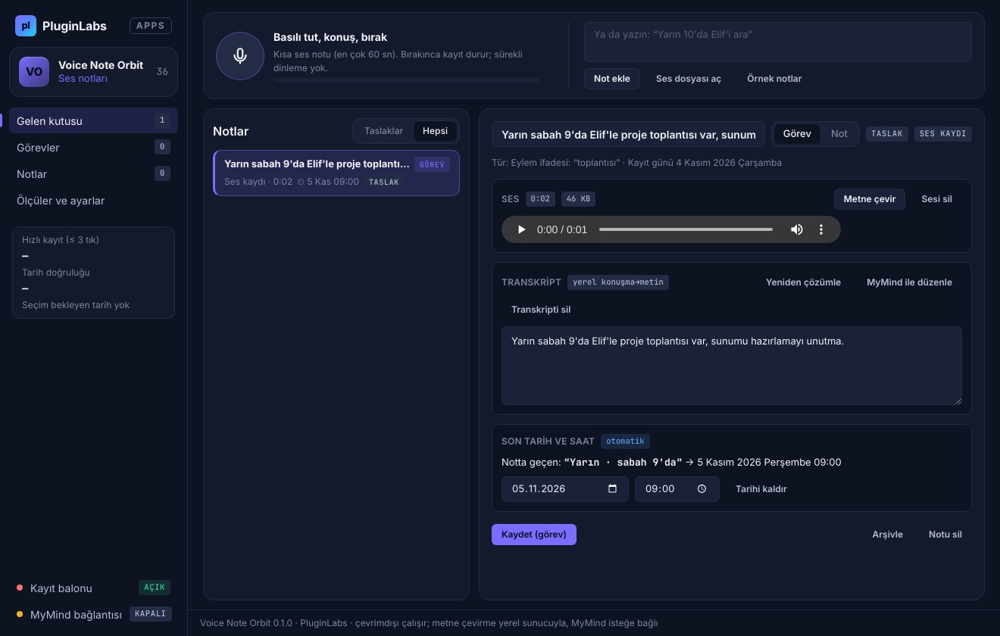

| Yüzen balon: belirsiz saat, tek tıkla seç-kaydet | Belirsiz tarih seçimi |
| --- | --- |
| 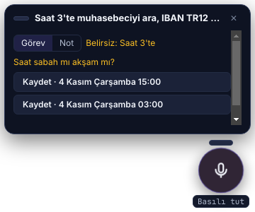 | 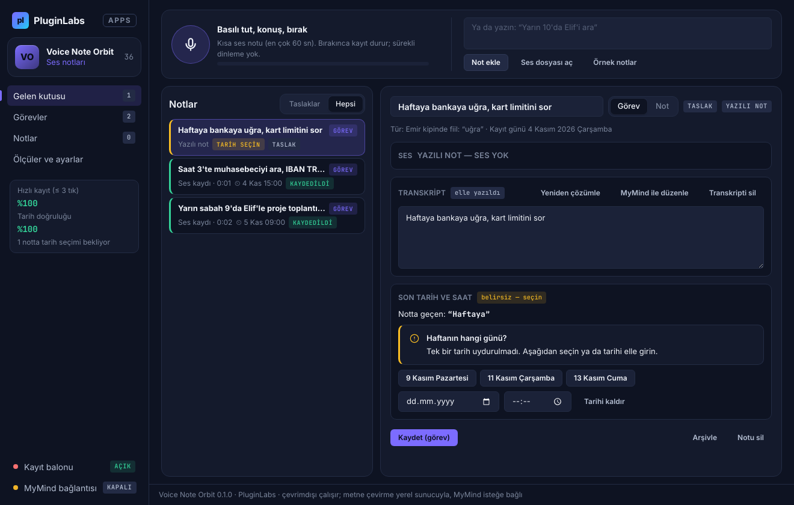 |
| **MyMind düzeltmesi (IBAN gönderilmedi)** | **Görevler** |
| 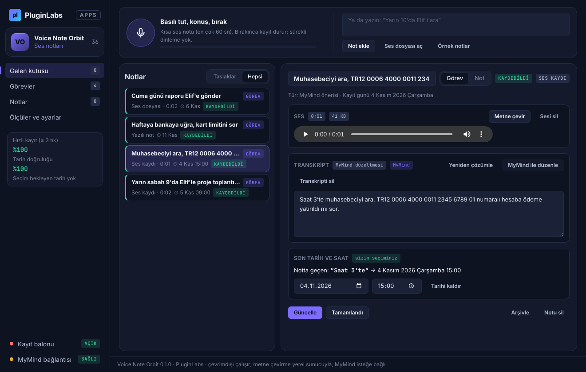 | 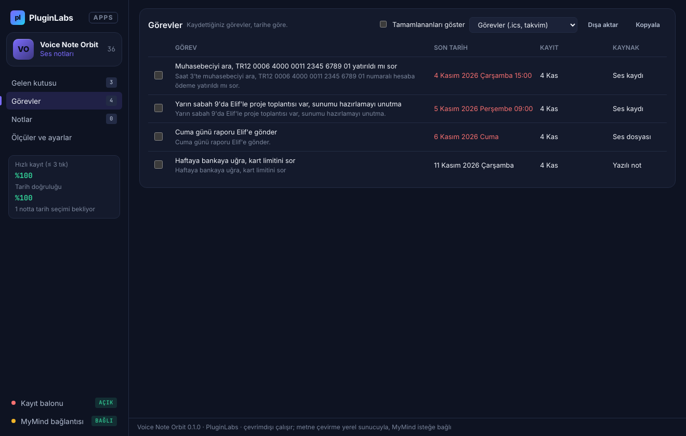 |
| **Ölçüler ve ayarlar** | **Boş gelen kutusu** |
| 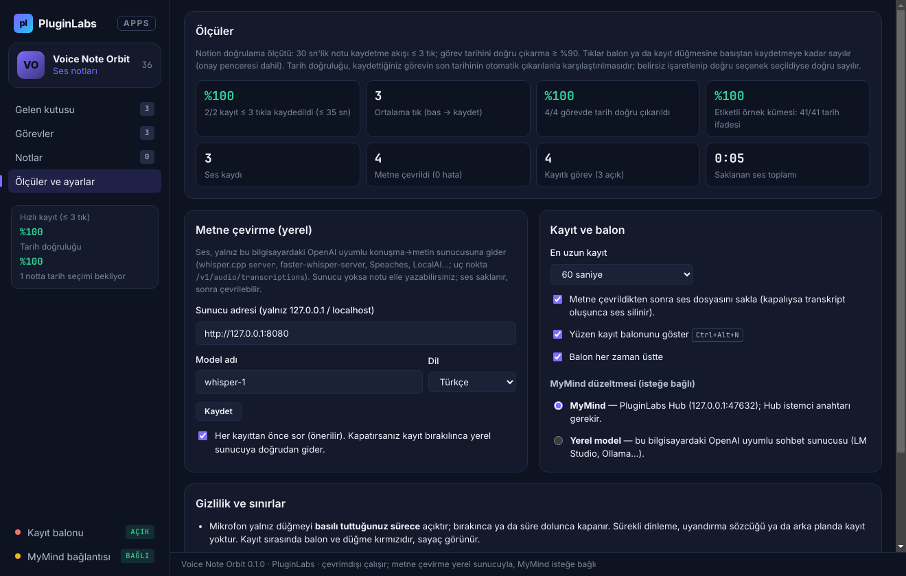 | 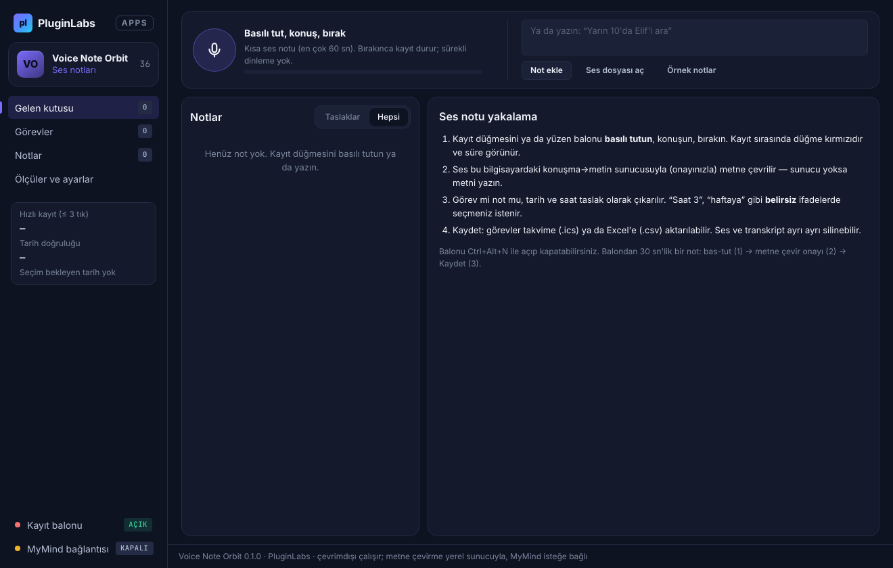 |

Ekran görüntüleri gerçek uygulamadan, duman testinin test verisiyle alınmıştır (Chromium taklit mikrofonu, taklit whisper ve MyMind yanıtları, uydurma kişiler; `masaustu-*`: Linux/xvfb, commit e2e39ac; `windows-masaustu-*`: GitHub Actions Windows runner, [çalıştırma 42361929923](https://github.com/timdesigners-pixel/pluginlabs-dagitim/actions/runs/42361929923), release ekinde de var).

**Windows'ta (Windows runner, gerçek pencere):**

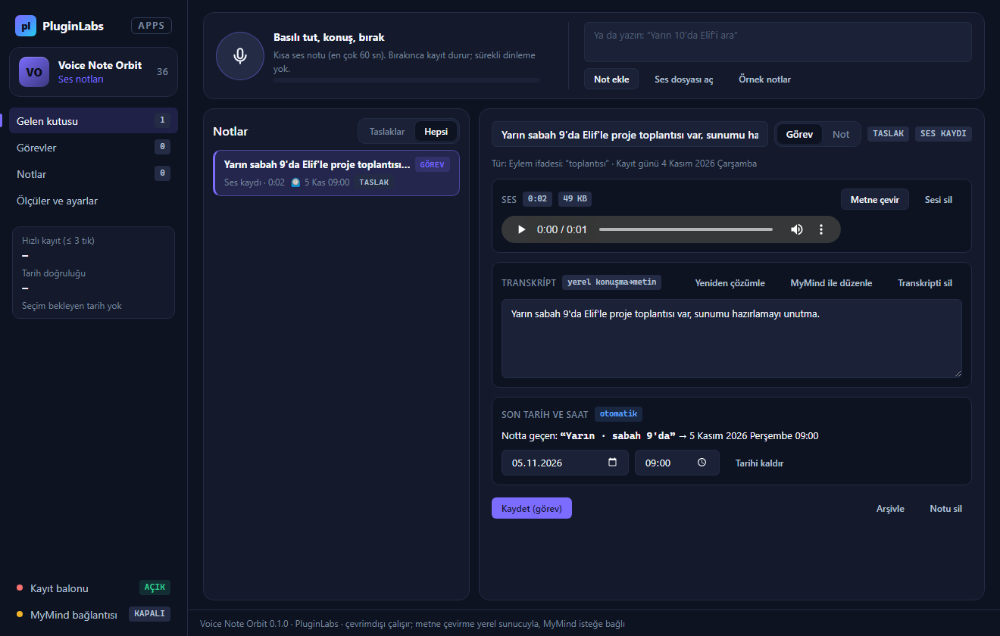

| Windows — yüzen balon | Windows — belirsiz tarih seçimi | Windows — görevler |
| --- | --- | --- |
| 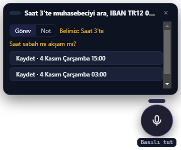 | 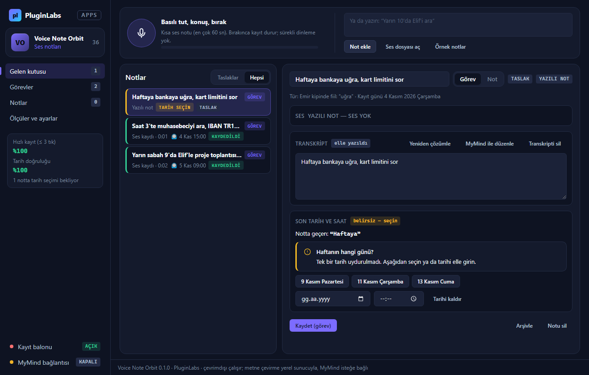 | 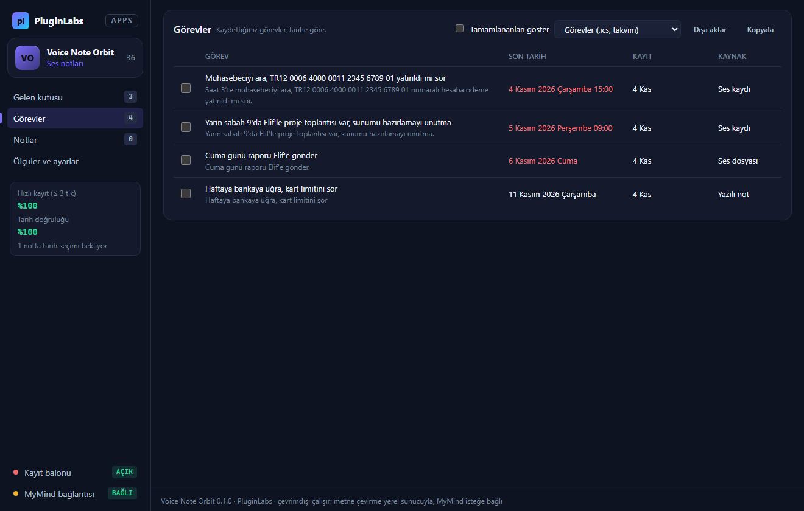 |

## İndir
[voice-note-orbit-v0.1.0](https://github.com/timdesigners-pixel/pluginlabs-dagitim/releases/tag/voice-note-orbit-v0.1.0) — `VoiceNoteOrbit-0.1.0-Windows-x64.exe` (kurulum, SHA-256 `3af3a5f6…7538`), `VoiceNoteOrbit-0.1.0-Windows-Portable-x64.exe` (taşınabilir, SHA-256 `ecffe519…bf1a`, 81 542 900 bayt), SHA256SUMS + BUILD-INFO + Windows ekran görüntüleri. İmzasız önizleme. PluginLabs Hub kataloğundan da kurulabilir (Hub kataloğu birleşip yayımlanınca).

## Metne çevirme için yerel sunucu (bir kez)
Uygulama konuşma tanıma modeli taşımaz; ses yalnız **bu bilgisayardaki** OpenAI uyumlu bir sunucuya gider. Örnekler:
- **whisper.cpp:** `whisper-server -m ggml-small.bin --host 127.0.0.1 --port 8080 --inference-path /v1/audio/transcriptions` → Ayarlar'da `http://127.0.0.1:8080`.
- **faster-whisper-server / Speaches**, **LocalAI**: `/v1/audio/transcriptions` uç noktasını sunan herhangi biri; model adını Ayarlar'a yazın.
Sunucu yoksa da uygulama çalışır: ses saklanır, metni yazarsınız ya da sunucu açılınca **Metne çevir**.

## Kullanım
1. **Basılı tut** (balon ya da ana pencere; Boşluk/Enter da olur) → konuşun → bırakın. Balon `Ctrl+Alt+N` ile açılır/kapanır, sürükleyerek taşınır.
2. Onay penceresi neyin nereye gideceğini gösterir → **Metne çevir**.
3. Taslakta tür (Görev/Not), başlık ve tarih–saat görünür. Belirsizse seçenekten birini seçin (balonda: "Kaydet · 4 Kasım Çarşamba 15:00" tek tık).
4. **Kaydet.** Görevler **Görevler** bölümünde tarihe göre; **.ics** ile takvime, **.csv** ile Excel'e aktarılır.
5. **Sesi sil**, **Transkripti sil**, **Notu sil** ayrı düğmelerdir.

## Güvenlik ve gizlilik
- Mikrofon yalnız düğme basılıyken açık; bırakınca, odak kaybolunca ya da süre dolunca izler (track) durdurulur. Uyandırma sözcüğü ya da arka plan kaydı yok.
- İzin işleyicisi: yalnız kendi pencerelerimiz ve yalnız `audio`; kamera, ekran paylaşımı (`setDisplayMediaRequestHandler` boş), bildirim vb. reddedilir. Duman testi kamera isteğinin reddedildiğini denetler.
- Arayüz ağa erişemez (CSP `connect-src 'none'`; `media-src blob:` yalnız yerel oynatma için); tek ağ yolu ana süreçteki loopback istemcisidir (`desktop/net.js`: yalnız `127.0.0.1` / `localhost` / `::1`, yönlendirme yok).
- Ana süreç gelen WAV'ı doğrular (RIFF/PCM 16 bit, 8–48 kHz, süre sınırı) ve kayıtları `ses/` klasörüne yazar; kasa varsa ses dosyaları da şifreli (`.bin`).
- MyMind: ses gitmez; yalnız seçili notun transkripti, hassas değerler ⟦n⟧ yer tutucusuyla. Transkriptte geçmeyen tarih ifadesi ve aşırı farklı düzeltme atılır.
- Notlar, sesler ve MyMind istemci anahtarı Windows kasasında (Electron `safeStorage`, DPAPI) şifreli; kasa yoksa düz dosya, anahtar yalnız bellekte. Yazma atomik.
- `contextIsolation`, `sandbox`, `nodeIntegration: false`; IPC yalnız kendi pencerelerinden; dış gezinme ve yeni pencere engelli. CSV formül enjeksiyonuna karşı korumalı.

## Geliştirme
```
npm ci
npm test                       # çekirdek birim testleri (41 etiketli + 20 bağımsız tarih örneği, ≥ %90)
npm start                      # uygulamayı açar
PLAYWRIGHT_MODULE=playwright xvfb-run -a -s "-screen 0 1440x900x24" node tests/desktop-smoke.cjs docs/screenshots   # duman testi (Linux)
npm run build:win              # Windows kurulum + taşınabilir (Windows'ta)
```
- `src/core.js` — saf işlevler: tarih/saat çıkarımı (belirsizlik ve adaylar), tür, başlık, maskeleme, MyMind isteği/yanıt doğrulaması, WAV doğrulama, ölçüler, dışa aktarma.
- `src/recorder.js` — basılı tutarak kayıt (getUserMedia → 16 kHz mono WAV) ve ses dosyası dönüştürme; ana pencere ve balon ortak.
- `src/sample.js` — elle etiketlenmiş tarih örnekleri ve örnek notlar.
- `desktop/` — Electron ana süreç (pencere + balon, izinler, kalıcılık), preload (dar `vnDesktop` arayüzü), loopback ağ istemcisi (whisper + MyMind).
- `ci/pluginlabs-dagitim-voice-note-orbit-windows.yml` — `pluginlabs-dagitim` deposunda Windows derleme ve yayın iş akışı.
- Tasarım: PluginLabs tokenları ve bileşenleri (`pl/`, değiştirilmez), koyu tema, Hub aksanı; düzen PL-035 Meeting Trace ile aynı çizgide.

## Sınırlar
Uygulama içinde konuşma tanıma modeli yok (yerel whisper sunucusu gerekir; Hub'da ses→metin uç noktası henüz yok). Kurallar Türkçe ve İngilizce. Chrome eklentisi, Linux ve macOS paketleri bu sürümde yok. Gerçek mikrofon ve gerçek whisper modeliyle ölçülmedi; Windows DPI, ekran okuyucu ve çoklu monitörde balon konumu elle denenmedi.
