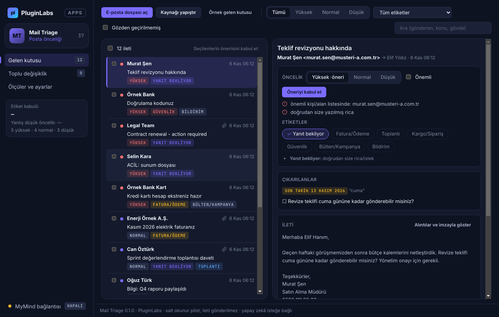

# PL-037 · Mail Triage

> Seçilen e-postalar için etiket, öncelik ve yanıt taslakları önerir.

| Alan | Değer |
| --- | --- |
| Kimlik | `PL-037` · `mail-triage` |
| Kategori | 04 · Araştırma, yazma ve bilgi akışları — PL-031–040 |
| Durum | 07.11.2026: **0.1.0 Windows uygulaması yayımlandı** (salt okunur pilot) — [mail-triage-v0.1.0](https://github.com/timdesigners-pixel/pluginlabs-dagitim/releases/tag/mail-triage-v0.1.0) (`pluginlabs-dagitim`, Windows runner: test + duman testi + SHA256 + BUILD-INFO + Windows ekran görüntüleri); kaynak [app/](app/README.md); Hub 0.4.23 kataloğunda · Notion durumu: Mevcut e-posta kategorizasyon görevinden yeni ürün önerisi |
| Öncelik / efor | P1 · L |
| Hedef platformlar | Windows, Linux, macOS, Chrome |
| Dağıtım biçimi | masaüstü uygulaması, Chrome eklentisi (Manifest V3) |
| Geliştirme deposu | Henüz yok — kaynak bu klasörün [`app/`](app/README.md) alt klasöründe (ön geliştirme alanı; bkz. [repo hiyerarşisi](../../../docs/REPO-HIYERARSISI.md)); Windows derlemesi ve sürüm dosyaları `pluginlabs-dagitim` deposunda (iş akışı: [`app/ci/`](app/ci/pluginlabs-dagitim-mail-triage-windows.yml)) |
| Codex projesi | `PL-037 · Mail Triage` — ikinci klasör: PluginLabs |
| Notion kaynağı | [Notion](https://app.notion.com/p/4038aa13d8f981c08edfda43643b31fc) |

## Ne işe yarar

**Kullanıcı ve problem:** Gelen kutusunda öncelik, fatura ve yanıt bekleyen işleri ayırmak isteyen kişiler.

**Kısa tanım (Hub kataloğu):** Seçilen e-postalar için etiket, öncelik ve yanıt taslakları önerir.

## Hangi platformlar için yayınlanır

**Notion’daki platform tanımı:** Chrome; izinli e-posta API’siyle W / L / M panel

- Windows
- Linux
- macOS
- Chrome

> Platformlar hedef kapsamdır. PluginLabs ürün ilkesi gereği test edilmemiş platform “destekleniyor” diye etiketlenmez; her platform gerçek cihaz/tarayıcı kabulünden sonra yayın listesine girer.

## Özellikler

### MVP ve temel akış

Seçili e-postaları incele, etiket ve öncelik öner; toplu değişiklik önizlemesi göster. İlk pilot salt okunur.

### Yapay zekânın rolü

Eylem/tarih/konu çıkarır ve kısa yanıt taslağı sunar; mesaj gönderimi otomatik değil.

## Teknik bağımlılık ve sınırlar

OAuth kapsamları, sağlayıcı doğrulaması ve hassas içerik kısıtları. İlk sürüm tüm kutuyu dış servise taşımaz.

## Gelir hipotezi

Bireysel Pro; ekip ortak gelen kutusu paketi daha sonra.

## Doğrulama ölçütü

Önerilen etiket kabulü ≥%85; önemli e-postayı yanlış düşük öncelikleme \<%2.

## Öncelik ve efor

P1 · L; sağlayıcı izin/onay süresi takvime dahil.

## 0.1.0 sürümü (Windows)

Notion MVP akışı: **seçili e-postaları incele → etiket ve öncelik öner → toplu değişiklik önizlemesi**; ilk pilot **salt okunur**. Kullanıcı posta uygulamasından dışa aktardığı `.eml` (birden çok) ya da `.mbox` dosyalarını açar veya iletinin kaynağını yapıştırır; posta kutusuna bağlanılmaz, OAuth istenmez, ileti gönderilmez/taşınmaz/silinmez, kaynak dosyalar değiştirilmez (Notion: "ilk sürüm tüm kutuyu dış servise taşımaz"). MIME (multipart, quoted-printable, base64, RFC 2047/2231; UTF-8, ISO-8859-9, Windows-1254) ayrıştırılır, HTML düz metne çevrilir.

Her ileti için **gerekçeli etiket** (Yanıt bekliyor, Fatura/Ödeme, Toplantı, Kargo/Sipariş, Güvenlik, Bülten/Kampanya, Bildirim) ve **öncelik** (Yüksek/Normal/Düşük) önerilir. Düşük yalnız toplu/otomatik ve önem işareti olmayan iletiye verilir; önemli kişi/alan, size doğrudan soru/rica, yakın son tarih, güvenlik uyarısı, "yüksek önem" başlığı ve son ödeme tarihli fatura **Düşük önerilmez** (Notion ölçütü: önemli e-postayı yanlış düşük öncelikleme < %2). Kullanıcı öneriyi kabul eder ya da düzeltir; seçili iletilerde etiket/öncelik değişikliği önce **önce/sonra tablosuyla** önizlenir, önem işaretli ileti Düşük'e alınırken uyarı verilir. **Yapay zekânın rolü:** eylem/tarih/tutar kurallarla çıkarılır ve kısa **yanıt taslağı** hazırlanır — **gönderim otomatik değil**, taslak panoya kopyalanır. İsteğe bağlı MyMind / yerel model: tek ileti, her istekte onay; adlar [Gönderen]/[Alıcı], e-posta adresleri, telefon, IBAN, kart, T.C. kimlik, doğrulama kodu gönderilmez; model önem işaretli iletiyi Düşük yapamaz. Ölçüler: etiket kabulü (hedef ≥ %85) ve yanlış düşük öncelik oranı kullanıcının kararlarından; elle etiketli 12 iletilik örnekte etiket kesinliği/duyarlılığı %100, önemli iletinin Düşük önerilmesi 0/6 (gerçek gelen kutularında ölçülmedi). Dışa aktarma: CSV (Excel), Markdown özet, JSON yedek; kayıt Windows kasasıyla (DPAPI) şifreli.

Kapsam dışı (bu sürüm): Gmail/Outlook API ve OAuth (sağlayıcı doğrulaması sonraki faz), etiketin posta kutusuna yazılması, Chrome eklentisi, Linux/macOS paketleri, ekip ortak gelen kutusu, Pro. Ayrıntı: [app/README.md](app/README.md).

## Geliştirme ve ortak çalışma (Codex + Claude Code)

- Dal adı: `codex/PL-037-<konu>` veya `claude/PL-037-<konu>`; iki ajan aynı dalda aynı anda çalışmaz.
- İşe başlamadan önce [AKTIF-ISLER.md](../../../docs/ortak-calisma/AKTIF-ISLER.md) tablosuna satır eklenir; iş bitince devir notu yazılır.
- Kurallar: [AGENTS.md](../../../AGENTS.md) (her iki ajan için ortak), protokol: [AI-ORTAK-CALISMA.md](../../../docs/ortak-calisma/AI-ORTAK-CALISMA.md).

## Notion kartının özgün metni

Aşağıdaki metin `resources/notion-catalog.json` (Notion anlık görüntüsü, 2026-10-26) içindeki kartın kısaltılmadan aktarılmış hâlidir.

Tam kartı göster

- **Durum:** Mevcut e-posta kategorizasyon görevinden yeni ürün önerisi
- **Platform:** Chrome; izinli e-posta API’siyle W / L / M panel
- **Kullanıcı ve problem:** Gelen kutusunda öncelik, fatura ve yanıt bekleyen işleri ayırmak isteyen kişiler.
- **MVP ve temel akış:** Seçili e-postaları incele, etiket ve öncelik öner; toplu değişiklik önizlemesi göster. İlk pilot salt okunur.
- **Yapay zekânın rolü:** Eylem/tarih/konu çıkarır ve kısa yanıt taslağı sunar; mesaj gönderimi otomatik değil.
- **Teknik bağımlılık ve sınır:** OAuth kapsamları, sağlayıcı doğrulaması ve hassas içerik kısıtları. İlk sürüm tüm kutuyu dış servise taşımaz.
- **Gelir hipotezi:** Bireysel Pro; ekip ortak gelen kutusu paketi daha sonra.
- **Doğrulama ölçütü:** Önerilen etiket kabulü ≥%85; önemli e-postayı yanlış düşük öncelikleme \<%2.
- **Öncelik ve efor:** P1 · L; sağlayıcı izin/onay süresi takvime dahil.

---
Oluşturma: 29.10.2026 · Kaynak → hedef: Notion kataloğu → `registry/projects.json` → bu dosya
