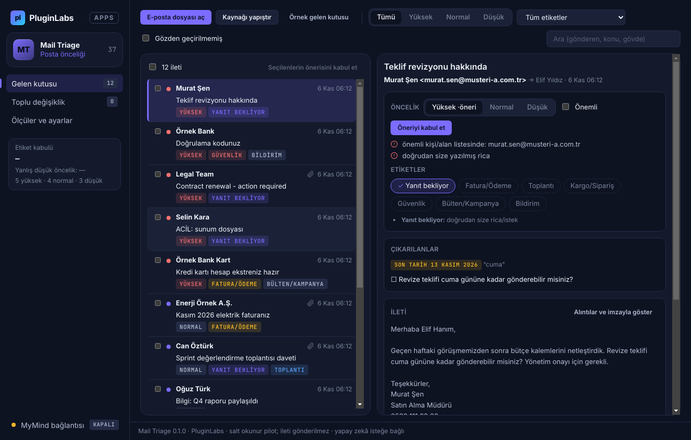
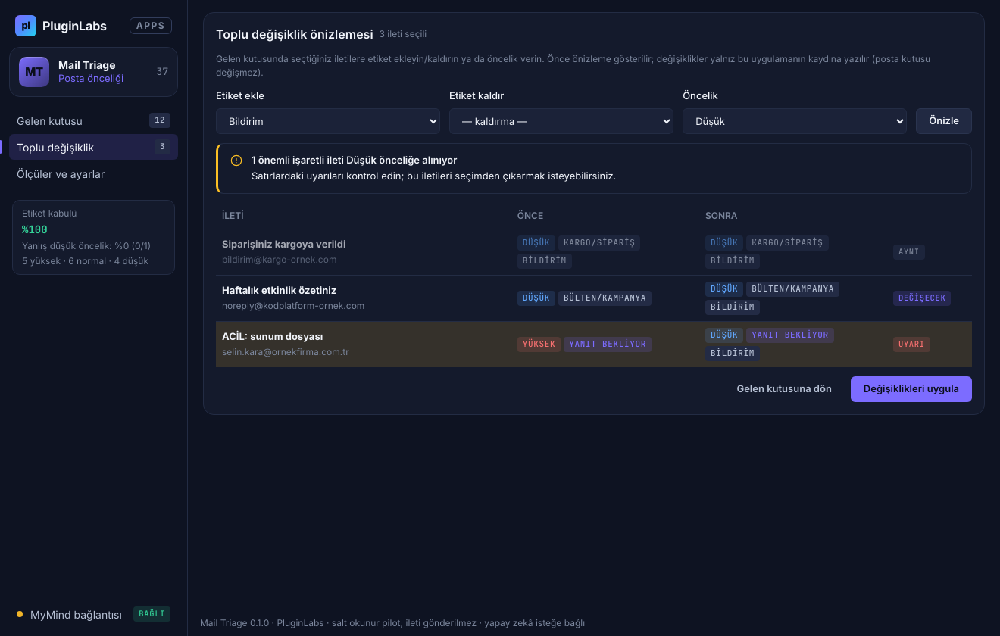
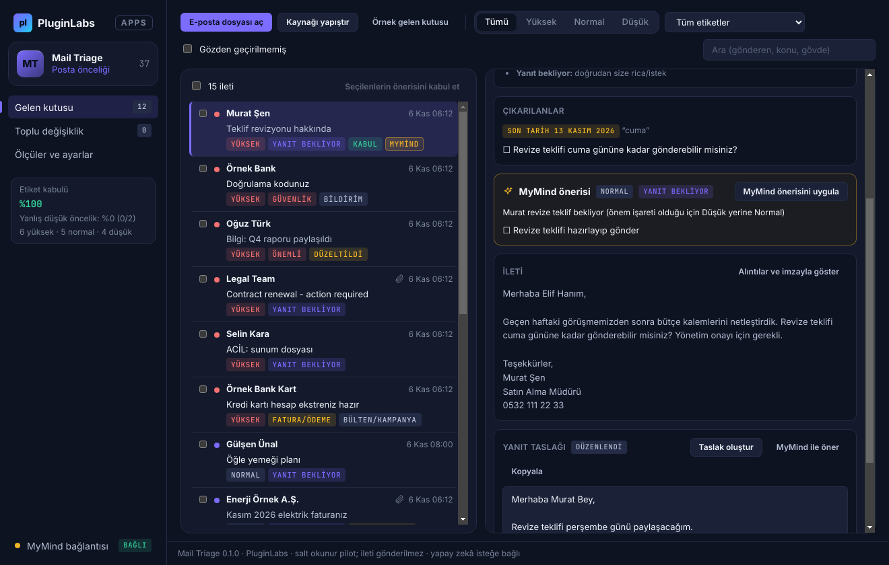
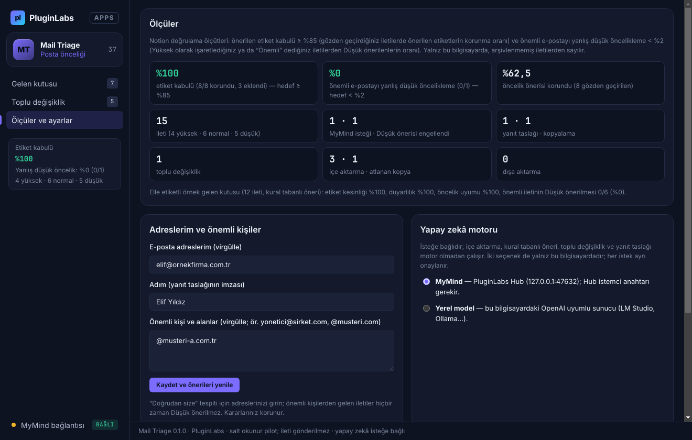
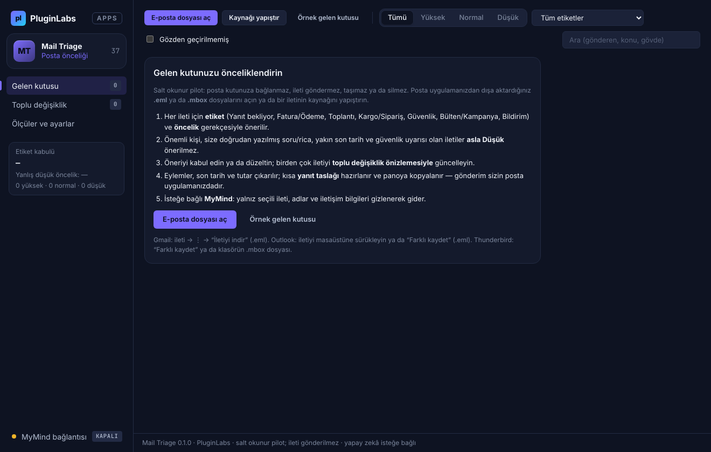

# Mail Triage (PL-037) — Windows uygulaması

Posta uygulamanızdan dışa aktardığınız e-postalar (`.eml`, `.mbox`) için **gerekçeli etiket ve öncelik** önerir; eylemleri, son tarihleri ve tutarları çıkarır; birden çok iletiyi **toplu değişiklik önizlemesiyle** düzenlemenizi ve kısa bir **yanıt taslağı** hazırlamanızı sağlar. **Salt okunur pilot:** posta kutunuza bağlanmaz, ileti göndermez/taşımaz/silmez, kaynak dosyaları değiştirmez. Önemli kişiden gelen, size doğrudan soru soran, son tarihi yaklaşan ya da güvenlikle ilgili iletiler **asla Düşük** önerilmez. İsteğe bağlı olarak **MyMind** (PluginLabs Hub) ya da bu bilgisayardaki **yerel model** ile — her istekte onayla, adlar ve iletişim bilgileri gizlenerek — öneri alınır.

> Ürün deposu henüz yok; kaynak bu klasördedir (PluginLabs ürün ön geliştirme alanı, PL-025 modeli). Windows paketleri `pluginlabs-dagitim` deposunda `mail-triage-v<sürüm>` etiketiyle yayımlanır.



| Toplu değişiklik önizlemesi (uyarı) | MyMind önerisi ve yanıt taslağı |
| --- | --- |
|  |  |
| **Ölçüler ve ayarlar** | **Başlangıç (salt okunur)** |
|  |  |

Ekran görüntüleri gerçek uygulamadan, duman testinin test verisiyle (uydurma örnek gelen kutusu; taklit MyMind yanıtı) Linux/xvfb'de alınmıştır. Windows runner'ında alınan gerçek pencere görüntüleri release ekindedir (`windows-masaustu-*`).

## İndir
[mail-triage-v0.1.0](https://github.com/timdesigners-pixel/pluginlabs-dagitim/releases/tag/mail-triage-v0.1.0) — `MailTriage-0.1.0-Windows-x64.exe` (kurulum), `MailTriage-0.1.0-Windows-Portable-x64.exe` (taşınabilir), SHA256SUMS + BUILD-INFO. İmzasız önizleme. PluginLabs Hub kataloğundan da kurulabilir (Hub kataloğu birleşip yayımlanınca).

## Kullanım
1. **Ölçüler ve ayarlar** → e-posta adreslerinizi, adınızı ve önemli kişi/alanları girin (ör. `@musteri.com`). İlk deneme için **Örnek gelen kutusu** (adresler boşsa örnek ayarları da yazar).
2. **E-posta dosyası aç** (.eml birden çok, .mbox) ya da **Kaynağı yapıştır**. Gmail: ileti → ⋮ → "İletiyi indir"; Outlook: iletiyi masaüstüne sürükleyin; Thunderbird: "Farklı kaydet" ya da klasörün .mbox dosyası.
3. Listede öncelik sırası; sağda öneri ve **gerekçeleri**. **Öneriyi kabul et** ya da etiket çiplerine tıklayarak / önceliği seçerek düzeltin; gerekirse **Önemli** işaretleyin.
4. Birden çok iletiyi seçin → **Toplu değişiklik** → etiket ekle/kaldır, öncelik → **Önizle** → **Değişiklikleri uygula**.
5. **Taslak oluştur** ya da **MyMind ile öner** → düzenleyin → **Kopyala** → posta uygulamanızda yapıştırıp gönderin.
6. **Dışa aktar**: öneriler `.csv` (Excel) ya da gelen kutusu özeti `.md`.

Kısayollar: Ctrl+O dosya aç, Ctrl+F ara, J/K sonraki/önceki ileti.

## Öneriler nasıl üretilir
- **Etiketler:** konu ve gövdedeki anahtar sözcükler (konuda geçen daha ağır), `List-Unsubscribe`/`List-Id` (Bülten/Kampanya), `Auto-Submitted`/no-reply gönderen (Bildirim), `.ics` eki (Toplantı), fatura/ekstre eki (Fatura/Ödeme), size doğrudan yazılmış soru/rica (Yanıt bekliyor; toplu ve otomatik iletilerde verilmez). Her etiketin gerekçesi gösterilir.
- **Öncelik:** önem işaretleri — önemli kişi/alan, doğrudan soru/rica, aciliyet ifadesi (toplu iletide sayılmaz), 7 gün içindeki son tarih (fatura ise toplu iletide de), güvenlik iletisi, "yüksek önem" başlığı, fatura. Güçlü işaret (VIP, acil, güvenlik, ≤ 2 gün son tarih, son tarihli doğrudan rica) → **Yüksek**; toplu/otomatik ve işaretsiz → **Düşük**; diğerleri → **Normal**.
- **Ölçüler:** etiket kabulü = gözden geçirdiğiniz iletilerde önerilen etiketlerden korunanların oranı; yanlış düşük öncelik = Yüksek ya da "Önemli" olarak işaretlediğiniz iletilerden Düşük önerilenlerin oranı.

## Güvenlik ve gizlilik
- Salt okunur: posta sunucusu bağlantısı, OAuth, gönderme/taşıma/silme yok; ekler açılmaz/kaydedilmez; kaynak dosyalar yalnız okunur. Mikrofon/kamera dahil izin istekleri reddedilir.
- İleti HTML'i ana süreçte düz metne çevrilir; arayüz CSP ile ağa kapalıdır (`connect-src 'none'`, `frame-src 'none'`), metin yalnız `textContent`/`value` ile yazılır; `contextIsolation` + `sandbox`; IPC yalnız kendi penceresinden.
- Ağ erişimi yalnız `desktop/net.js` içinde ve yalnız bu bilgisayara (Hub 127.0.0.1:47632 ya da loopback yerel model; `redirect: error`).
- Modele yalnız seçili ileti gider: alıntılar ve imza atılır, gövde 4000 karakterle sınırlı; adlar [Gönderen]/[Alıcı]/[Kişi]; e-posta adresleri, alan adı, telefon, bağlantı, IBAN, kart, T.C. kimlik, doğrulama kodu/parola gönderilmez. İletideki talimatlar veri sayılır. Yanıtta bilinmeyen etiketler atılır; önem işaretli ileti Düşük yapılamaz.
- İletiler, kararlar ve anahtar Windows kasasında (DPAPI) şifreli; kasa yoksa düz JSON, anahtar yalnız bellekte. Silme yok, arşiv var. CSV'de formül enjeksiyonu engellenir.

## Geliştirme
```bash
npm ci
npm test                                   # çekirdek birim testleri (node:test)
PLAYWRIGHT_MODULE=playwright xvfb-run -a -s "-screen 0 1440x900x24" node tests/desktop-smoke.cjs docs/screenshots
npm run build:win                          # Windows: kurulum + taşınabilir
node scripts/make-icons.cjs                # simgeleri yeniden üret
```
Windows derlemesi `ci/pluginlabs-dagitim-mail-triage-windows.yml` iş akışıyla `pluginlabs-dagitim` deposunda, sabit bir PluginLabs commit'inden yapılır.
