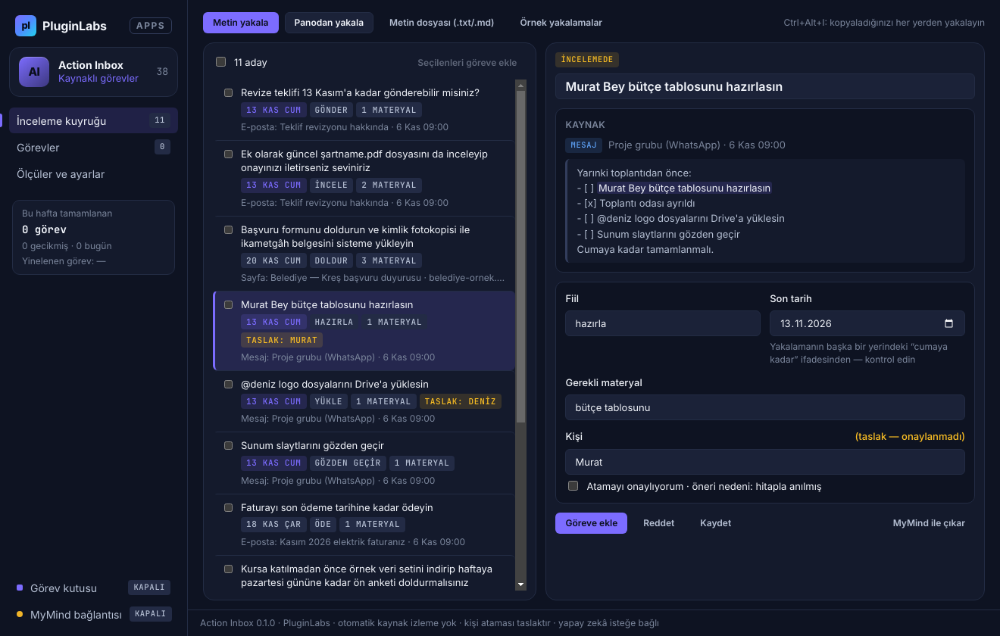

# PL-038 · Action Inbox

> Sayfa, mesaj ve e-postalardan seçilen yapılacakları kaynaklı bir görev kuyruğunda toplar.

| Alan | Değer |
| --- | --- |
| Kimlik | `PL-038` · `action-inbox` |
| Kategori | 04 · Araştırma, yazma ve bilgi akışları — PL-031–040 |
| Durum | 07.11.2026: **0.1.0 Windows uygulaması yayımlandı** — [action-inbox-v0.1.0](https://github.com/timdesigners-pixel/pluginlabs-dagitim/releases/tag/action-inbox-v0.1.0) (`pluginlabs-dagitim`, Windows runner: test + duman testi + SHA256 + BUILD-INFO + Windows ekran görüntüleri); kaynak [app/](app/README.md); Hub 0.4.24 kataloğunda · Notion durumu: Yeni fikir |
| Öncelik / efor | P1 · M |
| Hedef platformlar | Windows, Linux, macOS, Chrome |
| Dağıtım biçimi | masaüstü uygulaması, Chrome eklentisi (Manifest V3), widget |
| Geliştirme deposu | Henüz yok — kaynak bu klasörün [`app/`](app/README.md) alt klasöründe (ön geliştirme alanı; bkz. [repo hiyerarşisi](../../../docs/REPO-HIYERARSISI.md)); Windows derlemesi ve sürüm dosyaları `pluginlabs-dagitim` deposunda (iş akışı: [`app/ci/`](app/ci/pluginlabs-dagitim-action-inbox-windows.yml)) |
| Codex projesi | `PL-038 · Action Inbox` — ikinci klasör: PluginLabs |
| Notion kaynağı | [Notion](https://app.notion.com/p/4038aa13d8f981c08edfda43643b31fc) |

## Ne işe yarar

**Kullanıcı ve problem:** E-posta, sayfa ve mesajlarda kalan yapılacakları tek yerde toplamak isteyen kişiler.

**Kısa tanım (Hub kataloğu):** Sayfa, mesaj ve e-postalardan seçilen yapılacakları kaynaklı bir görev kuyruğunda toplar.

## Hangi platformlar için yayınlanır

**Notion’daki platform tanımı:** Chrome + W / L / M görev kutusu/widget

- Windows
- Linux
- macOS
- Chrome

> Platformlar hedef kapsamdır. PluginLabs ürün ilkesi gereği test edilmemiş platform “destekleniyor” diye etiketlenmez; her platform gerçek cihaz/tarayıcı kabulünden sonra yayın listesine girer.

## Özellikler

### MVP ve temel akış

Kullanıcı seçtiği metni görev adayı olarak kaydeder; kaynak URL, tarih önerisi ve inceleme kuyruğu. İlk sürüm otomatik kaynak izleme yok.

### Yapay zekânın rolü

Fiil, son tarih ve gerekli materyali çıkarır; kişi ataması taslaktır.

## Teknik bağımlılık ve sınırlar

Mail Triage sınıflandırır; Action Inbox kaynaklar arası tek görev kuyruğunu yönetir. Aynı iş için tekrar görev tespiti gerekir.

## Gelir hipotezi

Ücretsiz kişisel kuyruk; Pro bağlayıcı ve ekip akışı.

## Doğrulama ölçütü

Kaynaklı görev tamamlama haftalık ölçülür; yinelenen görev \<%3.

## Öncelik ve efor

P1 · M; Note Master görev şeması ve Flow Dock hızlı yakalaması ortak.

## 0.1.0 sürümü (Windows)

Notion MVP akışı: **kullanıcı seçtiği metni görev adayı olarak kaydeder; kaynak URL, tarih önerisi ve inceleme kuyruğu; ilk sürüm otomatik kaynak izleme yok.** Metin yapıştırılarak (kaynak türü, başlık ve http/https adresiyle), **Panodan yakala** düğmesiyle, her yerde **Ctrl+Alt+I** genel kısayoluyla (pano yalnız tuşa basınca okunur) ya da `.txt`/`.md` dosyasından yakalanır. Liste satırları ve eylem cümleleri ayrı adaylara bölünür; hiçbir aday kullanıcı onaylamadan görev olmaz.

Yapay zekânın rolü (Notion): **fiil, son tarih ve gerekli materyal çıkarılır; kişi ataması taslaktır.** Kural tabanlı çıkarım her zaman çalışır (son tarih yakalama gününe göre ve kaynağı gösterilerek); MyMind ya da yerel model isteğe bağlıdır, her istek onaylıdır, kişi adları [Kişi1]… ve iletişim bilgileri ⟦n⟧ olarak gider, kaynak adresi gönderilmez; metinde olmayan kişi denetimde atılır. Kişi ataması "Atamayı onaylıyorum" işaretlenmedikçe her yerde taslak yazar.

Teknik sınır (Notion): **aynı iş için tekrar görev tespiti** — yeni aday açık ya da yakın zamanda tamamlanan bir görevle aynı iş görünürse "olası yineleme" uyarısı çıkar; **Mevcut göreve birleştir** kaynağı o göreve ekler (görev çoğalmaz). Doğrulama ölçütü ekranında **haftalık kaynaklı görev tamamlama** (son 4 hafta) ve **yinelenen görev oranı** (hedef < %3) gösterilir. Görev kuyruğu son tarihe göre kovalanır; **görev kutusu (widget)** her zaman üstte kalabilir. Dışa aktarma: Markdown, iCalendar (VTODO), CSV, JSON yedek.

Kapsam dışı (bu sürüm): otomatik kaynak izleme, Chrome eklentisi (sayfada sağ tıkla yakalama), Linux/macOS paketleri, Pro bağlayıcılar ve ekip akışı, Note Master/Flow Dock ortak görev şeması. Ayrıntı: [app/README.md](app/README.md).

## Geliştirme ve ortak çalışma (Codex + Claude Code)

- Dal adı: `codex/PL-038-<konu>` veya `claude/PL-038-<konu>`; iki ajan aynı dalda aynı anda çalışmaz.
- İşe başlamadan önce [AKTIF-ISLER.md](../../../docs/ortak-calisma/AKTIF-ISLER.md) tablosuna satır eklenir; iş bitince devir notu yazılır.
- Kurallar: [AGENTS.md](../../../AGENTS.md) (her iki ajan için ortak), protokol: [AI-ORTAK-CALISMA.md](../../../docs/ortak-calisma/AI-ORTAK-CALISMA.md).

## Notion kartının özgün metni

Aşağıdaki metin `resources/notion-catalog.json` (Notion anlık görüntüsü, 2026-10-26) içindeki kartın kısaltılmadan aktarılmış hâlidir.

Tam kartı göster

- **Durum:** Yeni fikir
- **Platform:** Chrome + W / L / M görev kutusu/widget
- **Kullanıcı ve problem:** E-posta, sayfa ve mesajlarda kalan yapılacakları tek yerde toplamak isteyen kişiler.
- **MVP ve temel akış:** Kullanıcı seçtiği metni görev adayı olarak kaydeder; kaynak URL, tarih önerisi ve inceleme kuyruğu. İlk sürüm otomatik kaynak izleme yok.
- **Yapay zekânın rolü:** Fiil, son tarih ve gerekli materyali çıkarır; kişi ataması taslaktır.
- **Teknik bağımlılık ve sınır:** Mail Triage sınıflandırır; Action Inbox kaynaklar arası tek görev kuyruğunu yönetir. Aynı iş için tekrar görev tespiti gerekir.
- **Gelir hipotezi:** Ücretsiz kişisel kuyruk; Pro bağlayıcı ve ekip akışı.
- **Doğrulama ölçütü:** Kaynaklı görev tamamlama haftalık ölçülür; yinelenen görev \<%3.
- **Öncelik ve efor:** P1 · M; Note Master görev şeması ve Flow Dock hızlı yakalaması ortak.

---
Oluşturma: 29.10.2026 · Kaynak → hedef: Notion kataloğu → `registry/projects.json` → bu dosya
