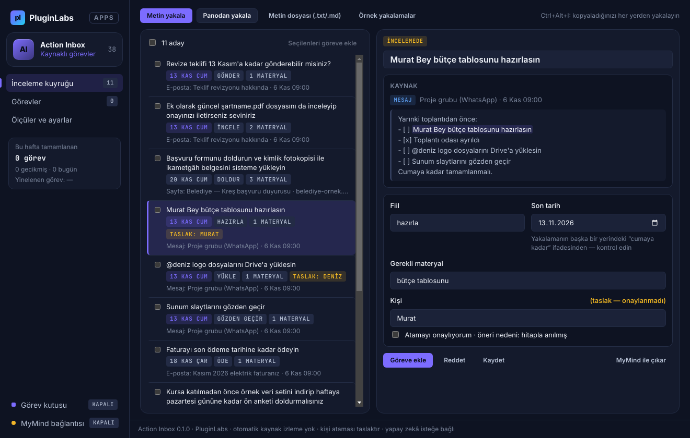
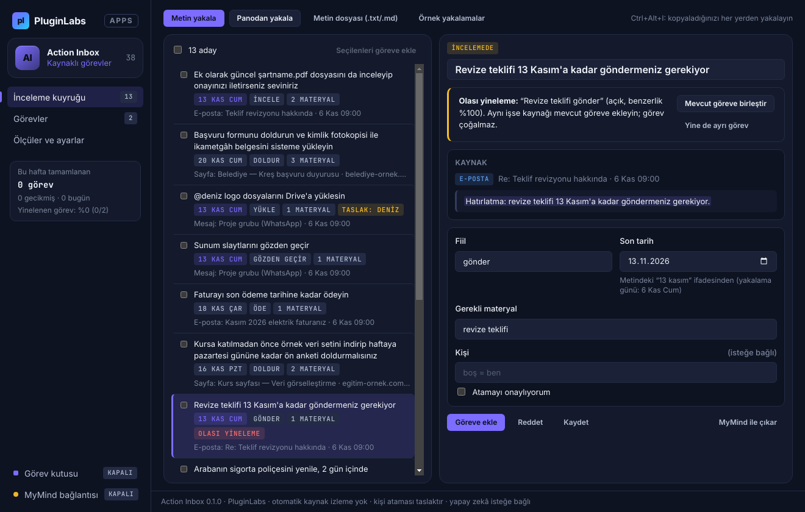
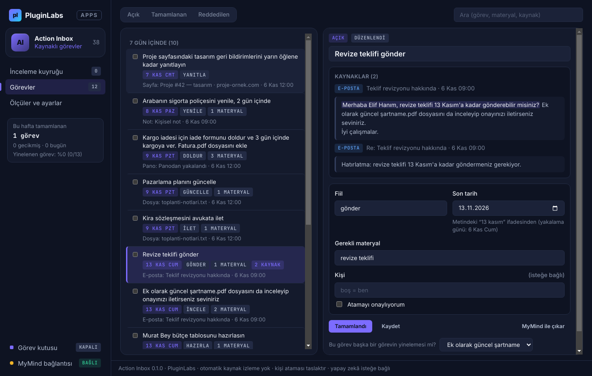
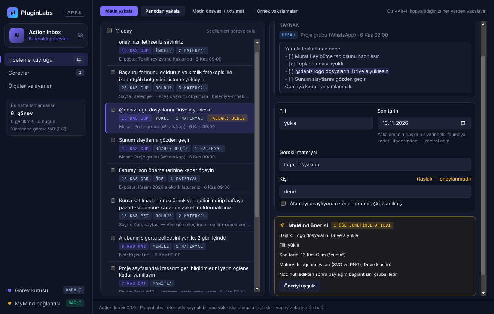
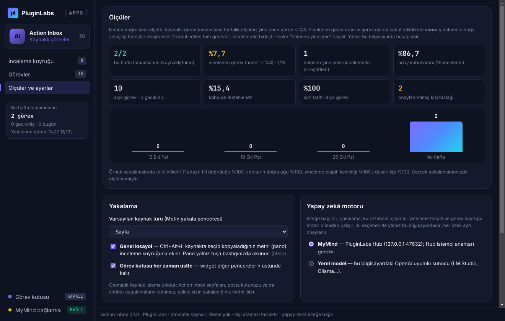
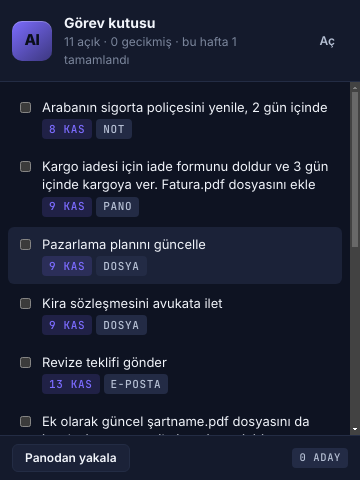
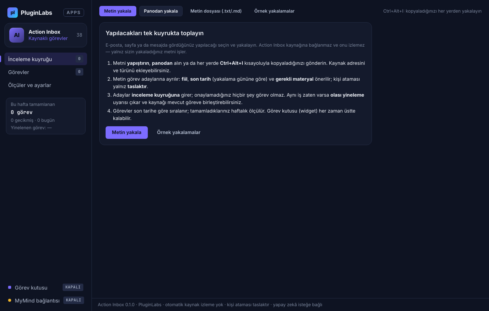

# Action Inbox (PL-038) — Windows uygulaması

E-posta, sayfa ve mesajlarda gördüğünüz yapılacakları **seçip yakalayın**: Action Inbox metni **kaynaklı görev adaylarına** ayırır, **fiil, son tarih ve gerekli materyali** önerir, adayları **inceleme kuyruğuna** koyar ve onayladıklarınızı tek bir **görev kuyruğunda** son tarihe göre sıralar. **Kişi ataması yalnız taslaktır**; aynı iş ikinci kez yakalanırsa **olası yineleme** uyarısı çıkar ve kaynağı mevcut göreve birleştirebilirsiniz. **Otomatik kaynak izleme yoktur** — yalnız sizin yakaladığınız metin işlenir. İsteğe bağlı olarak **MyMind** (PluginLabs Hub) ya da bu bilgisayardaki **yerel model** ile — her istekte onayla, adlar ve iletişim bilgileri gizlenerek — çıkarım yapılır.

> Ürün deposu henüz yok; kaynak bu klasördedir (PluginLabs ürün ön geliştirme alanı, PL-025 modeli). Windows paketleri `pluginlabs-dagitim` deposunda `action-inbox-v<sürüm>` etiketiyle yayımlanır.



| Olası yineleme uyarısı ve birleştirme | Görev kuyruğu (birleştirilmiş iki kaynak) |
| --- | --- |
|  |  |
| **MyMind önerisi (denetlenmiş)** | **Ölçüler ve ayarlar** |
|  |  |
| **Görev kutusu (widget)** | **Başlangıç** |
|  |  |

Ekran görüntüleri gerçek uygulamadan, duman testinin test verisiyle (uydurma örnek yakalamalar; taklit MyMind yanıtı; tarih 6 Kasım 2026'ya sabitlenmiş) Linux/xvfb'de alınmıştır. Windows runner'ında alınan gerçek pencere görüntüleri (`windows-masaustu-*`) release ekindedir.

## İndir
[action-inbox-v0.1.0](https://github.com/timdesigners-pixel/pluginlabs-dagitim/releases/tag/action-inbox-v0.1.0) — `ActionInbox-0.1.0-Windows-x64.exe` (kurulum), `ActionInbox-0.1.0-Windows-Portable-x64.exe` (taşınabilir), SHA256SUMS + BUILD-INFO. İmzasız önizleme. PluginLabs Hub kataloğundan da kurulabilir (Hub kataloğu birleşip yayımlanınca).

## Kullanım
1. Kaynakta yapılacak metni seçip kopyalayın, ardından **Ctrl+Alt+I** (her yerde) ya da **Panodan yakala**. Kaynak adresini/türünü eklemek için **Metin yakala** (Ctrl+N). Toplantı notu gibi listeler için `.txt`/`.md` dosyası da açabilirsiniz. İlk deneme için **Örnek yakalamalar**.
2. **İnceleme kuyruğu**nda her adayın kaynağı ve seçilen cümle vurgulu görünür. Başlığı, fiili, son tarihi, materyali ve kişiyi düzeltin → **Göreve ekle** ya da **Reddet**. Kişi ataması "Atamayı onaylıyorum" işaretlenmedikçe taslaktır.
3. **Olası yineleme** uyarısında aynı işse **Mevcut göreve birleştir** (kaynak eklenir, görev çoğalmaz); değilse **Yine de ayrı görev**.
4. **Görevler**: gecikmiş/bugün/7 gün/sonra/tarihsiz. İşaretleyerek tamamlayın; **Kaynağı aç** ile sayfaya dönün. Kabulden sonra yineleme fark ederseniz ayrıntıdan "Ona birleştir".
5. **Görev kutusu** (sol alt): her zaman üstte kalabilen küçük pencere; işaretleyerek tamamlama, panodan yakalama.
6. **Ölçüler ve ayarlar**: haftalık kaynaklı tamamlama, yinelenen görev oranı; dışa aktarma `.md`, `.ics` (takvim/görev uygulamaları), `.csv`, JSON yedek.

## Öneriler nasıl üretilir
- **Adaylar:** liste satırları ("- [ ] …", "• …", "1. …", "TODO: …") her biri bir aday ([x] atlanır); düz metinde eylem cümleleri (rica/emir kipleri, "-malı/-meli", "-sın/-sin", "gerekiyor/lazım", "-irseniz seviniriz", "could you / need to / please"); eylem yoksa kısa metnin tamamı ("eylem cümlesi bulunamadı" rozetiyle).
- **Son tarih:** yakalama gününe göre çözülür ve kaynağı gösterilir: "metindeki ‘cuma’ ifadesinden" ya da "yakalamanın başka bir yerindeki ‘cumaya kadar’ ifadesinden — kontrol edin".
- **Yineleme:** başlık + fiil + materyal sözcüklerinin (Türkçe eklere karşı kaba kök) benzerliği; aynı son tarih ve aynı kaynak adresi puanı artırır, farklı fiil azaltır; eşik %60. Reddedilen, birleştirilen ve 14 günden eski tamamlanan görevler karşılaştırılmaz.
- **Ölçüler:** yinelenen görev oranı = görev olarak kabul edildikten sonra yineleme olduğu anlaşılıp birleştirilen görevler / kabul edilen görevler (incelemede birleştirilenler "önlenen yineleme" sayılır); haftalık tamamlama pazartesiden başlar.

## Güvenlik ve gizlilik
- Kaynağa bağlanılmaz: sayfa indirme, posta kutusu, sohbet uygulaması erişimi yok. Pano yalnız düğmeye ya da kısayola bastığınızda okunur. Kaynak adresi yalnız http/https olabilir ve yalnız siz tıklayınca varsayılan tarayıcıda açılır. Mikrofon/kamera dahil izin istekleri reddedilir.
- Arayüz CSP ile ağa kapalıdır (`connect-src 'none'`, `frame-src 'none'`), metin yalnız `textContent`/`value` ile yazılır; `contextIsolation` + `sandbox`; IPC yalnız uygulamanın kendi pencerelerinden (ana pencere ve görev kutusu).
- Ağ erişimi yalnız `desktop/net.js` içinde ve yalnız bu bilgisayara (Hub 127.0.0.1:47632 ya da loopback yerel model; `redirect: error`).
- Modele yalnız seçili adayın cümlesi ve 1200 karakterlik bağlamı gider: kişi adları [Kişi1]…; e-posta, telefon, bağlantı, IBAN, kart, T.C. kimlik, parola değerleri ⟦n⟧; kaynak adresi ve başlığı gönderilmez. Metindeki talimatlar veri sayılır. Yanıtta metinde olmayan kişi ve çözülemeyen tarih atılır.
- Görevler ve anahtar Windows kasasında (DPAPI) şifreli; kasa yoksa düz JSON, anahtar yalnız bellekte. Silme yok: reddedilenler ve birleştirilenler kayıtta kalır. CSV'de formül enjeksiyonu engellenir.

## Geliştirme
```bash
npm ci
npm test                                   # çekirdek birim testleri (node:test)
PLAYWRIGHT_MODULE=playwright xvfb-run -a -s "-screen 0 1440x900x24" node tests/desktop-smoke.cjs docs/screenshots
npm run build:win                          # Windows: kurulum + taşınabilir
node scripts/make-icons.cjs                # simgeleri yeniden üret
```
Windows derlemesi `ci/pluginlabs-dagitim-action-inbox-windows.yml` iş akışıyla `pluginlabs-dagitim` deposunda, sabit bir PluginLabs commit'inden yapılır.
