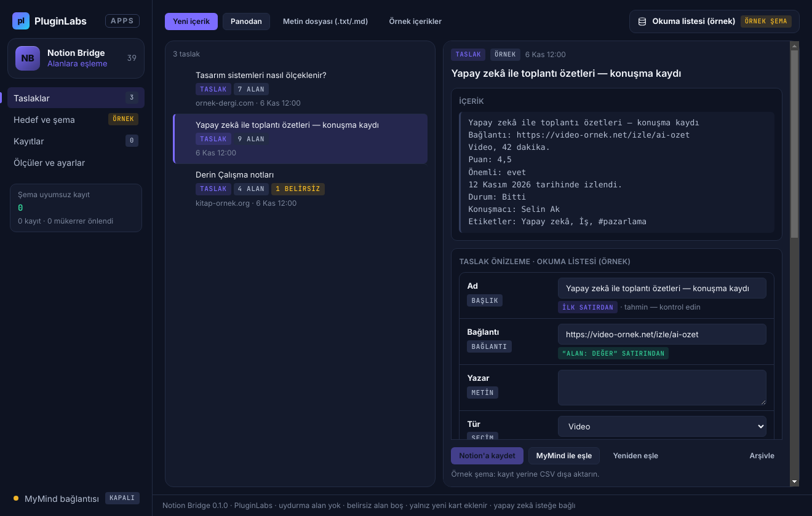

# PL-039 · Notion Bridge

> Seçilen içeriği Notion veritabanı alanlarına eşler ve kayıt öncesi taslak önizlemesi gösterir.

| Alan | Değer |
| --- | --- |
| Kimlik | `PL-039` · `notion-bridge` |
| Kategori | 04 · Araştırma, yazma ve bilgi akışları — PL-031–040 |
| Durum | 07.11.2026: **0.1.0 Windows uygulaması yayımlandı** — [notion-bridge-v0.1.0](https://github.com/timdesigners-pixel/pluginlabs-dagitim/releases/tag/notion-bridge-v0.1.0) (`pluginlabs-dagitim`, Windows runner: test + duman testi + SHA256 + BUILD-INFO + Windows ekran görüntüleri); kaynak [app/](app/README.md); Hub 0.4.25 kataloğunda · Notion durumu: Yeni fikir |
| Öncelik / efor | P1 · M |
| Hedef platformlar | Windows, Linux, macOS, Chrome |
| Dağıtım biçimi | masaüstü uygulaması, Chrome eklentisi (Manifest V3) |
| Geliştirme deposu | Henüz yok — kaynak bu klasörün [`app/`](app/README.md) alt klasöründe (ön geliştirme alanı; bkz. [repo hiyerarşisi](../../../docs/REPO-HIYERARSISI.md)); Windows derlemesi ve sürüm dosyaları `pluginlabs-dagitim` deposunda (iş akışı: [`app/ci/`](app/ci/pluginlabs-dagitim-notion-bridge-windows.yml)) |
| Codex projesi | `PL-039 · Notion Bridge` — ikinci klasör: PluginLabs |
| Notion kaynağı | [Notion](https://app.notion.com/p/4038aa13d8f981c08edfda43643b31fc) |

## Ne işe yarar

**Kullanıcı ve problem:** Web ve masaüstü verilerini Notion’daki doğru alana elle aktaran kullanıcılar.

**Kısa tanım (Hub kataloğu):** Seçilen içeriği Notion veritabanı alanlarına eşler ve kayıt öncesi taslak önizlemesi gösterir.

## Hangi platformlar için yayınlanır

**Notion’daki platform tanımı:** Chrome + W / L / M bağlantı penceresi

- Windows
- Linux
- macOS
- Chrome

> Platformlar hedef kapsamdır. PluginLabs ürün ilkesi gereği test edilmemiş platform “destekleniyor” diye etiketlenmez; her platform gerçek cihaz/tarayıcı kabulünden sonra yayın listesine girer.

## Özellikler

### MVP ve temel akış

İzinli Notion hedefi seç → şemayı oku → alan eşleştir → taslak önizle → kaydet. İlk sürüm tek veri tabanına kart ekleme.

### Yapay zekânın rolü

Metni veritabanı alanlarına ayırır; olmayan property uydurmaz ve belirsiz alanı boş bırakır.

## Teknik bağımlılık ve sınırlar

Notion yetkileri/rate limitleri ve API değişimleri; ayrıcalık yükseltmez. Var olan sayfa içeriğini sessizce değiştirmez.

## Gelir hipotezi

Freemium yakalama; Pro çoklu şema ve ekip onay akışı.

## Doğrulama ölçütü

Şema uyumsuz kayıt sıfır; aynı girdiyi tekrar çalıştırmada mükerrer kayıt oluşmaması.

## Öncelik ve efor

P1 · M; yerel dosya erişimi için masaüstü köprüsü.

## 0.1.0 sürümü (Windows)

Notion MVP akışı: **izinli Notion hedefi seç → şemayı oku → alan eşleştir → taslak önizle → kaydet; ilk sürüm tek veri tabanına kart ekleme.** Kullanıcının kendi dahili entegrasyon anahtarıyla (Windows kasasında şifreli) ve entegrasyonla paylaştığı tek veritabanına bağlanılır; şema (alanlar, türler, seçenekler) okunur. İçerik yapıştırılarak (isteğe bağlı http/https kaynak adresiyle), **Panodan** düğmesiyle, her yerde **Ctrl+Alt+N** genel kısayoluyla (pano yalnız tuşa basınca okunur) ya da `.txt`/`.md` dosyasından alınır.

Yapay zekânın rolü (Notion): **metni veritabanı alanlarına ayırır; olmayan property uydurmaz ve belirsiz alanı boş bırakır.** Kural tabanlı eşleme her zaman çalışır ("Alan: değer" satırları, kaynak adresi, tek tarih/e-posta/telefon alanı, metinde adı geçen tek seçenek, #etiketler); şemada karşılığı olmayan satırlar "eklenmedi" listesinde gösterilir, olmayan seçenek yeni seçenek olarak eklenmez, belirsiz alan boş kalır ve nedeni yazılır. MyMind ya da yerel model isteğe bağlıdır, her istek onaylıdır, iletişim bilgileri ⟦n⟧ olarak gider, kaynak adresi ve Notion anahtarı gönderilmez; yanıt aynı şema denetiminden geçer (uydurma alan/seçenek atılır).

Teknik sınır (Notion): **ayrıcalık yükseltmez; var olan sayfa içeriğini sessizce değiştirmez.** Yalnız üç Notion isteği vardır (şema okuma, başlıkla mükerrer sorgusu, yeni sayfa ekleme), her biri ayrı onaylıdır; PATCH/silme ucu yoktur; 429'da Retry-After'a uyulur. Doğrulama ölçütü: **şema uyumsuz kayıt sıfır** — taslak kayıttan önce şemaya göre denetlenir ve uyumsuzsa gönderilmez; **aynı girdiyi tekrar çalıştırmada mükerrer kayıt oluşmaması** — yerel parmak izi defteri ve Notion'da başlık sorgusu. Dışa aktarma: Notion "CSV ile birleştir" akışına uygun CSV, Markdown, JSON yedek.

Kapsam dışı (bu sürüm): çoklu şema ve ekip onay akışı (Pro), var olan kartı güncelleme, sayfa gövdesi (blok) yazma, kişi/dosya/ilişki alanları, OAuth genel entegrasyonu, Chrome eklentisi, Linux/macOS paketleri. Gerçek bir Notion çalışma alanına karşı denenmedi (taklit Notion API ile otomatik test). Ayrıntı: [app/README.md](app/README.md).

## Geliştirme ve ortak çalışma (Codex + Claude Code)

- Dal adı: `codex/PL-039-<konu>` veya `claude/PL-039-<konu>`; iki ajan aynı dalda aynı anda çalışmaz.
- İşe başlamadan önce [AKTIF-ISLER.md](../../../docs/ortak-calisma/AKTIF-ISLER.md) tablosuna satır eklenir; iş bitince devir notu yazılır.
- Kurallar: [AGENTS.md](../../../AGENTS.md) (her iki ajan için ortak), protokol: [AI-ORTAK-CALISMA.md](../../../docs/ortak-calisma/AI-ORTAK-CALISMA.md).

## Notion kartının özgün metni

Aşağıdaki metin `resources/notion-catalog.json` (Notion anlık görüntüsü, 2026-10-26) içindeki kartın kısaltılmadan aktarılmış hâlidir.

Tam kartı göster

- **Durum:** Yeni fikir
- **Platform:** Chrome + W / L / M bağlantı penceresi
- **Kullanıcı ve problem:** Web ve masaüstü verilerini Notion’daki doğru alana elle aktaran kullanıcılar.
- **MVP ve temel akış:** İzinli Notion hedefi seç → şemayı oku → alan eşleştir → taslak önizle → kaydet. İlk sürüm tek veri tabanına kart ekleme.
- **Yapay zekânın rolü:** Metni veritabanı alanlarına ayırır; olmayan property uydurmaz ve belirsiz alanı boş bırakır.
- **Teknik bağımlılık ve sınır:** Notion yetkileri/rate limitleri ve API değişimleri; ayrıcalık yükseltmez. Var olan sayfa içeriğini sessizce değiştirmez.
- **Gelir hipotezi:** Freemium yakalama; Pro çoklu şema ve ekip onay akışı.
- **Doğrulama ölçütü:** Şema uyumsuz kayıt sıfır; aynı girdiyi tekrar çalıştırmada mükerrer kayıt oluşmaması.
- **Öncelik ve efor:** P1 · M; yerel dosya erişimi için masaüstü köprüsü.

---
Oluşturma: 29.10.2026 · Kaynak → hedef: Notion kataloğu → `registry/projects.json` → bu dosya
