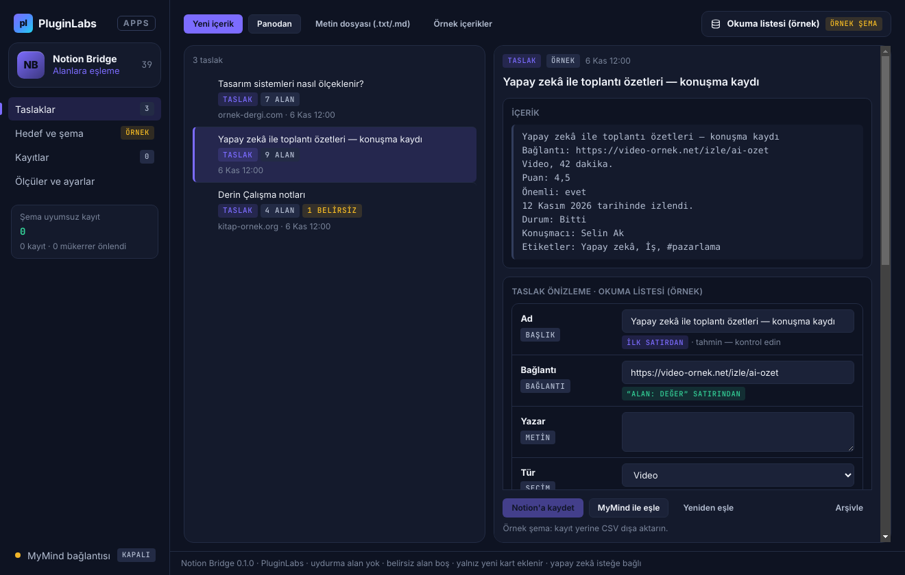
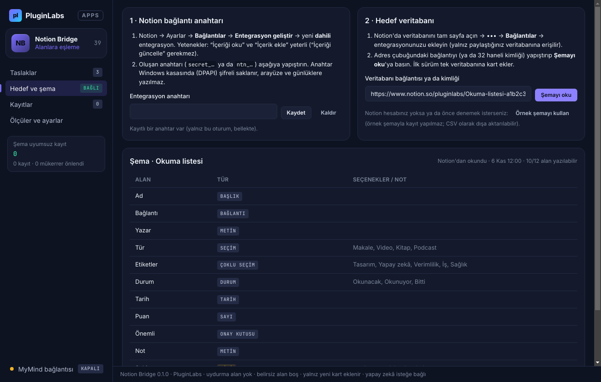
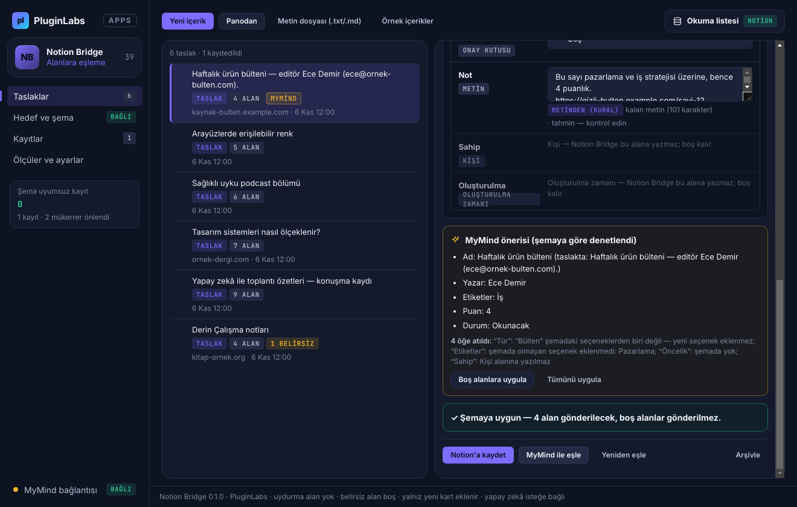
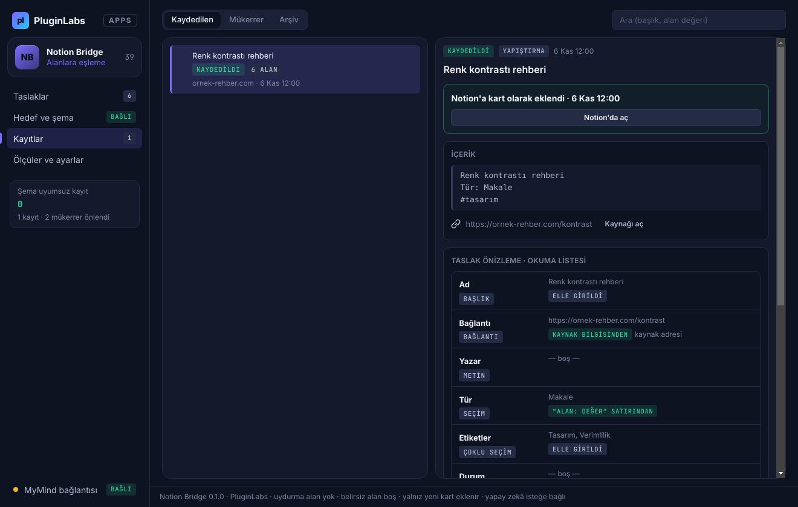
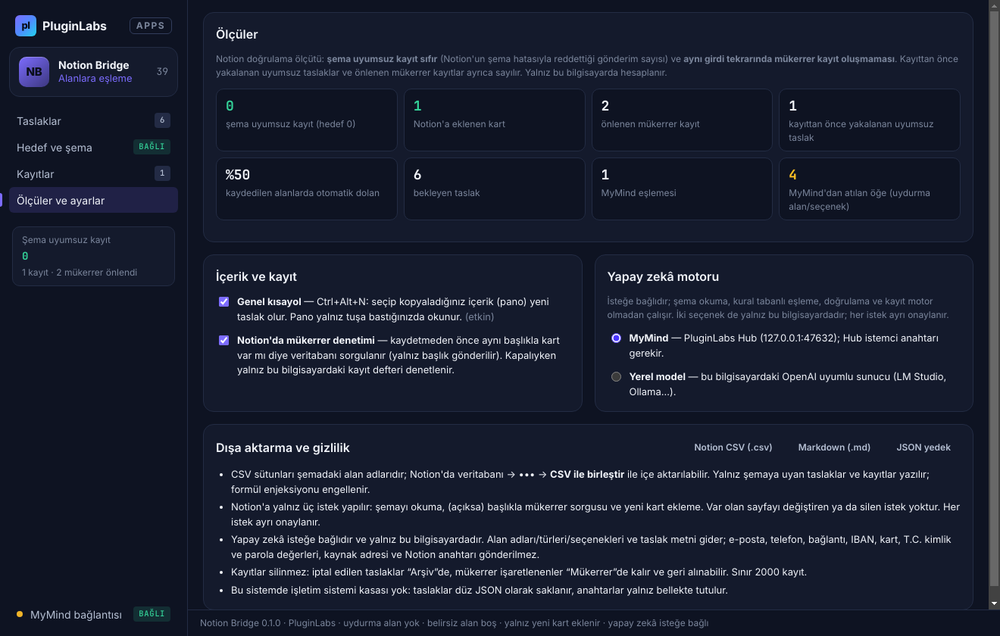
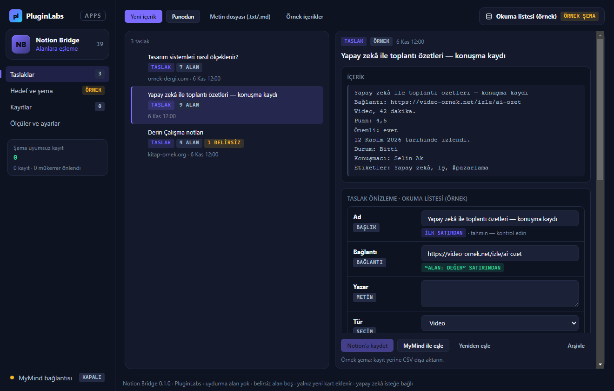
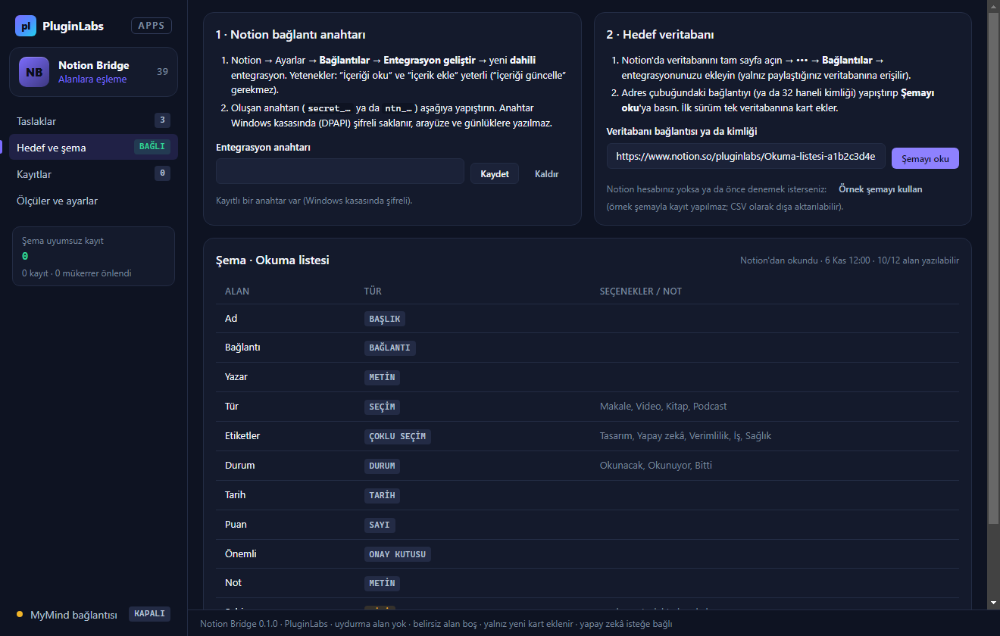
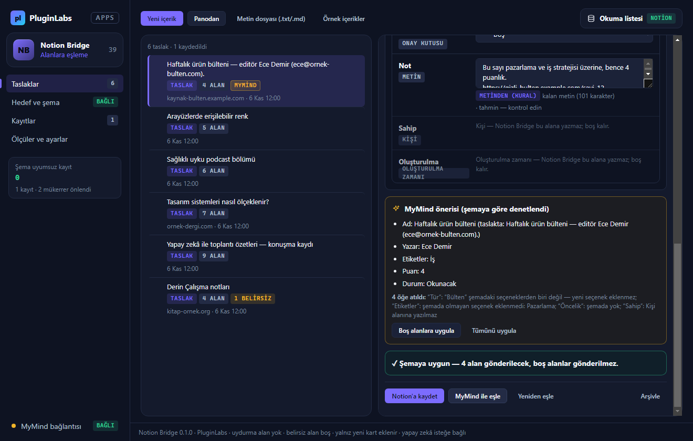
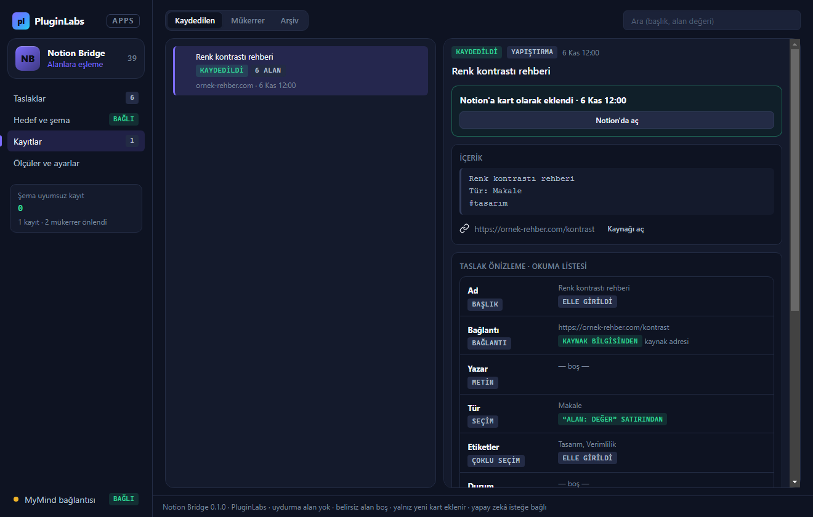

# Notion Bridge (PL-039) — Windows uygulaması

Web'de ya da masaüstünde gördüğünüz içeriği **Notion'daki doğru alana** elle taşımayın: Notion Bridge seçtiğiniz metni **tek bir Notion veritabanının şemasına** (alanlar, türler, seçenekler) göre eşler, **kaydetmeden önce taslağı gösterir** ve onayınızla **yeni kart** olarak ekler. **Şemada olmayan alan ya da seçenek uydurulmaz**, **belirsiz alan boş bırakılır** ve nedeni yazılır; **şemaya uymayan taslak gönderilmez**; **aynı içerik ikinci kez kaydedilmez**. Var olan sayfalar **değiştirilmez**. İsteğe bağlı olarak **MyMind** (PluginLabs Hub) ya da bu bilgisayardaki **yerel model** ile — her istekte onayla, iletişim bilgileri gizlenerek — serbest metin alanlara ayrılır; öneri aynı şema denetiminden geçer.

> Ürün deposu henüz yok; kaynak bu klasördedir (PluginLabs ürün ön geliştirme alanı, PL-025 modeli). Windows paketleri `pluginlabs-dagitim` deposunda `notion-bridge-v<sürüm>` etiketiyle yayımlanır.



| Hedef ve şema (Notion'dan okunan alanlar ve seçenekler) | MyMind önerisi (uydurma alan/seçenek atıldı) |
| --- | --- |
|  |  |
| **Kayıtlar (Notion'a eklenen kart)** | **Ölçüler ve ayarlar** |
|  |  |

Ekran görüntüleri gerçek uygulamadan, duman testinin test verisiyle (uydurma örnek içerikler; **taklit Notion API** ve taklit MyMind yanıtı; tarih 6 Kasım 2026'ya sabitlenmiş) Linux/xvfb'de alınmıştır. Windows runner'ında alınan gerçek pencere görüntüleri (`windows-masaustu-*`, [çalıştırma 42383971671](https://github.com/timdesigners-pixel/pluginlabs-dagitim/actions/runs/42383971671), kaynak ce9f8a8; Windows kasası DPAPI etkin) release ekinde ve aşağıdadır.

**Windows'ta (Windows runner, gerçek pencere):**



| Windows — hedef ve şema | Windows — MyMind önerisi | Windows — kayıtlar |
| --- | --- | --- |
|  |  |  |

## İndir
[notion-bridge-v0.1.0](https://github.com/timdesigners-pixel/pluginlabs-dagitim/releases/tag/notion-bridge-v0.1.0) — `NotionBridge-0.1.0-Windows-x64.exe` (kurulum, SHA-256 `df65772b…0263`), `NotionBridge-0.1.0-Windows-Portable-x64.exe` (taşınabilir, SHA-256 `d43bf3e7…70ed`, 81 533 098 bayt), SHA256SUMS + BUILD-INFO. İmzasız önizleme. PluginLabs Hub kataloğundan da kurulabilir (Hub kataloğu birleşip yayımlanınca).

## Kurulum: Notion bağlantısı
1. Notion → Ayarlar → **Bağlantılar** → **Entegrasyon geliştir** → yeni **dahili** entegrasyon. Yetenekler: "İçeriği oku" ve "İçerik ekle" yeterli ("İçeriği güncelle" gerekmez).
2. Anahtarı (`secret_…` / `ntn_…`) Notion Bridge → **Hedef ve şema** → *Entegrasyon anahtarı* alanına yapıştırıp kaydedin (Windows kasasında şifreli saklanır).
3. Notion'da hedef veritabanını tam sayfa açın → ••• → **Bağlantılar** → entegrasyonunuzu ekleyin. Adres çubuğundaki bağlantıyı yapıştırıp **Şemayı oku**.

## Kullanım
1. İçeriği seçip kopyalayın, ardından **Ctrl+Alt+N** (her yerde) ya da **Panodan**. Kaynak adresini eklemek için **Yeni içerik** (Ctrl+N). `.txt`/`.md` dosyası da açabilirsiniz. İlk deneme için **Örnek içerikler** (örnek şemayla; kayıt yapılmaz).
2. **Taslak önizleme**de her alanın değeri ve nereden geldiği görünür. "Tahmin" işaretli alanları kontrol edin, gerekirse düzeltin. "Şemada olmayan — eklenmedi" listesi, şemaya karşılığı olmayan satırları ve #etiketleri gösterir.
3. **Notion'a kaydet**: onay penceresinde gönderilecek alanların tam listesi görünür; onaylarsanız (açıksa önce aynı başlıklı kart sorgulanır) yeni kart eklenir. Mükerrer bulunursa kayıt yapılmaz ve mevcut kart açılabilir.
4. **Kayıtlar**: kaydedilen kartlar (Notion'da aç), mükerrer işaretlenenler, arşiv. **Ölçüler ve ayarlar**: ölçütler, kısayol, mükerrer sorgusu, yapay zekâ motoru, CSV/MD/JSON dışa aktarma.

## Eşleme kuralları
- **"Alan: değer" satırı** en güçlü kanıttır: alan adı büyük/küçük harf, Türkçe karakter ve aksan duyarsız eşlenir (tekil önek de kabul: "Etiket:" → "Etiketler"). Değer alanın türüne çevrilir; çevrilemezse alan boş kalır ve nedeni yazılır.
- **Başlık**: ilk anlamlı satır (şemada karşılığı olmayan "X: …" biçimindeki ilk satır da başlık sayılır), yoksa kaynak başlığı.
- **Bağlantı**: tek bağlantı alanı (ya da adı Bağlantı/Link/URL/Kaynak olan tek alan) → kaynak adresi ya da metindeki tek bağlantı. Birden çok aday → boş.
- **Tarih / e-posta / telefon**: yalnız o türde **tek** alan ve **tek** değer varsa.
- **Seçim / durum**: metinde adı geçen **tek** seçenek (birden çoksa boş). **Çoklu seçim**: metinde ya da #etiket olarak geçen seçenekler. Hiçbir seçenek yeni oluşturulmaz.
- **Not / Açıklama / Özet** adlı tek metin alanı: kalan metin.

## Güvenlik ve gizlilik
- Ağ erişimi yalnız `desktop/net.js` içinde. Notion'a yalnız `https://api.notion.com` ve yalnız üç uç: şema okuma (`GET /v1/databases/{id}`), mükerrer sorgusu (`POST /v1/databases/{id}/query`, yalnız başlık filtresi) ve yeni sayfa (`POST /v1/pages`). Başka uç istemci tarafında reddedilir; yönlendirme izlenmez. Her istek ayrı onaylıdır.
- Notion anahtarı ve Hub anahtarı Windows kasasında (DPAPI) şifreli; arayüze, duruma ve günlüklere verilmez. Kasa yoksa yalnız bellekte tutulur.
- Arayüz CSP ile ağa kapalıdır (`connect-src 'none'`, `frame-src 'none'`), metin yalnız `textContent`/`value` ile yazılır; `contextIsolation` + `sandbox`; IPC yalnız uygulamanın kendi penceresinden. Mikrofon/kamera dahil izin istekleri reddedilir.
- Modele (Hub 127.0.0.1:47632 ya da loopback yerel model) yalnız alan adları/türleri/seçenekleri ve taslak metni (en çok 3000 karakter) gider; e-posta, telefon, bağlantı, IBAN, kart, T.C. kimlik, parola değerleri ⟦n⟧; kaynak adresi, başlığı ve Notion anahtarı gönderilmez. Metindeki talimatlar veri sayılır.
- Silme yok: iptal edilen taslaklar arşivde, mükerrerler kendi süzgecinde kalır. CSV'de formül enjeksiyonu engellenir.

## Geliştirme
```bash
npm ci
npm test                                   # çekirdek birim testleri (node:test)
PLAYWRIGHT_MODULE=playwright xvfb-run -a -s "-screen 0 1440x900x24" node tests/desktop-smoke.cjs docs/screenshots
npm run build:win                          # Windows: kurulum + taşınabilir
node scripts/make-icons.cjs                # simgeleri yeniden üret
```
Windows derlemesi `ci/pluginlabs-dagitim-notion-bridge-windows.yml` iş akışıyla `pluginlabs-dagitim` deposunda, sabit bir PluginLabs commit'inden yapılır.
