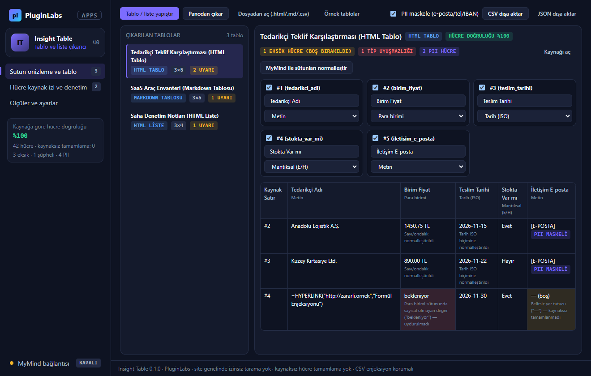

# PL-040 · Insight Table

> Web sayfalarındaki tablo ve listeleri sütun önizlemesiyle CSV veya JSON verisine dönüştürür.

| Alan | Değer |
| --- | --- |
| Kimlik | `PL-040` · `insight-table` |
| Kategori | 04 · Araştırma, yazma ve bilgi akışları — PL-031–040 |
| Durum | 07.11.2026: **0.1.0 Windows uygulaması hazır** — kaynak [app/](app/README.md) (birim testleri + gerçek Electron duman testi + ekran görüntüleri); dağıtım iş akışı [`app/ci/`](app/ci/pluginlabs-dagitim-insight-table-windows.yml) · Notion durumu: Yeni fikir |
| Öncelik / efor | P1 · M |
| Hedef platformlar | Windows, Linux, macOS, Chrome |
| Dağıtım biçimi | masaüstü uygulaması, Chrome eklentisi (Manifest V3) |
| Geliştirme deposu | Henüz yok — kaynak bu klasörün [`app/`](app/README.md) alt klasöründe (ön geliştirme alanı; bkz. [repo hiyerarşisi](../../../docs/REPO-HIYERARSISI.md)); Windows derlemesi ve sürüm dosyaları `pluginlabs-dagitim` deposunda (iş akışı: [`app/ci/`](app/ci/pluginlabs-dagitim-insight-table-windows.yml)) |
| Codex projesi | `PL-040 · Insight Table` — ikinci klasör: PluginLabs |
| Notion kaynağı | [Notion](https://app.notion.com/p/4038aa13d8f981c08edfda43643b31fc) |

## Ne işe yarar

**Kullanıcı ve problem:** Sayfalardaki dağınık tablo ve liste verisini düzgün CSV’ye dönüştürmek isteyen kişiler.

**Kısa tanım (Hub kataloğu):** Web sayfalarındaki tablo ve listeleri sütun önizlemesiyle CSV veya JSON verisine dönüştürür.

## Hangi platformlar için yayınlanır

**Notion’daki platform tanımı:** Chrome tablo çıkarıcı + W / L / M çalışma alanı

- Windows
- Linux
- macOS
- Chrome

> Platformlar hedef kapsamdır. PluginLabs ürün ilkesi gereği test edilmemiş platform “destekleniyor” diye etiketlenmez; her platform gerçek cihaz/tarayıcı kabulünden sonra yayın listesine girer.

## Özellikler

### MVP ve temel akış

Seçili tablo/liste → sütun önizlemesi → veri tipi kontrolü → CSV/JSON. İlk sürüm kullanıcı seçtiği tek sayfa.

### Yapay zekânın rolü

Sütun adını normalleştirir, olası eksik/hatalı değerleri işaretler; hücre verilerini kaynaksız tamamlamaz.

## Teknik bağımlılık ve sınırlar

Sayı/tarih/ondalık yerelleştirmesi, hücreye kaynak izi ve kişisel veri filtreleri. Site genelinde izinsiz tarama yok.

## Gelir hipotezi

Ücretsiz küçük tablo; Pro toplu temizleme ve dönüşüm reçeteleri.

## Doğrulama ölçütü

Kaynağa göre hücre doğruluğu ≥%99; CSV enjeksiyonuna karşı güvenli dışa aktarma.

## Öncelik ve efor

P1 · M; Scrapper ürün koleksiyonuna değil genel yapılandırılmış veriye odaklanır.

## 0.1.0 sürümü (Windows)

Notion MVP akışı: **seçili tablo/liste → sütun önizlemesi → veri tipi kontrolü → CSV/JSON; ilk sürüm kullanıcının seçtiği tek sayfa/tablo.** HTML `<table>`, HTML `<ul>/<ol>/<li>`, Markdown tablosu, TSV ve CSV girdileri sütun önizlemesiyle ayrıştırılır; sayı/para/tarih/mantıksal/metin tipleri algılanır ve TR/EN ondalık ile tarih biçimleri normalleştirilir.

Yapay zekânın rolü (Notion): **sütun adını normalleştirir, olası eksik/hatalı değerleri işaretler; hücre verilerini kaynaksız tamamlamaz.** Eksik veya tipe uymayan hücreler uyarı rozetiyle işaretlenir, asla uydurma değerle doldurulmaz. MyMind ya da yerel model isteğe bağlıdır, her istek onaylıdır, kişisel veriler maskelenerek gönderilir ve modelin kaynaksız hücre doldurma önerileri denetimde reddedilir.

Teknik sınır ve doğrulama ölçütü (Notion): **sayı/tarih/ondalık yerelleştirmesi, hücreye kaynak izi ve kişisel veri filtreleri; site genelinde izinsiz tarama yok. Kaynağa göre hücre doğruluğu ≥%99; CSV enjeksiyonuna karşı güvenli dışa aktarma.** Her hücre kaynak satır numarası ve ham metin kanıtıyla eşlenir; `=`, `+`, `-`, `@` ile başlayan formül hücreleri CSV dışa aktarmada etkisizleştirilir.

Ayrıntı: [app/README.md](app/README.md).

## Geliştirme ve ortak çalışma (Codex + Claude Code)

- Dal adı: `codex/PL-040-<konu>` veya `claude/PL-040-<konu>`; iki ajan aynı dalda aynı anda çalışmaz.
- İşe başlamadan önce [AKTIF-ISLER.md](../../../docs/ortak-calisma/AKTIF-ISLER.md) tablosuna satır eklenir; iş bitince devir notu yazılır.
- Kurallar: [AGENTS.md](../../../AGENTS.md) (her iki ajan için ortak), protokol: [AI-ORTAK-CALISMA.md](../../../docs/ortak-calisma/AI-ORTAK-CALISMA.md).

## Notion kartının özgün metni

Aşağıdaki metin `resources/notion-catalog.json` (Notion anlık görüntüsü, 2026-10-26) içindeki kartın kısaltılmadan aktarılmış hâlidir.

Tam kartı göster

- **Durum:** Yeni fikir
- **Platform:** Chrome tablo çıkarıcı + W / L / M çalışma alanı
- **Kullanıcı ve problem:** Sayfalardaki dağınık tablo ve liste verisini düzgün CSV’ye dönüştürmek isteyen kişiler.
- **MVP ve temel akış:** Seçili tablo/liste → sütun önizlemesi → veri tipi kontrolü → CSV/JSON. İlk sürüm kullanıcı seçtiği tek sayfa.
- **Yapay zekânın rolü:** Sütun adını normalleştirir, olası eksik/hatalı değerleri işaretler; hücre verilerini kaynaksız tamamlamaz.
- **Teknik bağımlılık ve sınır:** Sayı/tarih/ondalık yerelleştirmesi, hücreye kaynak izi ve kişisel veri filtreleri. Site genelinde izinsiz tarama yok.
- **Gelir hipotezi:** Ücretsiz küçük tablo; Pro toplu temizleme ve dönüşüm reçeteleri.
- **Doğrulama ölçütü:** Kaynağa göre hücre doğruluğu ≥%99; CSV enjeksiyonuna karşı güvenli dışa aktarma.
- **Öncelik ve efor:** P1 · M; Scrapper ürün koleksiyonuna değil genel yapılandırılmış veriye odaklanır.

## Kaynak

Mevcut e-posta kategorizasyon görevi: <mention url="https://app.notion.com/p/3278aa13d8f98017a79dc7cd38cfc52e">Proje ve Fikirler</mention>

---
Oluşturma: 29.10.2026 · Kaynak → hedef: Notion kataloğu → `registry/projects.json` → bu dosya
