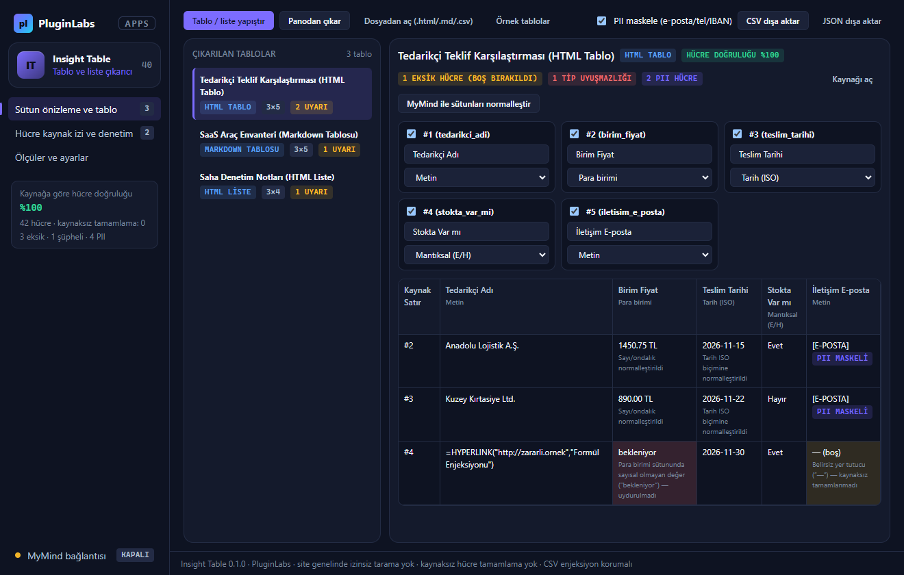
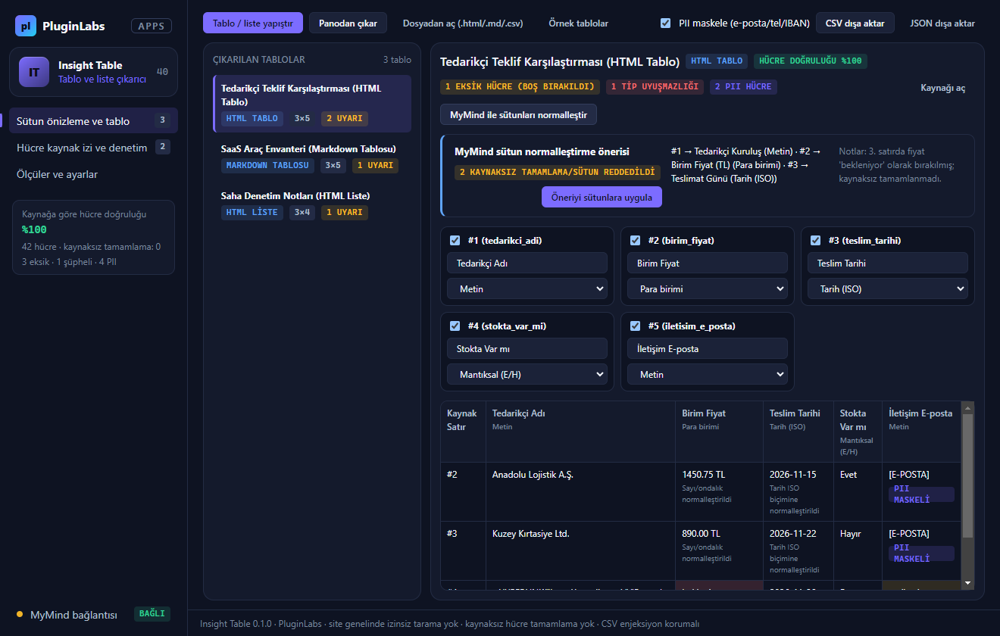
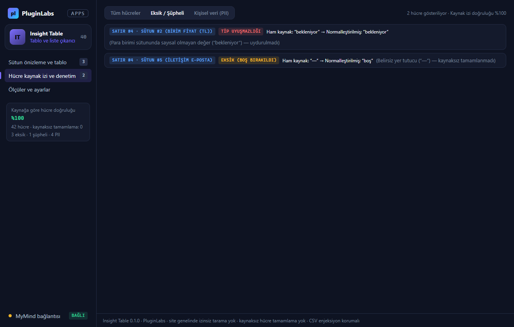

# Insight Table (PL-040) — Windows uygulaması

Web sayfalarındaki veya belgelerdeki dağınık **HTML tablo**, **HTML liste**, **Markdown tablosu**, **TSV** ve **CSV** verisini **sütun önizlemesi** ve **veri tipi kontrolüyle** temiz **CSV** veya **JSON** verisine dönüştürür. Sayı, para birimi ve tarih yerelleştirmesini (TR/EN) otomatik normalleştirir, eksik ya da şüpheli hücreleri işaretler (**hücre verilerini kaynaksız tamamlamaz**), her hücre için **kaynak izi** tutar, **kişisel verileri (PII)** maskeler ve **CSV formül enjeksiyonuna** (`=`, `+`, `-`, `@`) karşı güvenli dışa aktarır.

> Ürün deposu henüz yok; kaynak bu klasördedir (`apps/04-arastirma-yazma-ve-bilgi-akislari/PL-040-insight-table/app`). Windows paketleri `pluginlabs-dagitim` deposunda `insight-table-v<sürüm>` etiketiyle yayımlanır.



| MyMind sütun normalleştirme | Hücre kaynak izi ve denetim | Ölçüler ve ayarlar |
| --- | --- | --- |
|  |  |  |

## Özellikler
- **Seçili tablo / liste yakalama:** HTML `<table>`, `<ul>/<ol>/<li>`, Markdown tablosu, TSV ve CSV girdilerini ayrıştırır; site genelinde izinsiz tarama yapmaz.
- **Sütun önizlemesi ve veri tipi kontrolü:** `Metin`, `Sayı`, `Para birimi`, `Tarih (ISO)` ve `Mantıksal (E/H)` tiplerini algılar; Türkçe (`1.450,75 TL`, `22 Kasım 2026`, `15.11.2026`) ve İngilizce (`$49.90`) biçimleri normalleştirir.
- **Kaynaksız tamamlama sıfır:** Boş veya tipe uymayan hücreler uyarı rozetiyle işaretlenir; asla uydurma değerle doldurulmaz.
- **Hücre kaynak izi ve PII maskeleme:** Her hücrenin kaynak satır numarası ve ham metni saklanır; e-posta, telefon, IBAN ve T.C. kimlik numaraları isteğe bağlı maskelenir.
- **Güvenli CSV / JSON dışa aktarma:** CSV formül enjeksiyonu (`=HYPERLINK(...)` vb.) `'` önekiyle etkisizleştirilir.

## Geliştirme
```bash
npm test
node tests/desktop-smoke.cjs docs/screenshots
npm run build:win
node scripts/make-icons.cjs
```
