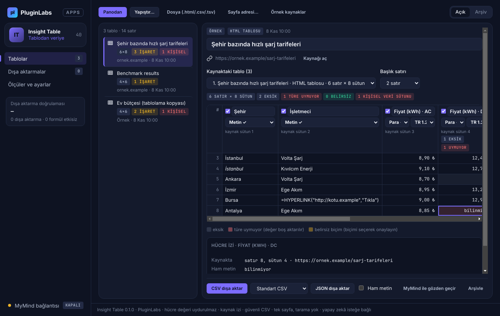
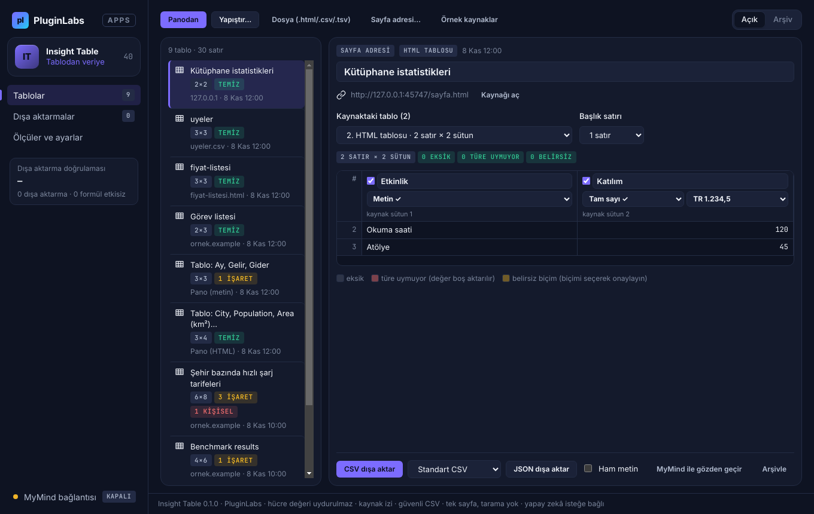
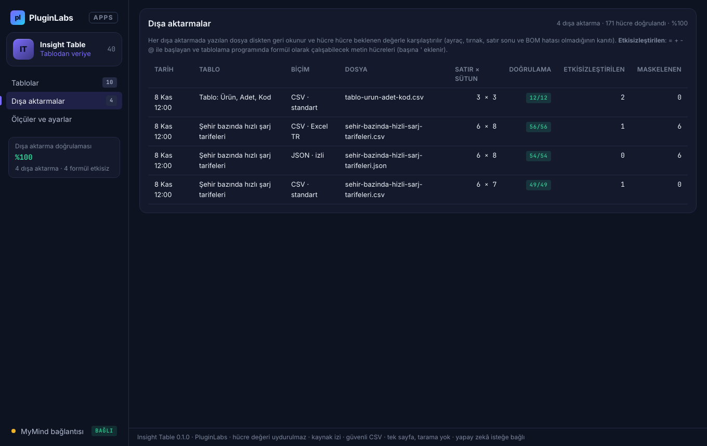

# Insight Table (PL-040) — Windows uygulaması

Sayfadaki dağınık **tablo ve listeleri** temiz veriye dönüştürün: Insight Table seçip kopyaladığınız tabloyu **sütunlara ayırır**, her sütunun **veri tipini denetler** (tam sayı, ondalık, para, yüzde, tarih, evet/hayır) ve **CSV ya da JSON** olarak dışa aktarır. **Sayı, tarih ve ondalık biçimi** (1.234,56 / 1,234.56; gün/ay / ay/gün) sütun düzeyinde kanıtla çözülür; **eksik, türe uymayan ve belirsiz** hücreler işaretlenir, **hiçbir hücre tahminle doldurulmaz**. Her hücre **kaynak izini** taşır, **kişisel veri** sütunları maskelenir, dışa aktarma **CSV enjeksiyonuna karşı güvenlidir** ve yazılan dosya **geri okunup doğrulanır**. İsteğe bağlı olarak **MyMind** (PluginLabs Hub) ya da bu bilgisayardaki **yerel model** sütun adlarını normalleştirmeyi önerir ve şüpheli değerleri işaretler — hücre değeri öneremez.

> Ürün deposu henüz yok; kaynak bu klasördedir (PluginLabs ürün ön geliştirme alanı, PL-025 modeli). Windows paketleri `pluginlabs-dagitim` deposunda `insight-table-v<sürüm>` etiketiyle yayımlanır.



| Tek sayfa adresi: kaynaktaki tablolar | MyMind önerisi (yalnız ad ve işaret; değer önerileri atıldı) |
| --- | --- |
|  |  |
| **Dışa aktarmalar (geri okuma doğrulaması)** | **Ölçüler ve ayarlar** |
|  |  |

Ekran görüntüleri gerçek uygulamadan, duman testinin test verisiyle (uydurma örnek kaynaklar; **taklit tek sayfa sunucusu** ve taklit MyMind yanıtı; tarih 8 Kasım 2026'ya sabitlenmiş) Linux/xvfb'de alınmıştır. Windows runner'ında alınan gerçek pencere görüntüleri release ekindedir.

## İndir
[insight-table-v0.1.0](https://github.com/timdesigners-pixel/pluginlabs-dagitim/releases/tag/insight-table-v0.1.0) — `InsightTable-0.1.0-Windows-x64.exe` (kurulum), `InsightTable-0.1.0-Windows-Portable-x64.exe` (taşınabilir), SHA256SUMS + BUILD-INFO. İmzasız önizleme. PluginLabs Hub kataloğundan da kurulabilir (Hub kataloğu birleşip yayımlanınca).

## Kullanım
1. Tarayıcıda tabloyu (ya da listeyi) seçip kopyalayın, ardından **Ctrl+Alt+T** (her yerde) ya da **Panodan**. Excel/Sheets hücreleri, CSV ve Markdown tablosu da olur. **Yapıştır…** (Ctrl+N) ile kaynak adresini de ekleyebilirsiniz; **Dosya** ile `.html/.csv/.tsv/.md`; **Sayfa adresi…** ile tek bir sayfa onayınızla indirilir. İlk deneme için **Örnek kaynaklar**.
2. **Önizleme**: kaynakta birden çok tablo varsa üstten seçin; başlık satırı sayısını düzeltin. Sütun başlığında ad, tür, biçim (TR/EN), dahil etme ve kişisel veri kipi.
3. **Denetim**: gri = eksik, kırmızı = türe uymuyor (boş aktarılır), sarı = belirsiz biçim (biçimi seçerek onaylayın). Bir hücreye tıklayınca **hücre izi**: kaynaktaki satır/sütun, ham metin, değer, işaret.
4. **Dışa aktarma**: CSV (Standart ya da Excel Türkçe), JSON (kaynak izli), isteğe bağlı ham metin. Sonuç kutusunda geri okuma doğrulaması (ör. 56/56 hücre), etkisizleştirilen formül benzeri hücre ve maskelenen kişisel veri sayısı.

## Ayrıştırma ve tür kuralları
- **HTML**: `script/style/noscript/iframe/svg` ve yorumlar atılır; `thead` ya da yalnız `th` içeren üst satırlar başlıktır (en çok 3); `colspan/rowspan` açılır ve değer kapsadığı her konuma yazılır (izde "birleştirilmiş hücreden"); `caption` ya da tablodan önceki başlık (h1–h4) tablo adıdır; `[1]`, `*`, `¹` gibi dipnot işaretleri sütun adından temizlenir.
- **Listeler**: en az 3 maddeli `ul/ol`; maddelerin %90'ı aynı ayraçla aynı sayıda parçaya bölünüyorsa sütunlara ayrılır. `dl` → Terim / Açıklama.
- **Metin**: Markdown boru tablosu, sekmeli metin, CSV (`,` `;` `|`; tırnaklı alan ve kaçış). Başlık satırı, ilk satır metin ve altı sayı/tarihse önerilir.
- **Tür**: boş olmayan hücrelerin en az %75'inin ayrıştığı en özgül tür (evet/hayır → tarih → yüzde → para → tam sayı/ondalık → e-posta → bağlantı → metin). Kişisel veri sütunları metin kalır.
- **Yerelleştirme**: sütundaki kesin biçimli değerler (TR/EN) → sayfa dili → ayarlardaki varsayılan. Kanıtsız belirsiz değer işaretlenir.

## Güvenlik ve gizlilik
- Ağ erişimi yalnız `desktop/net.js` içinde: kullanıcının yazdığı **tek sayfa** (onaydan sonra tek GET; çerez/kimlik yok; en çok 5 yönlendirme, yalnız http/https; 5 MB; yalnız HTML/metin yanıtı; bağlantılar izlenmez), Hub (127.0.0.1:47632) ve loopback yerel model.
- Arayüz CSP ile ağa kapalıdır (`connect-src 'none'`, `frame-src 'none'`); yapıştırılan HTML arayüzde işlenmez, ana süreçte metin olarak ayrıştırılır; metin yalnız `textContent`/`value` ile yazılır; `contextIsolation` + `sandbox`; IPC yalnız uygulamanın kendi penceresinden. Mikrofon/kamera dahil izin istekleri reddedilir.
- Hub anahtarı ve tablolar Windows kasasında (DPAPI) şifreli; anahtar arayüze, duruma ve günlüklere verilmez.
- Modele yalnız sütun adları/türleri ve ilk 12 satırdan örnek değerler gider; e-posta, telefon, T.C. kimlik, IBAN, kart parçaları maskelenir; kaynak adresi ve dosya adı gönderilmez. Değerlerdeki talimatlar veri sayılır. Yanıt denetlenir: hücre değeri/düzeltme/tamamlama alanları ve olmayan sütun/satır başvuruları atılır.
- CSV'de `=`, `+`, `-`, `@`, sekme ve satır başı ile başlayan metin hücreleri `'` ile etkisizleştirilir (yalın sayılar bozulmaz). Silme yok: tablolar arşive taşınır.

## Geliştirme
```bash
npm ci
npm test                                   # çekirdek birim testleri (node:test)
PLAYWRIGHT_MODULE=playwright xvfb-run -a -s "-screen 0 1440x900x24" node tests/desktop-smoke.cjs docs/screenshots
npm run build:win                          # Windows: kurulum + taşınabilir
node scripts/make-icons.cjs                # simgeleri yeniden üret
```
Windows derlemesi `ci/pluginlabs-dagitim-insight-table-windows.yml` iş akışıyla `pluginlabs-dagitim` deposunda, sabit bir PluginLabs commit'inden yapılır.
