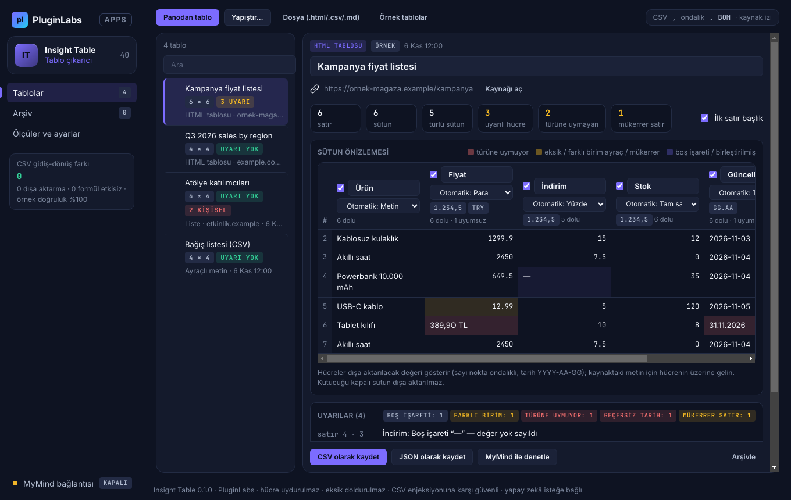
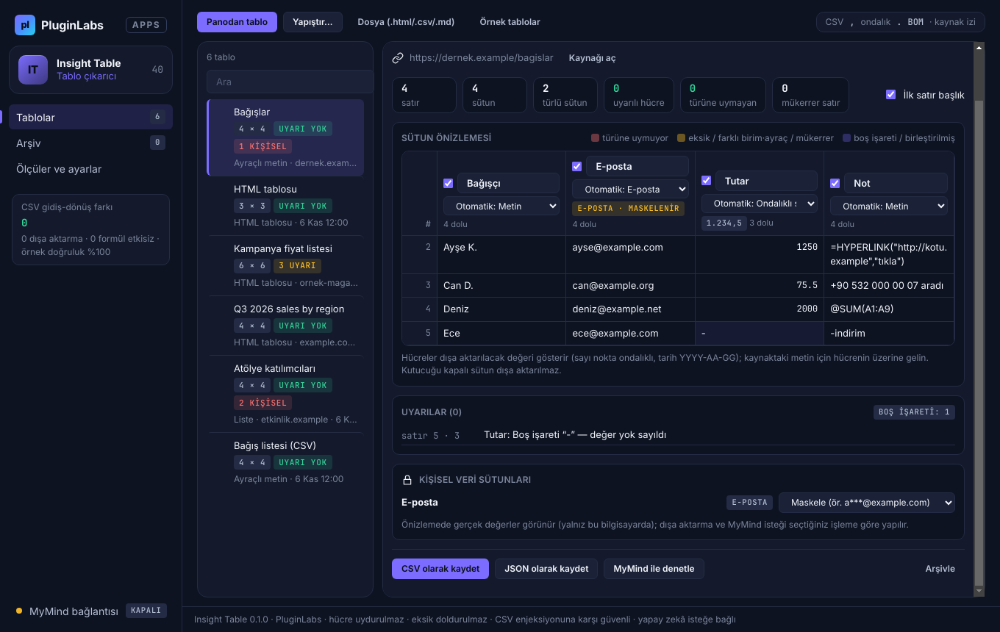
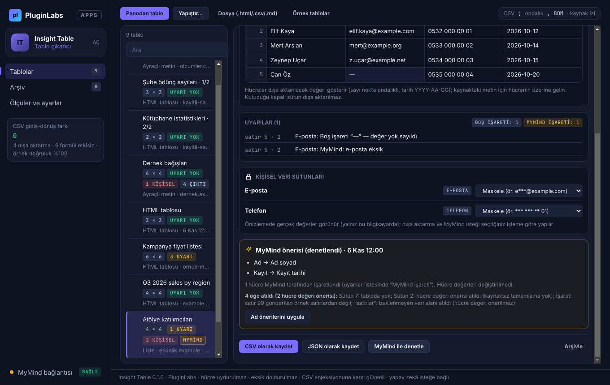
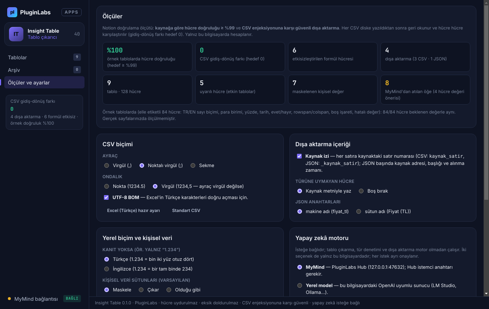
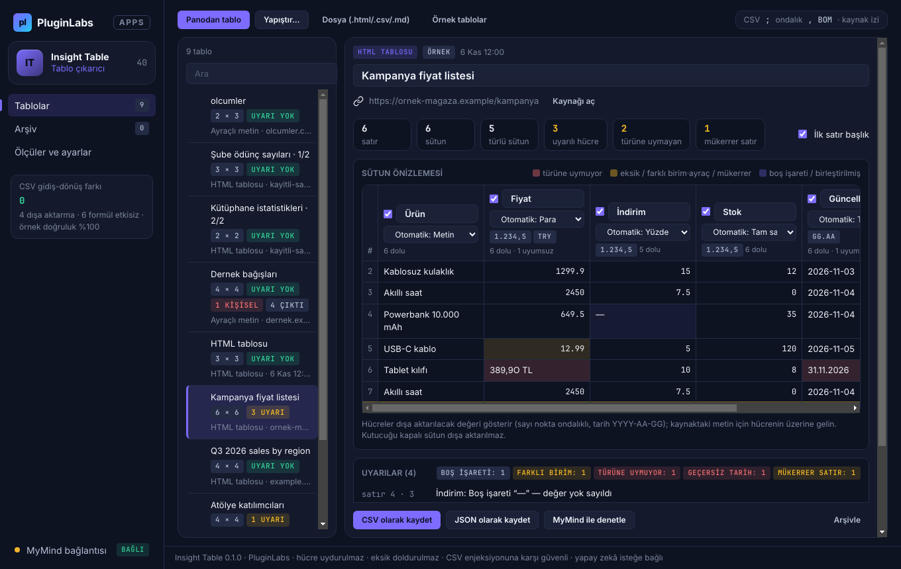
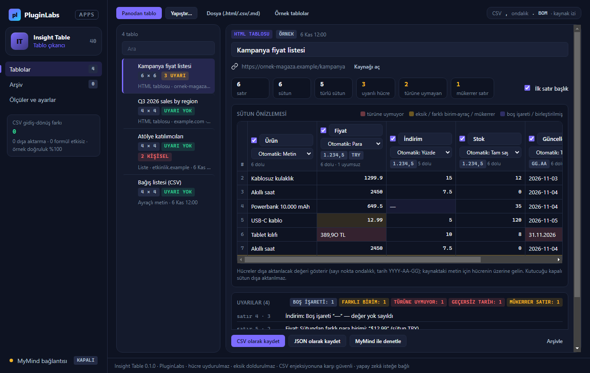
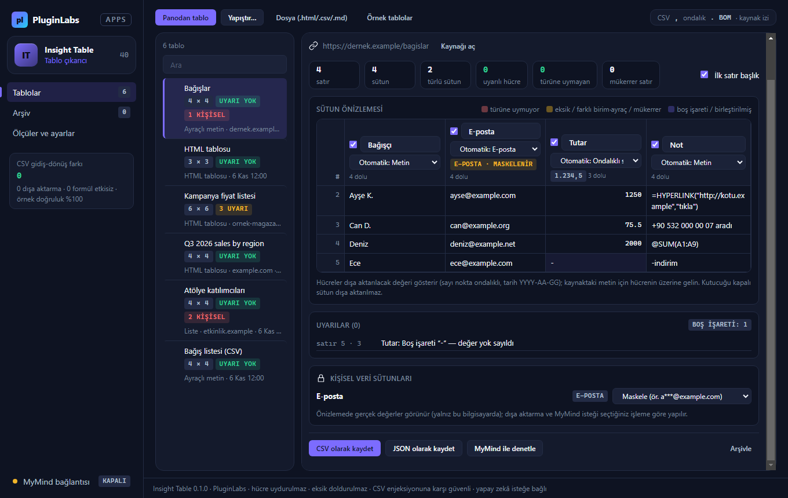
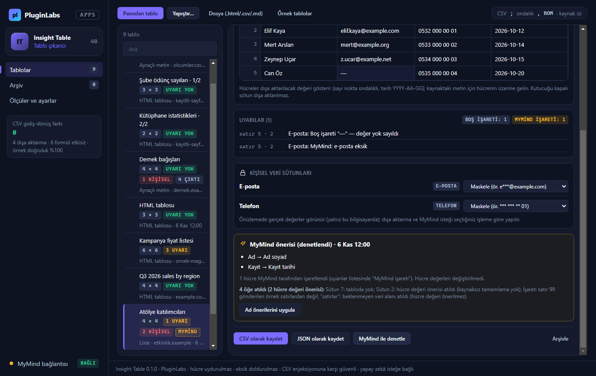
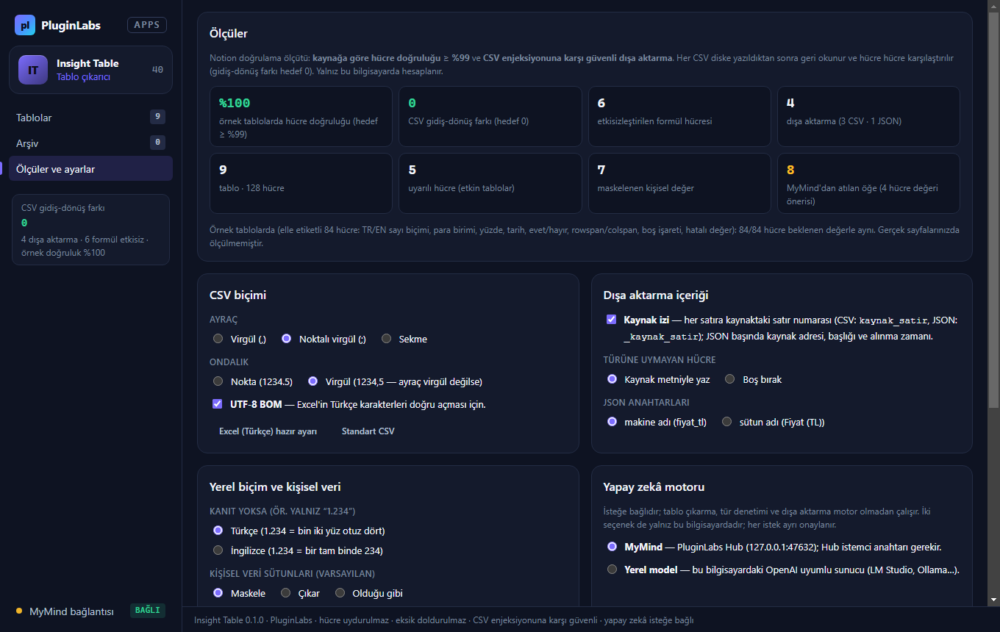

# Insight Table (PL-040) — Windows uygulaması

Sayfalardaki dağınık **tablo ve liste verisini düzgün CSV ya da JSON'a** çevirin: tarayıcıda tabloyu seçip kopyalayın (ya da CSV/Markdown yapıştırın, kaydedilmiş bir sayfayı açın), Insight Table **sütun önizlemesini** gösterir, her sütunun **veri tipini** (sayı, para, yüzde, tarih, evet/hayır, e-posta, bağlantı, telefon) ve **yerel biçimini** (1.234,56 ↔ 1,234.56; GG.AA ↔ AA/GG) denetler, **türüne uymayan, eksik, farklı birimli ya da mükerrer** hücreleri gerekçesiyle işaretler. Hücre değeri **uydurulmaz**, eksik **doldurulmaz**. CSV **formül enjeksiyonuna karşı güvenlidir** ve yazılan dosya geri okunup hücre hücre denetlenir. **Kişisel veri** sütunları varsayılan olarak maskelenir; her satır **kaynak satır numarasını** taşır. İsteğe bağlı olarak **MyMind** (PluginLabs Hub) ya da bu bilgisayardaki **yerel model** sütun adlarını normalleştirir ve olası hatalı değerleri işaretler — hücre değeri öneremez.

> Ürün deposu henüz yok; kaynak bu klasördedir (PluginLabs ürün ön geliştirme alanı, PL-025 modeli). Windows paketleri `pluginlabs-dagitim` deposunda `insight-table-v<sürüm>` etiketiyle yayımlanır.



| Uyarılar ve kişisel veri sütunu (CSV + formül hücreleri) | MyMind önerisi (hücre değeri önerileri atıldı) |
| --- | --- |
|  |  |
| **Ölçüler ve ayarlar** | **Tablolar (pano, yapıştırma, dosya, örnek)** |
|  |  |

Ekran görüntüleri gerçek uygulamadan, duman testinin test verisiyle (uydurma örnek tablolar ve taklit MyMind yanıtı; tarih 6 Kasım 2026'ya sabitlenmiş) Linux/xvfb'de alınmıştır. Windows runner'ında alınan gerçek pencere görüntüleri (`windows-masaustu-*`, [çalıştırma 42399061852](https://github.com/timdesigners-pixel/pluginlabs-dagitim/actions/runs/42399061852), kaynak a697439; Windows kasası DPAPI etkin) release ekinde ve aşağıdadır.

**Windows'ta (Windows runner, gerçek pencere):**



| Windows — uyarılar ve kişisel veri | Windows — MyMind önerisi | Windows — ölçüler ve ayarlar |
| --- | --- | --- |
|  |  |  |

## İndir
[insight-table-v0.1.0](https://github.com/timdesigners-pixel/pluginlabs-dagitim/releases/tag/insight-table-v0.1.0) — `InsightTable-0.1.0-Windows-x64.exe` (kurulum, SHA-256 `ef38e9ca…8b91`, 81 748 281 bayt), `InsightTable-0.1.0-Windows-Portable-x64.exe` (taşınabilir, SHA-256 `846762b4…7603`, 81 534 020 bayt), SHA256SUMS + BUILD-INFO. İmzasız önizleme. PluginLabs Hub kataloğundan da kurulabilir (Hub 0.4.26 kataloğu birleşip yayımlanınca).

## Kullanım
1. Tarayıcıda tabloyu ya da listeyi fareyle seçip **Ctrl+C**; ardından **Panodan tablo** ya da her yerde **Ctrl+Alt+T**. Alternatifler: **Yapıştır…** (Ctrl+N; HTML, CSV, sekmeli metin, Markdown tablo, satırlar; kaynak adresi eklenebilir), **Dosya** (.html/.csv/.tsv/.md/.txt), **Örnek tablolar**.
2. **Sütun önizlemesi**: sütun adını düzeltin, türü değiştirin ("Otomatik" sütundaki kanıta göre seçer), kutucuğunu kapatarak sütunu dışa aktarmadan çıkarın. Renkli hücrelerin gerekçesi **Uyarılar** listesinde ve hücrenin üzerinde görünür.
3. **Kişisel veri sütunları**: maskele / çıkar / olduğu gibi.
4. **CSV olarak kaydet** ya da **JSON olarak kaydet**. CSV biçimi (ayraç, ondalık, BOM; Excel (Türkçe) hazır ayarı), kaynak izi ve JSON anahtarları **Ölçüler ve ayarlar**'dan seçilir.

## Tür ve yerel biçim kuralları
- Sütun türü, dolu hücrelerin **≥ %80**'i aynı kurala uyuyorsa atanır; değilse metin kalır. Kontrol sırası: e-posta → bağlantı → telefon → tarih → evet/hayır → sayı (yüzde / para / tam sayı / ondalık).
- **Sayı biçimi**: "1.234,5" ve "1.234.567" Türkçe, "1,234.5" ve "1,234,567" İngilizce kanıtıdır; "1.234" ya da "1,234" belirsizdir ve sütunun, sütunda kanıt yoksa tablonun, o da yoksa ayardaki varsayılanın biçimiyle okunur. Sütunun biçimine uymayan kanıtlı hücre "karışık ayraç" işaretlenir.
- Baştaki sıfırlı değerler (06100, 007) ve 15 haneden uzun rakam dizileri **metin** kalır; kişisel veri sütunlarındaki numaralar sayıya çevrilmez.
- **Tarih**: YYYY-AA-GG, GG.AA.YYYY, GG/AA/YYYY ya da AA/GG/YYYY (sütundaki >12 kanıtına göre), "7 Kasım 2026", "Nov 3, 2026". Takvimde olmayan tarih işaretlenir.
- Türüne uymayan hücre **kaynak metniyle** yazılır (ayar: boş bırak); boş ve "—", "N/A" gibi boş işaretli hücreler `null`/boş olur — **hiçbir hücre doldurulmaz**.

## Güvenlik ve gizlilik
- Uygulama **web sayfası indirmez**, site taraması yapmaz; ağ erişimi yalnız `desktop/net.js` içinde ve yalnız isteğe bağlı yapay zekâ için (Hub 127.0.0.1:47632 ya da loopback yerel model). Her istek ayrı onaylıdır; yönlendirme izlenmez.
- Arayüz CSP ile ağa kapalıdır (`connect-src 'none'`, `frame-src 'none'`), metin yalnız `textContent`/`value` ile yazılır (yapıştırılan HTML hiçbir zaman sayfaya işlenmez; bağımlılıksız bir ayrıştırıcıyla yalnız metin çıkarılır); `contextIsolation` + `sandbox`; IPC yalnız uygulamanın kendi penceresinden. İzin istekleri reddedilir.
- CSV'de `=`, `+`, `-`, `@`, sekme, satır başı (ve tam genişlikli `＝＋－＠`) ile başlayan metin hücreleri `'` ile etkisizleştirilir.
- Modele sütun adları/türleri ve ilk 8 satır gider; kişisel veri sütunlarının değerleri yerine yalnız tür adı (⟦e-posta⟧), metin içi kişisel veriler ve bağlantılar ⟦n⟧ ile gider; kaynak adresi, sayfa başlığı ve dosya adı gönderilmez. Tablodaki talimatlar veri sayılır. Yanıttaki hücre değeri önerileri atılır.
- Tablolar ve Hub anahtarı Windows kasasında (DPAPI) şifreli saklanır. Silme yok: arşivlenen tablolar geri alınabilir.

## Geliştirme
```bash
npm ci
npm test                                   # çekirdek birim testleri (node:test)
PLAYWRIGHT_MODULE=playwright xvfb-run -a -s "-screen 0 1440x900x24" node tests/desktop-smoke.cjs docs/screenshots
npm run build:win                          # Windows: kurulum + taşınabilir
node scripts/make-icons.cjs                # simgeleri yeniden üret
```
Windows derlemesi `ci/pluginlabs-dagitim-insight-table-windows.yml` iş akışıyla `pluginlabs-dagitim` deposunda, sabit bir PluginLabs commit'inden yapılır.
