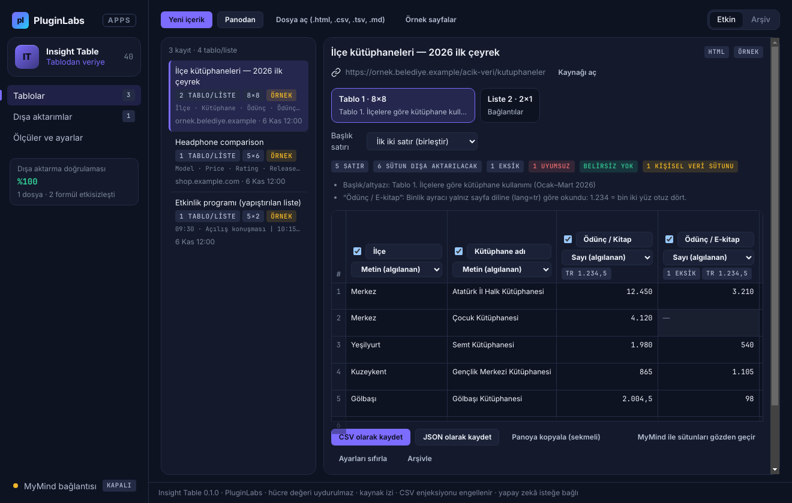
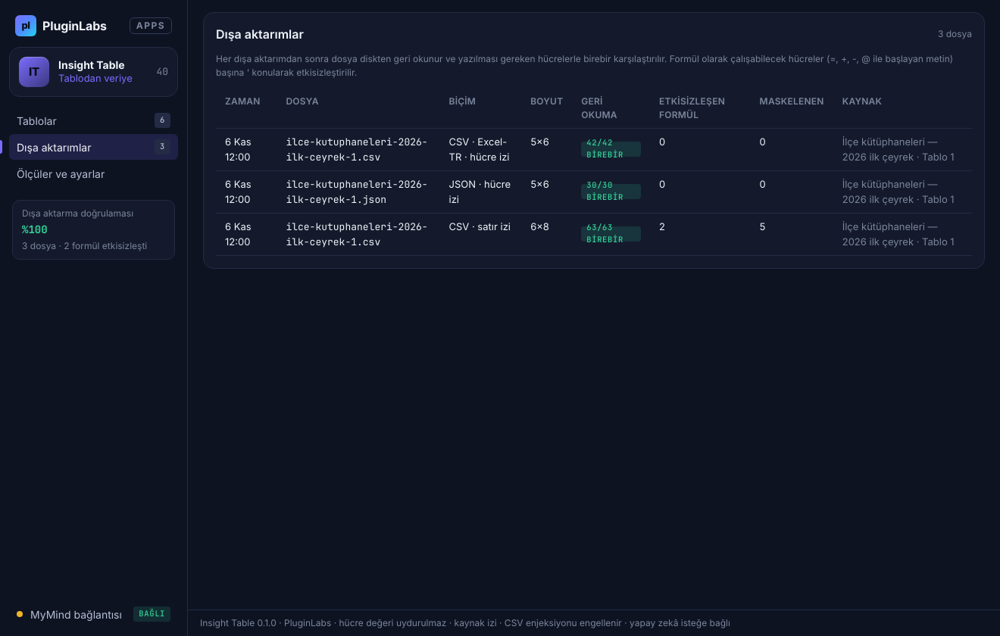
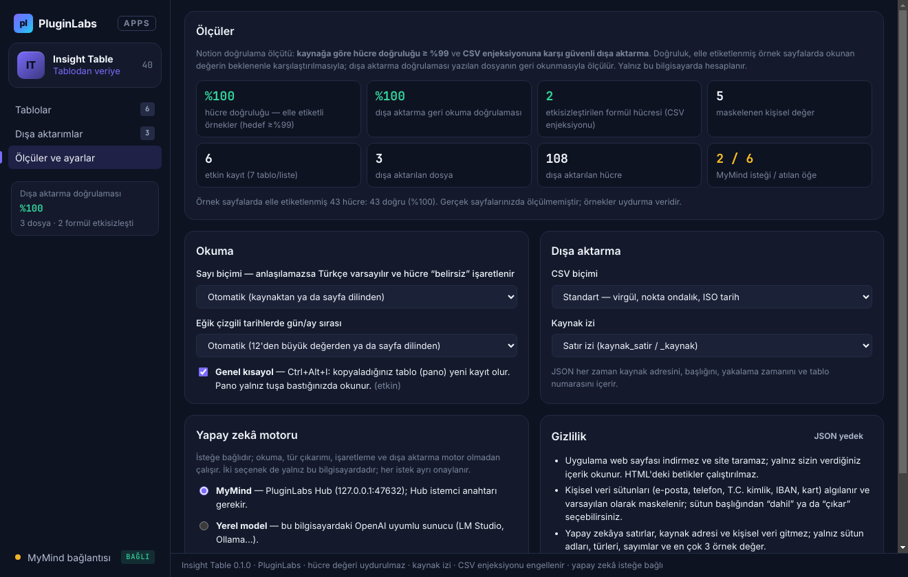

# Insight Table (PL-040) — Windows uygulaması

Sayfalardaki dağınık tablo ve listeleri elle temizlemeyin: Insight Table **seçtiğiniz sayfadaki tablo ve listeleri** okur, **sütunları ve veri türlerini önizlemede** gösterir, **Türkçe/İngilizce sayı ve tarih biçimlerini** çözer, eksik/uyumsuz/belirsiz hücreleri **işaretler** ve **CSV ya da JSON** olarak yazar. **Hücre değeri uydurulmaz**, her hücrenin **kaynak izi** tutulur, **kişisel veri sütunları maskelenir**, CSV **formül enjeksiyonuna karşı** korunur ve yazılan dosya **geri okunarak doğrulanır**. İsteğe bağlı olarak **MyMind** (PluginLabs Hub) ya da bu bilgisayardaki **yerel model** — her istekte onayla, satırlar ve kişisel veri gönderilmeden — sütun adlarını normalleştirir ve olası sorunları not eder.

> Ürün deposu henüz yok; kaynak bu klasördedir (PluginLabs ürün ön geliştirme alanı, PL-025 modeli). Windows paketleri `pluginlabs-dagitim` deposunda `insight-table-v<sürüm>` etiketiyle yayımlanır.


| Sütun ayarları (ad, tür, dahil etme, kişisel veri filtresi, satır çıkarma) | MyMind önerisi (hücre değeri önerisi atıldı) |
| --- | --- |
|  |  |
| **Dışa aktarımlar (geri okuma doğrulaması)** | **Ölçüler ve ayarlar** |
|  |  |

Ekran görüntüleri gerçek uygulamadan, duman testinin test verisiyle (uydurma örnek sayfalar; taklit MyMind yanıtı; tarih 6 Kasım 2026'ya sabitlenmiş) Linux/xvfb'de alınmıştır.

## İndir
[insight-table-v0.1.0](https://github.com/timdesigners-pixel/pluginlabs-dagitim/releases/tag/insight-table-v0.1.0) — `InsightTable-0.1.0-Windows-x64.exe` (kurulum), `InsightTable-0.1.0-Windows-Portable-x64.exe` (taşınabilir), SHA256SUMS + BUILD-INFO. İmzasız önizleme. PluginLabs Hub kataloğundan da kurulabilir (Hub kataloğu birleşip yayımlanınca).

## Kullanım
1. Tarayıcıda tabloyu fareyle seçip kopyalayın, ardından **Ctrl+Alt+I** (her yerde) ya da **Panodan**. Kaynak adresini eklemek için **Yeni içerik** (Ctrl+N) penceresine yapıştırın. Sayfayı `.html` olarak kaydedip **Dosya aç** ile de açabilirsiniz; Excel/Sheets satırları, CSV ve Markdown tabloları da okunur. İlk deneme için **Örnek sayfalar**.
2. Sayfada birden çok tablo/liste varsa üstteki kartlardan seçin. **Başlık satırı** (yok / ilk / ilk iki) önerilir; değiştirebilirsiniz.
3. Sütun başlıklarında ad, tür, dışa aktarma kutusu ve (kişisel veri sütunlarında) **Maskele / Olduğu gibi / Çıkar** filtresi. Hücre renkleri: gri **eksik**, kırmızı **türe uymuyor**, sarı **belirsiz**; sol kenarı altın **kişisel veri olabilir**. Satır numarasına tıklayarak satırı çıkarın.
4. **CSV olarak kaydet** / **JSON olarak kaydet**: dosya yazılır, geri okunur ve hücre hücre karşılaştırılır. CSV biçimi (standart / Excel-Türkçe) ve kaynak izi (satır / hücre / yok) **Ölçüler ve ayarlar**'dan.

## Okuma kuralları
- **Sayı:** `1.234,56` (TR), `1,234.56` (EN), `%12,5`, `₺/TL/$/€/£` (birim ayrı tutulur), `(1.500)` → −1500, dipnot `[1]` atılır. Sütunun biçimi kesin örneklerden; yoksa sayfa dilinden (`lang`); o da yoksa TR varsayılır ve `1.234` gibi iki türlü okunabilen hücreler **belirsiz** işaretlenir. Sütunda iki biçim karışıksa azınlık **uyumsuz**.
- **Tarih:** ISO, `GG.AA.YYYY`, `3 Nisan 2019`, `15 Kas 2026`, `Mar 3, 2026`. Eğik çizgilide gün/ay sırası 12'den büyük değerden, yoksa sayfa dilinden; o da yoksa GG/AA ve **belirsiz**.
- **Evet/hayır, e-posta, bağlantı:** sütunun en az %80'i uyuyorsa o tür; uymayan hücre **uyumsuz** (ham metniyle yazılır).
- **Eksik:** boş hücre, `—`, `-`, `N/A`, `null`, `?` gibi yer tutucular → CSV'de boş, JSON'da `null`. Değer önerilmez ya da tamamlanmaz.

## Güvenlik ve gizlilik
- Uygulama ağdan sayfa indirmez. Tek ağ erişimi isteğe bağlı yapay zekâdır (`desktop/net.js`): Hub `127.0.0.1:47632` ya da loopback yerel model; yönlendirme izlenmez; her istek ayrı onaylıdır.
- HTML DOM kurulmadan, betik çalıştırılmadan küçük bir ayrıştırıcıyla okunur; kaynak HTML arayüze hiçbir zaman HTML olarak eklenmez (metin yalnız `textContent`/`value`). Arayüz CSP ile ağa kapalıdır (`connect-src 'none'`); `contextIsolation` + `sandbox`; IPC yalnız uygulamanın kendi penceresinden; izin istekleri reddedilir.
- Hub anahtarı ve kayıtlar Windows kasasında (DPAPI) şifreli; anahtar arayüze ve günlüklere verilmez.
- Modele satırlar, kaynak adresi ve kişisel veri sütunlarının örnekleri gitmez; yanıttaki hücre değeri önerileri atılır.

## Geliştirme
```bash
npm ci
npm test                                   # çekirdek birim testleri (node:test)
PLAYWRIGHT_MODULE=playwright xvfb-run -a -s "-screen 0 1440x900x24" node tests/desktop-smoke.cjs docs/screenshots
npm run build:win                          # Windows: kurulum + taşınabilir
node scripts/make-icons.cjs                # simgeleri yeniden üret
```
Windows derlemesi `ci/pluginlabs-dagitim-insight-table-windows.yml` iş akışıyla `pluginlabs-dagitim` deposunda, sabit bir PluginLabs commit'inden yapılır.
