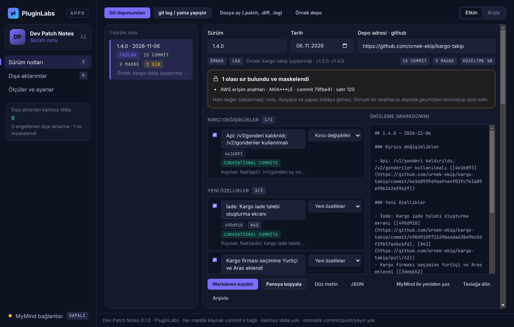

# PL-041 · Dev Patch Notes

> Git değişikliklerinden kaynak commit bağlantıları içeren düzenlenebilir sürüm notları hazırlar.

| Alan | Değer |
| --- | --- |
| Kimlik | `PL-041` · `dev-patch-notes` |
| Kategori | 05 · Geliştirici ve profesyonel araçlar — PL-041–050 |
| Durum | 07.11.2026: **0.1.0 Windows uygulaması yayımlandı** — [dev-patch-notes-v0.1.0](https://github.com/timdesigners-pixel/pluginlabs-dagitim/releases/tag/dev-patch-notes-v0.1.0) (`pluginlabs-dagitim`, Windows runner: test + duman testi + SHA256 + BUILD-INFO + Windows ekran görüntüleri); kaynak [app/](app/README.md); Hub 0.4.27 kataloğunda · Notion durumu: Yeni fikir |
| Öncelik / efor | P1 · M |
| Hedef platformlar | Windows, Linux, macOS, Chrome |
| Dağıtım biçimi | masaüstü uygulaması, Chrome eklentisi (Manifest V3), tarayıcı yan paneli |
| Geliştirme deposu | Henüz yok — kaynak bu klasörün [`app/`](app/README.md) alt klasöründe (ön geliştirme alanı; bkz. [repo hiyerarşisi](../../../docs/REPO-HIYERARSISI.md)); Windows derlemesi ve sürüm dosyaları `pluginlabs-dagitim` deposunda (iş akışı: [`app/ci/`](app/ci/pluginlabs-dagitim-dev-patch-notes-windows.yml)) |
| Codex projesi | `PL-041 · Dev Patch Notes` — ikinci klasör: PluginLabs |
| Notion kaynağı | [Notion](https://app.notion.com/p/4038aa13d8f981059dfad209ce1240d1) |

## Ne işe yarar

**Kullanıcı ve problem:** Kod değişikliğini kullanıcıya anlaşılır sürüm notuna dönüştürmek isteyen küçük ekipler.

**Kısa tanım (Hub kataloğu):** Git değişikliklerinden kaynak commit bağlantıları içeren düzenlenebilir sürüm notları hazırlar.

## Hangi platformlar için yayınlanır

**Notion’daki platform tanımı:** Chrome yan paneli + W / L / M geliştirici aracı

- Windows
- Linux
- macOS
- Chrome

> Platformlar hedef kapsamdır. PluginLabs ürün ilkesi gereği test edilmemiş platform “destekleniyor” diye etiketlenmez; her platform gerçek cihaz/tarayıcı kabulünden sonra yayın listesine girer.

## Özellikler

### MVP ve temel akış

Seçilen git diff/commit listesini içe al; değişiklikleri özellik/düzeltme başlıklarına ayır, kaynak commit bağlantısıyla düzenlenebilir not üret.

### Yapay zekânın rolü

Kod farkından davranış değişikliği taslağı çıkarır; test geçişi veya performans artışı kanıtsız yazılmaz.

## Teknik bağımlılık ve sınırlar

Yalnız seçili depo/veri; API anahtarı ve sır taraması. Otomatik commit, push ve yayın yok.

## Gelir hipotezi

Freemium bireysel; ekip başına Pro ve özel şablonlar.

## Doğrulama ölçütü

10 sürümde editör düzeltme süresinde ≥%50 azalma; uydurma teslim iddiası sıfır.

## Öncelik ve efor

P1 · M; geliştiricinin onayladığı yayın notu aracı.

## 0.1.0 sürümü (Windows)

Notion MVP akışı: **seçilen git diff/commit listesini içe al; değişiklikleri özellik/düzeltme başlıklarına ayır, kaynak commit bağlantısıyla düzenlenebilir not üret.** Kaynak: yerel git deposu (yalnız okuma; son etiketten bu yana gibi bir aralık), yapıştırılan `git log` / `--oneline` / `git format-patch` / `git diff` ya da .patch dosyası. Conventional Commits kesin; Türkçe/İngilizce anahtar sözcük ve dosya türü tahmin olarak işaretlenir; birleştirme commit'leri, geri alınan çiftler ve bakım işleri varsayılan olarak notta yer almaz. Her madde commit (ve PR) bağlantısıyla gelir ve düzenlenebilir.

Yapay zekânın rolü (Notion): **kod farkından davranış değişikliği taslağı çıkarır; test geçişi veya performans artışı kanıtsız yazılmaz.** MyMind / yerel model isteğe bağlı, her istekte onaylı, sırlar maskeli; maddede commit iletisinde geçmeyen test/performans/güvenlik/teslim iddiası varsa — kim yazmış olursa olsun — dışa aktarma engellenir.

Teknik sınır (Notion): **yalnız seçili depo/veri; API anahtarı ve sır taraması. Otomatik commit, push ve yayın yok.** Git yalnız `rev-parse`, `remote get-url origin`, `tag --list`, `log`, `show` ile, kabuksuz okunur; bulunan sırlar girişte maskelenir ve nota, dosyaya, modele gitmez.

Doğrulama ölçütü (Notion): **10 sürümde editör düzeltme süresinde ≥ %50 azalma; uydurma teslim iddiası sıfır.** Uygulama son 10 dışa aktarılan sürümde düzeltme oranını ve etkin düzenleme süresini ölçer (elle yazma tabanı ölçülmez); kanıtsız iddia içeren not dışa aktarılamadığı için dışa aktarılan uydurma iddia 0. Örnek depoda (15 commit, elle etiketli) kategori doğruluğu %100.

Kapsam dışı (bu sürüm): Chrome yan paneli, Linux/macOS paketleri, ekip başına Pro ve özel şablonlar, uzak depodan fetch, GitHub/GitLab release oluşturma. Gerçek depolarda ve gerçek bir modelle ölçülmedi. Ayrıntı: [app/README.md](app/README.md).

## Geliştirme ve ortak çalışma (Codex + Claude Code)

- Dal adı: `codex/PL-041-<konu>` veya `claude/PL-041-<konu>`; iki ajan aynı dalda aynı anda çalışmaz.
- İşe başlamadan önce [AKTIF-ISLER.md](../../../docs/ortak-calisma/AKTIF-ISLER.md) tablosuna satır eklenir; iş bitince devir notu yazılır.
- Kurallar: [AGENTS.md](../../../AGENTS.md) (her iki ajan için ortak), protokol: [AI-ORTAK-CALISMA.md](../../../docs/ortak-calisma/AI-ORTAK-CALISMA.md).

## Notion kartının özgün metni

Aşağıdaki metin `resources/notion-catalog.json` (Notion anlık görüntüsü, 2026-10-26) içindeki kartın kısaltılmadan aktarılmış hâlidir.

Tam kartı göster

- **Durum:** Yeni fikir
- **Platform:** Chrome yan paneli + W / L / M geliştirici aracı
- **Kullanıcı ve problem:** Kod değişikliğini kullanıcıya anlaşılır sürüm notuna dönüştürmek isteyen küçük ekipler.
- **MVP ve temel akış:** Seçilen git diff/commit listesini içe al; değişiklikleri özellik/düzeltme başlıklarına ayır, kaynak commit bağlantısıyla düzenlenebilir not üret.
- **Yapay zekânın rolü:** Kod farkından davranış değişikliği taslağı çıkarır; test geçişi veya performans artışı kanıtsız yazılmaz.
- **Teknik bağımlılık ve sınır:** Yalnız seçili depo/veri; API anahtarı ve sır taraması. Otomatik commit, push ve yayın yok.
- **Gelir hipotezi:** Freemium bireysel; ekip başına Pro ve özel şablonlar.
- **Doğrulama ölçütü:** 10 sürümde editör düzeltme süresinde ≥%50 azalma; uydurma teslim iddiası sıfır.
- **Öncelik ve efor:** P1 · M; geliştiricinin onayladığı yayın notu aracı.

---
Oluşturma: 29.10.2026 · Kaynak → hedef: Notion kataloğu → `registry/projects.json` → bu dosya
