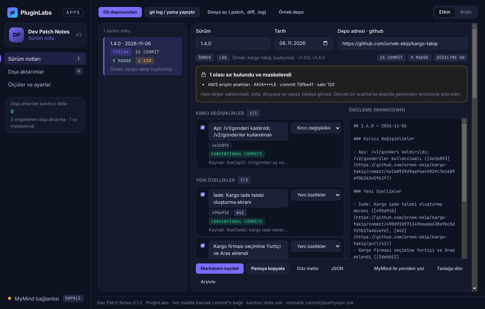
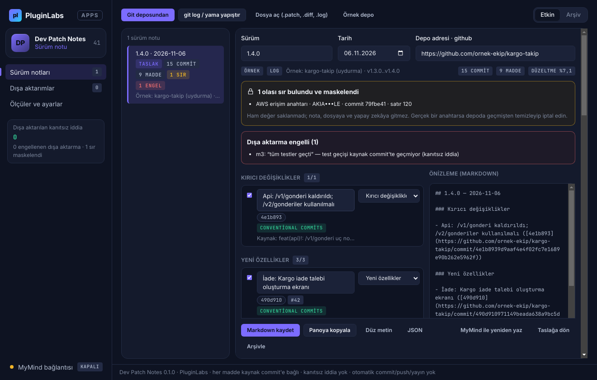
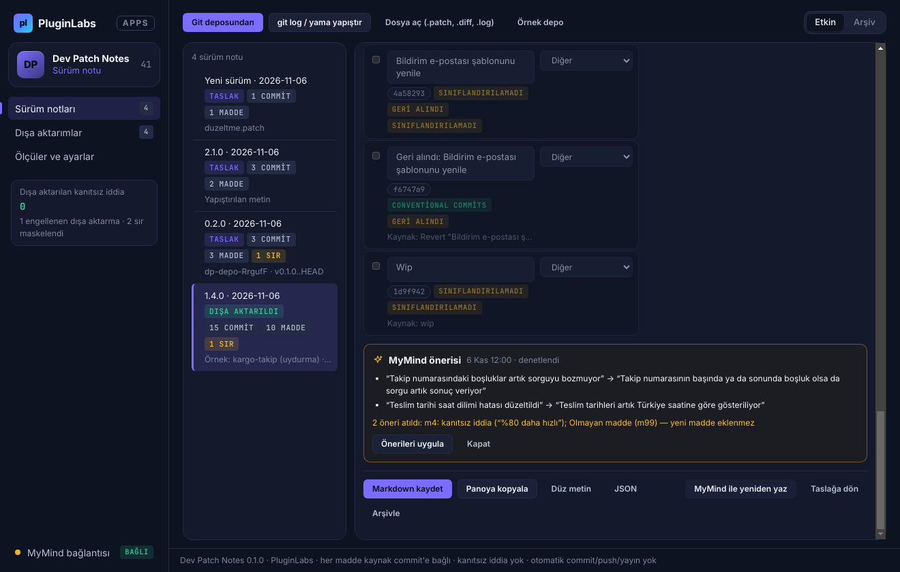
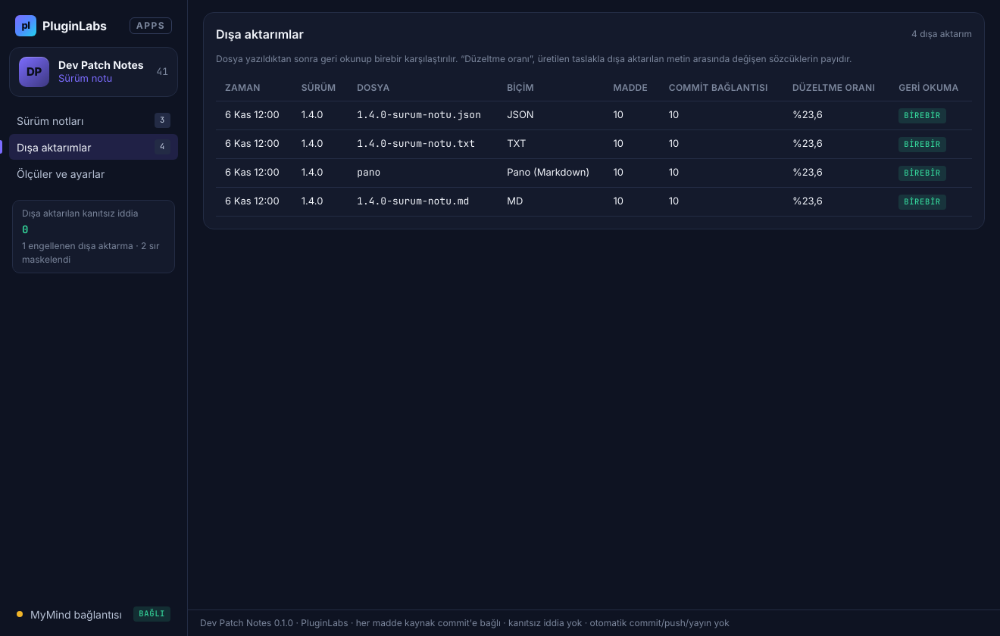
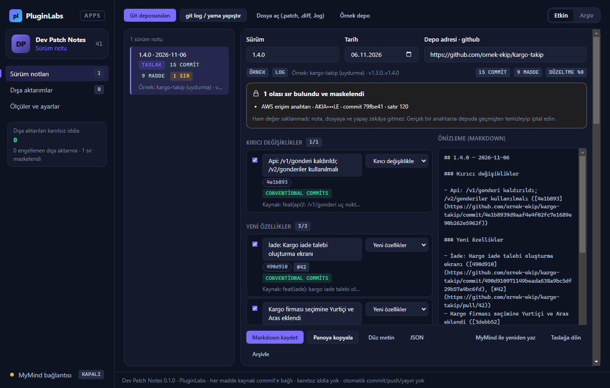
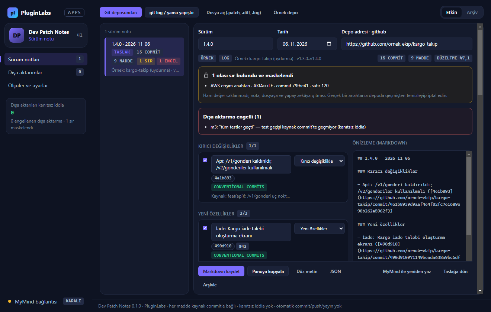
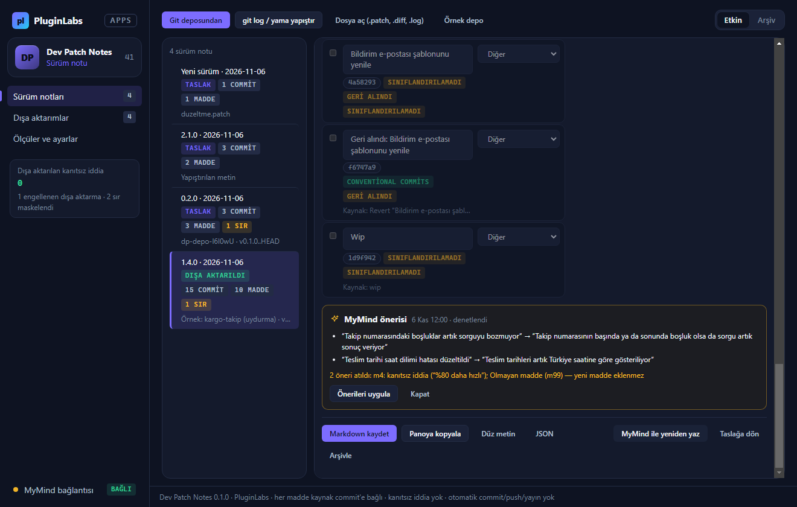
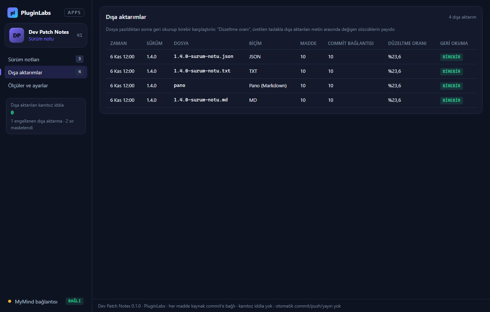

# Dev Patch Notes (PL-041) — Windows uygulaması

Kod değişikliğini kullanıcıya anlaşılır sürüm notuna dönüştürmek için: Dev Patch Notes **seçtiğiniz git commit'lerini** (yerel depo, `git log`, `.patch`, `git diff`) **özellik / düzeltme / iyileştirme / güvenlik / belge** başlıklarına ayırır ve **her maddesi kaynak commit (ve PR) bağlantılı, düzenlenebilir** bir not üretir. Commit'te yazmayan **test, performans, güvenlik ya da tamamlanma iddiası nota giremez** (dışa aktarma engellenir), **sırlar girişte maskelenir**, depo **yalnız okunur** — otomatik commit, push ve yayın yoktur. İsteğe bağlı olarak **MyMind** (PluginLabs Hub) ya da **yerel model** maddeleri kullanıcı diliyle yeniden yazar; öneri aynı denetimden geçer.

> Ürün deposu henüz yok; kaynak bu klasördedir (PluginLabs ürün ön geliştirme alanı, PL-025 modeli). Windows paketleri `pluginlabs-dagitim` deposunda `dev-patch-notes-v<sürüm>` etiketiyle yayımlanır.



| Kanıtsız iddia → dışa aktarma engeli | MyMind önerisi (yeni madde ve kanıtsız iddia atıldı) |
| --- | --- |
|  |  |
| **Dışa aktarımlar (düzeltme oranı, geri okuma)** | **Ölçüler ve ayarlar** |
|  |  |

Ekran görüntüleri gerçek uygulamadan, duman testinin test verisiyle (uydurma örnek depo; taklit MyMind yanıtı; tarih 6 Kasım 2026'ya sabitlenmiş) Linux/xvfb'de alınmıştır. Windows runner'ında alınan gerçek pencere görüntüleri (`windows-masaustu-*`, [çalıştırma 42404990282](https://github.com/timdesigners-pixel/pluginlabs-dagitim/actions/runs/42404990282), kaynak b01e54a) release ekinde ve aşağıdadır.

**Windows'ta (Windows runner, gerçek pencere):**



| Windows — kanıtsız iddia engeli | Windows — MyMind önerisi | Windows — dışa aktarımlar |
| --- | --- | --- |
|  |  |  |

## İndir
[dev-patch-notes-v0.1.0](https://github.com/timdesigners-pixel/pluginlabs-dagitim/releases/tag/dev-patch-notes-v0.1.0) — `DevPatchNotes-0.1.0-Windows-x64.exe` (kurulum, SHA-256 `6d5a7c72…2e45`), `DevPatchNotes-0.1.0-Windows-Portable-x64.exe` (taşınabilir, SHA-256 `5d04ef6f…b4df`, 81 535 432 bayt), SHA256SUMS + BUILD-INFO. İmzasız önizleme. Yerel depodan okumak için [Git for Windows](https://git-scm.com) gerekir (yapıştırma ve dosya için gerekmez). PluginLabs Hub kataloğundan da kurulabilir (Hub kataloğu birleşip yayımlanınca).

## Kullanım
1. **Git deposundan** → klasör seçin; aralık son etiketten itibaren önerilir (`v1.3.0..HEAD`), depo adresi origin'den gelir. Ya da **git log / yama yapıştır**, **Dosya aç** (.patch/.diff/.log). İlk deneme için **Örnek depo**.
2. Maddeleri gözden geçirin: metni düzenleyin, başlığını değiştirin, kutuyla notta yer alıp almayacağını seçin. Rozetler: *Conventional Commits* (kesin), *tahmin*, *sınıflandırılamadı*, *birleştirme*, *geri alındı*. Commit kısaltmasına tıklayınca commit sayfası açılır.
3. Kırmızı madde = kanıtsız iddia ya da sır: düzeltmeden dışa aktarılmaz.
4. **Markdown kaydet / Panoya kopyala / Düz metin / JSON**. Şablon (Türkçe başlıklar / Keep a Changelog) ve bakım maddeleri **Ölçüler ve ayarlar**'dan.

## Güvenlik ve gizlilik
- Git yalnız `desktop/git.js` içinden, kabuksuz (`execFile`) ve sabit beyaz listeyle çağrılır: `rev-parse`, `remote get-url origin`, `tag --list`, `log`, `show`. Depoyu ya da uzağı değiştiren komut yoktur; aralık seçenek olarak yorumlanamaz (`--end-of-options`, biçim denetimi); `GIT_OPTIONAL_LOCKS=0`.
- Tek ağ erişimi isteğe bağlı yapay zekâdır (`desktop/net.js`): Hub `127.0.0.1:47632` ya da loopback yerel model; yönlendirme izlenmez; her istek ayrı onaylıdır.
- Sırlar girişte maskelenir; arayüze, kayda, dosyaya ve modele ham hâli gitmez. Arayüz CSP ile ağa kapalıdır (`connect-src 'none'`), metin yalnız `textContent`/`value` ile yazılır; `contextIsolation` + `sandbox`; IPC yalnız uygulamanın kendi penceresinden; izin istekleri reddedilir. Hub anahtarı ve kayıtlar Windows kasasında (DPAPI) şifreli.

## Geliştirme
```bash
npm ci
npm test                                   # çekirdek birim testleri (node:test)
PLAYWRIGHT_MODULE=playwright xvfb-run -a -s "-screen 0 1440x900x24" node tests/desktop-smoke.cjs docs/screenshots
npm run build:win                          # Windows: kurulum + taşınabilir
node scripts/make-icons.cjs                # simgeleri yeniden üret
```
Windows derlemesi `ci/pluginlabs-dagitim-dev-patch-notes-windows.yml` iş akışıyla `pluginlabs-dagitim` deposunda, sabit bir PluginLabs commit'inden yapılır.
