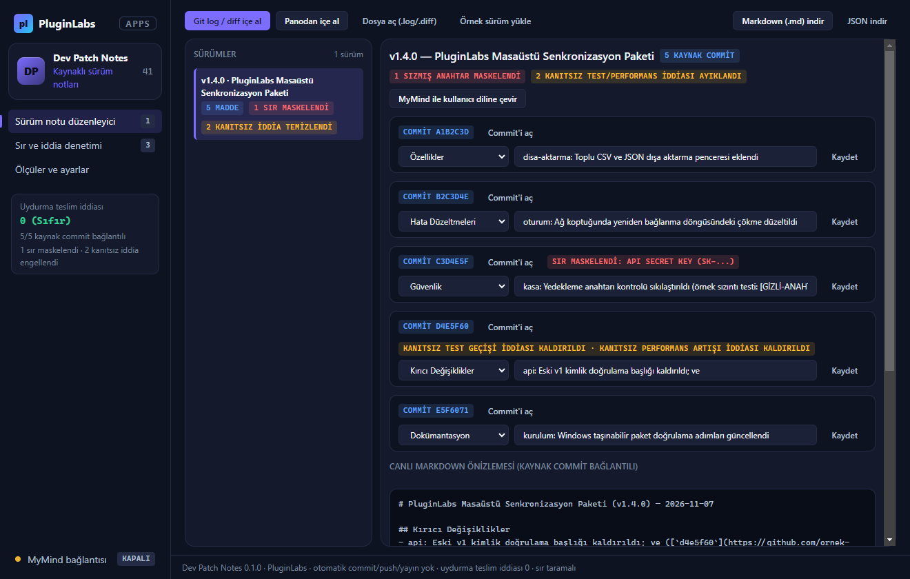
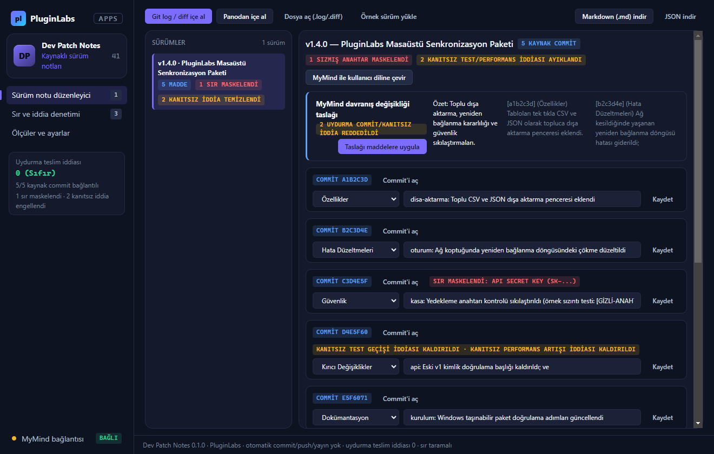
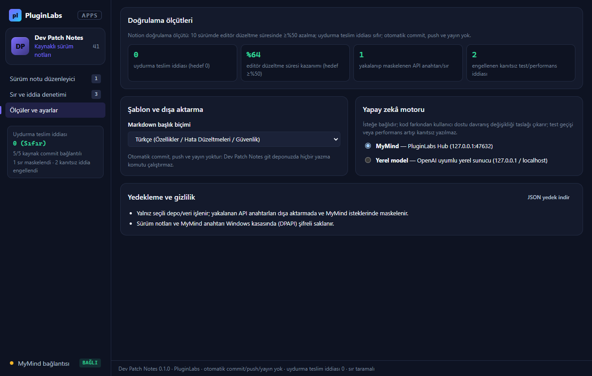

# Dev Patch Notes (PL-041) — Windows uygulaması

Seçilen **`git log`**, **commit listesi** veya **`git diff`** çıktısını içe alır; değişiklikleri **Özellikler**, **Hata Düzeltmeleri**, **Güvenlik**, **Kırıcı Değişiklikler**, **Dokümantasyon** ve **Bakım** başlıklarına ayırır; **kaynak commit bağlantıları** içeren düzenlenebilir sürüm notları üretir. Commit mesajlarında ya da diff içinde unutulan **API anahtarlarını ve sırları** yakalayıp maskeler; kanıtı olmayan **"tüm testler geçti"** veya **"performansta %X artış"** iddialarını engeller (**uydurma teslim iddiası sıfır**). Otomatik commit, push veya yayın yapmaz.

> Ürün deposu henüz yok; kaynak bu klasördedir (`apps/05-gelistirici-ve-profesyonel-araclar/PL-041-dev-patch-notes/app`). Windows paketleri `pluginlabs-dagitim` deposunda `dev-patch-notes-v<sürüm>` etiketiyle yayımlanır.



| MyMind davranış değişikliği taslağı | Sır ve iddia denetimi | Ölçüler ve ayarlar |
| --- | --- | --- |
|  |  |  |

## Özellikler
- **Git log / commit listesi / diff ayrıştırma:** Tam `git log`, `git log --oneline` ve ham `git diff` çıktılarını destekler.
- **Kaynak commit bağlantıları:** Her maddeyi kaynak commit SHA ve depo bağlantısıyla (`[`sha`](repo/commit/sha)`) eşler.
- **API anahtarı ve sır taraması:** `sk-...`, `ghp_...`, `AKIA...`, Slack token ve PEM özel anahtarlarını otomatik yakalar ve maskeler.
- **Uydurma teslim iddiası sıfır:** Kaynakta kanıtı olmayan test geçişi ve performans artışı iddialarını hem içe almada hem elle düzenlemede hem de MyMind yanıtlarında engeller.
- **Markdown / Keep a Changelog / JSON dışa aktarma:** Düzenlenebilir `.md` ve `.json` çıktıları üretir; otomatik commit, push ve yayın yapmaz.

## Geliştirme
```bash
npm test
node tests/desktop-smoke.cjs docs/screenshots
npm run build:win
node scripts/make-icons.cjs
```
