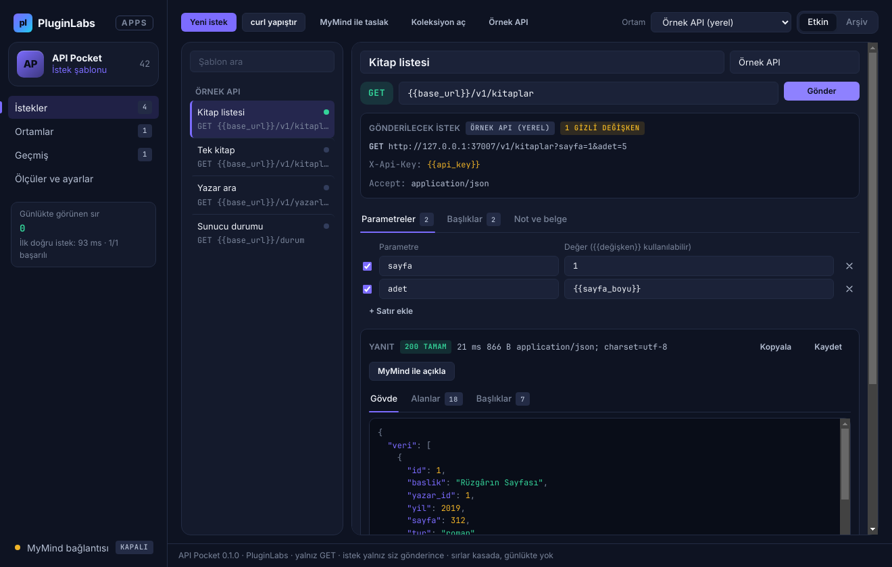

# PL-042 · API Pocket

> API isteklerini şablonlarla gönderir, ortam değişkenlerini kullanır ve yanıtları biçimlendirir.

| Alan | Değer |
| --- | --- |
| Kimlik | `PL-042` · `api-pocket` |
| Kategori | 05 · Geliştirici ve profesyonel araçlar — PL-041–050 |
| Durum | 08.11.2026: **0.1.0 Windows uygulaması yayımlandı** — [api-pocket-v0.1.0](https://github.com/timdesigners-pixel/pluginlabs-dagitim/releases/tag/api-pocket-v0.1.0) (`pluginlabs-dagitim`, Windows runner: test + duman testi + SHA256 + BUILD-INFO + Windows ekran görüntüleri); kaynak [app/](app/README.md); Hub 0.4.30 kataloğunda · Notion durumu: Yeni fikir |
| Öncelik / efor | P1 · M |
| Hedef platformlar | Windows, Linux, macOS, Chrome |
| Dağıtım biçimi | masaüstü uygulaması, Chrome eklentisi (Manifest V3) |
| Geliştirme deposu | Henüz yok — kaynak bu klasörün [`app/`](app/README.md) alt klasöründe (ön geliştirme alanı; bkz. [repo hiyerarşisi](../../../docs/REPO-HIYERARSISI.md)); Windows derlemesi ve sürüm dosyaları `pluginlabs-dagitim` deposunda (iş akışı: [`app/ci/`](app/ci/pluginlabs-dagitim-api-pocket-windows.yml)) |
| Codex projesi | `PL-042 · API Pocket` — ikinci klasör: PluginLabs |
| Notion kaynağı | [Notion](https://app.notion.com/p/4038aa13d8f981059dfad209ce1240d1) |

## Ne işe yarar

**Kullanıcı ve problem:** Küçük API çağrılarını büyük araç açmadan test etmek isteyen geliştiriciler.

**Kısa tanım (Hub kataloğu):** API isteklerini şablonlarla gönderir, ortam değişkenlerini kullanır ve yanıtları biçimlendirir.

## Hangi platformlar için yayınlanır

**Notion’daki platform tanımı:** Chrome paneli + W / L / M yerel istemci

- Windows
- Linux
- macOS
- Chrome

> Platformlar hedef kapsamdır. PluginLabs ürün ilkesi gereği test edilmemiş platform “destekleniyor” diye etiketlenmez; her platform gerçek cihaz/tarayıcı kabulünden sonra yayın listesine girer.

## Özellikler

### MVP ve temel akış

İstek şablonu, ortam değişkenleri, yanıt biçimleme ve örnek veri; ilk sürüm GET ve kullanıcı başlatmalı istek.

### Yapay zekânın rolü

İstek taslağı ve yanıt alanlarını açıklar; doğru API belgesi varsa bağlar.

## Teknik bağımlılık ve sınırlar

Sırlar işletim sistemi kasasında; üretim ortamına yazan yöntemlerde ek önizleme. Tarayıcı CORS sınırları için masaüstü ajanı gerekebilir.

## Gelir hipotezi

Ücretsiz koleksiyon; Pro ekip şeması ve test reçeteleri.

## Doğrulama ölçütü

Örnek API’de ilk doğru istek ≤2 dk; sırların günlükte görünmesi sıfır.

## Öncelik ve efor

P1 · M; sınırsız üretim otomasyonundan uzak dar araç.

## 0.1.0 sürümü (Windows)

Notion MVP akışı: **istek şablonu, ortam değişkenleri, yanıt biçimleme ve örnek veri; ilk sürüm GET ve kullanıcı başlatmalı istek.** Şablonlar adres, parametre ve başlıklarda `{{değişken}}` kullanır; ortamlar (geliştirme / üretim…) araç çubuğundan seçilir. İstek yalnız **Gönder**'e basınca gider; yanıt renklendirilmiş JSON, alan listesi (yol, tür, görülme, boş) ve başlıklarla gösterilir. **Örnek API** düğmesi bu bilgisayarda (yalnız 127.0.0.1) uydurma bir kitap API'si, hazır ortam ve dört şablon açar. curl komutu yapıştırılarak şablon oluşturulabilir.

Teknik sınır (Notion): **sırlar işletim sistemi kasasında; üretim ortamına yazan yöntemlerde ek önizleme.** Gizli değişkenler yalnız ana süreçte çözülür ve Windows kasasında (DPAPI) saklanır; arayüz, geçmiş, onay metni, curl kopyası ve koleksiyon dışa aktarması sırrı `{{ad}}` olarak gösterir, yanıtta geçen sır ⟦sır:ad⟧ olur; curl içe aktarmada anahtarlar otomatik gizliye taşınır. İlk sürüm yalnız GET gönderse de “üretim” işaretli ortamda her gönderimden önce maskeli önizleme ve onay istenir. Tarayıcı CORS sınırı masaüstü uygulamasında yoktur (istek ana süreçten gider).

Yapay zekânın rolü (Notion): **istek taslağı ve yanıt alanlarını açıklar; doğru API belgesi varsa bağlar.** MyMind ya da yerel model, onayla ve veri azaltılarak (yalnız alan yolları/türleri/maskeli örnekler; taslakta değişkenlerin yalnız adları) çalışır; olmayan alan, kullanıcının vermediği belge bağlantısı, GET dışı yöntem ve düz yazılmış anahtar atılır. Doğrulama ölçütü: **örnek API'de ilk doğru istek ≤ 2 dk** (uygulamada ölçülür) ve **sırların günlükte görünmesi sıfır** (kayıtlı geçmiş ve şablonlar her açılışta taranır).

Kapsam dışı (bu sürüm): POST/PUT/PATCH/DELETE ve gövde, OAuth akışları, Chrome paneli, Linux/macOS paketleri, ekip şeması ve test reçeteleri (Pro). Gerçek bir genel API'ye ve gerçek bir modele karşı denenmedi (uygulama içi örnek API, taklit yankı sunucusu ve taklit MyMind ile otomatik test). Ayrıntı: [app/README.md](app/README.md).

## Geliştirme ve ortak çalışma (Codex + Claude Code)

- Dal adı: `codex/PL-042-<konu>` veya `claude/PL-042-<konu>`; iki ajan aynı dalda aynı anda çalışmaz.
- İşe başlamadan önce [AKTIF-ISLER.md](../../../docs/ortak-calisma/AKTIF-ISLER.md) tablosuna satır eklenir; iş bitince devir notu yazılır.
- Kurallar: [AGENTS.md](../../../AGENTS.md) (her iki ajan için ortak), protokol: [AI-ORTAK-CALISMA.md](../../../docs/ortak-calisma/AI-ORTAK-CALISMA.md).

## Notion kartının özgün metni

Aşağıdaki metin `resources/notion-catalog.json` (Notion anlık görüntüsü, 2026-10-26) içindeki kartın kısaltılmadan aktarılmış hâlidir.

Tam kartı göster

- **Durum:** Yeni fikir
- **Platform:** Chrome paneli + W / L / M yerel istemci
- **Kullanıcı ve problem:** Küçük API çağrılarını büyük araç açmadan test etmek isteyen geliştiriciler.
- **MVP ve temel akış:** İstek şablonu, ortam değişkenleri, yanıt biçimleme ve örnek veri; ilk sürüm GET ve kullanıcı başlatmalı istek.
- **Yapay zekânın rolü:** İstek taslağı ve yanıt alanlarını açıklar; doğru API belgesi varsa bağlar.
- **Teknik bağımlılık ve sınır:** Sırlar işletim sistemi kasasında; üretim ortamına yazan yöntemlerde ek önizleme. Tarayıcı CORS sınırları için masaüstü ajanı gerekebilir.
- **Gelir hipotezi:** Ücretsiz koleksiyon; Pro ekip şeması ve test reçeteleri.
- **Doğrulama ölçütü:** Örnek API’de ilk doğru istek ≤2 dk; sırların günlükte görünmesi sıfır.
- **Öncelik ve efor:** P1 · M; sınırsız üretim otomasyonundan uzak dar araç.

---
Oluşturma: 29.10.2026 · Kaynak → hedef: Notion kataloğu → `registry/projects.json` → bu dosya
