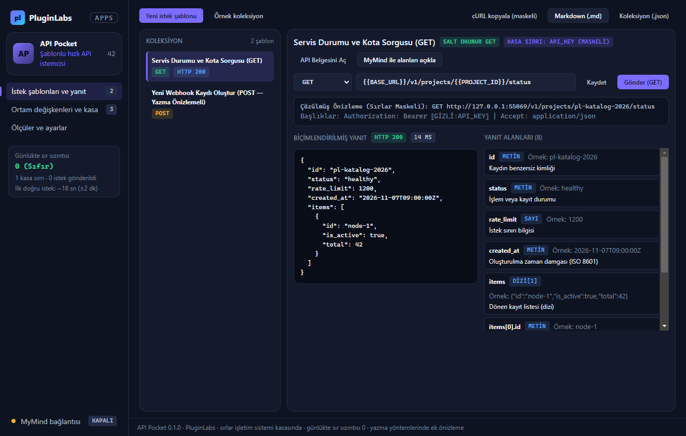
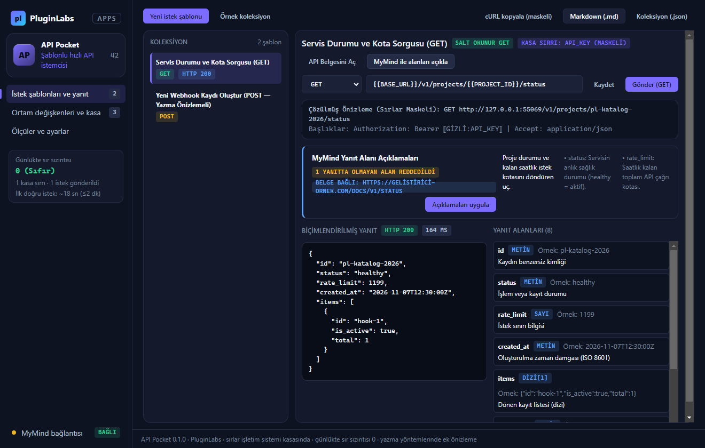
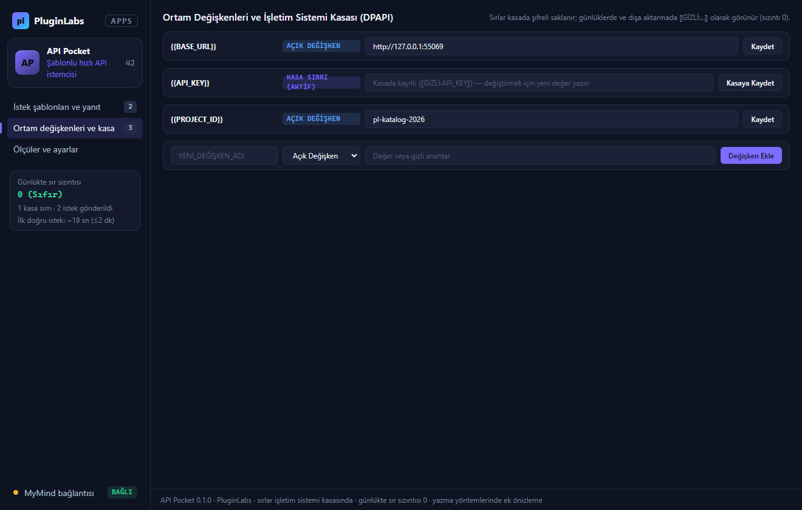
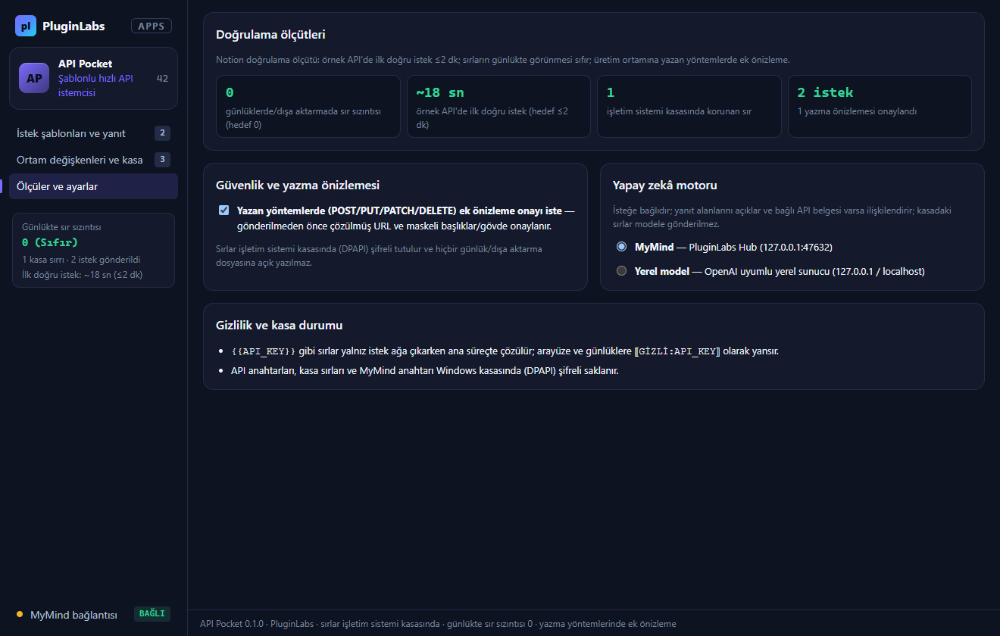

# API Pocket (PL-042) — Windows uygulaması

Küçük API çağrılarını büyük ve ağır araçlar açmadan **istek şablonları** ve **ortam değişkenleriyle** (`{{BASE_URL}}`, `{{API_KEY}}`) gönderir, JSON yanıtlarını biçimlendirir ve **yanıt alanlarını açıklar**. Sırlar **işletim sistemi kasasında (DPAPI)** şifreli saklanır; arayüzde, günlüklerde ve dışa aktarma dosyalarında `⟦GİZLİ:...⟧` yer tutucusuyla maskelenir (**sırların günlükte görünmesi sıfır**). Sunucuda değişiklik yapan yazma yöntemlerinde (`POST`, `PUT`, `PATCH`, `DELETE`) gönderim öncesi **ek önizleme ve onay** uygulanır.

> Ürün deposu henüz yok; kaynak bu klasördedir (`apps/05-gelistirici-ve-profesyonel-araclar/PL-042-api-pocket/app`). Windows paketleri `pluginlabs-dagitim` deposunda `api-pocket-v<sürüm>` etiketiyle yayımlanır.



| MyMind yanıt alanı açıklaması | Ortam değişkenleri ve kasa | Ölçüler ve ayarlar |
| --- | --- | --- |
|  |  |  |

## Özellikler
- **İstek şablonları ve ortam değişkenleri:** URL, başlık ve gövde içinde `{{BASE_URL}}`, `{{PROJECT_ID}}`, `{{API_KEY}}` yer tutucularını kullanır.
- **Sırlar işletim sistemi kasasında (0 sızıntı):** Gizli anahtarlar Windows kasasında (`safeStorage` DPAPI) şifreli tutulur; yalnızca istek ağa çıkarken ana süreçte çözülür ve hiçbir günlüğe ya da dışa aktarmaya açık yazılmaz.
- **Yazma yöntemlerinde ek önizleme:** `POST`, `PUT`, `PATCH`, `DELETE` isteklerinde gönderim öncesi çözülmüş URL ve maskeli gövde/başlıklar onaylanır.
- **Yanıt biçimleme ve alan açıklamaları:** JSON yanıtlarını girintili biçimlendirir, her alanın yolunu, veri tipini ve açıklamasını listeler; bağlı API belgesi varsa ilişkilendirir.
- **Maskeli cURL, Markdown ve JSON dışa aktarma:** Sırları açık etmeden paylaşılabilir cURL komutları ve koleksiyon çıktıları üretir.

## Geliştirme
```bash
npm test
node tests/desktop-smoke.cjs docs/screenshots
npm run build:win
node scripts/make-icons.cjs
```
