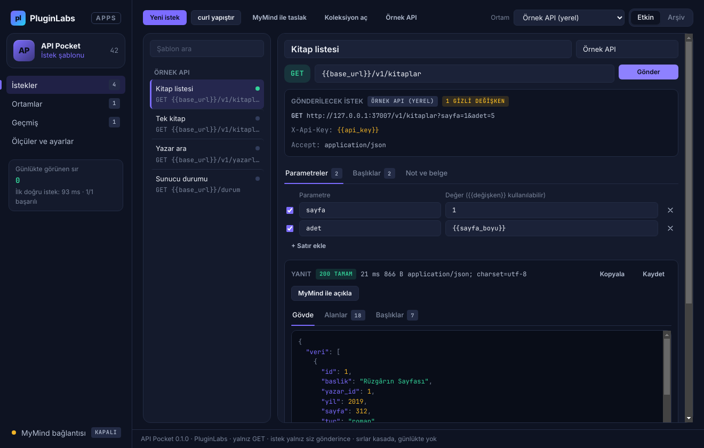
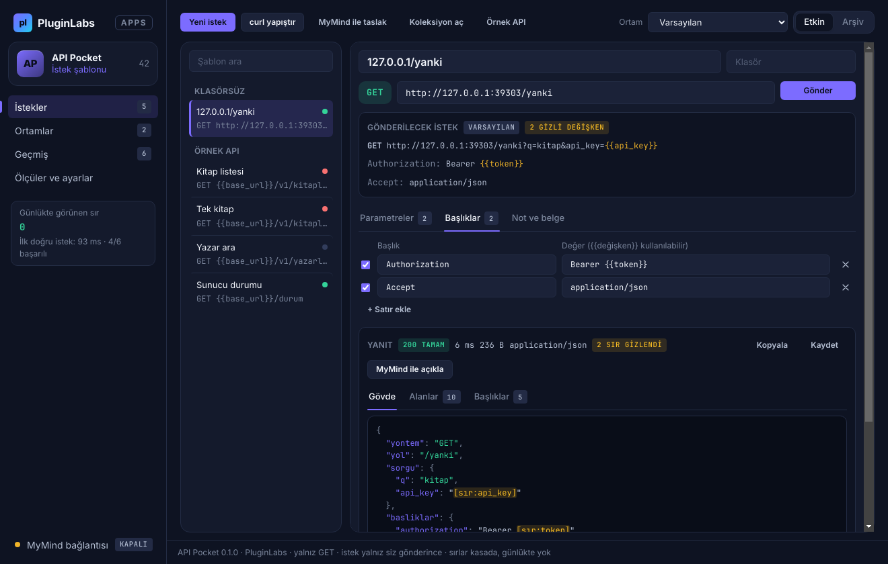
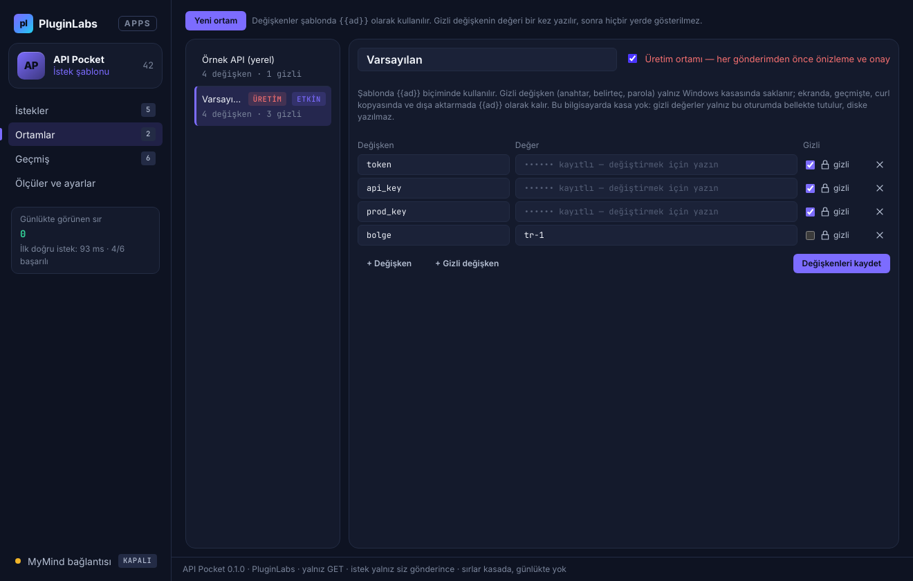
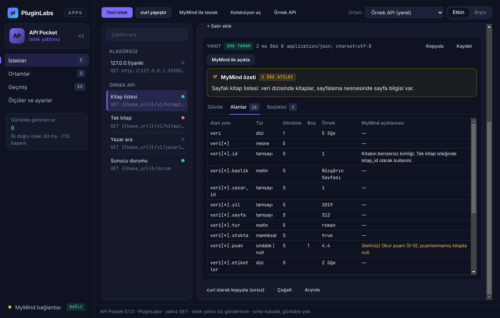
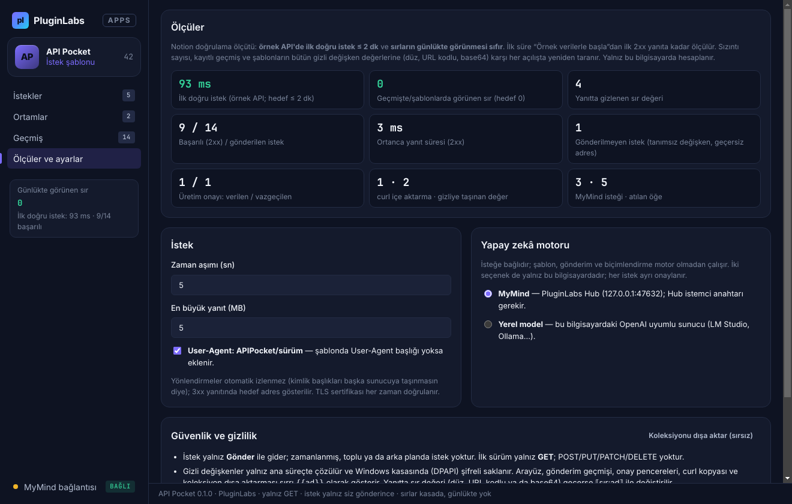
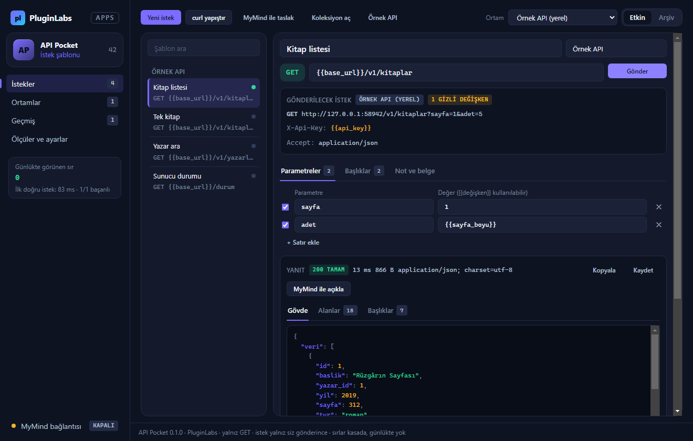
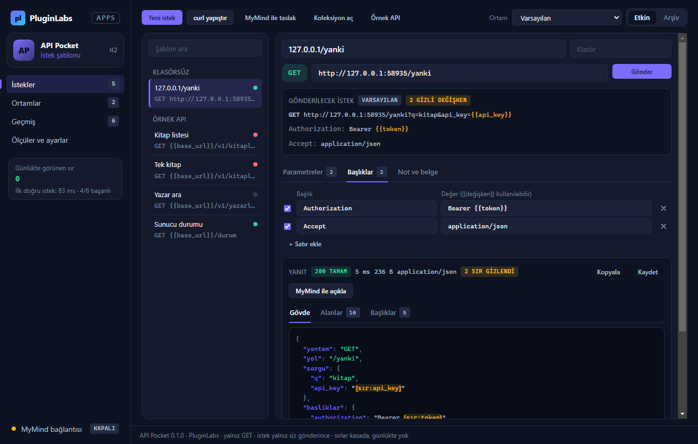
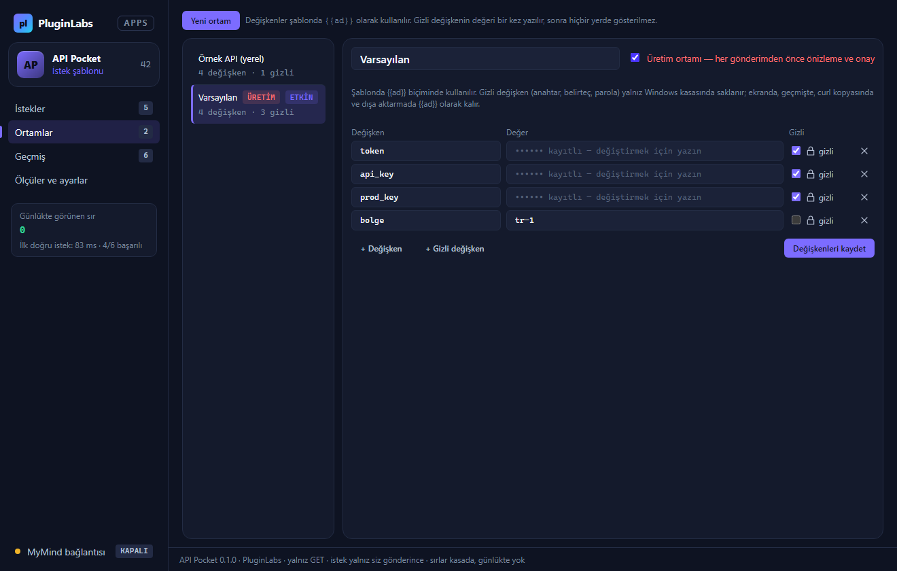
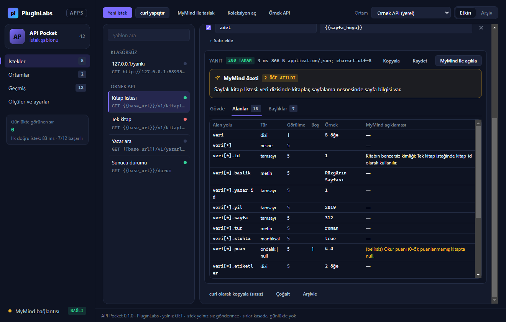

# API Pocket (PL-042) — Windows uygulaması

Küçük bir API çağrısını denemek için büyük bir araç açmayın: API Pocket **istek şablonlarını** **ortam değişkenleriyle** (`{{base_url}}`, `{{api_key}}` …) doldurur, isteği **yalnız siz Gönder'e bastığınızda** yollar ve yanıtı **biçimlendirir** (renklendirilmiş JSON, alan listesi, başlıklar). İlk sürüm yalnız **GET** isteği gönderir. Anahtar ve belirteçler **gizli değişken** olarak Windows kasasında (DPAPI) saklanır; **ekranda, gönderim geçmişinde, curl kopyasında, dışa aktarmada ve yapay zekâ isteğinde görünmez** — yanıtta geri yansısa bile ⟦sır:ad⟧ olarak gösterilir. İsteğe bağlı olarak **MyMind** (PluginLabs Hub) ya da bu bilgisayardaki **yerel model** yanıt alanlarını açıklar ya da bir cümleden istek taslağı hazırlar — her istekte onayla, veri azaltılarak.

> Ürün deposu henüz yok; kaynak bu klasördedir (PluginLabs ürün ön geliştirme alanı, PL-025 modeli). Windows paketleri `pluginlabs-dagitim` deposunda `api-pocket-v<sürüm>` etiketiyle yayımlanır.



| curl içe aktarma: anahtarlar gizli değişkene taşındı, yanıtta ⟦sır:…⟧ | Ortamlar: gizli değer ekrana gelmez, üretim ortamı onaylı |
| --- | --- |
|  |  |
| **MyMind alan açıklaması (uydurma alan ve dış bağlantı atıldı)** | **Ölçüler ve ayarlar** |
|  |  |

Ekran görüntüleri gerçek uygulamadan, duman testinin test verisiyle (uygulama içi uydurma kitap API'si, taklit yankı sunucusu ve taklit MyMind yanıtı) Linux/xvfb'de alınmıştır; bu ortamda işletim sistemi kasası yoktur (gizli değerler yalnız bellekte). Windows runner'ında alınan gerçek pencere görüntüleri (`windows-masaustu-*`, [çalıştırma 42444671045](https://github.com/timdesigners-pixel/pluginlabs-dagitim/actions/runs/42444671045), kaynak 0285f75; Windows kasası DPAPI etkin, kullanıcı verisinde düz sır yok) release ekinde ve aşağıdadır.

**Windows'ta (Windows runner, gerçek pencere):**



| Windows — curl ve gizli değişken | Windows — ortamlar | Windows — MyMind alan açıklaması |
| --- | --- | --- |
|  |  |  |

## İndir
[api-pocket-v0.1.0](https://github.com/timdesigners-pixel/pluginlabs-dagitim/releases/tag/api-pocket-v0.1.0) — `APIPocket-0.1.0-Windows-x64.exe` (kurulum, SHA-256 `676953c4…2aa9`), `APIPocket-0.1.0-Windows-Portable-x64.exe` (taşınabilir, SHA-256 `e0db60ad…2004`, 81 539 363 bayt), SHA256SUMS + BUILD-INFO. İmzasız önizleme. PluginLabs Hub kataloğundan da kurulabilir (Hub kataloğu birleşip yayımlanınca).

## Kullanım
1. **Örnek API** → “Örnek verilerle başla”: bu bilgisayarda (yalnız 127.0.0.1) uydurma bir kitap API'si açılır; hazır ortam (`base_url`, gizli `api_key`, `kitap_id`, `sayfa_boyu`) ve dört şablon gelir. **Gönder** → ilk doğru istek. Süre “Ölçüler”de görünür (hedef ≤ 2 dk).
2. Kendi API'niz için **curl yapıştır** (tarayıcıda Ağ sekmesi → “Copy as cURL” ya da belgedeki örnek) veya **Yeni istek** (Ctrl+N). Authorization, X-Api-Key, Cookie gibi başlıklar ve `api_key`, `token` gibi parametreler otomatik olarak **gizli değişkene** taşınır.
3. **Ortamlar**: değişken ekleyin; anahtarı **gizli** işaretleyin. Gizli değer bir kez yazılır; sonra düzenleyicide boş görünür (“kayıtlı”) ve boş bırakılırsa korunur. Canlı sistem için ortamı **Üretim** işaretleyin: her gönderimden önce maskeli önizleme ve onay.
4. Şablonda adres, parametreler ve başlıklar `{{ad}}` ile; **Gönderilecek istek** kutusu çözülmüş adresi gizli değerler `{{ad}}` hâlinde gösterir. Tanımsız değişken, geçersiz adres ya da başlıkta satır sonu varsa istek **gönderilmez**.
5. **Yanıt**: durum, süre, boyut; **Gövde** (girintili, renklendirilmiş JSON; XML/HTML/metin olduğu gibi, çalıştırılmadan), **Alanlar** (yol, tür, görülme, boş, örnek), **Başlıklar**. Kopyala / Kaydet. 3xx yanıtında hedef adres gösterilir, otomatik izlenmez.
6. **MyMind ile açıkla**: alan açıklamaları Alanlar tablosuna eklenir. **MyMind ile taslak**: bir cümleden GET şablonu (gönderilmez, yalnız eklenir).
7. **Geçmiş**: maskeli gönderim kayıtları (gövde saklanmaz). **Ölçüler ve ayarlar**: ilk doğru istek süresi, günlükte görünen sır (hedef 0), zaman aşımı, yanıt sınırı, yapay zekâ motoru, sırsız koleksiyon dışa aktarma.

## Güvenlik ve gizlilik
- Ağ erişimi yalnız `desktop/net.js` içinde (ana süreç). Arayüz CSP ile ağa kapalıdır (`connect-src 'none'`); yanıt yalnız `textContent` ile yazılır, HTML/JS çalıştırılmaz. `contextIsolation` + `sandbox`; IPC yalnız uygulamanın kendi penceresinden; izin istekleri reddedilir.
- İstek: yalnız GET, yalnız http/https, yalnız kullanıcı başlatmalı; yönlendirme izlenmez (kimlik başlığı başka sunucuya taşınmaz); çerez ve önbellek yok; TLS doğrulaması kapatılamaz; zaman aşımı (5–120 sn) ve yanıt boyutu (1–20 MB) sınırlı; `Host`, `Content-Length` gibi başlıklar kullanıcıya açık değildir.
- Gizli değişkenler yalnız ana süreçte çözülür. Kasa (DPAPI) varsa şifreli saklanır; yoksa **diske hiç yazılmaz**. Arayüze yalnız “kayıtlı” bilgisi gider. Geçmiş, onay metni, curl kopyası ve koleksiyon dışa aktarması sırrı `{{ad}}` olarak tutar; yanıttaki sır değerleri (düz, URL kodlu, base64) ⟦sır:ad⟧ ile değiştirilir. “Günlükte görünen sır” ölçüsü kayıtlı geçmiş ve şablonları her açılışta bütün gizli değerlere karşı yeniden tarar; koleksiyon dışa aktarması düz sır bulursa durur.
- Modele (Hub 127.0.0.1:47632 ya da loopback yerel model) yalnız şunlar gider: açıklamada alan yolları, türler ve en çok 40 karakterlik maskeli örnekler, sorgusuz adres, durum, içerik türü ve varsa belge bağlantınız; taslakta açıklamanız (e-posta/telefon/bağlantı/anahtar ⟦…⟧) ve değişkenlerin yalnız adları. Yanıt denetlenir: olmayan alan, verilmeyen bağlantı, GET dışı yöntem ve düz yazılmış anahtar atılır.
- Silme yok: şablonlar arşivlenir.

## Geliştirme
```bash
npm ci
npm test                                   # çekirdek birim testleri (node:test)
PLAYWRIGHT_MODULE=playwright xvfb-run -a -s "-screen 0 1440x900x24" node tests/desktop-smoke.cjs docs/screenshots
npm run build:win                          # Windows: kurulum + taşınabilir
node scripts/make-icons.cjs                # simgeleri yeniden üret
```
Windows derlemesi `ci/pluginlabs-dagitim-api-pocket-windows.yml` iş akışıyla `pluginlabs-dagitim` deposunda, sabit bir PluginLabs commit'inden yapılır.
