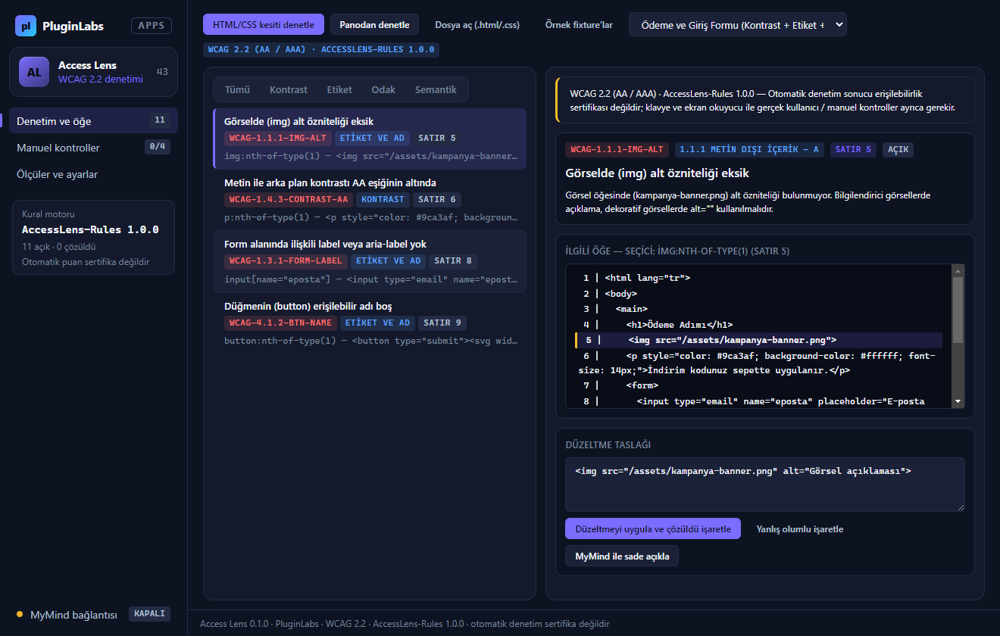

# PL-043 · Access Lens

> Web sayfalarındaki kontrast, etiket, odak sırası ve semantik erişilebilirlik sorunlarını raporlar.

| Alan | Değer |
| --- | --- |
| Kimlik | `PL-043` · `access-lens` |
| Kategori | 05 · Geliştirici ve profesyonel araçlar — PL-041–050 |
| Durum | 07.11.2026: **0.1.0 Windows masaüstü uygulaması hazır** — kaynak [`app/`](app/README.md) (çekirdek birim testleri + gerçek Electron duman testi + Windows ekran görüntüleri); dağıtım iş akışı [`app/ci/`](app/ci/pluginlabs-dagitim-access-lens-windows.yml) · Notion durumu: Yeni fikir |
| Öncelik / efor | P1 · M |
| Hedef platformlar | Windows, Linux, macOS, Chrome |
| Dağıtım biçimi | masaüstü uygulaması, Chrome eklentisi (Manifest V3) |
| Geliştirme deposu | Henüz yok — kaynak bu klasörün [`app/`](app/README.md) alt klasöründe (ön geliştirme alanı; bkz. [repo hiyerarşisi](../../../docs/REPO-HIYERARSISI.md)); Windows derlemesi ve sürüm dosyaları `pluginlabs-dagitim` deposunda (iş akışı: [`app/ci/`](app/ci/pluginlabs-dagitim-access-lens-windows.yml)) |
| Codex projesi | `PL-043 · Access Lens` — ikinci klasör: PluginLabs |
| Notion kaynağı | [Notion](https://app.notion.com/p/4038aa13d8f981059dfad209ce1240d1) |

## Ne işe yarar

**Kullanıcı ve problem:** Arayüzündeki erişilebilirlik sorunlarını erken görmek isteyen tasarımcı/geliştiriciler.

**Kısa tanım (Hub kataloğu):** Web sayfalarındaki kontrast, etiket, odak sırası ve semantik erişilebilirlik sorunlarını raporlar.

## Hangi platformlar için yayınlanır

**Notion’daki platform tanımı:** Chrome denetim paneli; rapor W / L / M

- Windows
- Linux
- macOS
- Chrome

> Platformlar hedef kapsamdır. PluginLabs ürün ilkesi gereği test edilmemiş platform “destekleniyor” diye etiketlenmez; her platform gerçek cihaz/tarayıcı kabulünden sonra yayın listesine girer.

## Özellikler

### MVP ve temel akış

Seçili sayfada kontrast, etiket, odak sırası ve semantik uyarılar; sorun seçildiğinde ilgili öğeyi göster.

### Yapay zekânın rolü

Sorunu sade açıklar ve düzeltme taslağı önerir; otomatik puanı erişilebilirlik sertifikası gibi sunmaz.

## Teknik bağımlılık ve sınırlar

Standart sürümü ve kural motoru çıktısı görünür. Klavye/ekran okuyucu manuel kontrolleri ayrıca gerekir.

## Gelir hipotezi

Ücretsiz temel denetim; Pro rapor geçmişi ve ekip takibi.

## Doğrulama ölçütü

Bilinen fixture’larda kurala göre doğru bulgu; kritik yanlış olumlu \<%5 hedefi.

## Öncelik ve efor

P1 · M; gerçek engelli kullanıcı testi ürün doğrulamasına dahil.

## 0.1.0 sürümü (Windows)

Notion MVP akışı: **seçili sayfada/kesitte kontrast, etiket, odak sırası ve semantik uyarılar; sorun seçildiğinde ilgili öğeyi göster.** HTML/CSS kesiti yapıştırılarak, panodan ya da `.html`/`.css`/`.svg` dosyasından denetlenir; her bulgu için WCAG 2.2 kural kodu, satır numarası, CSS seçicisi ve uygulanabilir düzeltme taslağı üretilir; bulgu seçildiğinde kaynak kodda ilgili satır vurgulanır.

Yapay zekânın rolü (Notion): **sorunu sade açıklar ve düzeltme taslağı önerir; otomatik puanı erişilebilirlik sertifikası gibi sunmaz.** MyMind (PluginLabs Hub) ya da yerel model isteğe bağlıdır, yalnız loopback (`127.0.0.1` / `localhost`) üzerinden ve her istekte kullanıcı onayıyla çalışır; e-posta, bağlantı ve gizli anahtarlar `⟦…⟧` ile maskelenir.

Teknik sınır ve doğrulama ölçütü (Notion): **standart sürümü (`WCAG 2.2 (AA / AAA)`) ve kural motoru (`AccessLens-Rules 1.0.0`) açıkça görünür; klavye ve ekran okuyucu manuel kontrolleri ayrıca gerekir.** Bilinen 4 doğrulama kesitinde (fixture) beklenen 11 bulgunun tamamı (%100) yakalanır, kritik yanlış olumlu oranı %0’dır (hedef < %5). Dışa aktarma: Markdown denetim raporu (`.md`), CSV bulgu tablosu (`.csv`) ve JSON yedek.

Kapsam dışı (bu sürüm): canlı Chrome sekmesi denetim eklentisi (Manifest V3), çok kullanıcılı ekip takibi (Pro), Linux/macOS paketleri. Ayrıntı: [app/README.md](app/README.md).

## Geliştirme ve ortak çalışma (Codex + Claude Code)

- Dal adı: `codex/PL-043-<konu>` veya `claude/PL-043-<konu>`; iki ajan aynı dalda aynı anda çalışmaz.
- İşe başlamadan önce [AKTIF-ISLER.md](../../../docs/ortak-calisma/AKTIF-ISLER.md) tablosuna satır eklenir; iş bitince devir notu yazılır.
- Kurallar: [AGENTS.md](../../../AGENTS.md) (her iki ajan için ortak), protokol: [AI-ORTAK-CALISMA.md](../../../docs/ortak-calisma/AI-ORTAK-CALISMA.md).

## Notion kartının özgün metni

Aşağıdaki metin `resources/notion-catalog.json` (Notion anlık görüntüsü, 2026-10-26) içindeki kartın kısaltılmadan aktarılmış hâlidir.

Tam kartı göster

- **Durum:** Yeni fikir
- **Platform:** Chrome denetim paneli; rapor W / L / M
- **Kullanıcı ve problem:** Arayüzündeki erişilebilirlik sorunlarını erken görmek isteyen tasarımcı/geliştiriciler.
- **MVP ve temel akış:** Seçili sayfada kontrast, etiket, odak sırası ve semantik uyarılar; sorun seçildiğinde ilgili öğeyi göster.
- **Yapay zekânın rolü:** Sorunu sade açıklar ve düzeltme taslağı önerir; otomatik puanı erişilebilirlik sertifikası gibi sunmaz.
- **Teknik bağımlılık ve sınır:** Standart sürümü ve kural motoru çıktısı görünür. Klavye/ekran okuyucu manuel kontrolleri ayrıca gerekir.
- **Gelir hipotezi:** Ücretsiz temel denetim; Pro rapor geçmişi ve ekip takibi.
- **Doğrulama ölçütü:** Bilinen fixture’larda kurala göre doğru bulgu; kritik yanlış olumlu \<%5 hedefi.
- **Öncelik ve efor:** P1 · M; gerçek engelli kullanıcı testi ürün doğrulamasına dahil.

---
Oluşturma: 29.10.2026 · Kaynak → hedef: Notion kataloğu → `registry/projects.json` → bu dosya
