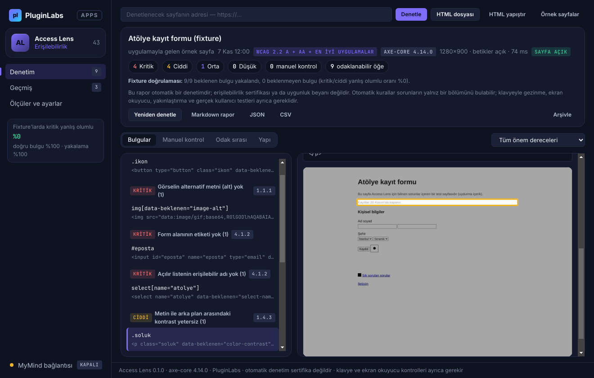
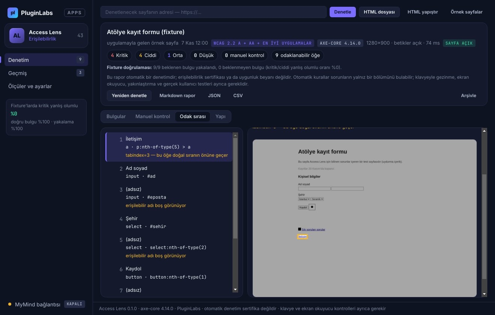
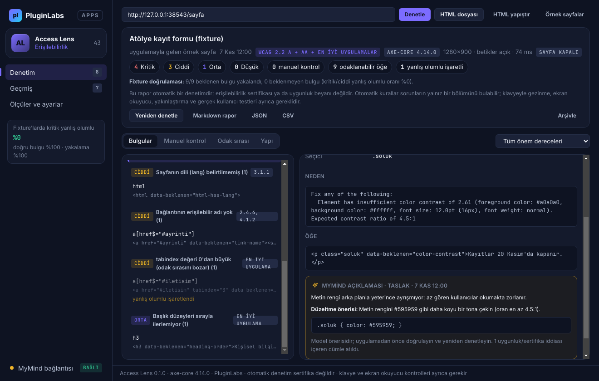
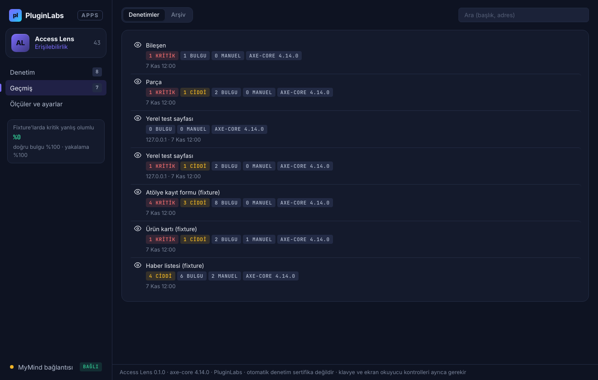
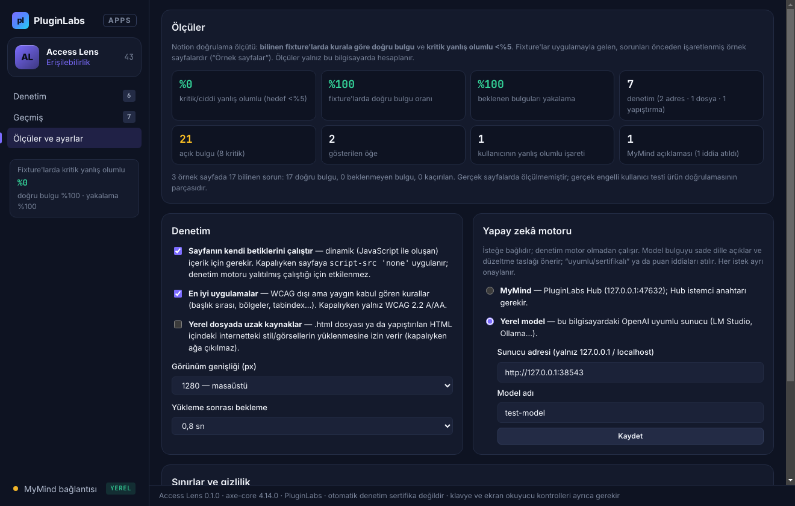

# Access Lens (PL-043) — Windows uygulaması

Arayüzünüzdeki erişilebilirlik sorunlarını yayından önce görün: Access Lens seçtiğiniz **tek web sayfasını** (adres, kaydedilmiş `.html` dosyası ya da yapıştırılan HTML) yalıtılmış, oturumsuz bir pencerede açar ve **axe-core** kural motoruyla **WCAG 2.2 A/AA** ölçütlerine göre **kontrast, form etiketi, erişilebilir ad, başlık yapısı ve ARIA** sorunlarını raporlar. Bir bulguya tıkladığınızda **ilgili öğe sayfanın görüntüsünde işaretlenir**; **odak sırası** ve **başlık/bölge yapısı** ayrı sekmelerdedir. Standart ve motor sürümü her raporda görünür. **Puan ya da sertifika üretilmez** — otomatik denetim manuel kontrollerin yerini tutmaz. İsteğe bağlı olarak **MyMind** (PluginLabs Hub) ya da yerel model bulguyu sade dille açıklar ve düzeltme taslağı önerir.

> Ürün deposu henüz yok; kaynak bu klasördedir (PluginLabs ürün ön geliştirme alanı, PL-025 modeli). Windows paketleri `pluginlabs-dagitim` deposunda `access-lens-v<sürüm>` etiketiyle yayımlanır.



| Odak sırası (pozitif tabindex uyarısı, öğe işaretli) | MyMind açıklaması (taslak; sertifika iddiası atıldı) |
| --- | --- |
|  |  |
| **Geçmiş** | **Ölçüler ve ayarlar (fixture doğruluğu, kritik yanlış olumlu)** |
|  |  |

Ekran görüntüleri gerçek uygulamadan, duman testinde (uygulamayla gelen örnek sayfalar, yerel test sunucusu, taklit MyMind yanıtı; tarih 7 Kasım 2026'ya sabitlenmiş) Linux/xvfb'de alınmıştır; denetimler gerçek axe-core çalıştırmasıdır.

## Kullanım
1. Adresi yazıp **Denetle** (açılış onaylanır), **HTML dosyası** seçin ya da **HTML yapıştır**. İlk deneme için **Örnek sayfalar** (bilinen sorunları işaretli 3 fixture).
2. **Bulgular**: önem süzgeci, kurala göre gruplu liste; ayrıntıda WCAG ölçütü, motorun açıklaması ve nedeni, öğenin HTML'i. **Öğeyi göster** ile öğe görüntüde işaretlenir (yalnız son denetlenen sayfa açıkken). **Yanlış olumlu** ile işaretleyebilirsiniz.
3. **Manuel kontrol**: motorun emin olamadıkları. **Odak sırası**: Tab sırası ve uyarılar. **Yapı**: başlıklar ve bölgeler.
4. Düzelttikten sonra **Yeniden denetle**: yeni / giderilen / süren bulgular. **Markdown rapor**, **JSON**, **CSV**.

## Güvenlik ve gizlilik
- Denetlenen sayfa görünmez bir pencerede açılır: her denetimde **yeni bellek içi oturum** (çerezleriniz ve oturumlarınız kullanılmaz, diske yazılmaz), sandbox, Node yok, önyükleme betiği yok, izinler reddedilir, indirmeler iptal, yeni pencere yok, ilk yüklemeden sonra başka adrese gidilmez (`desktop/auditor.js`).
- axe-core ve denetim betiği (`desktop/page-audit.js`) sayfanın betiklerinden **yalıtılmış bir dünyada** çalışır; sayfa değiştirilmez. "Sayfa betikleri" kapalıyken sayfaya CSP `script-src 'none'` uygulanır.
- Yerel dosya/yapıştırılan HTML'de uzak kaynaklar (ayar kapalıyken) engellenir; uygulama ağa çıkmaz. Adres denetiminde yalnız o sayfa ve kendi kaynakları yüklenir.
- Ana pencere CSP ile ağa kapalıdır (`connect-src 'none'`), metin yalnız `textContent`/`value` ile yazılır (bulgulardaki HTML parçaları düz metindir); IPC yalnız uygulamanın kendi penceresinden. Bulgulardaki e-posta/telefon/uzun sayılar maskelenir.
- MyMind/yerel model yalnız loopback (`desktop/net.js`), her istek onaylı; sayfa adresi gönderilmez; uyumluluk/sertifika/puan iddiaları atılır.
- Denetimler ve Hub anahtarı Windows kasasında (DPAPI) şifreli; silme yok (arşiv).

## Geliştirme
```bash
npm ci
npm test                                   # çekirdek birim testleri (node:test)
PLAYWRIGHT_MODULE=playwright xvfb-run -a -s "-screen 0 1440x900x24" node tests/desktop-smoke.cjs docs/screenshots
npm run build:win                          # Windows: kurulum + taşınabilir
node scripts/make-icons.cjs                # simgeleri yeniden üret
```
Fixture'lar: `src/fixtures/*.html` — bilinen her sorun öğesinde `data-beklenen="<axe kural kimliği>"`. Windows derlemesi `ci/pluginlabs-dagitim-access-lens-windows.yml` iş akışıyla `pluginlabs-dagitim` deposunda, sabit bir PluginLabs commit'inden yapılır.

## Lisanslar
axe-core © Deque Systems, Mozilla Public License 2.0 (`node_modules/axe-core/LICENSE`, pakete dahil). Access Lens: PluginLabs, UNLICENSED.
