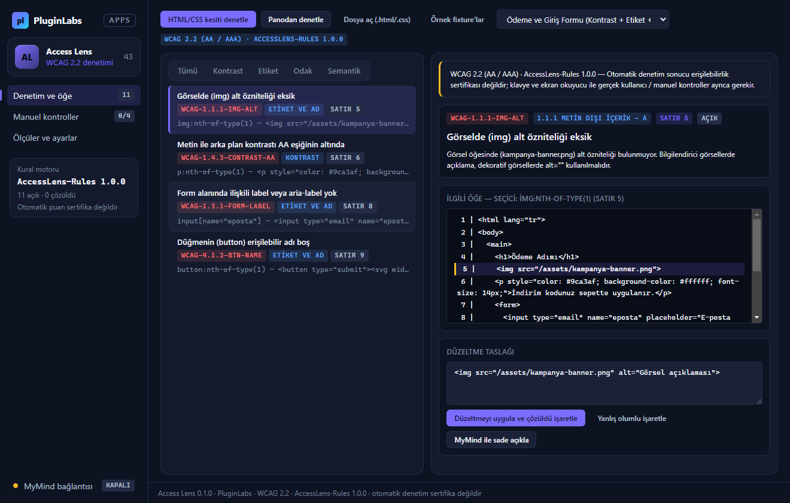
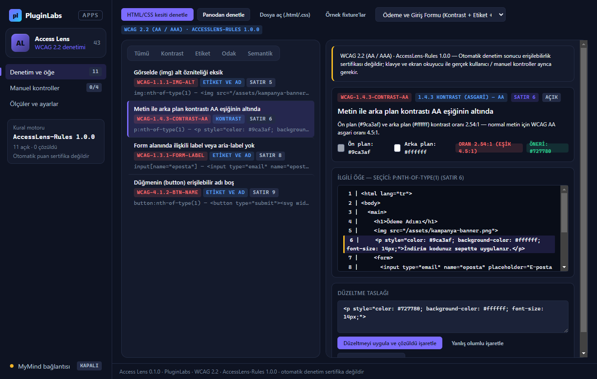
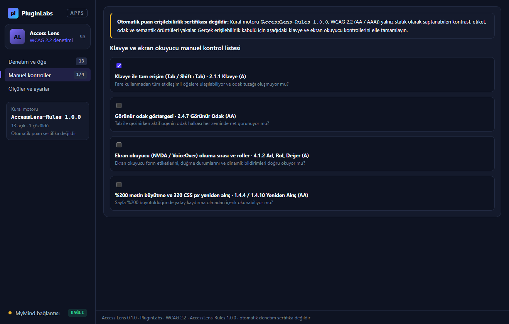

# Access Lens (PL-043) — Windows uygulaması

Arayüzünüzdeki erişilebilirlik sorunlarını yayın öncesinde erken görün: **Access Lens**, seçtiğiniz HTML ve CSS kesitlerinde **kontrast (WCAG 2.2 AA/AAA)**, **form etiketi (`label` / `aria-label`)**, **görsel `alt` metni**, **düğme/bağlantı erişilebilir adı**, **odak sırası (`tabindex`, `outline: none`, klavye etkileşimi)** ve **semantik bölgeleri (`lang`, `<main>`, başlık hiyerarşisi)** denetler. Bir sorun seçildiğinde **ilgili öğeyi ve satır numarasını** kaynakta vurgular ve uygulanabilir **düzeltme taslağı** üretir. İsteğe bağlı **MyMind** (PluginLabs Hub) ya da **yerel model** ile — her istekte onayla, kişisel veriler ve bağlantılar maskelenerek — bulgu sade Türkçe ile açıklanır.

> **Sertifika uyarısı (Notion teknik sınırı):** Standart sürümü (`WCAG 2.2 (AA / AAA)`) ve kural motoru (`AccessLens-Rules 1.0.0`) her ekranda ve dışa aktarılan raporda açıkça görünür. Otomatik denetim puanı **erişilebilirlik sertifikası değildir**; klavye ve ekran okuyucu manuel kontrolleri ayrıca gerekir.



| Kontrast analizi ve önerilen renk | MyMind sade açıklama ve düzeltme taslağı |
| --- | --- |
|  |  |
| **Manuel klavye ve ekran okuyucu kontrol listesi** | **Ölçüler ve ayarlar (fixture doğrulaması)** |
|  |  |

## Kullanım
1. **HTML/CSS kesiti denetle**, **Panodan denetle** ya da **Dosya aç (`.html`/`.css`/`.svg`)** ile bileşen veya sayfa kaynağını yükleyin. İlk deneme için **Örnek fixture’lar (4 kesit)** düğmesini kullanabilirsiniz.
2. **Denetim ve öğe** görünümünde kategoriye göre (*Kontrast*, *Etiket*, *Odak*, *Semantik*) süzün; bir bulguya tıkladığınızda sağ panelde ilgili satır vurgulanır, kontrast oranı ve düzeltme taslağı gösterilir.
3. **Düzeltmeyi uygula ve çözüldü işaretle** ile taslağı kaynağa uygulayın veya **MyMind ile sade açıkla** ile yerel modelden açıklama alın.
4. **Manuel kontroller** sekmesinde klavye (`Tab` / `Shift+Tab`), görünür odak, ekran okuyucu (NVDA / VoiceOver) ve %200 büyütme adımlarını tamamlayın.
5. **Ölçüler ve ayarlar** sekmesinden Markdown (`.md`), CSV (`.csv`) veya JSON yedek dışa aktarın.

## Güvenlik ve gizlilik
- Arayüz CSP ile ağa kapalıdır (`connect-src 'none'`), tüm metinler `textContent`/`value` ile işlenir (`contextIsolation: true`, `sandbox: true`).
- Ağ erişimi yalnız `desktop/net.js` üzerinden ve yalnız `127.0.0.1` / `localhost` (PluginLabs Hub veya yerel model) adreslerine, her seferinde kullanıcı onayıyla yapılır. E-posta, bağlantı ve gizli dizgeler `⟦…⟧` ile maskelenir.
- Denetimler ve MyMind anahtarı Windows kasasında (DPAPI) şifreli saklanır.

## Geliştirme
```bash
npm test                                   # çekirdek birim testleri (10 test)
node tests/desktop-smoke.cjs docs/screenshots
npm run build:win                          # Windows kurulum + taşınabilir exe
node scripts/make-icons.cjs                # simgeleri yeniden üret
```
