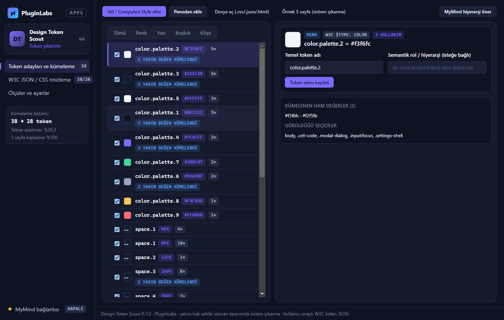

# PL-044 · Design Token Scout

> Seçilen arayüzden renk, yazı ve boşluk değerlerini çıkararak tasarım tokenları oluşturur.

| Alan | Değer |
| --- | --- |
| Kimlik | `PL-044` · `design-token-scout` |
| Kategori | 05 · Geliştirici ve profesyonel araçlar — PL-041–050 |
| Durum | 07.11.2026: **0.1.0 Windows masaüstü uygulaması hazır** — kaynak [`app/`](app/README.md) (çekirdek birim testleri + gerçek Electron duman testi + Windows ekran görüntüleri); dağıtım iş akışı [`app/ci/`](app/ci/pluginlabs-dagitim-design-token-scout-windows.yml) · Notion durumu: Yeni fikir |
| Öncelik / efor | P1 · M |
| Hedef platformlar | Windows, Linux, macOS, Chrome |
| Dağıtım biçimi | masaüstü uygulaması, Chrome eklentisi (Manifest V3) |
| Geliştirme deposu | Henüz yok — kaynak bu klasörün [`app/`](app/README.md) alt klasöründe (ön geliştirme alanı; bkz. [repo hiyerarşisi](../../../docs/REPO-HIYERARSISI.md)); Windows derlemesi ve sürüm dosyaları `pluginlabs-dagitim` deposunda (iş akışı: [`app/ci/`](app/ci/pluginlabs-dagitim-design-token-scout-windows.yml)) |
| Codex projesi | `PL-044 · Design Token Scout` — ikinci klasör: PluginLabs |
| Notion kaynağı | [Notion](https://app.notion.com/p/4038aa13d8f981059dfad209ce1240d1) |

## Ne işe yarar

**Kullanıcı ve problem:** Mevcut bir arayüzün tutarlı renk, yazı ve boşluk sistemini belgelemek isteyen tasarımcılar.

**Kısa tanım (Hub kataloğu):** Seçilen arayüzden renk, yazı ve boşluk değerlerini çıkararak tasarım tokenları oluşturur.

## Hangi platformlar için yayınlanır

**Notion’daki platform tanımı:** Chrome + W / L / M + isteğe bağlı tasarım bağlayıcısı

- Windows
- Linux
- macOS
- Chrome

> Platformlar hedef kapsamdır. PluginLabs ürün ilkesi gereği test edilmemiş platform “destekleniyor” diye etiketlenmez; her platform gerçek cihaz/tarayıcı kabulünden sonra yayın listesine girer.

## Özellikler

### MVP ve temel akış

Seçili sayfadaki computed style örneklerinden renk/font/spacing adayları çıkar; kullanıcı onayıyla token JSON üret.

### Yapay zekânın rolü

Yakın değerleri kümeler ve olası token hiyerarşisi önerir.

## Teknik bağımlılık ve sınırlar

Yalnız erişilen sayfa ve hak sahibi olunan tasarımda kullanılır. Tasarım kopyalama yerine sistem çıkarma; dinamik durumlar ayrıca örneklenir.

## Gelir hipotezi

Bireysel Pro; ekip tasarım sistemi paketi.

## Doğrulama ölçütü

Örnek 5 sayfada kullanılan ana değerleri ≥%90 kapsama; token tekrarında düşüş.

## Öncelik ve efor

P1 · M; 1001 Designs çıktı üretir, bu araç var olan sistemi belgeler.

## 0.1.0 sürümü (Windows)

Notion MVP akışı: **seçili sayfadaki computed style örneklerinden renk/font/spacing adayları çıkar; kullanıcı onayıyla token JSON üret.** Sayfa veya bileşenin computed style JSON çıktısı, CSS kuralları ya da HTML kesitleri yapıştırılarak, panodan ya da `.css`/`.json`/`.html` dosyasından alınır; renk (`hex`/`rgb`/`hsl`), tipografi (`font-family`, boyut, ağırlık, satır yüksekliği), boşluk (`padding`, `margin`, `gap`) ve köşe yarıçapı (`border-radius`) değerleri çıkarılır.

Yapay zekânın rolü (Notion): **yakın değerleri kümeler ve olası token hiyerarşisi önerir.** Kural tabanlı kümeleme her zaman çalışır (RGB Öklid mesafesi ve piksel toleransı ile `#7c6cff`/`#7d6dff` veya `15px`/`16px` gibi yakın sapmaları tek adayda birleştirir); MyMind (PluginLabs Hub) ya da yerel model isteğe bağlıdır, yalnız loopback üzerinden ve her istekte kullanıcı onayıyla semantik token hiyerarşisi (`color.surface.card`, `space.md`) önerir.

Teknik sınır ve doğrulama ölçütü (Notion): **yalnız erişilen sayfa ve hak sahibi olunan tasarımda kullanılır; tasarım kopyalama yerine sistem çıkarma; dinamik durumlar (`hover`, `focus`, koyu tema) ayrıca örneklenir.** Örnek 5 sayfada kullanılan 22 ana tasarım değerinin %100’ü kapsanır (hedef ≥ %90) ve kümeleme ile token tekrarında %26,3 düşüş sağlanır. Yalnız kullanıcı onayıyla W3C Design Tokens JSON (`$value`, `$type`), CSS `:root` değişkenleri ve Markdown belgesi dışa aktarılır.

Kapsam dışı (bu sürüm): canlı Chrome sekmesi seçici eklentisi (Manifest V3), doğrudan Figma bağlayıcısı, Linux/macOS paketleri. Ayrıntı: [app/README.md](app/README.md).

## Geliştirme ve ortak çalışma (Codex + Claude Code)

- Dal adı: `codex/PL-044-<konu>` veya `claude/PL-044-<konu>`; iki ajan aynı dalda aynı anda çalışmaz.
- İşe başlamadan önce [AKTIF-ISLER.md](../../../docs/ortak-calisma/AKTIF-ISLER.md) tablosuna satır eklenir; iş bitince devir notu yazılır.
- Kurallar: [AGENTS.md](../../../AGENTS.md) (her iki ajan için ortak), protokol: [AI-ORTAK-CALISMA.md](../../../docs/ortak-calisma/AI-ORTAK-CALISMA.md).

## Notion kartının özgün metni

Aşağıdaki metin `resources/notion-catalog.json` (Notion anlık görüntüsü, 2026-10-26) içindeki kartın kısaltılmadan aktarılmış hâlidir.

Tam kartı göster

- **Durum:** Yeni fikir
- **Platform:** Chrome + W / L / M + isteğe bağlı tasarım bağlayıcısı
- **Kullanıcı ve problem:** Mevcut bir arayüzün tutarlı renk, yazı ve boşluk sistemini belgelemek isteyen tasarımcılar.
- **MVP ve temel akış:** Seçili sayfadaki computed style örneklerinden renk/font/spacing adayları çıkar; kullanıcı onayıyla token JSON üret.
- **Yapay zekânın rolü:** Yakın değerleri kümeler ve olası token hiyerarşisi önerir.
- **Teknik bağımlılık ve sınır:** Yalnız erişilen sayfa ve hak sahibi olunan tasarımda kullanılır. Tasarım kopyalama yerine sistem çıkarma; dinamik durumlar ayrıca örneklenir.
- **Gelir hipotezi:** Bireysel Pro; ekip tasarım sistemi paketi.
- **Doğrulama ölçütü:** Örnek 5 sayfada kullanılan ana değerleri ≥%90 kapsama; token tekrarında düşüş.
- **Öncelik ve efor:** P1 · M; 1001 Designs çıktı üretir, bu araç var olan sistemi belgeler.

---
Oluşturma: 29.10.2026 · Kaynak → hedef: Notion kataloğu → `registry/projects.json` → bu dosya
