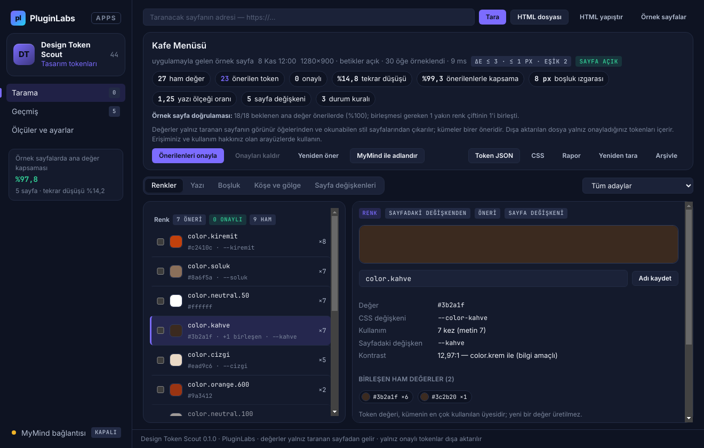
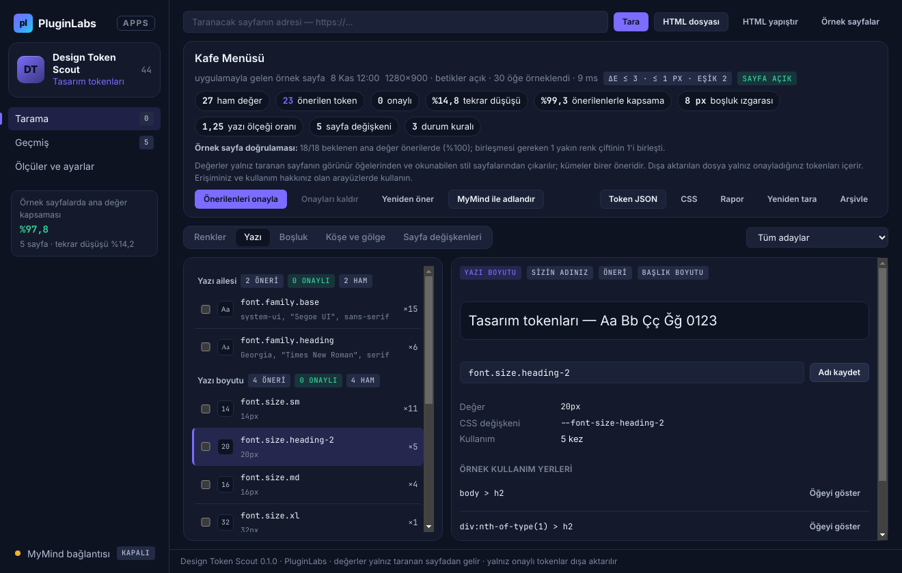
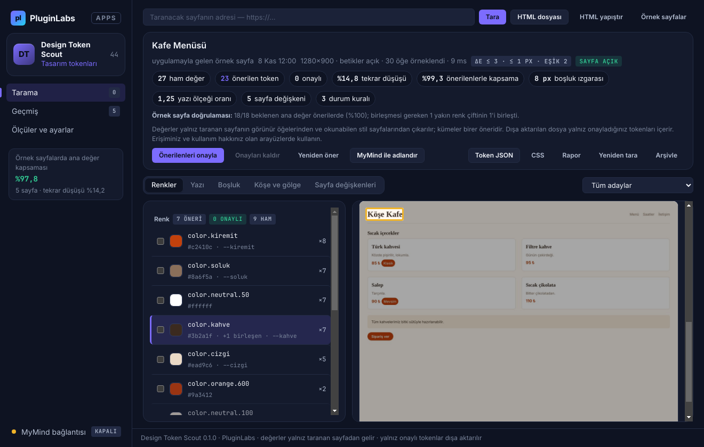
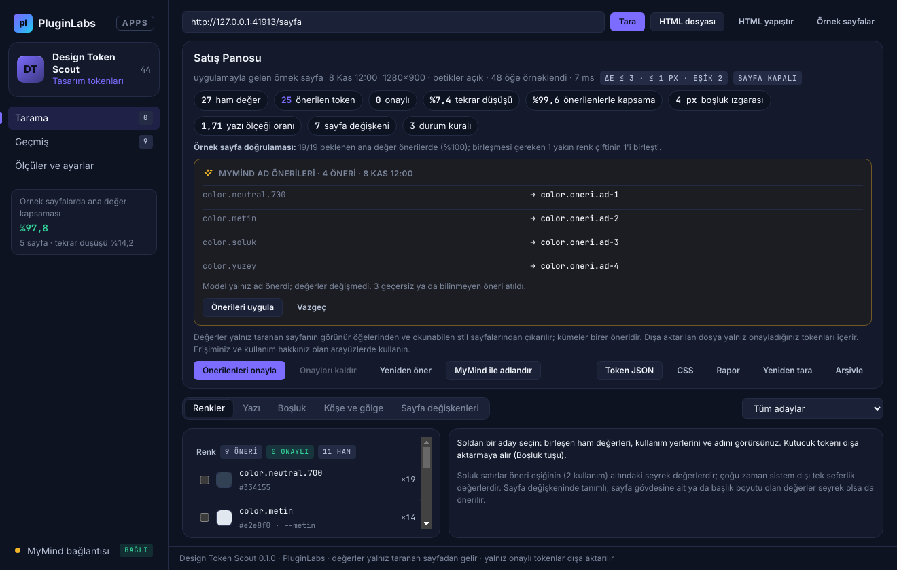
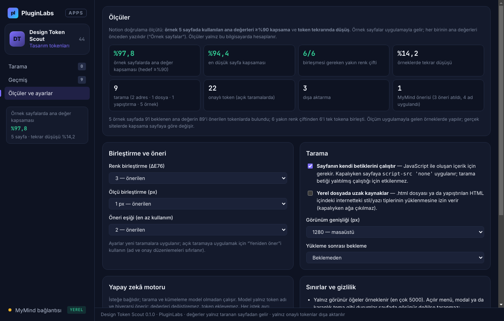

# Design Token Scout (PL-044) — Windows uygulaması

Var olan bir arayüzün tasarım sistemini belgeleyin: Design Token Scout seçtiğiniz **tek web sayfasını** (adres, kaydedilmiş `.html` dosyası ya da yapıştırılan HTML) yalıtılmış, oturumsuz bir pencerede açar ve görünür öğelerin **hesaplanmış stillerinden (computed style)** **renk, yazı ailesi/boyutu/kalınlığı/satır yüksekliği, boşluk, köşe yarıçapı ve gölge** değerlerini kullanım sayısı ve örnek öğeleriyle çıkarır. **:hover/:focus** gibi durum kurallarını ayrıca örnekler, sayfanın kendi **CSS değişkenlerini** eşler, yakın değerleri birleştirir (renkte ΔE, ölçülerde px toleransı) ve **token adları, hiyerarşi ve anlamsal takma adlar** önerir. **Yalnız onayladığınız tokenlar** **W3C Design Tokens (DTCG) JSON**, **CSS değişkenleri** ve **Markdown rapor** olarak dışa aktarılır. Hiçbir değer uydurulmaz: token değeri kümenin en çok kullanılan üyesidir. İsteğe bağlı olarak **MyMind** (PluginLabs Hub) ya da yerel model yalnız **ad önerir**.

> Ürün deposu henüz yok; kaynak bu klasördedir (PluginLabs ürün ön geliştirme alanı, PL-025 modeli). Windows paketleri `pluginlabs-dagitim` deposunda `design-token-scout-v<sürüm>` etiketiyle yayımlanır.



| Yazı (kullanıcının verdiği ad, başlık boyutu çapası) | Kullanım yeri (örnek öğe sayfa görüntüsünde işaretli) |
| --- | --- |
|  |  |
| **MyMind ad önerileri (geçersizler atıldı, değerler değişmez)** | **Ölçüler ve ayarlar (5 örnek sayfada kapsama)** |
|  |  |

Ekran görüntüleri gerçek uygulamadan, duman testinde (uygulamayla gelen örnek sayfalar, yerel test sunucusu, taklit MyMind yanıtı; tarih 8 Kasım 2026'ya sabitlenmiş) Linux/xvfb'de alınmıştır; taramalar gerçek Chromium hesaplanmış stilleridir.

## İndir
Windows paketi `pluginlabs-dagitim` deposunda `design-token-scout-v0.1.0` etiketiyle yayımlanır (kurulum + taşınabilir exe, SHA256SUMS + BUILD-INFO). İmzasız önizleme. PluginLabs Hub kataloğundan da kurulabilir (Hub kataloğu birleşip yayımlanınca).

## Kullanım
1. Adresi yazıp **Tara** (açılış onaylanır), **HTML dosyası** seçin ya da **HTML yapıştır**. İlk deneme için **Örnek sayfalar** (ana değerleri önceden yazılı 5 sayfa).
2. Üst özet: ham değer → önerilen token, **tekrar düşüşü**, kapsama, boşluk ızgarası, yazı ölçeği oranı, sayfa değişkenleri ve durum kuralları.
3. **Renkler / Yazı / Boşluk / Köşe ve gölge** sekmelerinde adayları inceleyin: renk örneği ya da önizleme, birleşen ham değerler, rolü (metin/zemin/kenarlık/durum), sayfadaki değişken adı, kontrast (bilgi amaçlı). **Öğeyi göster** kullanım yerini sayfa görüntüsünde işaretler. **Sayfa değişkenleri** sekmesi `:root` değişkenlerini ve durum kurallarını listeler.
4. Adları düzenleyin, kutucukla tek tek ya da **Önerilenleri onayla** ile onaylayın. İsterseniz **MyMind ile adlandır** → **Önerileri uygula**.
5. **Token JSON** (DTCG), **CSS** ya da **Rapor** (Markdown) — yalnız onaylı tokenlar. Birleştirme ayarlarını değiştirdiyseniz **Yeniden öner**.

## Güvenlik ve gizlilik
- Taranan sayfa görünmez bir pencerede açılır: her taramada **yeni bellek içi oturum** (çerezleriniz ve oturumlarınız kullanılmaz, diske yazılmaz), sandbox, Node yok, önyükleme betiği yok, izinler reddedilir, indirmeler iptal, yeni pencere yok, ilk yüklemeden sonra başka adrese gidilmez (`desktop/scanner.js`).
- Tarama betiği (`desktop/page-scan.js`) sayfanın betiklerinden **yalıtılmış bir dünyada** çalışır; sayfa değiştirilmez (renk biçimlendirmesi DOM'a eklenmeyen bir tuval bağlamıyla yapılır). "Sayfa betikleri" kapalıyken sayfaya CSP `script-src 'none'` uygulanır.
- Yerel dosya/yapıştırılan HTML'de uzak kaynaklar (ayar kapalıyken) engellenir; uygulama ağa çıkmaz. Adres taramasında yalnız o sayfa ve kendi kaynakları yüklenir.
- Ana pencere CSP ile ağa kapalıdır (`connect-src 'none'`), metin yalnız `textContent`/`value` ile yazılır; renk örnekleri CSSOM ile boyanır; IPC yalnız uygulamanın kendi penceresinden. Dışa aktarılan değerler uygulamanın kendi biçimleyicisinden geçer (yazı ailesi adında CSS'i bozabilecek karakterler atılır).
- MyMind/yerel model yalnız loopback (`desktop/net.js`), her istek onaylı; yalnız token türü/değeri/kullanımı/adı gider; sayfa adresi, seçiciler ve metinler gönderilmez.
- Taramalar ve Hub anahtarı Windows kasasında (DPAPI) şifreli; silme yok (arşiv).

## Geliştirme
```bash
npm ci
npm test                                   # çekirdek birim testleri (node:test)
PLAYWRIGHT_MODULE=playwright xvfb-run -a -s "-screen 0 1440x900x24" node tests/desktop-smoke.cjs docs/screenshots
npm run build:win                          # Windows: kurulum + taşınabilir
node scripts/make-icons.cjs                # simgeleri yeniden üret
```
Örnek sayfalar: `src/fixtures/*.html` — her birinde ana değerler ve birleşmesi gereken yakın renk çiftleri `<script type="application/json" id="dts-beklenen">` bloğundadır (çalıştırılmaz). Windows derlemesi `ci/pluginlabs-dagitim-design-token-scout-windows.yml` iş akışıyla `pluginlabs-dagitim` deposunda, sabit bir PluginLabs commit'inden yapılır.

## Lisans
Design Token Scout: PluginLabs, UNLICENSED. Ek çalışma zamanı bağımlılığı yoktur (Electron dışında).
