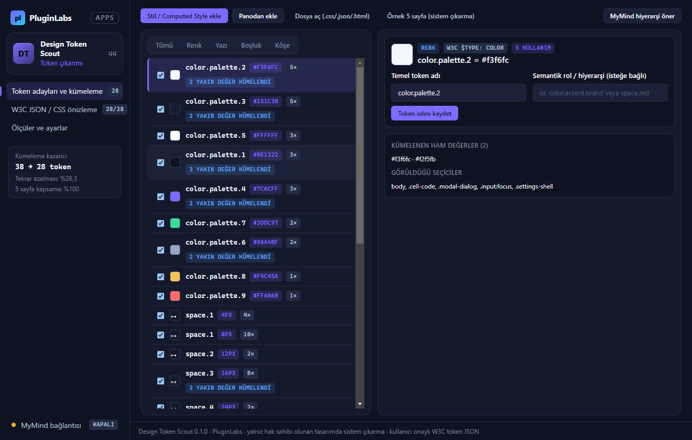
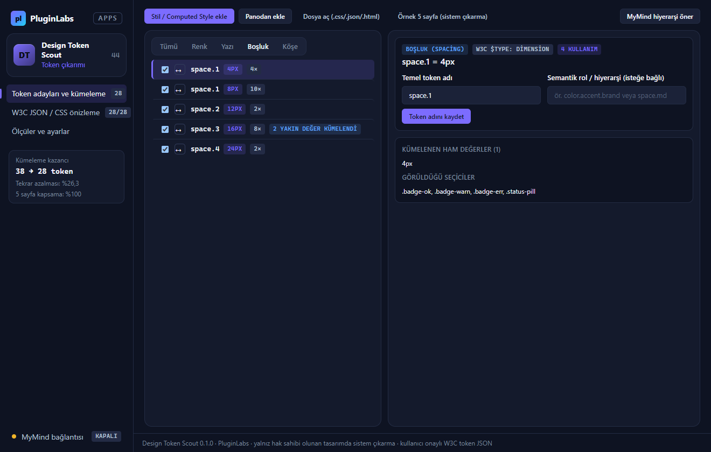
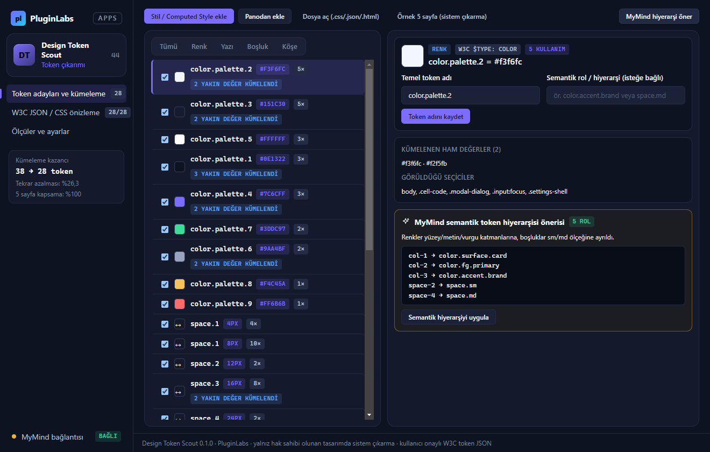
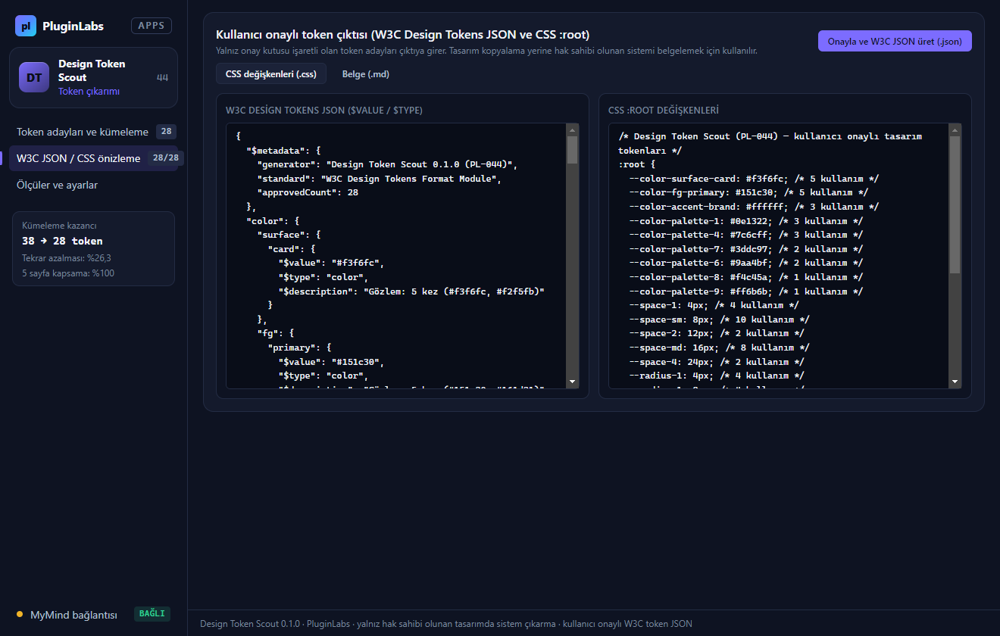

# Design Token Scout (PL-044) — Windows uygulaması

Mevcut bir arayüzün tutarlı renk, yazı ve boşluk sistemini belgeleyin: **Design Token Scout**, seçtiğiniz sayfalardaki **computed style JSON**, **CSS** veya **HTML** örneklerinden **renk (`hex`/`rgb`/`hsl`)**, **yazı (`font-family`, boyut, ağırlık, satır yüksekliği)**, **boşluk (`padding`, `margin`, `gap`)** ve **köşe yarıçapı (`border-radius`)** adaylarını çıkarır; yakın değerleri (ör. `#7c6cff` ile `#7d6dff` veya `15px` ile `16px`) kümeleyerek token tekrarını azaltır ve **kullanıcı onayıyla W3C Design Tokens JSON (`$value`, `$type`)**, **CSS `:root` değişkenleri** ve **Markdown tasarım sistemi belgesi** üretir. İsteğe bağlı **MyMind** (PluginLabs Hub) ya da **yerel model** ile semantik token hiyerarşisi (`color.surface.card`, `space.md`) önerisi alınabilir.

> **İlke (Notion teknik sınırı):** Yalnız erişilen sayfa ve hak sahibi olunan tasarımda kullanılır; tasarım kopyalama yerine var olan sistemi belgeler. Dinamik durumlar (`hover`, `focus`, koyu tema) ayrıca örneklenir.



| Boşluk (spacing) ölçeği ve kümeleme | MyMind semantik token hiyerarşisi önerisi |
| --- | --- |
|  |  |
| **W3C Design Tokens JSON ve CSS :root önizleme** | **Ölçüler ve ayarlar (5 sayfa ≥%90 kapsama)** |
|  |  |

## Kullanım
1. **Stil / Computed Style ekle**, **Panodan ekle** ya da **Dosya aç (`.css`/`.json`/`.html`)** ile sayfa ve dinamik durum örneklerini yükleyin. İlk deneme için **Örnek 5 sayfa (sistem çıkarma)** düğmesini kullanabilirsiniz.
2. **Token adayları ve kümeleme** görünümünde adayları inceleyin, istemediklerinizi onaydan çıkarın veya semantik rol (`color.bg.canvas`) atayın.
3. **MyMind hiyerarşi öner** ile kümelenmiş adaylar için semantik adlandırma önerisi alın ve onayınızla uygulayın.
4. **W3C JSON / CSS önizleme** sekmesinde çıktıyı inceleyip **Onayla ve W3C JSON üret (`.json`)**, **CSS değişkenleri (`.css`)** veya **Belge (`.md`)** olarak kaydedin.

## Geliştirme
```bash
npm test                                   # çekirdek birim testleri (10 test)
node tests/desktop-smoke.cjs docs/screenshots
npm run build:win                          # Windows kurulum + taşınabilir exe
node scripts/make-icons.cjs                # simgeleri yeniden üret
```
