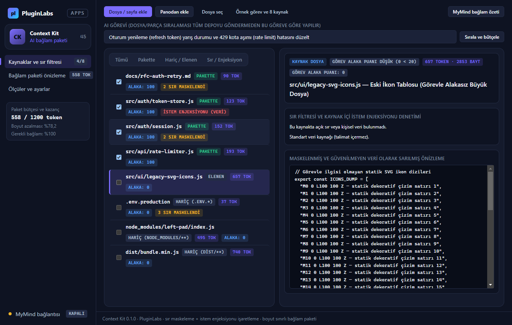

# PL-045 · Context Kit

> Seçilen dosya ve sayfalardan boyut sınırı olan, önizlenebilir AI bağlam paketleri hazırlar.

| Alan | Değer |
| --- | --- |
| Kimlik | `PL-045` · `context-kit` |
| Kategori | 05 · Geliştirici ve profesyonel araçlar — PL-041–050 |
| Durum | 08.11.2026: **0.1.0 Windows masaüstü uygulaması hazır** — kaynak [`app/`](app/README.md) (çekirdek birim testleri + gerçek Electron duman testi + Windows ekran görüntüleri); dağıtım iş akışı [`app/ci/`](app/ci/pluginlabs-dagitim-context-kit-windows.yml) · Notion durumu: Yeni fikir |
| Öncelik / efor | P0 · M |
| Hedef platformlar | Windows, Linux, macOS, Chrome |
| Dağıtım biçimi | masaüstü uygulaması, Chrome eklentisi (Manifest V3) |
| Geliştirme deposu | Henüz yok — kaynak bu klasörün [`app/`](app/README.md) alt klasöründe (ön geliştirme alanı; bkz. [repo hiyerarşisi](../../../docs/REPO-HIYERARSISI.md)); Windows derlemesi ve sürüm dosyaları `pluginlabs-dagitim` deposunda (iş akışı: [`app/ci/`](app/ci/pluginlabs-dagitim-context-kit-windows.yml)) |
| Codex projesi | `PL-045 · Context Kit` — ikinci klasör: PluginLabs |
| Notion kaynağı | [Notion](https://app.notion.com/p/4038aa13d8f981059dfad209ce1240d1) |

## Ne işe yarar

**Kullanıcı ve problem:** AI’a yanlış veya gereksiz dosyaları bağlam olarak verip zaman/kota kaybeden kullanıcılar.

**Kısa tanım (Hub kataloğu):** Seçilen dosya ve sayfalardan boyut sınırı olan, önizlenebilir AI bağlam paketleri hazırlar.

## Hangi platformlar için yayınlanır

**Notion’daki platform tanımı:** W / L / M; Chrome kaynak seçici

- Windows
- Linux
- macOS
- Chrome

> Platformlar hedef kapsamdır. PluginLabs ürün ilkesi gereği test edilmemiş platform “destekleniyor” diye etiketlenmez; her platform gerçek cihaz/tarayıcı kabulünden sonra yayın listesine girer.

## Özellikler

### MVP ve temel akış

Klasör/sayfa seç → ilgili parçaları ve dosya ağacını önizle → sır filtresi → boyut limitli bağlam paketi dışa aktar.

### Yapay zekânın rolü

Göreve göre dosya/parça sıralaması ve kısa bağlam özeti; tüm depoyu otomatik göndermez.

## Teknik bağımlılık ve sınırlar

Hariç tutma kuralları, sır/kişisel veri işaretleme ve token tahmini. Kaynak içi istem enjeksiyonları talimat sayılmaz.

## Gelir hipotezi

Ücretsiz yerel paketleme; Pro değerlendirme ve ekip reçeteleri.

## Doğrulama ölçütü

Test görevinde gerekli bağlam kapsaması ≥%90; paket boyutunda ≥%40 azalma hedefi.

## Öncelik ve efor

P0 · M; AI maliyetini somut görevle ölçen niş ürün.

## 0.1.0 sürümü (Windows)

Notion MVP akışı: **klasör/sayfa seç → ilgili parçaları ve dosya ağacını önizle → sır filtresi → boyut limitli bağlam paketi dışa aktar.** Dosya veya web sayfası kesitleri yapıştırılarak, panodan ya da dosya seçiciyle alınır; `node_modules/**`, `.git/**`, `.env*`, `dist/**`, `*.lock` gibi hariç tutma kuralları otomatik uygulanır; açık API anahtarları (`sk-...`, `AKIA...`, `ghp_...`, JWT/Bearer, PEM) ve kişisel veriler (e-posta, telefon) maskelenir.

Yapay zekânın rolü (Notion): **göreve göre dosya/parça sıralaması ve kısa bağlam özeti; tüm depoyu otomatik göndermez.** Kural tabanlı görev-alaka puanlaması her zaman çalışır ve token/bayt üst sınırı içinde yalnız görevle alakalı parçaları seçer; MyMind (PluginLabs Hub) ya da yerel model isteğe bağlıdır, yalnız loopback üzerinden ve her istekte kullanıcı onayıyla kısa bağlam özeti ve öncelikli dosya sıralaması üretir.

Teknik sınır ve doğrulama ölçütü (Notion): **hariç tutma kuralları, sır/kişisel veri işaretleme ve token tahmini; kaynak içi istem enjeksiyonları talimat sayılmaz.** Kaynak kod ve sayfa içindeki prompt injection kalıpları algılanarak işaretlenir ve dışa aktarılan tüm kaynaklar güvenilmeyen veri (`UNTRUSTED_DATA`) sınırlarıyla sarılır. Örnek görevde gerekli 4 bağlam kaynağının %100’ü kapsanır (hedef ≥ %90) ve paket boyutunda %76,6 azalma sağlanır (hedef ≥ %40). Kullanıcı onayıyla Markdown (`.md`), XML (`.xml`) ve JSON (`.json`) bağlam paketi dışa aktarılır.

Kapsam dışı (bu sürüm): canlı Chrome sekmesi kaynak seçici eklentisi (Manifest V3), Linux/macOS paketleri. Ayrıntı: [app/README.md](app/README.md).

## Geliştirme ve ortak çalışma (Codex + Claude Code)

- Dal adı: `codex/PL-045-<konu>` veya `claude/PL-045-<konu>`; iki ajan aynı dalda aynı anda çalışmaz.
- İşe başlamadan önce [AKTIF-ISLER.md](../../../docs/ortak-calisma/AKTIF-ISLER.md) tablosuna satır eklenir; iş bitince devir notu yazılır.
- Kurallar: [AGENTS.md](../../../AGENTS.md) (her iki ajan için ortak), protokol: [AI-ORTAK-CALISMA.md](../../../docs/ortak-calisma/AI-ORTAK-CALISMA.md).

## Notion kartının özgün metni

Aşağıdaki metin `resources/notion-catalog.json` (Notion anlık görüntüsü, 2026-10-26) içindeki kartın kısaltılmadan aktarılmış hâlidir.

Tam kartı göster

- **Durum:** Yeni fikir
- **Platform:** W / L / M; Chrome kaynak seçici
- **Kullanıcı ve problem:** AI’a yanlış veya gereksiz dosyaları bağlam olarak verip zaman/kota kaybeden kullanıcılar.
- **MVP ve temel akış:** Klasör/sayfa seç → ilgili parçaları ve dosya ağacını önizle → sır filtresi → boyut limitli bağlam paketi dışa aktar.
- **Yapay zekânın rolü:** Göreve göre dosya/parça sıralaması ve kısa bağlam özeti; tüm depoyu otomatik göndermez.
- **Teknik bağımlılık ve sınır:** Hariç tutma kuralları, sır/kişisel veri işaretleme ve token tahmini. Kaynak içi istem enjeksiyonları talimat sayılmaz.
- **Gelir hipotezi:** Ücretsiz yerel paketleme; Pro değerlendirme ve ekip reçeteleri.
- **Doğrulama ölçütü:** Test görevinde gerekli bağlam kapsaması ≥%90; paket boyutunda ≥%40 azalma hedefi.
- **Öncelik ve efor:** P0 · M; AI maliyetini somut görevle ölçen niş ürün.

---
Oluşturma: 29.10.2026 · Kaynak → hedef: Notion kataloğu → `registry/projects.json` → bu dosya
