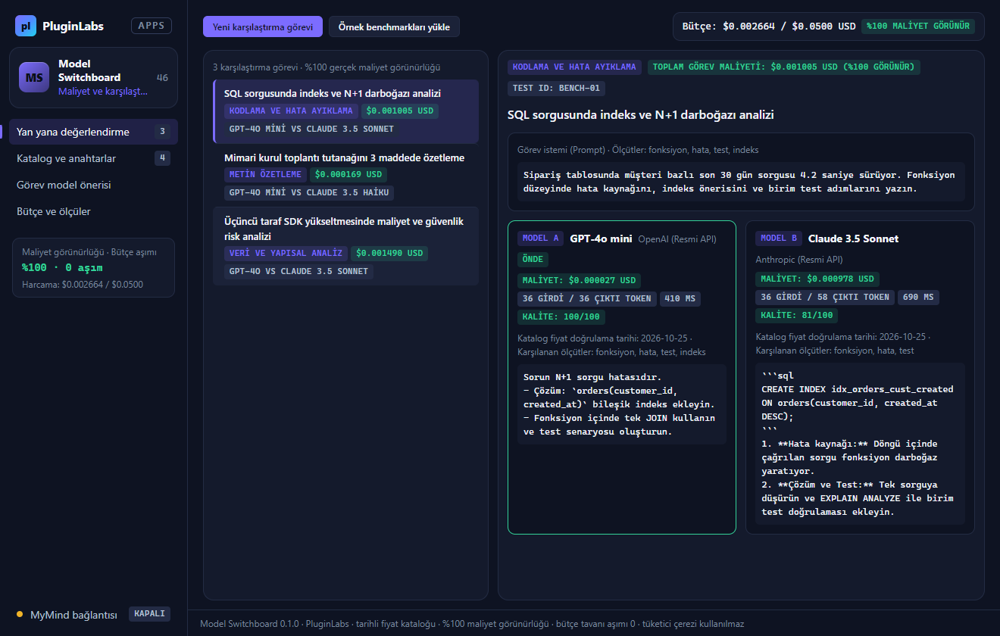

# PL-046 · Model Switchboard

> Model sağlayıcılarını, istek maliyetlerini ve aynı görevde ürettikleri yanıtları karşılaştırır.

| Alan | Değer |
| --- | --- |
| Kimlik | `PL-046` · `model-switchboard` |
| Kategori | 05 · Geliştirici ve profesyonel araçlar — PL-041–050 |
| Durum | 07.11.2026: **0.1.0 Windows uygulaması hazır** — [model-switchboard-v0.1.0](https://github.com/timdesigners-pixel/pluginlabs-dagitim/releases/tag/model-switchboard-v0.1.0) (`pluginlabs-dagitim`, Windows runner: test + duman testi + SHA256 + BUILD-INFO + Windows ekran görüntüleri); kaynak [app/](app/README.md) · Notion durumu: Yeni fikir |
| Öncelik / efor | P2 · L |
| Hedef platformlar | Windows, Linux, macOS, Chrome |
| Dağıtım biçimi | masaüstü uygulaması, Chrome eklentisi (Manifest V3) |
| Geliştirme deposu | Henüz yok — kaynak bu klasörün [`app/`](app/README.md) alt klasöründe (ön geliştirme alanı; bkz. [repo hiyerarşisi](../../../docs/REPO-HIYERARSISI.md)); Windows derlemesi ve sürüm dosyaları `pluginlabs-dagitim` deposunda (iş akışı: [`app/ci/`](app/ci/pluginlabs-dagitim-model-switchboard-windows.yml)) |
| Codex projesi | `PL-046 · Model Switchboard` — ikinci klasör: PluginLabs |
| Notion kaynağı | [Notion](https://app.notion.com/p/4038aa13d8f981059dfad209ce1240d1) |

## Ne işe yarar

**Kullanıcı ve problem:** Birden çok model sağlayıcısının maliyet, anahtar ve çıktılarını karşılaştırmak isteyen kişiler.

**Kısa tanım (Hub kataloğu):** Model sağlayıcılarını, istek maliyetlerini ve aynı görevde ürettikleri yanıtları karşılaştırır.

## Hangi platformlar için yayınlanır

**Notion’daki platform tanımı:** Chrome + W / L / M geliştirici/kullanıcı paneli

- Windows
- Linux
- macOS
- Chrome

> Platformlar hedef kapsamdır. PluginLabs ürün ilkesi gereği test edilmemiş platform “destekleniyor” diye etiketlenmez; her platform gerçek cihaz/tarayıcı kabulünden sonra yayın listesine girer.

## Özellikler

### MVP ve temel akış

Resmi API anahtarıyla tek panel; model kataloğu, istek maliyeti tahmini ve aynı görevde yan yana değerlendirme. İlk sürüm iki sağlayıcı.

### Yapay zekânın rolü

Görev türüne göre model önerir; hız/kalite ölçümünü kayıtlı test sonucuna bağlar.

## Teknik bağımlılık ve sınırlar

Fiyatlar sağlayıcıdan doğrulanmalı ve tarihli olmalı; limit aşımı için kullanıcı bütçe tavanı. Tüketici web hesabı çerezi kullanılmaz.

## Gelir hipotezi

Pro yerel istemci; ekip bütçe/anahtar politikası. API faturası ayrıca açıkça belirtilir.

## Doğrulama ölçütü

Görev başına gerçek maliyet görünürlüğü %100; bütçe tavanı aşımı sıfır hedefi.

## Öncelik ve efor

P2 · L; sağlayıcı sözleşmeleri ve sürekli katalog bakımı.

## 0.1.0 sürümü (Windows)

Notion MVP akışı: **resmi API anahtarıyla tek panel; model kataloğu, istek maliyeti tahmini ve aynı görevde yan yana değerlendirme. İlk sürüm iki sağlayıcı.** Kullanıcının kendi resmi API anahtarları (OpenAI ve Anthropic) Windows kasasında (DPAPI) şifreli saklanır; tüketici web hesabı çerezi (`Cookie`, `session`) reddedilir. Tarihli fiyat kataloğu üzerinden her karşılaştırma görevinden önce tahmini maliyet hesaplanır ve tamamlandığında girdi/çıktı token sayısı ile gerçek USD maliyeti gösterilir (**görev başına gerçek maliyet görünürlüğü %100**).

Yapay zekânın rolü (Notion): **görev türüne göre model önerir; hız/kalite ölçümünü kayıtlı test sonucuna bağlar.** Kodlama, özetleme, analiz, çeviri ve genel görev türleri için kayıtlı benchmark sonuçlarına (`bench-01` vb.) bağlı ortalama hız (`ms`), kalite (`0–100`) ve maliyet (`USD`) analizi yapılır. İsteğe bağlı onaylı MyMind (PluginLabs Hub) ya da yerel model (loopback) önerisinde katalogda olmayan model ve kayıtlı olmayan test kimlikleri denetimde atılır.

Teknik sınır ve doğrulama ölçütü (Notion): **fiyatlar sağlayıcıdan doğrulanmalı ve tarihli olmalı; limit aşımı için kullanıcı bütçe tavanı. Tüketici web hesabı çerezi kullanılmaz. Görev başına gerçek maliyet görünürlüğü %100; bütçe tavanı aşımı sıfır hedefi.** Toplam harcama + yeni görev tahmini kullanıcı bütçe tavanını aşarsa karşılaştırma çalıştırılmaz ve aşım engellenir. Dışa aktarma: CSV (formül enjeksiyonu korumalı), Markdown raporu ve JSON yedek.

Kapsam dışı (bu sürüm): iki sağlayıcı dışındaki sağlayıcılar, ekip bütçe/anahtar politikası (Pro), Chrome eklentisi, Linux/macOS paketleri. Ayrıntı: [app/README.md](app/README.md).

## Geliştirme ve ortak çalışma (Codex + Claude Code)

- Dal adı: `codex/PL-046-<konu>` veya `claude/PL-046-<konu>`; iki ajan aynı dalda aynı anda çalışmaz.
- İşe başlamadan önce [AKTIF-ISLER.md](../../../docs/ortak-calisma/AKTIF-ISLER.md) tablosuna satır eklenir; iş bitince devir notu yazılır.
- Kurallar: [AGENTS.md](../../../AGENTS.md) (her iki ajan için ortak), protokol: [AI-ORTAK-CALISMA.md](../../../docs/ortak-calisma/AI-ORTAK-CALISMA.md).

## Notion kartının özgün metni

Aşağıdaki metin `resources/notion-catalog.json` (Notion anlık görüntüsü, 2026-10-26) içindeki kartın kısaltılmadan aktarılmış hâlidir.

Tam kartı göster

- **Durum:** Yeni fikir
- **Platform:** Chrome + W / L / M geliştirici/kullanıcı paneli
- **Kullanıcı ve problem:** Birden çok model sağlayıcısının maliyet, anahtar ve çıktılarını karşılaştırmak isteyen kişiler.
- **MVP ve temel akış:** Resmi API anahtarıyla tek panel; model kataloğu, istek maliyeti tahmini ve aynı görevde yan yana değerlendirme. İlk sürüm iki sağlayıcı.
- **Yapay zekânın rolü:** Görev türüne göre model önerir; hız/kalite ölçümünü kayıtlı test sonucuna bağlar.
- **Teknik bağımlılık ve sınır:** Fiyatlar sağlayıcıdan doğrulanmalı ve tarihli olmalı; limit aşımı için kullanıcı bütçe tavanı. Tüketici web hesabı çerezi kullanılmaz.
- **Gelir hipotezi:** Pro yerel istemci; ekip bütçe/anahtar politikası. API faturası ayrıca açıkça belirtilir.
- **Doğrulama ölçütü:** Görev başına gerçek maliyet görünürlüğü %100; bütçe tavanı aşımı sıfır hedefi.
- **Öncelik ve efor:** P2 · L; sağlayıcı sözleşmeleri ve sürekli katalog bakımı.

---
Oluşturma: 29.10.2026 · Kaynak → hedef: Notion kataloğu → `registry/projects.json` → bu dosya
